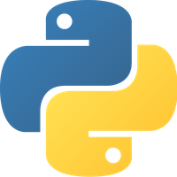

Este capítulo recorre el núcleo del lenguaje Python. Comienza por los tipos de datos y
las operaciones que los combinan, la entrada y la salida por consola y el tratamiento de
cadenas de texto. Continúa con las estructuras de control y de datos, con las funciones
y con la ejecución de _scripts_ y módulos.

## Bibliografía

- van Rossum, G., Warsaw, B. y Coghlan, N. (2001). _PEP 8: Style Guide for Python Code_.
  <https://peps.python.org/pep-0008/>
- van Rossum, G., Lehtosalo, J. y Langa, Ł. (2014). _PEP 484: Type Hints_.
  <https://peps.python.org/pep-0484/>
- Portilla, J. (s.f.). _Complete Python Bootcamp_ \[Curso\]. Udemy.
  <https://www.udemy.com/course/complete-python-bootcamp/>

## Introducción

<figure markdown="span">
  
  <figcaption>Logo de Python.</figcaption>
</figure>

**Python** es un lenguaje de programación de alto nivel, interpretado y de propósito
general, desarrollado por Guido van Rossum. Su principal ventaja es una sintaxis legible
y concisa, que reduce el esfuerzo de escritura y de mantenimiento del código. A ello se
debe en buena medida su rápida adopción en el sector tecnológico, impulsada además por
el auge de la inteligencia artificial.

Python cuenta con una amplia comunidad de desarrolladores y un ecosistema robusto de
bibliotecas y _frameworks_ que permiten abordar una gran diversidad de proyectos,
incluyendo aplicaciones web, análisis de datos, automatización de tareas y aprendizaje
automático.

### Creación y configuración del entorno

Antes de comenzar a programar en Python es necesario disponer de un entorno de
desarrollo correctamente configurado. El capítulo de
[entornos virtuales](section_1_environments.md) cubre el ecosistema de herramientas
disponible para su gestión y las instrucciones detalladas de configuración. En este
documento se utiliza uv como gestor de entornos, por lo que no es necesario instalar
nada adicional para empezar a trabajar con Python.

### Jupyter Notebooks

Existen dos formas principales de trabajar en Python. La primera es mediante archivos
con extensión `.py`, que funcionan como archivos de texto plano y permiten al entorno de
desarrollo (por ejemplo, Visual Studio Code) ofrecer funcionalidades como autocompletado
y corrección de sintaxis. Esta es la forma de programar más recomendable para proyectos
de producción.

Sin embargo, para explorar el lenguaje y para proyectos de ciencia de datos, se tiende a
utilizar **Jupyter Notebooks**, una herramienta interactiva que integra código, texto y
visualizaciones en un único documento. Entre sus principales ventajas destacan:

- **Interactividad**: Permite ejecutar bloques de código de manera independiente, lo que
  facilita la prueba de ideas y la depuración paso a paso.
- **Documentación integrada**: Admite texto en formato Markdown, permitiendo incluir
  explicaciones y notas directamente junto al código.
- **Visualización**: Facilita la incorporación de gráficos y visualizaciones, mostrando
  los resultados de manera inmediata dentro del mismo documento.

La elección entre una u otra herramienta depende sobre todo de la facilidad para
organizar los proyectos y del enfoque de exploración y desarrollo que se adopte. También
influye la forma de trabajo del equipo. Ambos enfoques son complementarios: el
_notebook_ predomina en la fase exploratoria y el archivo `.py` en el código que llega a
producción.

## Tipos de datos y operaciones

Para dominar Python, es fundamental comprender primero los pilares que sostienen
cualquier programa: cómo se almacena la información, cómo se manipula y cómo se controla
el flujo de las instrucciones. En las siguientes secciones se exploran los elementos
esenciales del lenguaje, desde los tipos de datos básicos y las operaciones matemáticas
hasta las estructuras de control que permiten dotar de lógica al código.

### Tipos de datos

Python ofrece varios tipos de datos fundamentales que permiten definir, almacenar y
manipular información. La siguiente tabla resume los principales tipos de datos y sus
características:

| Tipo de datos                               | Tipo integrado | Ejemplos                         |
| ------------------------------------------- | -------------- | -------------------------------- |
| **Números enteros**                         | `int`          | `3`                              |
| **Números flotantes**                       | `float`        | `2.3`                            |
| **Cadenas de texto**                        | `str`          | `"Hola"`                         |
| **Listas** (colección ordenada y mutable)   | `list`         | `[10, "hello", 200.3]`           |
| **Diccionarios** (pares clave-valor)        | `dict`         | `{"edad": 20, "nombre": "Dani"}` |
| **Tuplas** (secuencia ordenada e inmutable) | `tuple`        | `(10, "hello", 200.3)`           |
| **_Sets_** (colección desordenada y única)  | `set`          | `{"a", "b"}`                     |
| **Booleanos** (valores lógicos)             | `bool`         | `True`, `False`                  |

Los nombres de la segunda columna son **tipos integrados** (_built-ins_), es decir,
funciones y clases que Python pone a disposición del programa sin necesidad de importar
nada. No son palabras reservadas, de modo que el lenguaje permite reasignarlos, aunque
hacerlo es una mala práctica porque oculta el tipo original durante el resto del
programa.

Las **palabras reservadas** (_keywords_) son distintas: forman parte de la gramática del
lenguaje y no pueden emplearse como nombre de variable ni de función bajo ninguna
circunstancia. Entre ellas se encuentran `if`, `else`, `for`, `while`, `def`, `class`,
`return`, `import`, `True`, `False` y `None`. La lista completa se obtiene con
`keyword.kwlist`, del módulo `keyword` de la biblioteca estándar.

Python es un lenguaje de **tipificación dinámica**, por lo que no es necesario declarar
explícitamente el tipo de dato, ya que este se asigna automáticamente según el valor.
Sin embargo, cada vez es más común, y constituye una buena práctica, utilizar lo que se
conoce como _typing_ para anotar los tipos. Por ejemplo:

```python linenums="1"
# Declaración sin anotaciones de tipo
valor_entero = 12

# Declaración con anotaciones de tipo
valor_entero: int = 12
lista_valores: list[int] = [1, 2, 3]
diccionario_valores: dict[str, list[int]] = {"esto_es_un_string": [1, 2, 3]}
```

!!! note

    Para conocer el tipo de una variable se utiliza la función `type(variable)`.

### Operaciones aritméticas

Python permite realizar una amplia variedad de operaciones sobre datos numéricos y otros
tipos. Las principales operaciones matemáticas y funciones disponibles son:

| Operador o función            | Descripción                                                                             |
| ----------------------------- | --------------------------------------------------------------------------------------- |
| `+`, `-`, `*`, `/`, `//`, `%` | Suma, resta, multiplicación, división, división entera y módulo (resto de la división). |
| `-x`                          | Cambia el signo de un número.                                                           |
| `abs(x)`                      | Devuelve el valor absoluto de $x$.                                                      |
| `pow(x, y)` o `x**y`          | Potencia de $x$ elevado a $y$, es decir, $x^y$.                                         |
| `max(x, y)`                   | Devuelve el valor máximo entre $x$ e $y$.                                               |
| `min(x, y)`                   | Devuelve el valor mínimo entre $x$ e $y$.                                               |
| `round(x, n)`                 | Redondea $x$ a $n$ decimales.                                                           |
| `hex(x)`                      | Convierte $x$ a hexadecimal.                                                            |
| `bin(x)`                      | Convierte $x$ a binario.                                                                |

### Operadores de comparación y lógicos

Existen diferentes tipos de operadores en Python. Los **operadores de comparación**
permiten evaluar relaciones entre dos valores y devuelven un resultado booleano (`True`
o `False`):

| Expresión | Descripción               |
| --------- | ------------------------- |
| `A == B`  | A es igual a B.           |
| `A != B`  | A es distinto de B.       |
| `A < B`   | A es menor que B.         |
| `A <= B`  | A es menor o igual que B. |
| `A > B`   | A es mayor que B.         |
| `A >= B`  | A es mayor o igual que B. |

Por otro lado, los **operadores lógicos** permiten combinar varias condiciones y
controlar el flujo de ejecución en función de los resultados:

| Operador | Descripción                                              |
| -------- | -------------------------------------------------------- |
| `and`    | Devuelve `True` si todas las condiciones son verdaderas. |
| `or`     | Devuelve `True` si al menos una condición es verdadera.  |
| `not`    | Invierte el valor lógico de la condición.                |

Los operadores lógicos se utilizan principalmente en estructuras de control, como
condicionales y bucles, para determinar el flujo del programa en función de condiciones
lógicas.

### Variables

Una variable es un nombre que hace referencia a un valor almacenado en memoria. Al
crearlas en Python se deben respetar ciertas reglas:

- Los nombres no pueden comenzar con números.
- No se permiten espacios en los nombres.
- No se pueden utilizar los siguientes símbolos:
  `: ' " < > / , ? | \ ( ) ! @ # $ % ^ & * ~ - +`.
- No se pueden emplear palabras reservadas del lenguaje.

Más allá de estas restricciones, la convención recogida en la guía de estilo PEP 8
establece el uso de nombres en minúsculas con palabras separadas por guiones bajos
(_snake case_), por ejemplo `numero_de_alumnos`. Las constantes, por su parte, se
escriben en mayúsculas, como en `TASA_MAXIMA`. Conviene además elegir nombres
descriptivos que expresen el propósito del valor almacenado, ya que esto reduce la
necesidad de comentarios explicativos.

## Entrada y salida de datos

### Salida por pantalla

Para mostrar datos en pantalla se utiliza la función `print()`:

```python linenums="1"
print("Esto es una prueba")
```

Es posible concatenar variables que contienen cadenas de texto o métodos que devuelvan
un valor utilizando el operador `+`, por ejemplo:

```python linenums="1"
nombre: str = "Daniel"
edad: int = 19

print("Yo me llamo " + nombre + " y tengo " + str(edad) + " años.")
```

Este método resulta engorroso y obliga a convertir de forma explícita los valores que no
son cadenas. Desde Python 3.6 se dispone de las **_f-strings_**, cadenas precedidas por
el carácter `f` que permiten insertar variables o expresiones directamente entre llaves
`{}`:

```python linenums="1"
nombre: str = "Daniel"
edad: int = 19

print(f"Yo me llamo {nombre} y tengo {edad} años")
```

Incluso es posible modificar la cantidad específica de decimales para un valor de tipo
`float` utilizando el formato `{valor_float:.precisiónf}`. Por ejemplo, para mostrar el
número $\pi$ con 5 decimales:

```python linenums="1"
import math

pi: float = math.pi
print(f"El número pi con 5 decimales es: {pi:.5f}")
```

### Entrada del usuario

Python permite recibir información del usuario mediante la función `input()`. Esta
función siempre devuelve el valor introducido como una cadena de texto, por lo que es
necesario realizar una conversión de tipo (lo que se denomina como _casting_) si se
requiere un tipo de dato diferente:

```python linenums="1"
nombre: str = input("Introduce tu nombre: ")
edad: str = input("Introduce tu edad: ")

print("\n\t- DATOS DEL USUARIO - \n")
print(f"Nombre: {nombre}")
print(f"Edad: {edad}")
```

Para convertir el resultado de `input()` en un número es necesario aplicar un _casting_
explícito, como en el siguiente ejemplo, donde una entrada de tipo `str` se transforma
en un `float`:

```python linenums="1"
numero: float = float(input("Introduce un número: "))
```

## Cadenas de texto

Una cadena de texto, o _string_, es una secuencia de caracteres que puede contener
letras, números, símbolos o espacios. A continuación se muestra un ejemplo básico de
_string_ junto con el uso del indexado:

```python linenums="1"
frase: str = "Hola buenas"

# Muestra el carácter 'H'
print(f"El primer carácter de mi string es {frase[0]}")

# Muestra el carácter 'b'
print(f"El sexto carácter de mi string es {frase[5]}")
```

El **índice** de un _string_ comienza en `0`, por lo que `frase[0]` hace referencia al
primer carácter (`"H"`), `frase[1]` al segundo y `frase[5]` al sexto (`"b"`), ya que el
espacio en blanco también cuenta como carácter. Los índices negativos cuentan desde el
final hacia el principio, de modo que `frase[-1]` devuelve el último carácter, `'s'`.

Los _strings_ son **inmutables**, lo que significa que no es posible cambiar un carácter
específico en un _string_ ya creado. Intentar modificar directamente un elemento produce
un error:

```python linenums="1"
frase: str = "Hola buenas"

# Intentar cambiar el primer carácter provoca un error de tipo TypeError
frase[0] = "h"
```

Este código genera un error de tipo `TypeError`. Para modificar un _string_, es
necesario crear uno nuevo combinando partes del original:

```python linenums="1"
frase: str = "Hola buenas"

# Crear un nuevo string con la primera letra modificada
nueva_frase: str = "h" + frase[1:]

# Imprime: hola buenas
print(nueva_frase)
```

### Operaciones sobre cadenas de texto

Sobre una cadena pueden aplicarse tanto funciones integradas del lenguaje, que la
reciben como argumento, como **métodos**, que se invocan sobre la propia cadena con la
notación `cadena.metodo()`. La distinción entre ambos se detalla en el apartado de
funciones. La siguiente tabla recoge las operaciones más habituales:

| Operación                                          | Descripción                                                                                                    |
| -------------------------------------------------- | -------------------------------------------------------------------------------------------------------------- |
| `str(variable_a_convertir_en_string)`              | Convierte una variable en una cadena de texto.                                                                 |
| `variable *= x`                                    | Repite la cadena `variable` `x` veces y reasigna el resultado, siendo `x` un entero.                           |
| `variable[índice:]`                                | Obtiene una subcadena desde el índice hasta el final de la cadena.                                             |
| `variable[::X]`                                    | Obtiene caracteres de la cadena con un paso de `X`, es decir, toma un carácter cada `X` caracteres.            |
| `variable[::-1]`                                   | Invierte la cadena.                                                                                            |
| `variable.lower()`                                 | Convierte toda la cadena a minúsculas.                                                                         |
| `variable.upper()`                                 | Convierte toda la cadena a mayúsculas.                                                                         |
| `variable.isupper()`                               | Devuelve `True` si toda la cadena está en mayúsculas, `False` en caso contrario.                               |
| `variable.upper().isupper()`                       | Convierte la cadena a mayúsculas y devuelve `True` si toda la cadena está en mayúsculas.                       |
| `variable.split()`                                 | Divide la cadena en una lista de subcadenas basadas en espacios. Puede especificarse un delimitador diferente. |
| `len(variable)`                                    | Devuelve el número de caracteres en la cadena.                                                                 |
| `variable.index("a")` o `variable.index("buenas")` | Devuelve el índice de la primera aparición de la subcadena indicada y lanza `ValueError` si no aparece.        |
| `variable.replace("buenas", "me llamo Daniel")`    | Reemplaza una subcadena dentro de la cadena por otra subcadena.                                                |
| `variable.count("x")`                              | Cuenta el número de veces que aparece el carácter especificado.                                                |
| `variable.find("x")`                               | Devuelve el índice de la primera aparición de la subcadena indicada, o `-1` si no aparece.                     |
| `variable.isalnum()`                               | Devuelve `True` si todos los caracteres son alfanuméricos.                                                     |
| `variable.isalpha()`                               | Devuelve `True` si todos los caracteres son alfabéticos.                                                       |
| `variable.islower()`                               | Devuelve `True` si todos los caracteres están en minúsculas.                                                   |
| `variable.isspace()`                               | Devuelve `True` si todos los caracteres son espacios en blanco.                                                |
| `variable.istitle()`                               | Devuelve `True` si cada palabra empieza por mayúscula y el resto de sus caracteres están en minúsculas.        |
| `variable.split("x")`                              | Divide la cadena en partes cuando encuentra el carácter `x`.                                                   |
| `variable.partition("x")`                          | Devuelve una tupla con la parte anterior a la primera aparición de `x`, el propio `x` y la parte posterior.    |
| `variable.strip()`                                 | Elimina los espacios al principio y al final de la cadena.                                                     |

## Estructuras de control

### Condicionales

Las sentencias condicionales de Python (`if`, `elif` y `else`) permiten ejecutar
diferentes bloques de código según se cumplan o no ciertas condiciones. Esto resulta
fundamental para controlar el flujo de un programa y tomar decisiones en función de los
datos evaluados.

El condicional básico es la sentencia `if`, que ejecuta un bloque de código solo si la
condición se cumple:

```python linenums="1"
if condicion:
    # Código a ejecutar si la condición es verdadera
    ...
```

Si la condición no se cumple, se puede usar una instrucción `else` para ejecutar un
bloque alternativo:

```python linenums="1"
if condicion:
    # Código a ejecutar si la condición es verdadera
    ...
else:
    # Código a ejecutar si la condición es falsa
    ...
```

Para manejar múltiples condiciones, se utiliza la instrucción `elif`, que permite
evaluar varias condiciones de forma secuencial. Esto significa que, si la primera
condición se cumple, el resto de condiciones no se evalúan y se descartan directamente.
En el caso de que la primera condición no se cumpla, se evalúa la siguiente:

```python linenums="1"
if primera_condicion:
    # Código a ejecutar si la primera condición es verdadera
    ...
elif segunda_condicion:
    # Código a ejecutar si la segunda condición es verdadera
    ...
else:
    # Código a ejecutar si ninguna de las condiciones anteriores es verdadera
    ...
```

???+ example "Condicional `if`"

    En este ejemplo se utiliza un condicional `if` para verificar si una letra está
    presente en una palabra:

    ```python linenums="1"
    letra: str = "y"
    palabra: str = "Laguna"

    if letra in palabra:
        print(f"La palabra {palabra} contiene la letra {letra}")
    else:
        print(f"La palabra {palabra} no contiene la letra {letra}")
    ```

    Si `letra` se encuentra en el `string` `palabra`, el programa imprime un mensaje
    indicando que la palabra contiene la letra. En caso contrario, se ejecuta el
    bloque `else`.

### Bucle `for`

El bucle `for` es ideal para iterar sobre secuencias como listas o _strings_. Su
sintaxis básica es:

```python linenums="1"
for variable in iterable:
    # Código a ejecutar para cada elemento del iterable
    ...
```

???+ example "Recorrer un rango de números"

    La función `range(n, m, s)` genera una secuencia de números desde `n` hasta
    `m - 1`, con un paso de `s`. Por ejemplo, para mostrar números desde 0 hasta 10
    en pasos de 2:

    ```python linenums="1"
    for numero in range(0, 11, 2):
        print(numero)
    ```

???+ example "Recorrer los caracteres de un _string_"

    Se puede utilizar `range()` y `len()` para iterar sobre los índices de un _string_:

    ```python linenums="1"
    mi_string: str = "Hola caracola"
    for indice in range(len(mi_string)):
        print(mi_string[indice])
    ```

    Alternativamente, se puede iterar directamente sobre los caracteres del _string_:

    ```python linenums="1"
    mi_string: str = "Hola caracola"
    for letra in mi_string:
        print(letra)
    ```

???+ example "Recorrer dos secuencias simultáneamente con `zip()`"

    `zip()` permite recorrer dos secuencias al mismo tiempo, emparejando sus elementos:

    ```python linenums="1"
    cadena1: str = "Hola"
    cadena2: str = "Yadira"

    for item in zip(cadena1, cadena2):
        print(item)
    ```

    La iteración se detiene al agotarse el _string_ más corto, por lo que los dos
    últimos caracteres de `cadena2` quedan fuera del recorrido.

???+ example "Uso de `enumerate()` para obtener índices y valores"

    `enumerate()` permite obtener el índice y el valor de cada elemento en una
    secuencia:

    ```python linenums="1"
    palabra: str = "abcde"

    for idx, letra in enumerate(palabra):
        print(f"Índice {idx}: {letra}")
    ```

### Bucle `while`

El bucle `while` continúa ejecutándose mientras una condición se mantenga verdadera. Su
sintaxis básica es:

```python linenums="1"
while condicion:
    # Código a ejecutar mientras la condición sea verdadera
    ...
```

???+ example "Crear un contador"

    Un bucle `while` puede usarse para incrementar un contador hasta que alcance un
    valor determinado:

    ```python linenums="1"
    contador: int = 0
    while contador < 5:
        print(contador)
        contador += 1
    ```

### Control de flujo con `break`, `continue` y `pass`

La instrucción `break` termina el bucle inmediatamente, incluso si no ha terminado de
recorrer todos los elementos:

```python linenums="1"
mi_string: str = "Daniel"

for letra in mi_string:
    if letra == "a":
        break
    print(letra)
```

En este ejemplo, el bucle se detiene al encontrar la letra `'a'` y no continúa con el
resto de las iteraciones.

Por otra parte, `continue` omite el resto del código en la iteración actual y pasa a la
siguiente:

```python linenums="1"
mi_string: str = "Daniel"

for letra in mi_string:
    if letra == "a":
        continue
    print(letra)
```

Cuando el bucle encuentra la letra `'a'`, omite el `print()` y continúa con la siguiente
letra.

Finalmente, `pass` no realiza ninguna acción y se utiliza como marcador de posición allí
donde la sintaxis exige un bloque pero todavía no hay nada que ejecutar:

```python linenums="1"
for letra in "Python":
    if letra == "h":
        # Sin pass, el bloque vacío provocaría un IndentationError
        pass
    else:
        print(f"Letra actual: {letra}")
```

## Estructuras de datos

En Python, las estructuras de datos son fundamentales para almacenar y manipular datos
de manera eficiente. A continuación se exploran las estructuras de datos más comunes del
lenguaje.

### Listas

Las **listas** en Python son estructuras de datos que permiten almacenar secuencias
ordenadas y mutables de elementos. A diferencia de otros lenguajes, las listas en Python
pueden contener elementos de diferentes tipos. Su tamaño es dinámico, lo que significa
que puede cambiar durante la ejecución del programa. La indexación comienza en `0`, y
los índices negativos permiten acceder a los elementos desde el final de la lista.

Para definir una lista, basta con usar corchetes y separar los elementos por comas:

```python linenums="1"
lista_amigos: list[str] = ["Jorge", "Fran", "Ricardo"]
```

También es posible inicializar una lista vacía:

```python linenums="1"
lista: list[str] = []
```

El acceso a los elementos se realiza mediante el índice:

```python linenums="1"
lista_amigos: list[str] = ["Jorge", "Fran", "Ricardo"]

# Accede al primer elemento
print(f"El primer amigo es {lista_amigos[0]}")

# Accede al último elemento
print(f"Mi amigo del pueblo es {lista_amigos[-1]}")

# Selecciona un rango de elementos
print(lista_amigos[0:2])

# Muestra la lista completa
print(lista_amigos)
```

#### Operaciones sobre listas

| Operación                 | Descripción                                                                            |
| ------------------------- | -------------------------------------------------------------------------------------- |
| `lista[indice] = x`       | Cambia el elemento en el índice especificado por `x`.                                  |
| `lista.extend(x)`         | Agrega los elementos de `x` al final de la lista actual.                               |
| `lista.append(x)`         | Añade un elemento `x` al final de la lista.                                            |
| `lista.insert(indice, x)` | Inserta `x` en el índice especificado.                                                 |
| `lista.remove(x)`         | Elimina la primera aparición de `x` en la lista.                                       |
| `lista.clear()`           | Vacía la lista.                                                                        |
| `lista.pop(indice)`       | Elimina y devuelve el elemento del índice indicado, o el último si se omite el índice. |
| `lista.index(x)`          | Devuelve el índice de la primera aparición de `x`.                                     |
| `lista.count(x)`          | Devuelve el número de veces que `x` aparece en la lista.                               |
| `lista.sort()`            | Ordena la lista en orden ascendente.                                                   |
| `lista.reverse()`         | Invierte el orden de los elementos en la lista.                                        |
| `lista2 = lista1.copy()`  | Crea una copia de `lista1` en `lista2`.                                                |
| `max(lista)`              | Devuelve el valor máximo de la lista.                                                  |
| `min(lista)`              | Devuelve el valor mínimo de la lista.                                                  |
| `del lista[indice]`       | Elimina el elemento situado en `indice`.                                               |

#### Comprensión de listas

Los bucles `for` permiten iterar sobre los elementos de una lista de manera sencilla.
Además, Python ofrece la **comprensión de listas** (_list comprehension_) para crear
listas nuevas a partir de operaciones sobre una secuencia de elementos. Esta técnica
proporciona una sintaxis concisa y expresiva:

```python linenums="1"
# Crear una lista con los caracteres de un string
mi_lista: list[str] = [letra for letra in "Hola"]
print(mi_lista)

# Crear una lista con los cuadrados de una secuencia de números
mi_lista_cuadrados: list[int] = [numero**2 for numero in range(0, 20, 2)]
print(mi_lista_cuadrados)

# Convertir temperaturas de grados Celsius a grados Fahrenheit
celsius: list[float] = [0, 10, 20, 34.5]
fahrenheit: list[float] = [((9 / 5) * temp + 32) for temp in celsius]
print(fahrenheit)

# Crear una lista con los cuadrados de los números pares
mi_lista_pares: list[int] = [
    numero**2 for numero in range(0, 15) if numero % 2 == 0
]
print(mi_lista_pares)
```

#### Listas anidadas y matrices

Las listas en Python pueden contener otras listas, lo que permite representar matrices o
tablas de datos. Este tipo de estructura resulta útil para manejar información en varias
dimensiones, como una imagen, que en realidad es una composición de tres matrices, una
por cada canal rojo, verde y azul (RGB):

```python linenums="1"
matriz: list[list[int]] = [
    [1, 2, 3],
    [4, 5, 6],
    [7, 8, 9],
]

# Acceder al elemento en la tercera fila y tercera columna
print(matriz[2][2])
```

En este caso, `matriz[2][2]` devuelve el valor `9`, que es el elemento ubicado en la
tercera fila y tercera columna.

### Tuplas

Las **tuplas** en Python son secuencias ordenadas e **inmutables**, lo que significa
que, a diferencia de las listas, sus elementos no pueden ser modificados después de su
creación. Las tuplas resultan útiles cuando se necesita garantizar que los datos no
cambien a lo largo del programa. Al no admitir modificaciones, su construcción es algo
más rápida y su consumo de memoria menor que el de una lista equivalente, si bien el
acceso y la iteración tienen un coste prácticamente idéntico.

Para definir una tupla se utilizan paréntesis:

```python linenums="1"
coordenadas: tuple[int, int] = (4, 5)

print(f"Coordenada completa {coordenadas}")
print(f"Primera coordenada {coordenadas[0]} y segunda coordenada {coordenadas[1]}")
```

También es posible combinar tuplas con otras estructuras de datos, como listas de
tuplas:

```python linenums="1"
lista_tuplas: list[tuple[int, int]] = [(1, 2), (3, 4), (5, 6)]
print(f"Mi lista de tuplas es {lista_tuplas}")
```

#### Métodos de tuplas

A pesar de ser inmutables, las tuplas disponen de algunos métodos útiles:

| Método           | Descripción                                                    |
| ---------------- | -------------------------------------------------------------- |
| `tupla.count(x)` | Devuelve el número de veces que `x` aparece en la tupla.       |
| `tupla.index(x)` | Devuelve el índice de la primera aparición de `x` en la tupla. |

### _Sets_

Los _sets_ en Python son colecciones **desordenadas** de elementos únicos. A diferencia
de las listas y tuplas, los _sets_ no permiten duplicados, lo que los convierte en una
herramienta útil para eliminar valores repetidos o para realizar operaciones matemáticas
como uniones e intersecciones.

Un _set_ se puede definir enumerando sus elementos entre llaves, como `{"a", "b", "c"}`,
o con la función `set()`. Un par de llaves vacías crea un diccionario, de modo que un
_set_ vacío solo puede construirse con `set()`:

```python linenums="1"
# Inicializar un set vacío
mi_set: set[int] = set()

# Añadir elementos
mi_set.add(1)

# El siguiente elemento no se añade, ya que los valores de un set son únicos
mi_set.add(1)

# Inicializar un set con elementos
mi_nuevo_set: set[str] = {"a", "b", "c"}
```

#### Métodos de _sets_

| Método                     | Descripción                                                                              |
| -------------------------- | ---------------------------------------------------------------------------------------- |
| `s.add(x)`                 | Añade un elemento `x` al _set_.                                                          |
| `s.clear()`                | Elimina todos los elementos del _set_.                                                   |
| `sc = s.copy()`            | Crea una copia del _set_.                                                                |
| `s1.difference(s2)`        | Devuelve los elementos en `s1` que no están en `s2`.                                     |
| `s1.difference_update(s2)` | Elimina los elementos en `s1` que están en `s2`.                                         |
| `s.discard(elem)`          | Elimina el elemento `elem` del _set_ sin causar error si `elem` no está presente.        |
| `s1.intersection(s2)`      | Devuelve los elementos comunes a `s1` y `s2`.                                            |
| `s1.issubset(s2)`          | Verifica si todos los elementos de `s1` están en `s2`.                                   |
| `s1.union(s2)`             | Devuelve la unión de `s1` y `s2`, combinando todos los elementos únicos de ambos _sets_. |

### Diccionarios

Los **diccionarios** en Python son colecciones de datos que almacenan pares de
**clave-valor**. Las claves son únicas y se utilizan para acceder a los valores
correspondientes. Los diccionarios son mutables, por lo que se pueden modificar después
de su creación.

Un diccionario se define utilizando llaves `{}`, donde cada elemento es un par de
clave-valor:

```python linenums="1"
conversion_meses: dict[str, str] = {
    "Ene": "Enero",
    "Feb": "Febrero",
    "Mar": "Marzo"
}

# Acceso a valores
print(conversion_meses["Ene"])
print(conversion_meses.get("Ene"))

# Manejo de claves no encontradas
clave: str = "Daniel"
print(conversion_meses.get(clave, f"La clave {clave} no está en el diccionario"))
```

#### Métodos de diccionarios

| Método                 | Descripción                                                  |
| ---------------------- | ------------------------------------------------------------ |
| `diccionario.items()`  | Devuelve una vista de los pares clave-valor del diccionario. |
| `diccionario.keys()`   | Devuelve una vista de las claves del diccionario.            |
| `diccionario.values()` | Devuelve una vista de los valores del diccionario.           |

???+ example "Diccionarios anidados"

    Es posible crear diccionarios dentro de otros diccionarios para representar
    estructuras más complejas:

    ```python linenums="1"
    inventario: dict[str, dict[str, int]] = {"almacen": {"tornillos": 100}}

    # Acceder al valor asociado a la clave interna
    print(inventario["almacen"]["tornillos"])
    ```

???+ example "Iteración sobre diccionarios"

    Se puede iterar sobre claves, valores o pares clave-valor en un diccionario:

    ```python linenums="1"
    d: dict[str, int] = {"k1": 1, "k2": 2}

    for llave in d.keys():
        print(llave)

    for valor in d.values():
        print(valor)

    for elemento in d.items():
        print(elemento)
    ```

???+ example "Listas de diccionarios"

    Es posible combinar listas y diccionarios para crear estructuras más elaboradas,
    como una lista de clientes y sus animales:

    ```python linenums="1"
    # El tipo de los valores varía según la clave, ya que unos almacenan una cadena
    # con el nombre y otros una lista de nombres de animales
    clientes: list[dict[str, str | list[str]]] = [
        {"nombre": "Lucía", "animales": ["Pakito", "Pakon", "Pakonazo"]},
        {"nombre": "Marcos", "animales": ["Rodolfo"]},
        {"nombre": "Elena"},
    ]

    for cliente in clientes:
        animales = cliente.get("animales", "No tiene animales")
        print(f"{cliente['nombre']} tiene: {animales}")
    ```

## Funciones

En Python, las funciones son herramientas esenciales para la programación modular y la
reutilización del código. Comprender la diferencia entre métodos y funciones y dominar
su uso permite escribir programas más organizados, legibles y fáciles de mantener.

### Métodos

Los métodos son funciones que están asociadas a un objeto específico, como una instancia
de una [clase](section_3_oop_and_advanced.md). Actúan sobre el objeto y pueden modificar
su estado o realizar alguna operación sobre él.

Cada tipo de objeto dispone de un conjunto específico de métodos. Por ejemplo, los
métodos para objetos de tipo `str` permiten realizar operaciones como convertir a
mayúsculas, dividir la cadena en palabras o reemplazar subcadenas.

```python linenums="1"
texto: str = "hola mundo"

# Convertir a mayúsculas. Imprime: HOLA MUNDO
print(texto.upper())

# Dividir en palabras. Imprime: ['hola', 'mundo']
print(texto.split())

# Reemplazar una subcadena. Imprime: hola Python
print(texto.replace("mundo", "Python"))
```

???+ note "Obtener una lista de métodos disponibles"

    Para obtener una lista de todos los métodos disponibles para un tipo de objeto, se
    puede usar la función `dir()`:

    ```python linenums="1"
    # Muestra todos los métodos disponibles para objetos de tipo str
    print(dir(str))
    ```

???+ note "Obtener ayuda sobre un método específico"

    Es posible obtener información detallada sobre un método específico utilizando la
    función `help()`:

    ```python linenums="1"
    # Muestra la documentación para el método upper()
    help(str.upper)
    ```

### Definición de funciones

Las funciones son bloques de código reutilizables que realizan una tarea específica y
pueden ser invocadas desde cualquier lugar del programa. A diferencia de los métodos,
las funciones no están vinculadas a ningún tipo de objeto en particular.

Para definir una función se utiliza la palabra clave `def`, seguida del nombre de la
función y paréntesis con los posibles parámetros:

```python linenums="1"
def saludo(nombre: str) -> str:
    """
    Genera un saludo para el nombre indicado.

    Args:
        nombre: Nombre de la persona a la que se saluda.

    Returns:
        El mensaje de saludo construido a partir del nombre.
    """

    return f"¡Hola, {nombre}!"

print(saludo("Mundo"))
```

Las funciones pueden tomar cualquier número de parámetros, y estos pueden tener valores
predeterminados. Si un parámetro tiene un valor predeterminado, es posible omitirlo al
llamar a la función:

```python linenums="1"
def saludo(nombre: str = "Mundo") -> str:
    """
    Genera un saludo para el nombre indicado.

    Args:
        nombre: Nombre de la persona a la que se saluda. Si se omite, se utiliza
            el valor predeterminado "Mundo".

    Returns:
        El mensaje de saludo construido a partir del nombre.
    """

    return f"¡Hola, {nombre}!"

print(saludo())
print(saludo("Python"))
```

En este ejemplo, `nombre` tiene un valor predeterminado de `"Mundo"`. Si se llama a
`saludo()` sin ningún argumento, se utiliza el valor predeterminado. Si se proporciona
un argumento, este reemplaza el valor predeterminado.

???+ example "Función para comprobar una lista"

    Esta función toma una lista de números como entrada y separa los números pares e
    impares en dos _sets_ distintos:

    ```python linenums="1"
    def comprobar_lista(lista: list[int]) -> None:
        """
        Separa los números pares e impares de una lista y muestra el resultado.

        Args:
            lista: Números enteros que se desean clasificar.
        """

        pares: set[int] = set()
        impares: set[int] = set()

        for numero in lista:
            if numero % 2 == 0:
                pares.add(numero)
            else:
                impares.add(numero)

        print(f"Números pares de la lista recibida: {pares}")
        print(f"Números impares de la lista recibida: {impares}")

    comprobar_lista([1, 1, 1, 1, 1, 1, 23, 56, 87, 918, 23, 12, 3, 2, 4, 6, 5])
    ```

???+ example "Función con tuplas"

    Este ejemplo muestra una función que determina el trabajador con más horas
    trabajadas:

    ```python linenums="1"
    def mejor_trabajador(lista: list[tuple[str, int]]) -> tuple[str, int]:
        """
        Determina el trabajador con mayor número de horas trabajadas.

        Args:
            lista: Pares formados por el nombre del empleado y sus horas trabajadas.

        Returns:
            Una tupla con el nombre del mejor trabajador y sus horas trabajadas.
        """

        maximo: int = 0
        mejor: str = ""

        for empleado, horas in lista:
            if horas > maximo:
                maximo = horas
                mejor = empleado

        return (mejor, maximo)

    horas_trabajadores: list[tuple[str, int]] = [
        ("Daniel", 22), ("Kike", 20), ("Ricardo", 25)
    ]
    mejor, maximo = mejor_trabajador(horas_trabajadores)
    print(f"El mejor trabajador es {mejor} que ha trabajado un total de {maximo} horas")
    ```

???+ example "Funciones que llaman a otras funciones"

    En este ejemplo se muestra un juego simple donde las funciones interactúan entre sí.
    Se utiliza la función `shuffle()` del módulo `random`, que reordena una lista de
    manera aleatoria:

    ```python linenums="1"
    from random import shuffle

    # Lista de vasos donde la letra O representa la bolita
    vasos: list[str] = [" ", "O", " "]

    def barajar_lista(mi_lista: list[str]) -> list[str]:
        """
        Reordena aleatoriamente los elementos de una lista.

        Args:
            mi_lista: Lista de vasos que se desea barajar.

        Returns:
            La misma lista con sus elementos reordenados.
        """

        shuffle(mi_lista)
        return mi_lista

    def inicio() -> None:
        """
        Muestra la posición inicial de la bolita antes de barajar los vasos.
        """

        print("La bolita se encuentra en el vaso 2\n")
        print("vaso 1: ")
        print("vaso 2: O")
        print("vaso 3: ")
        print("\nMoviendo la bola por los diferentes vasos...\n")

    def operar() -> None:
        """
        Solicita al usuario el vaso elegido, valida que esté dentro del rango y delega la
        comprobación del acierto en `comprobar()`.
        """

        resultado: int = int(input("¿En qué vaso está la bolita?: "))

        while resultado < 1 or resultado > 3:
            print("Este vaso no existe")
            resultado = int(input("¿En qué vaso está la bolita?: "))

        comprobar(resultado)

    def comprobar(resultado: int) -> None:
        """
        Comprueba si la elección del usuario coincide con la posición de la bolita.

        Args:
            resultado: Número del vaso elegido por el usuario.
        """

        if vasos[resultado - 1] == "O":
            print("\n¡Has acertado!\n")
        else:
            print("\nHas fallado :(\n")

        for i, vaso in enumerate(vasos, start=1):
            print(f"vaso {i}: {vaso}")

    inicio()
    barajar_lista(vasos)
    operar()
    ```

### Valores centinela

Los valores predeterminados obligan a distinguir entre un argumento que se ha omitido y
un argumento que se ha proporcionado de forma explícita. Cuando el valor predeterminado
es `None`, esa distinción desaparece en cuanto `None` pasa a ser un valor legítimo del
dominio de la función. El mismo problema aparece con marcadores como `-1`, `0` o la
cadena vacía, que se emplean con frecuencia para señalar la ausencia de dato y que
pueden colisionar con datos reales.

Un **valor centinela** (_sentinel value_) resuelve esa ambigüedad mediante un objeto
único cuya única finalidad es representar la ausencia de valor. El patrón habitual
consiste en crear ese objeto con `object()` y compararlo por identidad:

```python linenums="1"
from typing import Any

# Objeto único que representa la ausencia de argumento
_AUSENTE = object()

def inspeccionar_tipo(obj: Any = _AUSENTE) -> None:
    """
    Muestra el tipo del objeto recibido.

    Args:
        obj: Objeto cuyo tipo se desea inspeccionar. Si se omite, la
            función informa de que no se ha recibido ningún valor.
    """

    if obj is _AUSENTE:
        print("No se ha proporcionado ningún valor")
    else:
        print(type(obj))

# Imprime
# No se ha proporcionado ningún valor
inspeccionar_tipo()

# Imprime
# <class 'NoneType'>, porque None es un valor recibido y no el centinela
inspeccionar_tipo(None)
```

La llamada `object()` construye la instancia más simple de la jerarquía de tipos de
Python. La clase `object` es la base de la que heredan todas las demás y sus instancias
directas no admiten atributos ni métodos nuevos, ya que carecen de `__dict__`. Esa
combinación de unicidad y rigidez es lo que convierte al objeto en un centinela fiable,
puesto que ninguna otra referencia del programa puede ser idéntica a él.

La comparación debe realizarse con el operador `is` y no con `==`. El operador de
igualdad puede estar redefinido en el tipo del argumento recibido, de modo que un objeto
ajeno podría declararse igual al centinela y provocar que la función interprete como
ausente un valor que sí se ha proporcionado. El guion bajo inicial del nombre `_AUSENTE`
indica además que el centinela es un detalle interno del módulo y no forma parte de su
interfaz pública.

La limitación de este patrón está en el sistema de tipos, ya que el centinela no aporta
ningún tipo propio y la firma queda anotada como `Any`. La
[PEP 661](https://peps.python.org/pep-0661/) propone estandarizar el mecanismo mediante
una función `sentinel()` que devuelve un centinela con nombre y que los verificadores de
tipos reconocen, lo que permitiría escribir la firma de la siguiente forma:

```python linenums="1"
AUSENTE = sentinel("AUSENTE")

def actualizar_umbral(valor: int | AUSENTE = AUSENTE) -> None:
    """
    Actualiza el umbral de la configuración.

    Args:
        valor: Nuevo umbral. Si se omite, la configuración no se modifica.
    """

    if valor is AUSENTE:
        return

    print(f"Umbral actualizado a {valor}")
```

Esta propuesta continúa en discusión y no forma parte todavía de la biblioteca estándar,
por lo que el patrón basado en `object()` sigue siendo la solución recomendada.

### Argumentos arbitrarios (`*args` y `**kwargs`)

En Python, las construcciones `*args` y `**kwargs` se emplean en la definición de
funciones para que estas acepten un número arbitrario de argumentos. Lo significativo
son los operadores `*` y `**`, ya que `args` y `kwargs` son solo los nombres que la
comunidad ha adoptado por convención. Esta capacidad resulta especialmente útil cuando
no se conoce de antemano cuántos valores recibirá la función.

En el siguiente ejemplo, `a` y `b` son argumentos posicionales:

```python linenums="1"
def porcentaje_de_dos(a: float, b: float) -> float:
    """
    Calcula el cinco por ciento de la suma de dos valores.

    Args:
        a: Primer valor de la suma.
        b: Segundo valor de la suma.

    Returns:
        El cinco por ciento de la suma de ambos valores.
    """

    return sum((a, b)) * 0.05

porcentaje_de_dos(40, 60)
```

Si se desea que la función pueda manejar más de dos números, una opción sería asignar un
valor predeterminado a los parámetros adicionales:

```python linenums="1"
def porcentaje_de_tres(a: float, b: float, c: float = 0) -> float:
    """
    Calcula el cinco por ciento de la suma de hasta tres valores.

    Args:
        a: Primer valor de la suma.
        b: Segundo valor de la suma.
        c: Tercer valor de la suma, opcional.

    Returns:
        El cinco por ciento de la suma de los valores recibidos.
    """

    return sum((a, b, c)) * 0.05
```

`*args` permite configurar la función para aceptar un número arbitrario de argumentos
posicionales. Python toma todos los parámetros que se pasan y los agrupa como una tupla:

```python linenums="1"
def porcentaje_de_varios(*args: float) -> float:
    """
    Calcula el cinco por ciento de la suma de un número arbitrario de valores.

    Args:
        *args: Valores numéricos que se desean sumar.

    Returns:
        El cinco por ciento de la suma de todos los valores recibidos.
    """

    return sum(args) * 0.05
```

De manera similar, `**kwargs` permite manejar un número arbitrario de argumentos de
palabras clave. En lugar de crear una tupla, crea un diccionario:

```python linenums="1"
def mostrar_favoritos(**kwargs: str) -> None:
    """
    Muestra la fruta y la verdura favoritas si se han indicado.

    Args:
        **kwargs: Argumentos de palabra clave, entre los que se admiten las claves
            "fruta" y "verduras".
    """

    if "fruta" in kwargs:
        print(f"Mi fruta favorita es la {kwargs['fruta']}")
    else:
        print("No se encontró la fruta")

    if "verduras" in kwargs:
        print(f"Mi verdura favorita es la {kwargs['verduras']}")
    else:
        print("No se encontró la verdura")

mostrar_favoritos(fruta="manzana", verduras="zanahoria")
```

También es posible combinar ambos en la misma función:

```python linenums="1"
def describir_mascota(*args: int, **kwargs: str) -> None:
    """
    Combina argumentos posicionales y de palabra clave en un único mensaje.

    Args:
        *args: Valores numéricos posicionales.
        **kwargs: Argumentos de palabra clave, entre los que se espera la clave
            "animal".
    """

    print(f"Tengo {args[0]} coneja llamada {kwargs['animal']}")

describir_mascota(1, 2, 3, 4, animal="Misifu")
```

En este caso, `args` es una tupla de los argumentos posicionales y `kwargs` es un
diccionario de los argumentos de palabras clave, lo que proporciona una gran
flexibilidad a la hora de definir funciones.

### Funciones _lambda_, `map` y `filter`

Las **expresiones _lambda_** permiten crear funciones anónimas, es decir, funciones que
no se vinculan a ningún nombre. Su cuerpo debe ser una única expresión, cuyo valor se
devuelve de forma implícita, y pueden tomar varios argumentos. Por esa forma reducida
resultan adecuadas para operaciones simples y concisas, mientras que para lógica más
elaborada es preferible definir una función con `def`.

Una expresión _lambda_ puede definirse e invocarse en el mismo punto:

```python linenums="1"
# Imprime: 9
print((lambda num: pow(num, 2))(3))
```

La guía de estilo PEP 8 recomienda no asignar una expresión _lambda_ a un nombre, ya que
en ese caso resulta preferible declarar la función con `def`. Su verdadera utilidad
aparece cuando se pasan como argumento a otras funciones.

La función `map()` aplica una función a cada elemento de un iterable. No devuelve una
lista, sino un **iterador**, es decir, un objeto que produce sus elementos de uno en uno
a medida que se recorren, sin construirlos todos de antemano. Por eso es necesario
envolverlo en `list()` para materializar los resultados:

```python linenums="1"
mis_nums: list[int] = [1, 2, 3, 4, 5]
resultado: list[int] = list(map(lambda num: pow(num, 2), mis_nums))

# Imprime: [1, 4, 9, 16, 25]
print(resultado)
```

La función `filter()` selecciona los elementos de un iterable que satisfacen una
condición. Igual que `map()`, devuelve un iterador y no una lista:

```python linenums="1"
mis_nums: list[int] = [1, 2, 3, 4, 5]
resultado: list[int] = list(filter(lambda num: num % 2 == 0, mis_nums))

# Imprime: [2, 4]
print(resultado)
```

!!! note "Evaluación perezosa de `map()` y `filter()`"

    En Python 2 ambas funciones devolvían listas. En Python 3 devuelven iteradores, lo
    que evita construir en memoria una colección completa cuando solo se necesita
    recorrerla una vez. La diferencia se aprecia al imprimir el resultado sin
    convertirlo, que muestra algo como `<map object at 0x...>` en lugar de los valores.

    Como consecuencia, un iterador se agota tras recorrerlo. Si el resultado debe
    consultarse más de una vez, hay que materializarlo con `list()`.

Un uso habitual consiste en aplicar `map()` para transformar colecciones de cadenas de
texto:

```python linenums="1"
personas: list[str] = [
    "Dr. Christopher Brooks",
    "Dr. Kevyn Collins-Thompson",
    "Dr. VG Vinod Vydiswaran",
    "Dr. Daniel Romero",
]

resultado: list[str] = list(
    map(lambda persona: f"{persona.split()[0]} {persona.split()[-1]}", personas)
)

# Imprime: ['Dr. Brooks', 'Dr. Collins-Thompson', 'Dr. Vydiswaran', 'Dr. Romero']
print(resultado)
```

## Ejecución de _scripts_ y módulos

Una vez que se sabe definir funciones, el siguiente paso consiste en organizar un
archivo de código para que pueda emplearse tanto como programa ejecutable como en forma
de biblioteca de funciones reutilizables. Python resuelve esta distinción mediante la
variable especial `__name__`, que permite determinar si un archivo se está ejecutando
directamente como un _script_ o si está siendo importado como módulo desde otro archivo.
Comprender este comportamiento resulta útil para estructurar el código de manera que
ciertos bloques se ejecuten únicamente cuando el archivo constituye el punto de entrada
del programa.

Cuando un archivo de Python se ejecuta directamente, el intérprete asigna a la variable
`__name__` el valor `"__main__"`. En cambio, si el archivo se importa como módulo,
`__name__` toma el nombre del archivo sin la extensión `.py`.

???+ example "Uso de `__name__`"

    En este ejemplo se emplean dos archivos, `modulo_a.py` y `modulo_b.py`, donde el
    primero importa al segundo:

    Archivo `modulo_a.py`:

    ```python linenums="1"
    import modulo_b

    print(f"Módulo A, __name__ establecido a: {__name__}")

    if __name__ == "__main__":
        print("Módulo A ejecutado directamente")
    else:
        print("Módulo A importado desde otro módulo")
    ```

    Archivo `modulo_b.py`:

    ```python linenums="1"
    print(f"Módulo B, __name__ establecido a: {__name__}")

    if __name__ == "__main__":
        print("Módulo B ejecutado directamente")
    else:
        print("Módulo B importado desde otro módulo")
    ```

    Al ejecutar `python modulo_a.py`, el resultado es el siguiente:

    ```plaintext linenums="1"
    Módulo B, __name__ establecido a: modulo_b
    Módulo B importado desde otro módulo
    Módulo A, __name__ establecido a: __main__
    Módulo A ejecutado directamente
    ```

    Un módulo se ejecuta de arriba abajo, y una sentencia `import` se resuelve en el
    punto exacto en que aparece. Como en `modulo_a.py` el `import` es la primera
    sentencia, todo el contenido de `modulo_b.py` se ejecuta antes que el resto del
    archivo. Si el `import` estuviese después de los `print`, estos se ejecutarían
    primero.

    En el momento de la importación, la variable `__name__` de `modulo_b` contiene el
    nombre del módulo, mientras que en `modulo_a.py` contiene `"__main__"` porque es el
    archivo invocado directamente.

    Constituye una buena práctica definir una función `main()` que contenga el código
    principal del programa, ya que así se separa la lógica de ejecución de las
    definiciones reutilizables:

    ```python linenums="1"
    import modulo_b

    def main() -> None:
        """
        Ejecuta la lógica principal del programa.
        """

        print("Código principal de modulo_a.py")

    if __name__ == "__main__":
        main()
    ```

    Con esta estructura, el código de `main()` solo se ejecuta cuando el archivo se
    invoca directamente. Si el módulo se importa desde otro archivo, únicamente se
    evalúan las definiciones y las sentencias situadas fuera de la función, lo que
    resulta adecuado para exponer funciones y clases sin provocar efectos secundarios.

Con el núcleo del lenguaje cubierto, el capítulo de
[programación orientada a objetos y características avanzadas](section_3_oop_and_advanced.md)
continúa con los decoradores, los generadores, las reglas de alcance de las variables y
las clases.
