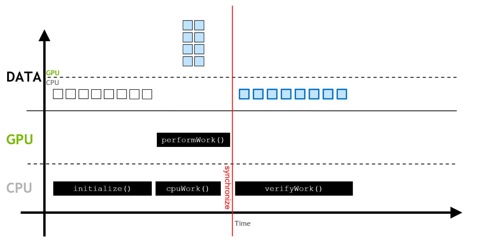
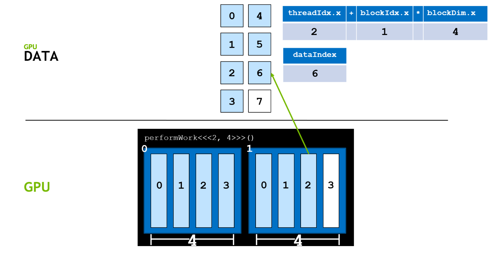
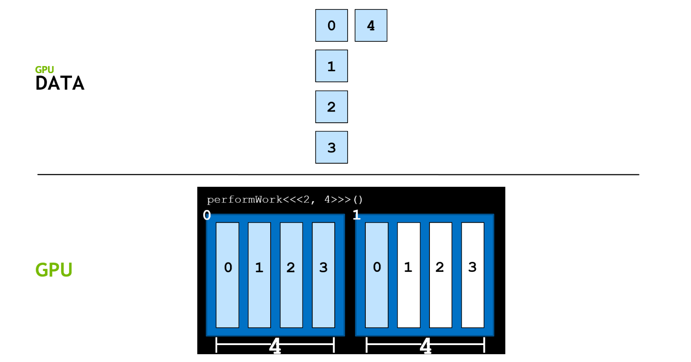
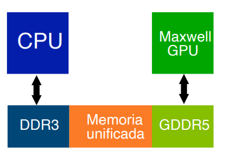
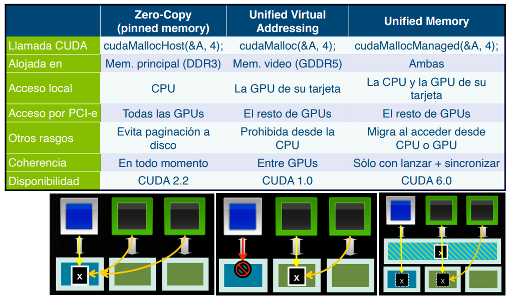
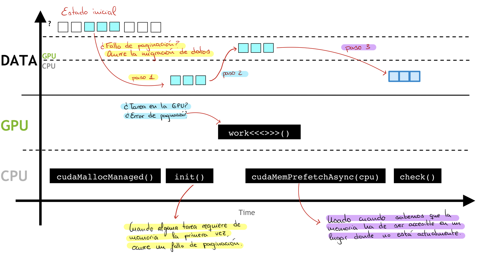
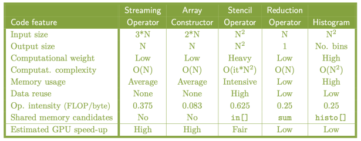
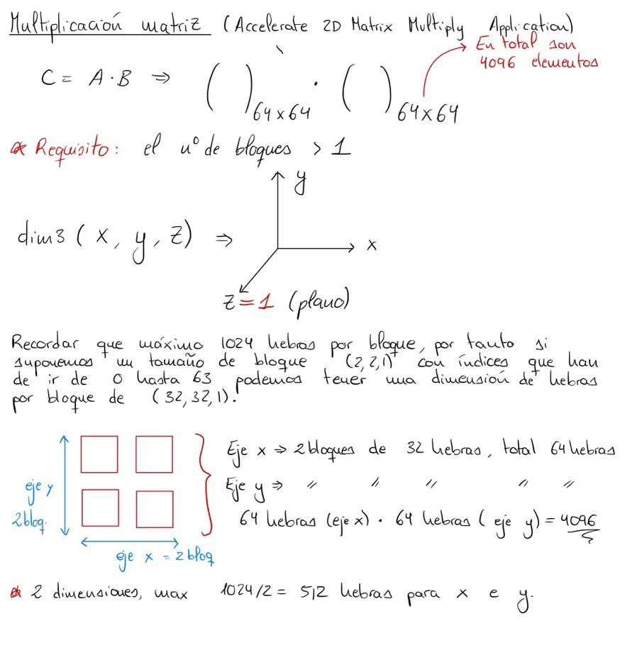
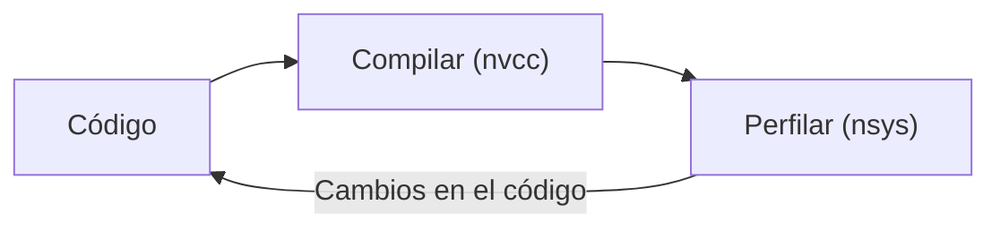

!!! warning

    El contenido de esta página no ha sido revisado ni corregido, por lo que puede
    estar incompleto, contener errores o presentar información desactualizada. Además,
    es posible que esté desordenado, carezca de una estructura clara o incluya notas
    copiadas directamente.

Este capítulo detalla la programación de _kernels_ CUDA en C, desde la identificación de
hilos y bloques y la gestión de la memoria del dispositivo hasta el manejo de errores,
los patrones habituales de paralelización y el perfilado de las aplicaciones
resultantes. Presupone los conceptos de arquitectura descritos en el capítulo de
[fundamentos](section_1_fundamentals.md).

## Bibliografía

- NVIDIA y Universidad de Málaga. (s.f.). _Deep Learning Institute - UMA_.
  <http://nvidiadli.uma.es/index.php/es/certificaciones-nvidia>

## Conceptos básicos

En CUDA, una función que se ejecuta de forma paralela en la GPU se denomina
**_kernel_**. Para conocer la GPU disponible y sus características se puede utilizar el
siguiente comando en la terminal:

```bash linenums="1"
nvidia-smi
```

!!! note "Requisitos previos"

    Es necesario disponer de una tarjeta gráfica de NVIDIA con los _drivers_ del sistema
    operativo instalados para poder utilizar estos comandos y programar con CUDA. En
    caso contrario, es posible acceder a plataformas de terceros que proporcionan este
    tipo de recursos, aunque pueden suponer un coste económico dependiendo del hardware
    seleccionado.

También es posible consultar las especificaciones de la GPU de forma programática desde
el propio código CUDA:

```c linenums="1"
#include <stdio.h>

int main(void)
{
    int deviceId;
    cudaGetDevice(&deviceId);

    cudaDeviceProp props;
    cudaGetDeviceProperties(&props, deviceId);

    printf("GPU: %s\n", props.name);
    printf("Tamaño del warp: %d\n", props.warpSize);
    printf("Hilos máximos por bloque: %d\n", props.maxThreadsPerBlock);
    printf("Número de multiprocesadores: %d\n", props.multiProcessorCount);

    return 0;
}
```

Durante la ejecución de un programa CUDA, la CPU y la GPU trabajan de forma simultánea,
de modo que resulta necesario sincronizar ambos componentes en los puntos en los que uno
depende del resultado del otro.

<figure markdown="span">
  
  <figcaption>Interacción y sincronización entre la CPU y la GPU.</figcaption>
</figure>

!!! warning "Sentencias condicionales dentro de un _kernel_"

    Conviene minimizar las bifurcaciones dentro de un _kernel_, y sobre todo evitar
    aquellas cuya condición dependa de `threadIdx.x` de forma que divida el _warp_.
    Cuando eso ocurre el _warp_ diverge, según se describe en el capítulo de
    [fundamentos](section_1_fundamentals.md), y el tiempo de ejecución se aproxima a
    la suma de las dos ramas.

La programación en CUDA se realiza utilizando C o C++, y los archivos fuente emplean la
extensión `.cu`. La compilación del código se lleva a cabo con el siguiente comando:

```bash linenums="1"
nvcc -arch=sm_70 -o resultado_nombre programa.cu -run
```

En este comando, `-arch=sm_70` especifica la arquitectura objetivo de la compilación,
`-o` indica el nombre del ejecutable generado y `-run` ejecuta el binario resultante una
vez finalizada la compilación.

!!! note "Prefijo `!` en Jupyter"

    Para compilar desde un _notebook_ de Jupyter se debe añadir el prefijo `!` al inicio
    del comando, es decir, `!nvcc -arch=sm_70 -o resultado_nombre programa.cu -run`.
    Dicho símbolo indica al _notebook_ que la instrucción debe ejecutarse en la _shell_
    del sistema en lugar de interpretarse como código Python.

???+ example "Código básico en CUDA"

    El programa invoca una función que se ejecuta en la CPU y un _kernel_ que se ejecuta
    en la GPU.

    ```c linenums="1"
    #include <stdio.h>

    void hola_cpu(void)
    {
        printf("Esto es un saludo desde la CPU\n");
    }

    // Define una función de kernel que se ejecuta en la GPU
    __global__ void ejemplo_kernel(void)
    {
        printf("Hola, esto se está ejecutando de forma paralela en GPU\n");
    }

    int main(void)
    {
        hola_cpu();

        // Lanza el kernel en la GPU con una sola instancia de un solo hilo
        ejemplo_kernel<<<1, 1>>>();

        // Espera a que todos los hilos en la GPU terminen antes de continuar
        cudaDeviceSynchronize();

        return 0;
    }
    ```

La palabra clave `__global__` indica que la función se ejecuta en la GPU y puede ser
invocada desde la CPU. El código ejecutado en la CPU se denomina _host_ y el ejecutado
en la GPU, _device_.

Las funciones `__global__` deben tener el tipo de retorno `void`. La invocación de un
_kernel_ utiliza la **configuración de ejecución**, que adopta la forma
`nombre_funcion<<<x, y>>>`, donde `x` es el número de bloques e `y` el número de hilos
por bloque. El número total de hilos se obtiene multiplicando ambos valores, de modo que
con 2 bloques y 4 hilos por bloque se obtienen 8 hilos. Los valores admisibles dependen
de las capacidades del hardware de la GPU.

El código del _kernel_ se ejecuta en cada hilo de cada bloque configurado. Un _kernel_
con un solo bloque utilizará únicamente un multiprocesador de la GPU, por lo que
desperdiciará la mayor parte del dispositivo. La función `cudaDeviceSynchronize()`
bloquea la CPU hasta que la GPU completa el trabajo pendiente, y actúa así como
herramienta de sincronización entre ambos.

???+ example "Control del orden de ejecución entre CPU y GPU"

    La posición de `cudaDeviceSynchronize()` determina el orden en que se completan las
    operaciones. En el siguiente ejemplo la GPU ejecuta primero y la CPU después.

    ```c linenums="1"
    #include <stdio.h>

    void hola_cpu(void)
    {
        printf("Hola desde la CPU.\n");
    }

    __global__ void hola_gpu(void)
    {
        printf("Hola desde la GPU.\n");
    }

    int main(void)
    {
        hola_gpu<<<1, 1>>>();
        cudaDeviceSynchronize();

        hola_cpu();

        return 0;
    }
    ```

CUDA permite acelerar los bucles cuyas iteraciones son independientes entre sí. Sirva
como punto de partida el incremento de un valor `b` sobre los `N` elementos de un
vector, resuelto en la CPU:

```c linenums="1"
#include <stdlib.h>

#define N (1 << 20)

void incremento_en_cpu(float *a, float b, int n)
{
    for (int idx = 0; idx < n; idx++)
    {
        a[idx] = a[idx] + b;
    }
}

int main(void)
{
    float *a = (float *)malloc(N * sizeof(float));
    float b = 2.0f;

    for (int idx = 0; idx < N; idx++)
    {
        a[idx] = 1.0f;
    }

    incremento_en_cpu(a, b, N);
    free(a);

    return 0;
}
```

Este bucle es adecuado para la paralelización porque cada índice se calcula de forma
independiente y el resultado no depende del orden en que se procesen los elementos. Esa
propiedad es lo que permite repartirlo entre hilos, ya que CUDA no garantiza ningún
orden de ejecución entre los distintos _warps_ ni entre los distintos bloques de la
malla.

## Identificación de hilos, bloques y mallas

CUDA proporciona variables integradas que describen los hilos, los bloques y la malla
(_grid_):

| Variable      | Descripción                                           |
| ------------- | ----------------------------------------------------- |
| `gridDim.x`   | Número total de bloques en la malla.                  |
| `blockIdx.x`  | Índice del bloque actual dentro de la malla.          |
| `blockDim.x`  | Número de hilos en un bloque dentro del _kernel_.     |
| `threadIdx.x` | Índice de un hilo dentro de un bloque en el _kernel_. |

Los bloques de un mismo _kernel_ no pueden comunicarse entre sí durante su ejecución, ya
que se planifican en cualquier orden y de forma independiente. El _kernel_ debe realizar
el trabajo de una sola iteración del bucle, de modo que la configuración de ejecución ha
de ajustarse al número de iteraciones mediante una elección adecuada del número de
bloques y del número de hilos por bloque. A continuación se presenta el código
paralelizado del bucle anterior. La reserva se realiza con `cudaMallocManaged()`, que
devuelve un puntero accesible tanto desde la CPU como desde la GPU y cuyo funcionamiento
se detalla en la sección de asignación de memoria:

```c linenums="1"
#include <math.h>

#define N (1 << 20)

__global__ void incremento_en_gpu(float *a, float b, int n)
{
    int idx = blockIdx.x * blockDim.x + threadIdx.x;

    if (idx < n)
    {
        a[idx] = a[idx] + b;
    }
}

int main(void)
{
    float *a;
    float b = 2.0f;
    int blocksize = 256;

    cudaMallocManaged(&a, N * sizeof(float));

    for (int idx = 0; idx < N; idx++)
    {
        a[idx] = 1.0f;
    }

    // Configuración de la malla a partir del número de datos y del tamaño de bloque
    dim3 dimBlock(blocksize);
    dim3 dimGrid(ceil(N / (float)blocksize));

    incremento_en_gpu<<<dimGrid, dimBlock>>>(a, b, N);
    cudaDeviceSynchronize();
    cudaFree(a);

    return 0;
}
```

Cada hilo realiza una iteración del bucle. La fórmula que asocia cada hilo a un índice
del bucle es la siguiente:

$$i_{x} = (\text{blockIdx.x} \cdot \text{blockDim.x}) + \text{threadIdx.x}$$

En esta expresión, $i_{x}$ representa el índice global del hilo dentro de la malla,
`blockIdx.x` identifica el bloque al que pertenece el hilo, `blockDim.x` indica cuántos
hilos contiene cada bloque y `threadIdx.x` señala la posición del hilo dentro de su
bloque.

<figure markdown="span">
  
  <figcaption>Mapeo de cada hilo a un índice del bucle en CUDA.</figcaption>
</figure>

!!! tip "Elección del tamaño de bloque"

    El tamaño de bloque debe ser múltiplo de 32, que es el número de hilos de un _warp_.
    Un bloque de 48 hilos, por ejemplo, ocuparía dos _warps_ y dejaría 16 hilos
    inactivos en el segundo, con lo que se desperdicia una cuarta parte de la capacidad
    de emisión. Los valores habituales están entre 128 y 512 hilos por bloque.

    Cuando el número de hilos lanzados supera el número de tareas, el _kernel_ debe
    comprobar que el índice global $i_{x}$ es menor que el número total de datos antes
    de acceder a la memoria. Omitir esa guarda provoca escrituras fuera de los límites
    del _array_.

<figure markdown="span">
  
  <figcaption>Comprobación de límites cuando el número de hilos supera al de tareas.</figcaption>
</figure>

## Asignación de memoria

La asignación y liberación de memoria se realiza de forma diferente en la CPU y en la
GPU. En la CPU se utilizan las funciones `malloc()` y `free()`:

```c linenums="1"
#include <stdlib.h>

void reserva_en_cpu(void)
{
    int N = 1 << 20;
    size_t size = N * sizeof(int);

    int *a = (int *)malloc(size);

    free(a);
}
```

En la GPU se emplean `cudaMallocManaged()` y `cudaFree()`, que reservan y liberan
memoria unificada accesible desde la CPU y desde la GPU:

```c linenums="1"
void reserva_en_gpu(void)
{
    int N = 1 << 20;
    size_t size = N * sizeof(int);

    int *a;
    cudaMallocManaged(&a, size);

    cudaFree(a);
}
```

Gracias a los avances en el hardware de interconexión, la tasa de transferencia entre la
CPU y la GPU ha mejorado de forma sustancial. Las versiones recientes de CUDA permiten
además el uso de **memoria unificada**, que simplifica el intercambio de datos entre
ambos componentes.

<figure markdown="span">
  
  <figcaption>Memoria unificada compartida entre la CPU y la GPU.</figcaption>
</figure>

La memoria unificada ofrece varias ventajas. Proporciona un único puntero a los datos,
accesible tanto desde la CPU como desde la GPU, lo que elimina la necesidad de invocar
`cudaMemcpy()` de forma explícita, facilita la portabilidad del código y garantiza la
coherencia entre ambas vistas de los datos. El sistema migra las páginas bajo demanda, y
cuando ese comportamiento automático no resulta suficiente es posible guiarlo de forma
manual con `cudaMemPrefetchAsync()`, que anticipa la migración, y con `cudaMemAdvise()`,
que no mueve datos y se limita a informar al _runtime_ del patrón de acceso previsto.

La siguiente imagen recoge los tipos de memoria que expone la plataforma.

<figure markdown="span">
  
  <figcaption>Tipos de memoria disponibles en CUDA.</figcaption>
</figure>

!!! warning "Consideraciones de la memoria unificada"

    En sistemas con varias GPU, la capacidad efectiva queda limitada por la memoria de
    la GPU más pequeña que participe en el acceso. La memoria que la CPU haya modificado
    debe migrar de nuevo al dispositivo antes de que un _kernel_ la utilice, y esa
    migración tiene un coste que conviene tener presente.

    A partir de la arquitectura Pascal el comportamiento es más flexible que en las
    generaciones anteriores. Es posible reservar más memoria unificada que la disponible
    en el dispositivo, ya que el _runtime_ la pagina bajo demanda, y la CPU puede
    acceder de forma concurrente a regiones que la GPU no esté utilizando siempre que la
    propiedad `concurrentManagedAccess` esté activa. En arquitecturas anteriores a
    Pascal ninguna de las dos cosas es posible: la GPU adquiere acceso exclusivo a toda
    la memoria unificada mientras ejecuta un _kernel_, de modo que cualquier acceso de
    la CPU exige un `cudaDeviceSynchronize()` previo.

<figure markdown="span">
  
  <figcaption>Jerarquía de memoria en CUDA.</figcaption>
</figure>

### Ejemplos de uso de memoria unificada

Los dos ejemplos siguientes ilustran el problema anterior sobre una arquitectura sin
acceso concurrente. En ambos casos el _kernel_ se lanza de forma asíncrona, por lo que
la CPU continúa ejecutando código mientras la GPU trabaja.

???+ example "Uso incorrecto de la memoria unificada"

    La CPU escribe en una variable gestionada sin haber esperado a que la GPU termine,
    lo que produce un acceso concurrente no sincronizado.

    ```c linenums="1"
    __device__ __managed__ int x, y = 2;

    __global__ void ejemplo_kernel(void)
    {
        x = 10;
    }

    int main(void)
    {
        ejemplo_kernel<<<1, 1>>>();

        // Error: la CPU accede a la variable 'y' mientras la GPU puede estar
        // utilizando la memoria unificada
        y = 20;

        return 0;
    }
    ```

???+ example "Uso correcto de la memoria unificada"

    La versión correcta sincroniza antes de que la CPU acceda a la variable.

    ```c linenums="1"
    __device__ __managed__ int x, y = 2;

    __global__ void ejemplo_kernel(void)
    {
        x = 10;
    }

    int main(void)
    {
        ejemplo_kernel<<<1, 1>>>();

        // Sincronización antes de que la CPU acceda a la memoria unificada
        cudaDeviceSynchronize();

        y = 20;

        return 0;
    }
    ```

### Reserva explícita y transferencias de datos

La memoria unificada simplifica el código, pero la API de CUDA ofrece también una
gestión explícita que separa de forma visible los datos del _host_ y los del _device_.
La reserva en la memoria global del dispositivo se realiza con `cudaMalloc()`, que
recibe la dirección del puntero y el tamaño en bytes, y la liberación con `cudaFree()`.
Los datos viajan entre ambas memorias con `cudaMemcpy()`, cuyo último argumento fija el
sentido de la copia: `cudaMemcpyHostToDevice`, `cudaMemcpyDeviceToHost` o
`cudaMemcpyDeviceToDevice`. Un puntero obtenido con `cudaMalloc()` solo es válido en el
dispositivo, por lo que desreferenciarlo desde la CPU es un error.

El patrón completo consta de cuatro pasos: reservar memoria en ambos lados, copiar las
entradas al dispositivo, lanzar el _kernel_ y copiar el resultado de vuelta. El producto
elemento a elemento de dos vectores lo ilustra con el esquema más simple, sin
dependencias entre las posiciones.

???+ example "Producto elemento a elemento con memoria explícita"

    Para simplificar se omite la comprobación de errores, que se trata en el apartado de
    manejo de errores. Los vectores del _host_ se reservan en el montón con `malloc()`
    porque $2^{20}$ elementos desbordarían la pila.

    ```c linenums="1"
    #include <stdio.h>
    #include <stdlib.h>

    #define N (1 << 20)

    __global__ void producto_vectores(const float *a, const float *b, float *c, int n)
    {
        int i = blockIdx.x * blockDim.x + threadIdx.x;

        if (i < n)
        {
            c[i] = a[i] * b[i];
        }
    }

    int main(void)
    {
        size_t size = N * sizeof(float);
        int hilos = 256;
        int bloques = (N + hilos - 1) / hilos;

        float *host_a = (float *)malloc(size);
        float *host_b = (float *)malloc(size);
        float *host_c = (float *)malloc(size);

        for (int i = 0; i < N; i++)
        {
            host_a[i] = i % 100;
            host_b[i] = 2.0f;
        }

        // Reserva de los tres vectores en la memoria global del dispositivo
        float *dev_a, *dev_b, *dev_c;
        cudaMalloc(&dev_a, size);
        cudaMalloc(&dev_b, size);
        cudaMalloc(&dev_c, size);

        // Copia de las entradas del host al dispositivo
        cudaMemcpy(dev_a, host_a, size, cudaMemcpyHostToDevice);
        cudaMemcpy(dev_b, host_b, size, cudaMemcpyHostToDevice);

        producto_vectores<<<bloques, hilos>>>(dev_a, dev_b, dev_c, N);

        // La copia de vuelta se encola tras el kernel, por lo que espera a que termine
        cudaMemcpy(host_c, dev_c, size, cudaMemcpyDeviceToHost);

        int errores = 0;
        for (int i = 0; i < N; i++)
        {
            if (host_c[i] != host_a[i] * host_b[i])
            {
                errores++;
            }
        }
        printf("c[7] = %.1f\nErrores: %d\n", host_c[7], errores);

        cudaFree(dev_a);
        cudaFree(dev_b);
        cudaFree(dev_c);
        free(host_a);
        free(host_b);
        free(host_c);

        return 0;
    }
    ```

    ```plaintext title="Expected output"
    c[7] = 14.0
    Errores: 0
    ```

Como `cudaMemcpy()` bloquea el _host_ y se encola tras el _kernel_ en el mismo flujo de
ejecución, la copia de vuelta actúa como sincronización implícita y no requiere un
`cudaDeviceSynchronize()` previo.

La configuración de ejecución condiciona el rendimiento tanto como la gestión de la
memoria. Lanzar `<<<1, N>>>` solo funciona mientras `N` no supere el máximo de hilos por
bloque y mantiene ocupado un único multiprocesador. Lanzar `<<<N, 1>>>` crea un bloque
por elemento con un solo hilo, de modo que cada _warp_ emite instrucciones para una
única posición de las 32 posibles y se desperdicia en torno al 97 % de la capacidad de
cálculo. El reparto con bloques de entre 128 y 512 hilos y una guarda de límites, como
el del ejemplo, evita ambos problemas.

## _Kernels_ con gran volumen de datos

Cuando la cantidad de datos excede el número de hilos disponibles, es necesario dividir
el trabajo en porciones que se ajusten al número de hilos lanzados. Tras procesar una
porción, cada hilo avanza a la siguiente aplicando un desplazamiento igual al número
total de hilos de la malla, esto es, $\text{blockDim.x} \cdot \text{gridDim.x}$. Este
patrón se conoce como **_grid stride loop_**:

```c linenums="1"
__global__ void duplica_elementos(int *a, int N)
{
    int indice_global = (blockIdx.x * blockDim.x) + threadIdx.x;
    int salto = blockDim.x * gridDim.x;

    for (int i = indice_global; i < N; i += salto)
    {
        // Cada hilo duplica el elemento que le corresponde en esta pasada
        a[i] = a[i] * 2;
    }
}
```

La condición `i < N` del bucle cumple aquí la misma función que la guarda de límites del
apartado anterior, de modo que el patrón es correcto para cualquier combinación de
tamaño de malla y volumen de datos.

## Manejo de errores

Las funciones de CUDA devuelven un valor de tipo `cudaError_t` que indica si se ha
producido un error. A continuación se muestra cómo gestionarlo al reservar memoria:

```c linenums="1"
#include <stdio.h>

void reserva_con_control_de_errores(int **a, size_t size)
{
    cudaError_t err = cudaMallocManaged(a, size);

    if (err != cudaSuccess)
    {
        printf("Error: %s\n", cudaGetErrorString(err));
    }
}
```

!!! warning "Doble indirección al reservar memoria"

    El parámetro debe declararse como `int **a` y no como `int *a`. Las funciones de
    reserva de CUDA escriben la dirección obtenida en la posición que reciben, de modo
    que si el puntero se pasa por valor la reserva se registra en la copia local y se
    pierde al retornar de la función, además de provocar una fuga de memoria en el
    dispositivo.

El lanzamiento de un _kernel_ requiere un tratamiento distinto, porque no devuelve un
código de error. Los errores de configuración se recuperan con `cudaGetLastError()`
inmediatamente después del lanzamiento, mientras que los errores producidos durante la
ejecución del _kernel_ solo afloran en la siguiente llamada de sincronización:

```c linenums="1"
#include <stdio.h>

__global__ void algun_kernel(void)
{
}

void lanza_kernel_con_control_de_errores(void)
{
    // El valor -1 no es válido para el número de hilos por bloque
    algun_kernel<<<1, -1>>>();

    // Errores síncronos: configuración de ejecución inválida
    cudaError_t err = cudaGetLastError();

    if (err != cudaSuccess)
    {
        printf("Error de lanzamiento: %s\n", cudaGetErrorString(err));
    }

    // Errores asíncronos: fallos durante la ejecución del kernel
    err = cudaDeviceSynchronize();

    if (err != cudaSuccess)
    {
        printf("Error de ejecución: %s\n", cudaGetErrorString(err));
    }
}
```

!!! note "`cudaGetLastError()` frente a `cudaPeekAtLastError()`"

    Ambas funciones consultan el último error registrado por el _runtime_, con una
    diferencia relevante: `cudaGetLastError()` restablece el estado de error a
    `cudaSuccess`, mientras que `cudaPeekAtLastError()` lo conserva. Conviene emplear la
    primera cuando el error ya se ha tratado y la segunda cuando se desea consultarlo
    sin consumirlo.

???+ tip "Macro auxiliar para verificar errores"

    Envolver cada llamada a la API con una comprobación centralizada evita repetir el
    mismo bloque condicional. Se implementa como macro y no como función para poder
    informar del archivo y de la línea donde se produjo el fallo.

    ```c linenums="1"
    #include <stdio.h>
    #include <stdlib.h>

    #define CHECK_CUDA(llamada)                                                    \
        do                                                                         \
        {                                                                          \
            cudaError_t err = (llamada);                                           \
            if (err != cudaSuccess)                                                \
            {                                                                      \
                fprintf(stderr, "Error CUDA en %s:%d: %s\n", __FILE__, __LINE__,   \
                        cudaGetErrorString(err));                                  \
                exit(EXIT_FAILURE);                                                \
            }                                                                      \
        } while (0)

    int main(void)
    {
        int *a;
        size_t size = 1024 * sizeof(int);

        CHECK_CUDA(cudaMallocManaged(&a, size));
        CHECK_CUDA(cudaDeviceSynchronize());
        CHECK_CUDA(cudaFree(a));

        return 0;
    }
    ```

    La comprobación no debe apoyarse en `assert()`, ya que las compilaciones que definen
    `NDEBUG` la eliminan por completo y el programa continuaría con datos inválidos. El
    uso de `exit(EXIT_FAILURE)` garantiza que el fallo se manifieste en cualquier
    configuración de compilación.

## Patrones comunes de _kernels_

<figure markdown="span">
  
  <figcaption>Patrones comunes de <em>kernels</em> en CUDA.</figcaption>
</figure>

Antes de describir cada patrón conviene definir el concepto de **bucle _forall_**, que
designa un bucle `for` sin dependencias entre iteraciones, de modo que el resultado no
varía en función del orden de ejecución ni del índice de inicio. Sobre esta base se
construyen los patrones que siguen. Los ejemplos se presentan en su versión secuencial
para hacer visible la estructura de dependencias de cada uno.

### Operadores _streaming_

Representan la forma más simple de un bucle _forall_. CUDA puede emplear tantos hilos
como elementos haya, ya que cada uno se procesa de manera independiente, como ocurre al
calcular la luminancia de una imagen a partir de sus tres canales de color:

```c linenums="1"
#define N (1920 * 1080)

float r[N], g[N], b[N], luminancia[N];

void calcula_luminancia(void)
{
    for (int i = 0; i < N; i++)
    {
        // Coeficientes de luminancia de la recomendación BT.601
        luminancia[i] = 255 * (0.299 * r[i] + 0.587 * g[i] + 0.114 * b[i]);
    }
}
```

Aunque los ejemplos de este apartado son secuenciales, el operador _streaming_ admite
una traducción casi directa a la GPU. Basta asignar un hilo a cada elemento, y cuando el
dominio es una imagen resulta natural emplear una malla bidimensional, con la coordenada
`x` asociada a la columna y la `y` a la fila, igual que en la multiplicación de
matrices. Las variables `blockIdx.y`, `blockDim.y` y `threadIdx.y` son las equivalentes
en el eje `y` de las ya descritas, y `dim3` admite dos argumentos para declarar bloques
y mallas bidimensionales, como se detalla en la sección de multiplicación de matrices
2D. El negativo de una imagen RGB de 8 bits por canal es el caso más sencillo, ya que
cada componente $c$ se sustituye por

$$c' = 255 - c$$

sin que exista ninguna dependencia entre píxeles.

???+ example "Negativo de una imagen en la GPU"

    Cada hilo procesa un píxel. La malla se dimensiona con división por exceso y el
    _kernel_ descarta los hilos que caen fuera de la imagen. La macro `CHECK_CUDA` es la
    definida en el apartado de manejo de errores.

    ```c linenums="1"
    #include <stdio.h>
    #include <stdlib.h>

    #define ANCHO 100
    #define ALTO 70

    typedef struct
    {
        unsigned char b, g, r;
    } Pixel;

    __global__ void negativo(const Pixel *entrada, Pixel *salida, int ancho, int alto)
    {
        int col = blockIdx.x * blockDim.x + threadIdx.x;
        int fila = blockIdx.y * blockDim.y + threadIdx.y;

        if (fila < alto && col < ancho)
        {
            int pos = fila * ancho + col;
            salida[pos].r = 255 - entrada[pos].r;
            salida[pos].g = 255 - entrada[pos].g;
            salida[pos].b = 255 - entrada[pos].b;
        }
    }

    int main(void)
    {
        size_t size = ANCHO * ALTO * sizeof(Pixel);
        Pixel *entrada, *salida;
        CHECK_CUDA(cudaMallocManaged(&entrada, size));
        CHECK_CUDA(cudaMallocManaged(&salida, size));

        // Imagen sintética: el rojo crece con la columna y el verde con la fila
        for (int fila = 0; fila < ALTO; fila++)
        {
            for (int col = 0; col < ANCHO; col++)
            {
                Pixel p = {(unsigned char)(fila + col), (unsigned char)(fila * 3),
                           (unsigned char)(col * 2)};
                entrada[fila * ANCHO + col] = p;
            }
        }

        // Bloques de 16x16 hilos y malla que cubre la imagen completa
        dim3 bloque(16, 16);
        dim3 malla((ANCHO + bloque.x - 1) / bloque.x, (ALTO + bloque.y - 1) / bloque.y);

        negativo<<<malla, bloque>>>(entrada, salida, ANCHO, ALTO);
        CHECK_CUDA(cudaGetLastError());
        CHECK_CUDA(cudaDeviceSynchronize());

        Pixel e = entrada[20 * ANCHO + 10];
        Pixel s = salida[20 * ANCHO + 10];
        printf("Entrada:  R=%d G=%d B=%d\n", e.r, e.g, e.b);
        printf("Negativo: R=%d G=%d B=%d\n", s.r, s.g, s.b);

        CHECK_CUDA(cudaFree(entrada));
        CHECK_CUDA(cudaFree(salida));

        return 0;
    }
    ```

    ```plaintext title="Expected output"
    Entrada:  R=20 G=60 B=30
    Negativo: R=235 G=195 B=225
    ```

Con bloques de $16 \times 16$ hilos, la imagen de $100 \times 70$ píxeles requiere una
malla de $7 \times 5$ bloques, es decir, $112 \times 80$ hilos, de modo que la guarda de
límites es imprescindible para los hilos sobrantes. Una suma de matrices elemento a
elemento sigue exactamente el mismo esquema, con dos entradas y la operación
`c[pos] = a[pos] + b[pos]`.

!!! warning "División entera al calcular la malla"

    Calcular la malla como `ancho / 16` trunca el resultado y deja sin procesar las
    columnas y filas sobrantes cuando las dimensiones no son múltiplos del tamaño de
    bloque. La división por exceso, `(ancho + 15) / 16`, combinada con la guarda de
    límites, funciona para cualquier tamaño.

!!! note "Estructuras de 3 bytes y relleno de filas"

    Una estructura de 3 bytes produce accesos no alineados que se fusionan peor que los
    de un `float` o un `int`, por lo que en imágenes grandes suele preferirse almacenar
    cada canal en un _array_ propio o añadir un cuarto byte de relleno. Además, el
    formato BMP, que almacena cada píxel en el orden `b, g, r` de la estructura
    anterior, rellena cada fila hasta un múltiplo de 4 bytes, de modo que el ancho en
    bytes de una fila puede no coincidir con `3 * ancho`.

### Operadores sobre vectores

A diferencia del operador _streaming_, que realiza varias operaciones por cada elemento
leído, el operador sobre vectores efectúa una sola. Su rendimiento queda por tanto
limitado por el ancho de banda de la memoria global y no por la capacidad de cálculo.
Cada iteración del bucle puede asignarse a un hilo distinto, lo que maximiza el
paralelismo y la escalabilidad al no existir comunicación entre iteraciones:

```c linenums="1"
#define N (1 << 20)

float a[N], b[N], c[N];

void suma_vectores(void)
{
    for (int i = 0; i < N; i++)
    {
        c[i] = a[i] + b[i];
    }
}
```

!!! note "Tamaño de los _arrays_ declarados de forma estática"

    Los tres _arrays_ del ejemplo se reservan de forma estática, por lo que su tamaño
    total forma parte del ejecutable. Con $N = 2^{20}$ ocupan 12 MiB, una cifra
    manejable. Elevar `N` a $2^{30}$ exigiría 12 GiB y el programa no llegaría a
    arrancar, de modo que para volúmenes grandes la reserva debe ser dinámica.

### Operadores patrón

Los operadores patrón (_stencil operators_) calculan cada elemento a partir de sus
vecinos. Las iteraciones externas deben serializarse debido a las dependencias entre
pasos temporales, pero el cálculo de cada elemento dentro de un mismo paso sí puede
paralelizarse. La carga computacional depende del número de iteraciones:

```c linenums="1"
#define N 1024
#define NITERS 100

float in[N][N], out[N][N];

void aplica_stencil(void)
{
    for (int iter = 0; iter < NITERS; iter++)
    {
        for (int i = 1; i < N - 1; i++)
        {
            for (int j = 1; j < N - 1; j++)
            {
                out[i][j] = 0.2 * (in[i][j] + in[i - 1][j] + in[i + 1][j] +
                                   in[i][j - 1] + in[i][j + 1]);
            }
        }

        for (int i = 1; i < N - 1; i++)
        {
            for (int j = 1; j < N - 1; j++)
            {
                in[i][j] = out[i][j];
            }
        }
    }
}
```

El grado de paralelismo disponible en cada paso temporal está determinado por el tamaño
de la matriz bidimensional, esto es, $N^2$.

### Operadores de reducción

Aunque el código presenta dependencias entre iteraciones, el paralelismo puede
desplegarse mediante una estructura en árbol binario. El número de pasos necesarios es
$\lceil \log_2 N \rceil$, y en cada uno de ellos el grado de paralelismo se reduce a la
mitad hasta llegar a un único hilo. Resulta fundamental emplear un patrón de acceso a
memoria que aproveche la jerarquía del dispositivo:

```c linenums="1"
#define N (1 << 20)

float x[N];

float reduce_suma(void)
{
    float suma = 0;

    for (int i = 0; i < N; i++)
    {
        suma += x[i];
    }

    return suma;
}
```

#### Reducción en un bloque con memoria compartida

La versión paralela de la suma anterior comienza por la reducción dentro de un bloque.
Esta reducción en árbol se apoya en la **memoria compartida**, una zona de baja latencia
situada en cada multiprocesador. Se reserva con el calificador `__shared__`, y todos los
hilos de un bloque la ven, pero ningún otro bloque puede acceder a ella. Para evitar
leer valores que otro hilo todavía no ha escrito, los hilos se coordinan con la barrera
`__syncthreads()`, que detiene a cada hilo hasta que todos los del bloque la han
alcanzado. Como la barrera exige la participación de todo el bloque, no puede situarse
dentro de una condición que solo cumplan algunos hilos. El capítulo de
[CUDA en Python](section_3_cuda_python.md) describe estos mismos conceptos con Numba.

El algoritmo carga un valor por hilo en la memoria compartida y repite una operación de
suma por pasos. En cada paso, los hilos con índice menor que `salto` suman a su valor el
de la posición `tid + salto`, y `salto` se divide entre dos hasta llegar a 1. Con un
bloque de 8 hilos la secuencia es la siguiente:

| Paso | `salto` | Hilos activos | Operación                      |
| ---- | ------- | ------------- | ------------------------------ |
| 1    | 4       | 0 a 3         | `c[t] += c[t + 4]`             |
| 2    | 2       | 0 y 1         | `c[t] += c[t + 2]`             |
| 3    | 1       | 0             | `c[0] += c[1]`, resultado en 0 |

Como los hilos activos son siempre los de menor índice, los _warps_ completos quedan
activos o inactivos, y la divergencia solo aparece en los últimos pasos, cuando quedan
menos de 32 hilos. El tamaño de bloque debe ser una potencia de 2 para que la mitad sea
exacta en todos los pasos, y los hilos que no tengan dato aportan un cero, que es el
elemento neutro de la suma.

???+ example "Suma de un vector con varios bloques"

    La suma de un bloque se encapsula en una función de dispositivo reutilizable, y el
    _kernel_ la aplica a un tramo del vector. Cada bloque produce una suma parcial.

    ```c linenums="1"
    // Máximo de hilos por bloque admitido por la memoria compartida reservada
    #define HILOS 1024

    // Suma los valores aportados por los hilos del bloque (blockDim.x potencia de 2)
    __device__ float suma_del_bloque(float valor)
    {
        __shared__ float compartida[HILOS];
        int tid = threadIdx.x;

        compartida[tid] = valor;
        __syncthreads();

        for (int salto = blockDim.x / 2; salto > 0; salto >>= 1)
        {
            if (tid < salto)
            {
                compartida[tid] += compartida[tid + salto];
            }

            // Barrera tras cada paso para que el siguiente lea valores ya escritos
            __syncthreads();
        }

        return compartida[0];
    }

    // Cada bloque suma un tramo de 'entrada' y escribe su resultado en 'parciales'
    __global__ void reduce_suma_bloques(const float *entrada, float *parciales, int n)
    {
        int i = blockIdx.x * blockDim.x + threadIdx.x;

        // Los hilos sin dato aportan el elemento neutro de la suma
        float valor = (i < n) ? entrada[i] : 0.0f;
        float total = suma_del_bloque(valor);

        if (threadIdx.x == 0)
        {
            parciales[blockIdx.x] = total;
        }
    }
    ```

    Un solo bloque basta mientras el vector no supere `HILOS` elementos. Para volúmenes
    mayores, los bloques no pueden comunicarse entre sí, de modo que cada uno deja una
    suma parcial y el proceso se repite sobre esas sumas hasta que queda un único valor.
    El número de pasadas es

    $$\lceil \log_{B} n \rceil$$

    donde $n$ es el número de elementos y $B$ el tamaño de bloque. Con $n = 60000$ y
    $B = 1024$ bastan dos, que reducen 60000 valores a 59 y estos a 1.

    ```c linenums="1"
    #include <stdio.h>
    #include <stdlib.h>

    // Kernel reduce_suma_bloques y función suma_del_bloque del bloque de código anterior
    // Macro CHECK_CUDA definida en el apartado de manejo de errores

    // Reduce 'restantes' valores hasta uno solo y devuelve el array que lo contiene.
    // Alterna los arrays de entrada y salida porque no se debe leer y escribir sobre el
    // mismo array, ya que un bloque podría sobrescribir datos que otro aún no ha leído
    float *reduce_en_gpu(float *datos, float *aux, int restantes)
    {
        while (restantes > 1)
        {
            int bloques = (restantes + HILOS - 1) / HILOS;

            reduce_suma_bloques<<<bloques, HILOS>>>(datos, aux, restantes);
            CHECK_CUDA(cudaGetLastError());

            float *temporal = datos;
            datos = aux;
            aux = temporal;
            restantes = bloques;
        }

        return datos;
    }

    int main(void)
    {
        int n = 60000;
        int bloques = (n + HILOS - 1) / HILOS;
        float *datos, *aux;

        CHECK_CUDA(cudaMallocManaged(&datos, n * sizeof(float)));
        CHECK_CUDA(cudaMallocManaged(&aux, bloques * sizeof(float)));

        for (int i = 0; i < n; i++)
        {
            datos[i] = i % 10;
        }

        float *resultado = reduce_en_gpu(datos, aux, n);
        CHECK_CUDA(cudaDeviceSynchronize());

        printf("Suma en GPU: %.0f\n", resultado[0]);

        CHECK_CUDA(cudaFree(datos));
        CHECK_CUDA(cudaFree(aux));

        return 0;
    }
    ```

    ```plaintext title="Expected output"
    Suma en GPU: 270000
    ```

!!! warning "Comparación de resultados en coma flotante"

    La suma en árbol agrupa los sumandos de forma distinta a un bucle secuencial, y la
    suma en coma flotante no es asociativa. Con datos reales el resultado puede diferir
    en los últimos dígitos, de modo que la verificación debe hacerse con una tolerancia
    y no con `==`. En el ejemplo el resultado es exacto porque los valores son enteros
    y las sumas son inferiores a $2^{24}$, el límite hasta el que un `float` representa
    enteros sin pérdida.

Existen alternativas con menos pasadas. La más simple es que el hilo 0 de cada bloque
sume su resultado parcial a un acumulador global con `atomicAdd()`, operación atómica
que se describe en el apartado de histogramas y que requiere un solo lanzamiento a costa
de un orden de suma no determinista. Otra opción es sustituir los últimos pasos de la
reducción por instrucciones de intercambio dentro del _warp_, como `__shfl_down_sync()`,
que evitan la memoria compartida y las barreras.

#### Producto escalar con un _kernel_ fusionado

El producto escalar de dos vectores combina un operador _streaming_ y una reducción. La
versión directa lanza primero un _kernel_ que multiplica elemento a elemento y escribe
el vector intermedio en memoria global, y después otro que lo reduce. Fusionar ambos
pasos elimina esa escritura y la lectura posterior: el producto se calcula en un
registro del hilo y entra directamente en la reducción del bloque.

???+ example "Producto escalar con multiplicación y reducción en un solo _kernel_"

    El primer lanzamiento multiplica y reduce por bloques. El resto de las pasadas
    reutilizan `reduce_en_gpu()` del ejemplo anterior, que ya no necesita multiplicar.

    ```c linenums="1"
    // Cada bloque multiplica un tramo de a y b y deja la suma de los productos
    __global__ void producto_escalar_parcial(const float *a, const float *b,
                                             float *parciales, int n)
    {
        int i = blockIdx.x * blockDim.x + threadIdx.x;

        float producto = (i < n) ? a[i] * b[i] : 0.0f;
        float total = suma_del_bloque(producto);

        if (threadIdx.x == 0)
        {
            parciales[blockIdx.x] = total;
        }
    }

    // Producto escalar completo de dos vectores de n elementos accesibles desde la GPU
    float producto_escalar(const float *a, const float *b, int n)
    {
        int bloques = (n + HILOS - 1) / HILOS;
        float *parciales, *aux;

        CHECK_CUDA(cudaMallocManaged(&parciales, bloques * sizeof(float)));
        CHECK_CUDA(cudaMallocManaged(&aux, bloques * sizeof(float)));

        producto_escalar_parcial<<<bloques, HILOS>>>(a, b, parciales, n);
        CHECK_CUDA(cudaGetLastError());

        float *resultado = reduce_en_gpu(parciales, aux, bloques);
        CHECK_CUDA(cudaDeviceSynchronize());

        // El valor se copia antes de liberar los arrays temporales
        float valor = resultado[0];
        CHECK_CUDA(cudaFree(parciales));
        CHECK_CUDA(cudaFree(aux));

        return valor;
    }
    ```

Este producto escalar es, además, la operación que se repite en cada muestra de una
convolución discreta, que se aborda tras los histogramas.

### Histogramas

Los histogramas constituyen un patrón en el que los bucles presentan dependencias en la
escritura, ya que varios hilos pueden incrementar la misma posición del histograma. Las
lecturas, en cambio, pueden realizarse en paralelo si se asignan a hilos distintos:

```c linenums="1"
#define N 1024
#define NBINS 256

unsigned int histo[NBINS];
unsigned char image[N][N];

void calcula_histograma(void)
{
    for (int i = 0; i < NBINS; i++)
    {
        histo[i] = 0;
    }

    for (int i = 0; i < N; i++)
    {
        for (int j = 0; j < N; j++)
        {
            histo[image[i][j]]++;
        }
    }
}
```

La versión paralela no puede utilizar el incremento habitual, porque dos hilos que
procesen píxeles del mismo nivel leerían el mismo valor y escribirían el mismo
resultado, con lo que una de las dos cuentas se perdería. Para evitarlo, CUDA
proporciona operaciones atómicas que resuelven la lectura, la modificación y la
escritura como una unidad indivisible. La forma adecuada de incrementar el contador es
`atomicAdd(&histo[image[i][j]], 1)`, que recibe la dirección de la posición a modificar
y el valor que se le suma.

En conjunto, el operador _streaming_ es el que mejor se adapta a la GPU, el operador
sobre vectores queda limitado por el ancho de banda de la memoria global, el operador
patrón es el que más partido saca de la memoria compartida, el operador de reducción
requiere una mayor intervención del programador y el histograma es el más difícil de
implementar con eficiencia.

### Convolución discreta y filtros FIR

Los operadores patrón y de reducción se combinan en la **convolución discreta**, la
operación en la que se basan los filtros de señal. Un filtro de respuesta finita al
impulso (FIR, _Finite Impulse Response_) calcula cada muestra de salida como una suma
ponderada de las $M$ muestras de entrada más recientes:

$$y\lbrack n\rbrack = \sum_{k=0}^{M-1} h\lbrack k\rbrack \, x\lbrack n-k\rbrack$$

En esta expresión, $x$ es la señal de entrada, $h$ el vector de $M$ coeficientes del
filtro, $y$ la señal filtrada y $n$ el índice de la muestra de salida. Las muestras
anteriores al inicio de la señal, con índice negativo, se consideran nulas, de modo que
las primeras $M-1$ salidas usan una ventana incompleta. Cada salida es el producto
escalar de los coeficientes con una ventana de la entrada, y ninguna depende de otra
salida, por lo que existen dos estrategias de paralelización.

La primera asigna un hilo a cada muestra de salida y recorre los coeficientes con un
bucle. Es la más eficiente cuando hay muchas muestras, porque los hilos consecutivos de
un _warp_ leen posiciones contiguas de la señal y el mismo coeficiente en cada
iteración. Esa lectura uniforme encaja con la **memoria constante**, un espacio de solo
lectura para los _kernels_ con una capacidad total de 64 KiB. Se declara con
`__constant__`, se rellena desde el _host_ con `cudaMemcpyToSymbol()` y cada
multiprocesador la accede a través de una caché dedicada. Cuando todos los hilos de un
_warp_ leen la misma dirección, el valor se difunde (_broadcast_) en una sola
transacción. Si leen direcciones distintas, los accesos se serializan.

???+ example "Filtro FIR con un hilo por muestra y coeficientes en memoria constante"

    El filtro es una media móvil de 64 coeficientes iguales y la señal de entrada es
    constante, lo que permite anticipar la salida: crece de forma lineal mientras la
    ventana se llena y se estabiliza en el valor de la señal. Un único lanzamiento
    cubre todas las muestras.

    ```c linenums="1"
    #include <stdio.h>

    // Macro CHECK_CUDA definida en el apartado de manejo de errores
    #define NUM_COEFICIENTES 64
    #define N (1 << 16)

    // Coeficientes del filtro en memoria constante
    __constant__ float coeficientes[NUM_COEFICIENTES];

    __global__ void filtro_fir(const float *x, float *y, int n)
    {
        int muestra = blockIdx.x * blockDim.x + threadIdx.x;

        if (muestra < n)
        {
            float acumulado = 0.0f;

            for (int k = 0; k < NUM_COEFICIENTES; k++)
            {
                // Las muestras anteriores al inicio de la señal se consideran nulas
                int j = muestra - k;
                if (j >= 0)
                {
                    acumulado += coeficientes[k] * x[j];
                }
            }

            y[muestra] = acumulado;
        }
    }

    int main(void)
    {
        float h[NUM_COEFICIENTES];
        float *x, *y;
        CHECK_CUDA(cudaMallocManaged(&x, N * sizeof(float)));
        CHECK_CUDA(cudaMallocManaged(&y, N * sizeof(float)));

        for (int k = 0; k < NUM_COEFICIENTES; k++)
        {
            h[k] = 1.0f / NUM_COEFICIENTES;
        }
        for (int i = 0; i < N; i++)
        {
            x[i] = 64.0f;
        }

        // Copia de los coeficientes del host a la memoria constante del dispositivo
        CHECK_CUDA(cudaMemcpyToSymbol(coeficientes, h, sizeof(h)));

        int hilos = 256;
        int bloques = (N + hilos - 1) / hilos;
        filtro_fir<<<bloques, hilos>>>(x, y, N);
        CHECK_CUDA(cudaGetLastError());
        CHECK_CUDA(cudaDeviceSynchronize());

        printf("y[0] = %.1f\ny[9] = %.1f\ny[1000] = %.1f\n", y[0], y[9], y[1000]);

        CHECK_CUDA(cudaFree(x));
        CHECK_CUDA(cudaFree(y));

        return 0;
    }
    ```

    ```plaintext title="Expected output"
    y[0] = 1.0
    y[9] = 10.0
    y[1000] = 64.0
    ```

La segunda estrategia dedica un bloque completo a cada muestra de salida, con un hilo
por coeficiente. Cada hilo calcula un producto y la suma de todos se obtiene con la
reducción en un bloque descrita antes. Resulta adecuada cuando el filtro tiene muchos
coeficientes, hasta el máximo de hilos por bloque, y las muestras son pocas, porque
aprovecha el paralelismo dentro de cada salida. A cambio, los hilos de un _warp_ leen
coeficientes distintos y la memoria constante pierde su ventaja de difusión. Requiere
que `NUM_COEFICIENTES` sea una potencia de 2 por la restricción de la reducción:

```c linenums="1"
// Un bloque por muestra de salida y un hilo por coeficiente.
// Usa suma_del_bloque() de la reducción en un bloque.
// Lanzamiento: filtro_fir_por_bloque<<<N, NUM_COEFICIENTES>>>(x, y);
__global__ void filtro_fir_por_bloque(const float *x, float *y)
{
    int muestra = blockIdx.x;
    int k = threadIdx.x;
    int j = muestra - k;

    float producto = (j >= 0) ? coeficientes[k] * x[j] : 0.0f;
    float total = suma_del_bloque(producto);

    if (k == 0)
    {
        y[muestra] = total;
    }
}
```

!!! tip "Un lanzamiento para todas las muestras"

    Es habitual escribir el filtrado como un bucle del _host_ que lanza un _kernel_ por
    cada muestra. Cada lanzamiento tiene un coste fijo de varios microsegundos, que en
    una señal de miles de muestras supera con creces el tiempo de cálculo. Tanto la
    malla de bloques de la segunda estrategia como el reparto de muestras entre hilos de
    la primera lanzan el filtrado completo una sola vez.

## Multiplicación de matrices 2D

Un caso de uso habitual en CUDA es la multiplicación de matrices, donde se aprovecha la
malla bidimensional de hilos para asignar cada elemento de la matriz resultado a un hilo
independiente.

<figure markdown="span">
  
  <figcaption>Multiplicación de matrices sobre una malla bidimensional de hilos.</figcaption>
</figure>

La clave consiste en calcular los índices de fila y de columna a partir de las
coordenadas del hilo en la malla. Cada hilo calcula un único elemento del resultado
acumulando el producto escalar de la fila correspondiente de la primera matriz con la
columna correspondiente de la segunda:

```c linenums="1"
#include <stdio.h>

#define N 64

__global__ void multiplica_matrices(int *a, int *b, int *c)
{
    int val = 0;

    // La dimensión x se asocia a la columna para que los hilos consecutivos de un
    // warp accedan a posiciones de memoria contiguas
    int col = (blockDim.x * blockIdx.x) + threadIdx.x;
    int fila = (blockDim.y * blockIdx.y) + threadIdx.y;

    if (fila < N && col < N)
    {
        for (int k = 0; k < N; ++k)
        {
            val += a[fila * N + k] * b[k * N + col];
        }

        c[fila * N + col] = val;
    }
}

int main(void)
{
    int *a, *b, *c;
    size_t size = N * N * sizeof(int);

    cudaMallocManaged(&a, size);
    cudaMallocManaged(&b, size);
    cudaMallocManaged(&c, size);

    // Inicializar matrices
    for (int fila = 0; fila < N; ++fila)
    {
        for (int col = 0; col < N; ++col)
        {
            a[fila * N + col] = fila;
            b[fila * N + col] = col + 2;
            c[fila * N + col] = 0;
        }
    }

    // Configuración 2D: bloques de 32x32 hilos y una malla de 2x2 bloques
    dim3 hilos_por_bloque(N / 2, N / 2, 1);
    dim3 numero_de_bloques(2, 2, 1);

    multiplica_matrices<<<numero_de_bloques, hilos_por_bloque>>>(a, b, c);
    cudaDeviceSynchronize();

    cudaFree(a);
    cudaFree(b);
    cudaFree(c);

    return 0;
}
```

!!! tip "Distribución de hilos en bloques multidimensionales"

    Al utilizar bloques multidimensionales, el producto de todas las dimensiones no debe
    superar el máximo de hilos por bloque, que habitualmente es 1024. Por ejemplo,
    `dim3(32, 32, 1)` es válido porque define 1024 hilos, mientras que `dim3(256, 3, 2)`
    no lo es porque define 1536.

???+ example "Dimensionado de una malla para un dominio rectangular"

    El reparto correcto de hilos y bloques sobre un dominio que no es cuadrado requiere
    un cálculo previo. Sea una matriz de $100 \times 200$ elementos, con 100 filas en la
    dimensión $j$ y 200 columnas en la dimensión $i$, lo que da un total de 20 000
    elementos que cubrir.

    El primer impulso consiste en asignar un bloque único con tantos hilos como haga
    falta. Puesto que se requieren al menos 100 hilos en una dimensión y 200 en la otra,
    y conviene que ambos sean múltiplos del tamaño de _warp_, que es 32, los valores
    inmediatamente superiores son $32 \cdot 4 = 128$ y $32 \cdot 7 = 224$. Sin embargo,
    esa configuración resulta inválida:

    $$
    128 \cdot 224 \cdot 1 = 28672 > 1024
    $$

    El producto excede con mucho el máximo de 1024 hilos por bloque. La solución
    consiste en trasladar el exceso a la malla, fijando bloques de $32 \times 32$ hilos,
    que agotan exactamente el límite, y repartiendo el resto entre los bloques de la
    malla:

    $$
    \frac{128}{32} = 4 \qquad \frac{224}{32} = 7
    $$

    La configuración resultante emplea una malla de $4 \times 7 \times 1$ bloques con
    $32 \times 32 \times 1$ hilos por bloque, lo que cubre el dominio completo
    respetando tanto el límite de hilos por bloque como la alineación con el tamaño de
    _warp_.

## Precarga de memoria

La función `cudaMemPrefetchAsync()` permite migrar datos a la memoria de la GPU, o de
vuelta a la CPU, de forma anticipada. Con ello se reducen los fallos de página (_page
faults_) que provocan migraciones bajo demanda durante la ejecución, y mejora el
rendimiento del _kernel_:

```c linenums="1"
// Kernel definido en la sección de identificación de hilos, bloques y mallas
__global__ void incremento_en_gpu(float *a, float b, int n);

void procesa_con_precarga(float *datos, size_t size, int N, int bloques, int hilos)
{
    int deviceId;
    cudaGetDevice(&deviceId);

    // Precarga de datos hacia la GPU antes de lanzar el kernel
    cudaMemPrefetchAsync(datos, size, deviceId);

    incremento_en_gpu<<<bloques, hilos>>>(datos, 2.0f, N);

    // Precarga de resultados hacia la CPU antes de acceder desde el host
    cudaMemPrefetchAsync(datos, size, cudaCpuDeviceId);

    // La precarga es asíncrona: hay que sincronizar antes de leer desde la CPU
    cudaDeviceSynchronize();
}
```

El sufijo `Async` del nombre indica que la función encola la migración y retorna de
inmediato, sin esperar a que esta se complete. Por ello la sincronización posterior es
imprescindible antes de que el _host_ lea los resultados.

Al utilizar precarga de memoria se obtienen menos transferencias, aunque de mayor
volumen cada una, lo que se traduce en una reducción apreciable del tiempo de ejecución
del _kernel_.

## Perfilado de aplicaciones

NVIDIA recomienda abordar la optimización mediante el ciclo **APOD** (_Assess,
Parallelize, Optimize, Deploy_), que aplica las mejoras de forma incremental: evaluar
dónde está el cuello de botella, paralelizar esa parte, optimizar la implementación
resultante y desplegarla antes de abordar el siguiente punto caliente. El perfilado es
la herramienta que sustenta la primera y la tercera fase.

El perfilador `nsys`, incluido en NVIDIA Nsight Systems, permite analizar el rendimiento
de las aplicaciones CUDA. Se ejecuta con el siguiente comando:

```bash linenums="1"
nsys profile --stats=true ./nombre_del_ejecutable
```

Entre la información que proporciona se encuentra el tiempo medio de ejecución del
_kernel_, lo que resulta útil para comparar distintas configuraciones de bloques e hilos
y determinar la distribución más adecuada para un problema concreto. Devuelve además la
actividad de la memoria unificada y genera un informe que puede abrirse en la interfaz
gráfica de Nsight Systems para su inspección detallada.

El uso de `nsys` responde a un proceso iterativo, donde cada medición orienta la
siguiente modificación del código:



!!! tip "Optimización de la configuración de ejecución"

    Para un volumen de datos de $2^{25}$ elementos y un máximo de 1024 hilos por bloque,
    se necesitan $2^{25} / 1024 = 32768$ bloques para cubrir todos los elementos.
    Consultar el número de multiprocesadores disponibles con `cudaDeviceProp` y
    contrastar varias configuraciones con `nsys` permite encontrar la combinación óptima
    de forma empírica. El rendimiento mejora cuando el número de bloques es múltiplo del
    número de multiprocesadores de la GPU, puesto que el reparto resulta equilibrado y
    ningún multiprocesador queda inactivo en la última tanda.

El capítulo de [CUDA en Python](section_3_cuda_python.md) aborda los mismos conceptos
con Numba y CuPy, donde muchas de estas decisiones se expresan de forma más concisa sin
dejar de estar presentes.
