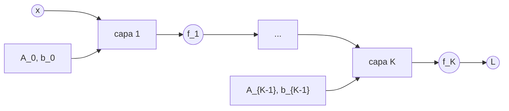
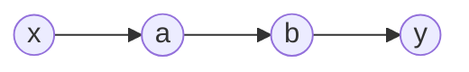
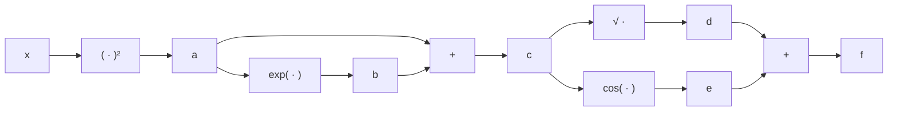

!!! warning

    El contenido de esta página no ha sido revisado ni corregido, por lo que puede
    estar incompleto, contener errores o presentar información desactualizada. Además,
    es posible que esté desordenado, carezca de una estructura clara o incluya notas
    copiadas directamente.

Numerosos algoritmos de aprendizaje automático optimizan una función objetivo respecto a
un conjunto de parámetros que determinan en qué medida el modelo explica los datos. La
regresión lineal, donde se ajusta una curva optimizando los pesos para maximizar la
verosimilitud, o los _autoencoders_ empleados en reducción de dimensionalidad y
compresión de datos, donde se minimiza un error de reconstrucción mediante la aplicación
repetida de la regla de la cadena, son dos ejemplos representativos.

Este capítulo recorre el cálculo vectorial que sustenta ese proceso de optimización,
desde las derivadas parciales y el gradiente hasta la retropropagación y la
diferenciación automática. Complementa el material de
[fundamentos matemáticos](section_2_deep_learning_math.md), cuyos conceptos de vector,
matriz y norma se emplean aquí sin volver a introducirlos.

## Bibliografía

- Deisenroth, M. P., Faisal, A. A., y Ong, C. S. (2020). _Mathematics for Machine
  Learning_. Cambridge University Press. <https://mml-book.github.io/>
- Baydin, A. G., Pearlmutter, B. A., Radul, A. A., y Siskind, J. M. (2018). Automatic
  differentiation in machine learning: a survey. _Journal of Machine Learning Research_,
  18(153). <https://jmlr.org/papers/v18/17-468.html>

## Diferenciación de funciones univariadas

La derivada de una función mide su razón de cambio. Partiendo del cociente incremental
entre la variación de la función y la variación de la variable, la definición formal
toma el límite cuando ese incremento tiende a cero:

$$
\frac{\partial y}{\partial x} = \lim_{h \to 0} \frac{f(x+h) - f(x)}{h}
$$

Geométricamente, la derivada representa la pendiente de la recta tangente a la gráfica
de la función en un punto.

Cuando la función depende de varias variables, la **derivada parcial** respecto a una de
ellas se obtiene derivando como de costumbre y tratando las demás como constantes. Para
la función $v = 2z^{3} - 3x^{2}z - 3y^{2}z$ las tres derivadas parciales resultan:

$$
\frac{\partial v}{\partial x} = -6xz \qquad \frac{\partial v}{\partial y} = -6yz
\qquad \frac{\partial v}{\partial z} = 6z^{2} - 3x^{2} - 3y^{2}
$$

### Aproximación local de una función

Buena parte de la optimización en inteligencia artificial se apoya en una idea sencilla:
una función complicada puede aproximarse, en el entorno de un punto, por algo mucho más
simple. La aproximación de primer orden alrededor de $x_0$ es:

$$
f(x) \approx f(x_0) + f'(x_0)(x - x_0)
$$

Esto es exactamente lo que hace el descenso del gradiente en cada paso: sustituir la
función de pérdida por su aproximación lineal en el punto actual y moverse en la
dirección que la reduce. La aproximación solo es fiable cerca de $x_0$, lo que explica
por qué la tasa de aprendizaje debe ser pequeña y por qué un paso demasiado grande puede
empeorar la pérdida en lugar de mejorarla. Añadir el término de segundo orden da la
aproximación cuadrática, que incorpora la curvatura y es la base de los métodos tipo
Newton tratados más adelante.

Entre las propiedades de las derivadas, la más relevante en este contexto es la **regla
de la cadena**, que permite derivar funciones compuestas y, por tanto, entrenar redes de
varias capas. Derivando $h(x) = (2x+1)^{4}$ mediante esta regla:

$$
h'(x) = 4 (2x+1)^{3} \cdot 2 = 8(2x+1)^{3}
$$

## Derivadas parciales y gradientes

El **gradiente** de una función $f$ respecto a un vector $\mathbf{x}$ se obtiene
variando una variable a la vez y manteniendo las demás constantes. Recoge todas las
derivadas parciales en un vector fila:

$$
\nabla_{\mathbf{x}} f = \mathrm{grad}\, f = \frac{\partial f}{\partial \mathbf{x}} =
\left\lbrack \frac{\partial f}{\partial x_1} \quad \frac{\partial f}{\partial x_2}
\quad \ldots \quad \frac{\partial f}{\partial x_n} \right\rbrack \in \mathbb{R}^{1
\times n}
$$

donde $n$ es el número de variables y el 1 corresponde a la dimensión del codominio de
$f$. Este vector fila se denomina gradiente de $f$ o, de forma equivalente en el caso
escalar, Jacobiano.

Para la función $f(x,y) = (x + 2y^{3})^{2}$, aplicando la regla de la cadena a cada
variable:

$$
\frac{\partial f}{\partial x} = 2(x + 2y^{3}) \qquad \frac{\partial f}{\partial y} =
12y^{2}(x + 2y^{3})
$$

Y para $f(x_1, x_2) = x_1^{2}x_2 + x_1 x_2^{3}$ el gradiente completo resulta:

$$
\nabla_{\mathbf{x}} f = \left\lbrack 2x_1 x_2 + x_2^{3} \quad x_1^{2} + 3x_1 x_2^{2}
\right\rbrack \in \mathbb{R}^{1 \times 2}
$$

Esta formulación presenta dos ventajas. La primera es que el gradiente se generaliza de
forma sistemática a funciones de valor vectorial, en cuyo caso se convierte en una
matriz. La segunda es que la regla de la cadena multivariante puede aplicarse sin
atender explícitamente a la dimensión del gradiente.

### Regla de la cadena multivariante

Cuando una función depende de variables que a su vez dependen de un parámetro común, el
gradiente respecto a ese parámetro suma las contribuciones de cada camino:

$$
\frac{\partial f}{\partial t} = \frac{\partial f}{\partial x_1} \frac{\partial
x_1}{\partial t} + \frac{\partial f}{\partial x_2} \frac{\partial x_2}{\partial t}
$$

Tomando $f(x_1, x_2) = x_1^{2} + 2x_2$ con $x_1 = \sin t$ y $x_2 = \cos t$, la derivada
respecto a $t$ resulta:

$$
\frac{\partial f}{\partial t} = 2\sin t \cos t - 2\sin t = 2\sin t (\cos t - 1)
$$

### Gradientes de funciones con valor vectorial

Para una función $f: \mathbb{R}^{n} \to \mathbb{R}^{m}$ y un vector $\mathbf{x} =
\lbrack x_1, \ldots, x_n \rbrack^{T} \in \mathbb{R}^{n}$, el vector de valores de la
función se escribe como:

$$
f(\mathbf{x}) = \begin{bmatrix} f_1(\mathbf{x}) \\ \vdots \\ f_m(\mathbf{x})
\end{bmatrix} \in \mathbb{R}^{m}
$$

La derivada parcial respecto a una componente $x_i$ es a su vez un vector que recoge la
derivada de cada función componente:

$$
\frac{\partial f}{\partial x_i} = \begin{bmatrix} \frac{\partial f_1}{\partial
x_i} \\ \vdots \\ \frac{\partial f_m}{\partial x_i} \end{bmatrix}
$$

La colección de todas las derivadas parciales de primer orden de una función con valor
vectorial se denomina **Jacobiano**. Se trata de una matriz de dimensión $m \times n$
definida por:

$$
\mathbf{J} = \nabla_{\mathbf{x}} f = \frac{\partial f(\mathbf{x})}{\partial \mathbf{x}}
= \left\lbrack \frac{\partial f(\mathbf{x})}{\partial x_1} \quad \ldots \quad
\frac{\partial f(\mathbf{x})}{\partial x_n} \right\rbrack
$$

Para el sistema $y_1 = -2x_1 + x_2$ e $y_2 = x_1 + x_2$, las cuatro derivadas parciales
son $\partial y_1/\partial x_1 = -2$, $\partial y_1/\partial x_2 = 1$, $\partial
y_2/\partial x_1 = 1$ y $\partial y_2/\partial x_2 = 1$, lo que da el Jacobiano:

$$
\mathbf{J} = \begin{bmatrix} -2 & 1 \\ 1 & 1 \end{bmatrix}
$$

El Jacobiano representa la transformación de coordenadas asociada a la función. Si esa
transformación es no lineal, el Jacobiano la aproxima localmente mediante una
transformación lineal. El valor absoluto de su determinante es el factor por el cual se
escalan las áreas o los volúmenes al transformar las coordenadas.

### Gradientes de matrices

En determinadas situaciones es necesario calcular gradientes de matrices respecto a
vectores o respecto a otras matrices, lo que da como resultado un tensor
multidimensional. Este tensor puede entenderse como una estructura que recoge derivadas
parciales organizadas en varias dimensiones. Para una matriz $\mathbf{A} \in
\mathbb{R}^{4 \times 2}$ derivada respecto a un vector $\mathbf{x} \in \mathbb{R}^{3}$,
cada derivada parcial $\partial \mathbf{A} / \partial x_i$ es una matriz de
$\mathbb{R}^{4 \times 2}$, y al agrupar las tres se obtiene un tensor de $\mathbb{R}^{4
\times 2 \times 3}$.

## Retropropagación y diferenciación automática

En numerosas aplicaciones de la inteligencia artificial los parámetros adecuados del
modelo se encuentran mediante descenso del gradiente, lo que exige poder calcular el
gradiente del objetivo de aprendizaje respecto a dichos parámetros. Ese gradiente se
obtiene aplicando la regla de la cadena. Sin embargo, una implementación descuidada
puede resultar más costosa de computar que la propia evaluación de la función. Para el
entrenamiento de modelos de aprendizaje profundo, el algoritmo de **retropropagación**
constituye la forma eficiente de realizar este cálculo.

### Gradientes en una red profunda

La regla de la cadena se aplica en aprendizaje profundo porque el valor de salida se
calcula como una composición de funciones organizadas en niveles:

$$
y = (f_K \circ f_{K-1} \circ \ldots \circ f_1)(\mathbf{x}) =
f_K(f_{K-1}(\ldots(f_1(\mathbf{x}))\ldots))
$$

donde $\mathbf{x}$ son las entradas, por ejemplo imágenes, $y$ las observaciones, por
ejemplo etiquetas de clase, y cada función $f_i$ con $i = 1, \ldots, K$ posee sus
propios parámetros.

En las redes neuronales con múltiples capas, la función de la capa $i$ toma la forma
$f_i(\mathbf{x}_{i-1}) = \sigma(\mathbf{A}_{i-1} \mathbf{x}_{i-1} + \mathbf{b}_{i-1})$,
donde $\mathbf{x}_{i-1}$ es la salida de la capa anterior y $\sigma$ la función de
activación, que puede ser la sigmoide logística $\frac{1}{1+e^{-x}}$, la tangente
hiperbólica o una unidad lineal rectificada. Entrenar estos modelos requiere el
gradiente de una función de pérdida $L$ respecto a todos los parámetros $\mathbf{A}_j$ y
$\mathbf{b}_j$, lo que a su vez exige calcular el gradiente respecto a las entradas de
cada capa.

Dada una estructura de red definida por $f_0 := \mathbf{x}_0$ y $f_i :=
\sigma_i(\mathbf{A}_{i-1} f_{i-1} + \mathbf{b}_{i-1})$ para $i = 1, \ldots, K$, el
objetivo consiste en encontrar los parámetros que minimizan la pérdida cuadrática:

$$
L(\theta) = \lVert y - f_K(\theta, \mathbf{x}) \rVert^{2}
$$

$$
\theta = \{\mathbf{A}_0, \mathbf{b}_0, \ldots, \mathbf{A}_{K-1}, \mathbf{b}_{K-1}\}
$$

Para obtener el gradiente respecto al conjunto $\theta$ se necesitan las derivadas
parciales de la pérdida respecto a los parámetros $\theta_j = \{\mathbf{A}_j,
\mathbf{b}_j\}$ de cada capa $j = 0, \ldots, K-1$. La regla de la cadena permite
escribirlas de forma recursiva. Para la última capa:

$$
\frac{\partial L}{\partial \theta_{K-1}} = \frac{\partial L}{\partial f_K}
\frac{\partial f_K}{\partial \theta_{K-1}}
$$

Para la penúltima aparece un factor adicional que propaga el gradiente una capa hacia
atrás:

$$
\frac{\partial L}{\partial \theta_{K-2}} = \frac{\partial L}{\partial f_K}
\frac{\partial f_K}{\partial f_{K-1}} \frac{\partial f_{K-1}}{\partial \theta_{K-2}}
$$

El patrón se generaliza a una capa arbitraria $i$ como un producto de factores
intermedios:

$$
\frac{\partial L}{\partial \theta_i} = \frac{\partial L}{\partial f_K}
\frac{\partial f_K}{\partial f_{K-1}} \ldots \frac{\partial f_{i+2}}{\partial f_{i+1}}
\frac{\partial f_{i+1}}{\partial \theta_i}
$$

En estas expresiones conviene distinguir dos tipos de factores. Los términos de la forma
$\partial f_{k}/\partial f_{k-1}$ son derivadas parciales de la salida de una capa
respecto a sus entradas, y son los que permiten propagar el gradiente hacia atrás. Los
términos de la forma $\partial f_{i+1}/\partial \theta_i$ son derivadas parciales de la
salida de una capa respecto a sus propios parámetros, y son los que finalmente se
emplean para actualizarlos.

### Diferenciación automática

La retropropagación es un caso particular de una técnica general del análisis numérico
denominada **diferenciación automática**. Se trata de un conjunto de métodos para
evaluar numéricamente el gradiente exacto de una función trabajando con variables
intermedias y aplicando la regla de la cadena sobre operaciones aritméticas elementales
de suma y producto junto con funciones elementales. Al aplicar la regla de la cadena a
estas operaciones, el gradiente de funciones considerablemente complicadas se calcula de
forma automática.

Considerando una cadena de dependencias donde $x$ determina $a$, que determina $b$, que
a su vez determina $y$:

La derivada se expresa como el producto de los factores intermedios:

$$
\frac{dy}{dx} = \frac{dy}{db} \frac{db}{da} \frac{da}{dx}
$$

Gracias a la propiedad asociativa del producto de matrices, este cálculo admite dos
agrupaciones distintas. La primera agrupa los factores comenzando por la salida:

$$
\frac{dy}{dx} = \left( \frac{dy}{db} \frac{db}{da} \right) \frac{da}{dx}
$$

Y la segunda comienza por la entrada:

$$
\frac{dy}{dx} = \frac{dy}{db} \left( \frac{db}{da} \frac{da}{dx} \right)
$$

La primera corresponde al **modo inverso**, denominado así porque los gradientes se
propagan hacia atrás, en sentido contrario al flujo de datos. La segunda corresponde al
**modo directo**, donde los gradientes fluyen junto con los datos. En las redes
neuronales, donde el número de parámetros es muy superior al número de salidas, el modo
inverso resulta significativamente más económico de computar, razón por la cual es el
que implementan las bibliotecas de aprendizaje profundo.

El uso de variables intermedias permite además reutilizar cálculos. Para la función:

$$
f(x) = \sqrt{x^2 + \exp(x^2)} + \cos\left(x^2 + \exp(x^2)\right)
$$

se definen las variables intermedias $a = x^2$, $b = \exp(a)$, $c = a + b$, $d =
\sqrt{c}$ y $e = \cos(c)$, de modo que el resultado final es $f = d + e$. El grafo de
cómputo resultante evita recalcular las subexpresiones repetidas:

### Derivadas de orden superior

En determinados contextos resultan necesarias las derivadas de orden superior, como en
el método de Newton para optimización, que requiere derivadas de segundo orden. La
colección de todas las derivadas parciales de segundo orden se denomina **matriz
Hessiana** y se denota $\nabla^2_{x,y} f(x,y)$:

$$
\mathbf{H} = \begin{bmatrix}
\dfrac{\partial^2 f}{\partial x^2} & \dfrac{\partial^2 f}{\partial x \partial y} \\
\dfrac{\partial^2 f}{\partial x \partial y} & \dfrac{\partial^2 f}{\partial y^2}
\end{bmatrix}
$$

La Hessiana mide la curvatura de la función localmente alrededor del punto considerado.
En la práctica del aprendizaje profundo casi nunca se calcula de forma explícita, porque
su tamaño crece con el cuadrado del número de parámetros, pero su estructura explica el
comportamiento del entrenamiento. Los autovalores de la Hessiana determinan si un punto
crítico es un mínimo o un punto de silla, y su condicionamiento acota la tasa de
aprendizaje admisible. Optimizadores como Adam pueden entenderse como aproximaciones
económicas a esta información de curvatura.

Los fundamentos de probabilidad y distribuciones que completan este aparato matemático,
y que sustentan los modelos probabilísticos, se tratan en el capítulo de
[estadística](section_1_statistics.md).
