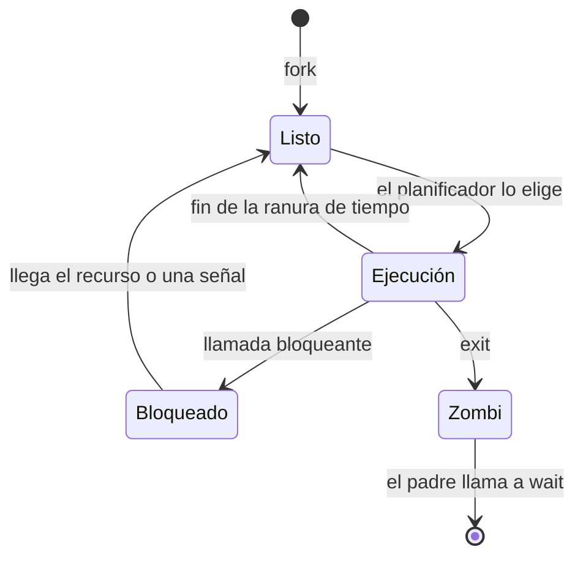

!!! warning

    El contenido de esta página no ha sido revisado ni corregido, por lo que puede
    estar incompleto, contener errores o presentar información desactualizada. Además,
    es posible que esté desordenado, carezca de una estructura clara o incluya notas
    copiadas directamente.

Este capítulo explica cómo un programa C crea y controla otros procesos en Linux.
Describe la clonación con `fork`, el contrato entre padre e hijo y la recogida de hijos
con `wait` y `waitpid`, los procesos zombis y huérfanos, la sustitución de un programa
por otro con la familia `exec`, la herencia del entorno y la construcción de una versión
propia de `system`.

## Introducción

Un **proceso** es un programa en ejecución. El
[capítulo de Linux](../../01_operative_systems/01_linux/section_1_fundamentals.md)
describe su identificador (PID), el del padre (PPID), los estados que puede adoptar y
las órdenes `ps`, `top` y `kill`, y no se repite aquí. Todos los procesos descienden del
que recibe el PID 1, y los PID son siempre mayores que 0. Cuando una _shell_ lanza un
programa, la _shell_ es el padre y el programa el hijo.

Desde C, un proceso conoce su identificador con `getpid()` y el de su padre con
`getppid()`, ambos de tipo `pid_t` y declarados en `unistd.h`. La comparación entre
procesos e hilos se desarrolla en el apartado de
[procesos e hilos en Unix](../07_concurrency/section_1_fundamentals.md) del módulo de
concurrencia. Los ejemplos de este capítulo suponen los conceptos de los capítulos de
[fundamentos](section_1_fundamentals.md) y [archivos](section_2_files.md).

## Concurrencia y planificación

Cuando varios procesos coexisten, el _kernel_ debe decidir cuál usa cada procesador en
cada momento. El **planificador** (_scheduler_) mantiene una cola con los procesos
listos para ejecutarse y va asignándoles procesador. Ningún proceso puede ocupar la CPU
indefinidamente: cada uno recibe un tiempo máximo, llamado **ranura de tiempo** (_time
slice_), y cuando se agota pasa de nuevo a la cola de listos.

Las llamadas al sistema son **bloqueantes** cuando pueden sacar al proceso de la CPU
para esperar un recurso, como datos de un archivo, de una tubería o una señal, y **no
bloqueantes** en caso contrario. Mientras espera, el proceso está bloqueado y no consume
CPU. Al llegar el recurso vuelve a la cola de listos y, tras ser elegido, a ejecución.
El diagrama resume estos estados y el final de un proceso, el estado zombi, que se
explica en los apartados siguientes.



El orden en que el planificador ejecuta los procesos no está en manos del programador, y
los ejemplos que siguen están construidos para que su salida no dependa de él.

## Clonación con fork

Para atender a varios clientes o tareas a la vez, un proceso crea copias de sí mismo. La
llamada `fork()` produce un **clon** (el proceso **hijo**) del proceso original (el
**padre**). El hijo es una copia en memoria del padre, con el mismo código y el mismo
contenido en la pila y el montón, y comienza a ejecutarse en la línea siguiente a la
llamada a `fork`. Desde ese momento la memoria de los dos es independiente, de manera
que si el clon cambia una variable o reserva memoria nueva, el original no lo percibe.
Los descriptores de archivos abiertos antes del `fork` también se copian, por lo que el
hijo accede a los mismos archivos y canales que el padre.

Para que cada proceso sepa quién es, `fork` devuelve valores distintos:

| Valor devuelto | Significado                                                   |
| -------------- | ------------------------------------------------------------- |
| Menor que 0    | Error: no se creó el hijo (`errno` indica la causa).          |
| 0              | El proceso actual es el hijo.                                 |
| Mayor que 0    | El proceso actual es el padre, y el valor es el PID del hijo. |

A partir de este valor, el código se divide en una zona exclusiva del padre y una zona
exclusiva del hijo. Tras el `fork`, ambos procesos esperan en la cola de listos y no se
puede suponer cuál se ejecutará antes.

???+ example "Zonas exclusivas de padre e hijo"

    El hijo duplica su copia de `x` y el padre conserva el valor original, lo que
    muestra que las memorias son independientes. El padre espera al hijo con `waitpid`
    para que la salida salga siempre en el mismo orden.

    ```c linenums="1"
    #include <stdio.h>
    #include <stdlib.h>
    #include <sys/types.h>
    #include <sys/wait.h>
    #include <unistd.h>

    int main(void) {
        int x = 5;
        pid_t pid_padre = getpid();

        // A partir de aquí hay dos procesos que continúan en la siguiente línea
        pid_t pid = fork();
        if (pid < 0) {
            perror("Error en fork");
            exit(1);
        }

        if (pid == 0) {
            // Zona exclusiva del hijo: fork devolvió 0
            x = x * 2;
            printf("[hijo]  x = %d, mi padre es el original: %s\n", x,
                   getppid() == pid_padre ? "sí" : "no");
            // El hijo siempre termina en su zona exclusiva
            exit(0);
        }

        // Zona exclusiva del padre: fork devolvió el PID del hijo
        // Se espera al hijo para que la salida sea reproducible y no quede zombi
        waitpid(pid, NULL, 0);
        printf("[padre] x = %d, el hijo ha terminado\n", x);
        return 0;
    }
    ```

    ```plaintext title="Expected output"
    [hijo]  x = 10, mi padre es el original: sí
    [padre] x = 5, el hijo ha terminado
    ```

!!! warning "Los _buffers_ de `stdio` se duplican con `fork`"

    Si el proceso tiene texto pendiente en el _buffer_ de `stdout` en el momento de
    llamar a `fork`, tanto el padre como el hijo lo vacían después y el texto aparece
    dos veces. El problema se manifiesta cuando la salida se redirige a un archivo o a
    una tubería, porque en un terminal el _buffer_ se vacía en cada salto de línea.
    Basta con llamar a `fflush(stdout)` antes de `fork`.

### Creación de varios hijos

Para crear varios hijos se llama a `fork` dentro de un bucle. El hijo debe terminar
siempre en su zona exclusiva con `exit`, porque si no, continuaría ejecutando el bucle y
crearía sus propios hijos, con un crecimiento exponencial del número de procesos que
puede colapsar el sistema. Es la primera norma del contrato entre padres e hijos que se
detalla a continuación.

???+ example "Creación de varios hijos y recogida de sus códigos de salida"

    El padre guarda el PID de cada hijo y los recoge después con `waitpid`, que admite
    un PID concreto y rellena un estado del que se extrae el código de salida con
    `WIFEXITED` y `WEXITSTATUS`.

    ```c linenums="1"
    #include <stdio.h>
    #include <stdlib.h>
    #include <sys/types.h>
    #include <sys/wait.h>
    #include <unistd.h>

    #define NUM_HIJOS 3

    int main(void) {
        pid_t hijos[NUM_HIJOS];

        for (int i = 0; i < NUM_HIJOS; i++) {
            hijos[i] = fork();
            if (hijos[i] < 0) {
                perror("Error en fork");
                exit(1);
            }
            if (hijos[i] == 0) {
                // Trabajo del hijo i y salida inmediata: no debe seguir el bucle
                exit(10 + i);
            }
        }

        // El padre recoge a cada hijo por su PID, en el orden de creación
        for (int i = 0; i < NUM_HIJOS; i++) {
            int estado;
            if (waitpid(hijos[i], &estado, 0) == -1) {
                perror("Error en waitpid");
                exit(1);
            }
            if (WIFEXITED(estado))
                printf("Hijo %d terminó con código %d\n", i, WEXITSTATUS(estado));
        }
        return 0;
    }
    ```

    ```plaintext title="Expected output"
    Hijo 0 terminó con código 10
    Hijo 1 terminó con código 11
    Hijo 2 terminó con código 12
    ```

## El contrato entre padre e hijo

Trabajar con procesos emparentados impone unas normas que garantizan que el sistema no
se llena de procesos inútiles:

- Los hijos deben acabar siempre su ejecución en su zona exclusiva con `exit`.
- El padre debe acabar más tarde que sus hijos.
- El padre debe evitar que sus hijos se conviertan en zombis.

Un **proceso zombi** es un hijo que ya ha terminado pero cuyo padre todavía no ha
consultado su estado. Cuando un proceso termina, el _kernel_ lo retira de la memoria y
de la lista de procesos ejecutables, pero conserva una entrada mínima con su código de
salida hasta que el padre da su consentimiento para liberarla. Mientras tanto el hijo
queda en estado difunto (`Z` en la salida de `ps`). Un zombi no consume CPU, pero ocupa
una entrada de la tabla de procesos, y un servidor que genere miles de ellos puede
agotarla.

El padre da ese consentimiento con `wait`, que bloquea hasta que termina algún hijo, lo
recoge y devuelve su PID, y con `waitpid(pid, &estado, opciones)`, que permite esperar a
un hijo concreto o a cualquiera con `-1`. El argumento `estado` puede ser `NULL` si no
interesa el código de salida. Esta espera bloquea al padre, lo que anula la concurrencia
que se buscaba al crear hijos, porque un servidor no puede quedarse parado esperando
mientras llegan nuevas peticiones.

La solución es que el padre no espere de forma explícita, sino que el _kernel_ le avise.
Cuando un hijo termina, el _kernel_ envía al padre la señal `SIGCHLD`, y basta con
instalar un manejador que ejecute `wait`.

!!! warning "Las señales no se encolan"

    Si varios hijos terminan a la vez, el padre puede recibir una sola señal `SIGCHLD`.
    Un manejador que llame a `wait` una vez dejaría zombis, de manera que debe repetirse
    `waitpid` con la opción `WNOHANG`, que no bloquea y devuelve 0 si no quedan hijos
    terminados. Los detalles de `sigaction` y de lo que puede hacerse dentro de un
    manejador se explican en el [capítulo de señales](section_5_signals.md).

???+ example "Recogida de hijos con un manejador de SIGCHLD"

    El manejador guarda y restaura `errno` porque `waitpid` puede modificarlo, y recoge
    todos los hijos disponibles. El programa principal espera a que se hayan recogido
    todos.

    ```c linenums="1"
    #define _DEFAULT_SOURCE
    #include <errno.h>
    #include <signal.h>
    #include <stdio.h>
    #include <stdlib.h>
    #include <sys/types.h>
    #include <sys/wait.h>
    #include <unistd.h>

    #define NUM_HIJOS 5

    static volatile sig_atomic_t recogidos = 0;

    void recoger_hijos(int sig) {
        (void)sig;
        // waitpid puede modificar errno y el manejador no debe alterarlo
        int errno_previo = errno;
        // Varias señales SIGCHLD pueden fundirse en una: se recogen todos los hijos
        while (waitpid(-1, NULL, WNOHANG) > 0)
            recogidos++;
        errno = errno_previo;
    }

    int main(void) {
        struct sigaction accion = {0};
        accion.sa_handler = recoger_hijos;
        sigemptyset(&accion.sa_mask);
        // SA_RESTART reinicia las llamadas interrumpidas y SA_NOCLDSTOP ignora las
        // notificaciones de hijos que solo se han detenido
        accion.sa_flags = SA_RESTART | SA_NOCLDSTOP;
        sigaction(SIGCHLD, &accion, NULL);

        for (int i = 0; i < NUM_HIJOS; i++) {
            pid_t pid = fork();
            if (pid < 0) {
                perror("Error en fork");
                exit(1);
            }
            if (pid == 0)
                exit(0);
        }

        // sleep se interrumpe con cada señal; el bucle acota la espera a 1 s
        while (recogidos < NUM_HIJOS)
            sleep(1);
        printf("Hijos recogidos: %d\n", (int)recogidos);
        return 0;
    }
    ```

    ```plaintext title="Expected output"
    Hijos recogidos: 5
    ```

Existe una alternativa más corta cuando el padre no necesita el código de salida de sus
hijos: `signal(SIGCHLD, SIG_IGN)` indica al _kernel_ que descarte esa información, y los
hijos desaparecen al terminar sin dejar zombis. No es posible mezclar este mecanismo con
`wait` para obtener el estado.

## Procesos huérfanos

Un **proceso huérfano** es un hijo cuyo padre termina antes que él. El _kernel_ lo
reasigna a otro proceso, normalmente el de PID 1 o un proceso de sistema equivalente,
que lo recoge cuando termina, de modo que no se convierte en zombi. El síntoma
observable es que `getppid()` cambia de valor: un hijo que compare su `getppid()` con el
PID original de su padre detecta así que este ha terminado. En el software de
comunicaciones no suele ocurrir porque el padre vive mientras haya trabajo pendiente, y
por eso el contrato exige que el padre acabe más tarde que sus hijos. Sí hay que tenerlo
presente cuando un proceso envía una señal a su padre o a su hijo, porque el
destinatario puede haber desaparecido antes de recibirla.

## Mutación con exec

La llamada `fork` solo crea copias del mismo programa. Para ejecutar un programa
distinto se usa la familia `exec`, que provoca una **mutación**: el proceso conserva su
PID y sigue siendo hijo del mismo padre, pero se descarga por completo de memoria, carga
el programa nuevo y lo ejecuta desde el principio de su `main`. Por eso, si la llamada
tiene éxito, el código que la sigue **nunca se ejecuta**. Solo se vuelve de `exec`
cuando falla, con resultado `-1`, y entonces conviene informar del error y terminar.

La llamada `execl(ruta, arg0, arg1, ..., NULL)` recibe una cantidad variable de
argumentos. El primero es la ruta del ejecutable, y el resto son las cadenas que
formarán el `argv` del programa nuevo, empezando por `argv[0]`, que por convención
repite el nombre. La lista debe terminar en `NULL`, convertido a `(char *)` para evitar
avisos. Las variantes se distinguen por las letras que siguen a `exec`:

| Variante          | Cómo se pasan los argumentos             | Búsqueda del programa         | Entorno    |
| ----------------- | ---------------------------------------- | ----------------------------- | ---------- |
| `execl`           | Lista terminada en `NULL`.               | Ruta completa.                | Heredado.  |
| `execlp`          | Lista terminada en `NULL`.               | En los directorios de `PATH`. | Heredado.  |
| `execle`          | Lista terminada en `NULL`.               | Ruta completa.                | Se indica. |
| `execv`, `execvp` | _Array_ de punteros terminado en `NULL`. | Ruta completa o `PATH`.       | Heredado.  |
| `execve`          | _Array_ de punteros terminado en `NULL`. | Ruta completa.                | Se indica. |

La `l` significa lista de argumentos, la `v` vector, la `p` búsqueda en `PATH` y la `e`
entorno explícito. La forma de vector resulta cómoda cuando el número de argumentos se
conoce solo en tiempo de ejecución.

???+ example "Hijos que mutan en otros programas"

    El primer hijo ejecuta `date` buscándolo en `PATH` y el segundo `echo` con ruta
    completa. El argumento `-d @0` fija la fecha en el instante cero para que la salida
    sea reproducible. El padre espera a cada hijo antes de crear el siguiente.

    ```c linenums="1"
    #include <stdio.h>
    #include <stdlib.h>
    #include <sys/types.h>
    #include <sys/wait.h>
    #include <unistd.h>

    int main(void) {
        for (int i = 0; i < 2; i++) {
            pid_t pid = fork();
            if (pid < 0) {
                perror("Error en fork");
                exit(1);
            }
            if (pid == 0) {
                if (i == 0)
                    // execlp busca date en PATH y -d @0 fija el instante cero
                    execlp("date", "date", "-u", "-d", "@0", (char *)NULL);
                else
                    // execl exige la ruta completa; el primer argumento es argv[0]
                    execl("/bin/echo", "echo", "hijo impar", (char *)NULL);

                // Solo se llega aquí si exec ha fallado
                perror("Error en exec");
                exit(1);
            }
            // Se espera a cada hijo para que la salida salga en orden
            waitpid(pid, NULL, 0);
        }
        return 0;
    }
    ```

    ```plaintext title="Expected output"
    Thu Jan  1 00:00:00 UTC 1970
    hijo impar
    ```

La combinación `fork` seguida de `exec` es la forma habitual en que una _shell_ lanza un
programa: se clona la _shell_ y el clon muta en el programa pedido, mientras el padre
espera o continúa. El patrón se conoce como _fork-exec_.

## Entorno de un proceso

Además de sus argumentos, cada proceso recibe un **entorno**, una lista de variables de
la forma `NOMBRE=valor` como `PATH` o `HOME`. Se consulta con `getenv("NOMBRE")`, que
devuelve el valor o `NULL`, y se modifica con `setenv(nombre, valor, sobrescribir)` y
`unsetenv(nombre)`. El entorno vive en la memoria del proceso, de modo que `fork` lo
copia y `exec` lo conserva en las variantes `execl`, `execlp`, `execv` y `execvp`. Esto
implica que las variables definidas por un proceso las ven sus descendientes, pero un
hijo nunca puede modificar el entorno de su padre. Las variantes `execle` y `execve`
sustituyen el entorno completo por el que se indica, un _array_ de cadenas
`NOMBRE=valor` terminado en `NULL`, como en
`execle("/usr/bin/env", "env", (char *)NULL, entorno)`, que solo muestra las variables
de `entorno`.

## Una versión propia de system

La función `system(comando)` de la biblioteca estándar ejecuta un comando desde un
programa. Por dentro combina la clonación y la mutación: crea un hijo con `fork`, que
ejecuta con `exec` una _shell_ que interpreta el comando, mientras el padre espera con
`waitpid` a que acabe. Reproducir ese comportamiento, limitado a un programa sin
argumentos, ilustra las tres piezas juntas.

???+ example "Implementación mínima de system"

    El hijo muta en el programa con `execlp`, y si no lo encuentra termina con 127, el
    código que usa la _shell_ para un comando no encontrado. El padre espera a que el
    hijo termine y devuelve su código de salida.

    ```c linenums="1"
    #include <stdio.h>
    #include <stdlib.h>
    #include <sys/types.h>
    #include <sys/wait.h>
    #include <unistd.h>

    // Ejecuta un programa sin argumentos y devuelve su código de salida, o -1 si falla
    int mi_system(const char *comando) {
        pid_t pid = fork();
        if (pid < 0) {
            perror("Error en fork");
            return -1;
        }

        if (pid == 0) {
            execlp(comando, comando, (char *)NULL);
            // exec ha fallado: 127 es el código que usa la shell para "no encontrado"
            perror(comando);
            exit(127);
        }

        // El padre espera y traduce el estado a un código de salida
        int estado;
        if (waitpid(pid, &estado, 0) == -1)
            return -1;
        return WIFEXITED(estado) ? WEXITSTATUS(estado) : -1;
    }

    int main(int argc, char *argv[]) {
        if (argc < 2) {
            fprintf(stderr, "Uso: %s comando\n", argv[0]);
            return 1;
        }
        int codigo = mi_system(argv[1]);
        printf("Código de salida de %s: %d\n", argv[1], codigo);
        return 0;
    }
    ```

    ```bash linenums="1"
    ./mi_system false
    ./mi_system noexiste
    ```

    ```plaintext title="Expected output"
    Código de salida de false: 1
    noexiste: No such file or directory
    Código de salida de noexiste: 127
    ```

!!! danger "Componer comandos con cadenas abre la puerta a la inyección"

    Construir la ruta del programa o el comando con `strcat` en un _buffer_ de tamaño
    fijo, como `"/bin/" + comando`, desborda el _buffer_ con nombres largos. Pasar a
    `system` una cadena que contiene datos del usuario permite que la _shell_ interprete
    caracteres como `;` o `|`, de modo que un nombre como `; rm -rf ~` ejecutaría un
    segundo comando. Es más seguro invocar el programa con `execv` y entregar cada
    argumento por separado, sin pasar por la _shell_.

Es un error frecuente poner la espera en el sitio equivocado: un `wait` en el hijo antes
del `exec` no hace nada, porque el hijo todavía no tiene hijos propios, y no sustituye
al `waitpid` del padre, sin el cual el hijo queda como zombi hasta que el padre termina.

## Servidor concurrente con fork

El uso más frecuente de `fork` en el software de comunicaciones es atender varias
peticiones a la vez. El proceso de servicio es un bucle infinito. En cada vuelta espera
una petición y, al llegar, crea un hijo que la atiende mientras el padre vuelve de
inmediato a esperar la siguiente. Se combina con un manejador de `SIGCHLD` para que los
hijos no queden como zombis. El esquema siguiente usa funciones auxiliares que dependen
del tipo de petición y no se definen aquí.

```c linenums="1"
// Manejador de SIGCHLD que recoge a los hijos con waitpid y WNOHANG
instalar_manejador_sigchld();

while (1) {
    // El padre se bloquea hasta que llega una petición
    int peticion = esperar_peticion();

    pid_t pid = fork();
    if (pid < 0) {
        perror("Error en fork");
        exit(1);
    }
    if (pid == 0) {
        // El hijo atiende la petición y termina siempre con exit
        atender(peticion);
        exit(0);
    }
    // El padre cierra su copia de la petición y vuelve al bucle
    cerrar_peticion(peticion);
}
```

El [capítulo de _sockets_](section_7_sockets.md) lo completa con `accept`, donde la
petición es una conexión de red. Por la herencia de descriptores, cada copia debe
cerrarse en los dos procesos: el padre cierra el descriptor de la conexión tras el
`fork` y el hijo cierra el del _socket_ de escucha. Si el padre no cierra el suyo, la
conexión nunca llega a verse terminada. Un servidor real debería además limitar el
número de hijos simultáneos, porque un cliente que abra conexiones sin parar podría
agotar los procesos disponibles.

Los procesos creados con `fork` tienen memorias separadas, así que para colaborar
necesitan un mecanismo de comunicación. El [siguiente capítulo](section_4_ipc.md)
presenta el más básico, las tuberías, y el de [señales](section_5_signals.md) el aviso
asíncrono entre procesos.
