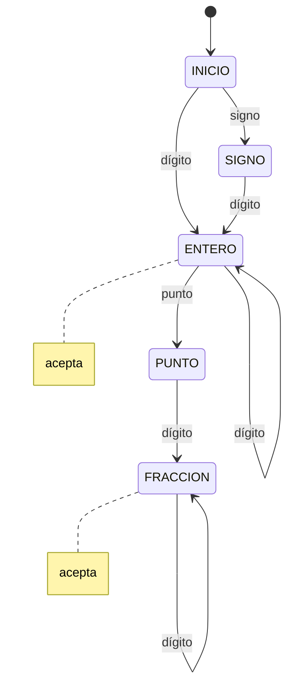

!!! warning

    El contenido de esta página no ha sido revisado ni corregido, por lo que puede
    estar incompleto, contener errores o presentar información desactualizada. Además,
    es posible que esté desordenado, carezca de una estructura clara o incluya notas
    copiadas directamente.

Este capítulo presenta las máquinas de estados finitos como modelo para organizar
programas que reaccionan a sucesos externos. Se parte de la teoría (estados, eventos,
transiciones y acciones, con las variantes de Mealy y de Moore), se implementa un
reconocedor completo en C con una tabla de transiciones y se revisan las fuentes de
eventos habituales: bytes de un flujo, señales, varios descriptores y temporizadores.
Presupone los conceptos de los capítulos de
[fundamentos de C](section_1_fundamentals.md), [archivos](section_2_files.md),
[procesos](section_3_processes.md), [comunicación entre procesos](section_4_ipc.md) y
[señales](section_5_signals.md).

## Introducción

Una **máquina de estados finitos** (_finite state machine_, FSM) es un modelo que
describe el comportamiento de un sistema mediante un conjunto finito de situaciones
posibles, los **estados**, y las reglas que gobiernan el paso de una a otra cuando
ocurre algo, los **eventos**. Es el modelo natural para programas cuya respuesta a un
suceso depende de lo ocurrido antes: un protocolo de red que distingue entre conexión
abierta y cerrada, un analizador léxico que recorre un texto carácter a carácter o un
controlador que reacciona a señales del sistema operativo.

Codificar ese comportamiento como máquina de estados tiene ventajas prácticas. El
programa expone de forma explícita qué situaciones admite y qué hace en cada una. El
comportamiento completo cabe en una tabla que puede revisarse sin ejecutar nada, y la
estructura del código no cambia al añadir estados o eventos, porque solo crece la tabla.
Frente a una colección de variables de bandera con condicionales dispersos, la máquina
impide que el programa se encuentre en combinaciones incoherentes de banderas.

Todas las implementaciones comparten un esquema: un bucle espera un evento, consulta qué
corresponde según el estado actual y actualiza el estado. La programación dirigida por
eventos con hilos y colas de mensajes se trata en el capítulo de
[paso de mensajes y eventos](../07_concurrency/section_3_message_passing_events.md).
Aquí el foco son los eventos que llegan a un único proceso.

## Fundamentos

### Estados, eventos y transiciones

Una máquina **determinista** es una tupla $M = (S, E, s_0, \delta, F)$ donde $S$ es el
conjunto finito de estados, $E$ el conjunto finito de eventos (el alfabeto de entrada),
$s_0 \in S$ el estado inicial, $F \subseteq S$ el conjunto de estados de aceptación o
terminales y $\delta$ la **función de transición**:

$$
\delta : S \times E \to S
$$

Cada par (estado, evento) determina el estado siguiente. En una implementación real
$\delta$ suele ser una función parcial, porque algunos pares carecen de significado. Un
evento sin transición definida en el estado actual puede ignorarse, registrarse o
tratarse como un error, y esa decisión forma parte del diseño.

El evento es la abstracción de lo que ocurre, no de cómo se detecta. Puede proceder de
un byte recibido, de una línea escrita en el teclado, de una señal, del vencimiento de
un temporizador o del cierre del extremo de una comunicación. La máquina solo exige que
el código de captura traduzca cada suceso relevante a un valor del conjunto $E$.

### Acciones: máquinas de Moore y de Mealy

Una máquina que solo cambia de estado no produce ningún efecto observable. Las
**acciones** añaden un alfabeto de salida $A$ y una función de salida $\lambda$. Según
de qué dependa esa función se distinguen dos modelos clásicos:

| Aspecto           | Máquina de Moore                         | Máquina de Mealy                         |
| ----------------- | ---------------------------------------- | ---------------------------------------- |
| Salida            | Depende solo del estado.                 | Depende del estado y del evento.         |
| Función de salida | $\lambda : S \to A$                      | $\lambda : S \times E \to A$             |
| Ubicación en C    | Acciones de entrada al estado.           | Acciones asociadas a la transición.      |
| Ejemplo           | Mostrar el mensaje de petición de clave. | Transformar el dato que acaba de llegar. |
| Número de estados | Tiende a requerir más.                   | Tiende a requerir menos.                 |

Ambos modelos tienen el mismo poder expresivo, ya que toda máquina de Mealy puede
convertirse en una de Moore a costa de duplicar estados. En el código real se combinan:
las acciones de entrada siguen el modelo de Moore y las acciones de transición, que
procesan el dato recién llegado, el de Mealy.

### Contexto y guardas

Algunas condiciones no conviene codificarlas como estados. Un contador que debe llegar a
tres exigiría un estado por cada valor, y un nombre de usuario introducido previamente
exigiría un estado por cada usuario posible. La solución es una **máquina extendida**:
el estado se complementa con un **contexto**, un conjunto de variables que las acciones
leen y modifican. Las transiciones pueden entonces depender de una **guarda**, una
condición sobre el contexto, de modo que el mismo par (estado, evento) conduzca a
estados distintos según el valor de una variable. Las variables del contexto solo tienen
sentido en ciertos estados y deben reiniciarse al abandonarlos.

### Diagramas de estados

El **diagrama de estados** representa cada estado como un nodo y cada transición como
una flecha etiquetada con el evento y, tras una barra, la acción asociada. Un círculo
con flecha marca el estado inicial. En esta wiki los diagramas se escriben con `mermaid`
y el tipo `stateDiagram-v2`. El siguiente reconoce números decimales con signo opcional,
como `42`, `-3.14` o `+7`. Los estados `ENTERO` y `FRACCION` son de aceptación y
cualquier transición no dibujada conduce al estado `ERROR`, del que no se sale.



Un diagrama equivale a una **tabla de estados y eventos**, con una fila por estado y una
columna por evento. Esa forma obliga a considerar todos los pares y deja a la vista los
que quedan sin definir, por lo que es la base de la implementación que sigue.

## Diseño de una máquina de estados

El diseño precede al código y se resume en cinco decisiones. Primero se enumeran los
estados, que son las situaciones en las que el sistema responde de forma distinta al
mismo evento. Después se enumeran los eventos, sin olvidar los de ciclo de vida: el fin
de la entrada, el cierre de un canal o el vencimiento de un plazo. Con ambos conjuntos
se completa la tabla, asignando a cada par un estado siguiente y, si procede, una
acción. Se decide a continuación qué variables forman el contexto y en qué transiciones
se reinician. Por último se fijan los estados terminales y la forma de finalizar el
programa.

Un punto delicado es el tratamiento de los eventos sin transición definida. Existen
cuatro políticas razonables, cuya elección depende del origen del evento:

| Política             | Cuándo se aplica                                                       |
| -------------------- | ---------------------------------------------------------------------- |
| Ignorar sin más      | El evento es irrelevante en ese estado (un carácter de relleno).       |
| Registrar e ignorar  | El evento es sospechoso pero no peligroso (ayuda a depurar).           |
| Abortar con un error | El evento revela una inconsistencia interna que no debería producirse. |
| Ir a un estado error | La entrada no es válida y se debe rechazar por completo.               |

!!! warning "Eventos inesperados"

    Terminar el proceso ante un evento que no figura en la tabla es una mala idea cuando
    los eventos proceden de señales, porque estas pueden llegar en cualquier estado. La
    política segura por defecto es ignorar y, durante el desarrollo, registrar.

## Implementación en C

Los estados y los eventos se declaran con `enum` en lugar de con macros `#define`, de
modo que el compilador pueda comprobar tipos y, con `-Wall -Wextra`, avisar de los
valores que un `switch` deja sin tratar. Un valor centinela al final del `enum`, como
`N_ESTADOS`, sirve de tamaño para las tablas.

### Tabla de transiciones

Cuando la lógica de transición no necesita guardas, toda la máquina cabe en una matriz
indexada por estado y evento que contiene el estado siguiente. El bucle principal se
reduce a una consulta, sin ramas condicionales, y la tabla puede revisarse de un vistazo
e incluso generarse a partir de una descripción externa. Los inicializadores
posicionales o designados de C99 (`[ESTADO] = {...}`) hacen que cada fila indique de
forma explícita a qué estado corresponde.

El reconocedor del diagrama anterior lee texto de la entrada estándar. Cada carácter se
traduce a un evento con `clasifica` y la tabla `siguiente` da el nuevo estado. Un salto
de línea cierra el reconocimiento de la línea: se informa del resultado según el estado
alcanzado y la máquina vuelve a `INICIO`. La tabla `acepta` es la función de salida de
una máquina de Moore, porque depende solo del estado, mientras que el eco de cada
carácter con `putchar` es una acción asociada a la transición, propia de una máquina de
Mealy.

???+ example "Reconocedor de números decimales con tabla de transiciones"

    El estado `ERROR` es un estado real de la tabla, de modo que ninguna celda queda a
    cero por omisión ni salta de forma silenciosa al estado inicial.

    ```c linenums="1"
    #include <stdio.h>

    typedef enum {
        INICIO,
        SIGNO,
        ENTERO,
        PUNTO,
        FRACCION,
        ERROR,
        N_ESTADOS
    } estado_t;

    typedef enum {
        EV_SIGNO,
        EV_DIGITO,
        EV_PUNTO,
        EV_OTRO,
        N_EVENTOS
    } evento_t;

    // Función de transición: una fila por estado y una columna por evento
    static const estado_t siguiente[N_ESTADOS][N_EVENTOS] = {
        [INICIO] = {SIGNO, ENTERO, ERROR, ERROR},
        [SIGNO] = {ERROR, ENTERO, ERROR, ERROR},
        [ENTERO] = {ERROR, ENTERO, PUNTO, ERROR},
        [PUNTO] = {ERROR, FRACCION, ERROR, ERROR},
        [FRACCION] = {ERROR, FRACCION, ERROR, ERROR},
        [ERROR] = {ERROR, ERROR, ERROR, ERROR},
    };

    // Estados de aceptación: la salida depende solo del estado (modelo de Moore)
    static const int acepta[N_ESTADOS] = {
        [ENTERO] = 1,
        [FRACCION] = 1,
    };

    // Traduce cada carácter al evento que lo representa
    static evento_t clasifica(int c) {
        if (c == '+' || c == '-') {
            return EV_SIGNO;
        }
        if (c >= '0' && c <= '9') {
            return EV_DIGITO;
        }
        return c == '.' ? EV_PUNTO : EV_OTRO;
    }

    static void informa(estado_t estado) {
        printf(": %s\n", acepta[estado] ? "válido" : "inválido");
    }

    int main(void) {
        estado_t estado = INICIO;

        for (int c = getchar(); c != EOF; c = getchar()) {
            if (c == '\n') {
                // El fin de línea cierra el reconocimiento y reinicia la máquina
                informa(estado);
                estado = INICIO;
                continue;
            }
            putchar(c);
            estado = siguiente[estado][clasifica(c)];
        }
        // Una última línea sin salto de línea también se evalúa
        if (estado != INICIO) {
            informa(estado);
        }
        return 0;
    }
    ```

    Con una entrada de seis líneas, la máquina acepta los números bien formados y
    rechaza los que carecen de dígitos antes del punto, los que terminan en punto, los
    que contienen letras y los que repiten el signo:

    ```bash linenums="1"
    printf '42\n-3.14\n+7.\n.5\n12a\n--1\n' | ./reconocedor
    ```

    ```plaintext title="Expected output"
    42: válido
    -3.14: válido
    +7.: inválido
    .5: inválido
    12a: inválido
    --1: inválido
    ```

La tabla pura tiene un límite: cada celda solo almacena un estado, de modo que no admite
acciones ni guardas. Existen dos formas de superarlo. La primera es una **tabla de
manejadores**, en la que cada celda guarda un puntero a una función que ejecuta la
acción, modifica el contexto y devuelve el estado siguiente, y donde un puntero nulo
marca una transición no definida. Es la forma natural de codificar una máquina de Mealy
y mantiene la estructura del bucle intacta al crecer. La segunda es un `switch` anidado,
uno exterior sobre el estado y otro interior sobre el evento, que resulta legible en
máquinas pequeñas y admite guardas con un simple `if`, pero crece con el producto de
estados por eventos y reparte la lógica por todo el código.

En la práctica ambas técnicas se mezclan: una tabla para las transiciones regulares y un
`switch` para los pocos casos con lógica especial. Lo importante es que el estado y el
contexto vivan en un solo lugar y que ningún otro código los modifique.

!!! tip "Avisos del compilador"

    Un `switch` sobre un `enum` sin rama `default` permite que `-Wall -Wextra` emita el
    aviso `-Wswitch` cuando se añade un estado y se olvida tratarlo. Un `default` que
    aborta o que ignora oculta ese olvido, por lo que conviene reservarlo para los
    eventos y dejar los estados sin `default` cuando todos están cubiertos.

## Obtención de eventos

La función que espera el siguiente evento aísla a la máquina del origen de los sucesos.
Su contrato es bloquear hasta que haya algo que procesar y devolver un valor del `enum`
de eventos, como hace `clasifica` en el reconocedor. Dentro de ella pueden aparecer
distintos mecanismos:

| Fuente                       | Mecanismo                      | Particularidad                                 |
| ---------------------------- | ------------------------------ | ---------------------------------------------- |
| Teclado o archivo            | `getchar`, `fgets`, `read`     | El fin de archivo es un evento más.            |
| Tubería, FIFO o _socket_     | `read`                         | Devuelve 0 cuando no quedan escritores.        |
| Señales                      | Manejador y tubería de eventos | Pueden interrumpir las llamadas bloqueantes.   |
| Varios descriptores a la vez | `select`, `poll`               | Hay que decidir la prioridad entre ellos.      |
| Paso del tiempo              | Plazo de `poll`, `setitimer`   | El vencimiento es un evento sin dato asociado. |

### Flujo de bytes

Un flujo de bytes puede interpretarse como una secuencia de eventos, uno por byte, como
en el reconocedor, o como una secuencia de eventos de nivel más alto (palabras, líneas,
mensajes) que la propia máquina reconstruye. Como `read` entrega los bytes en bloques
cuyo tamaño no controla el programa, un mensaje puede quedar dividido entre dos
lecturas. Si el estado vive en variables de la máquina y no en la estructura del bucle,
la fragmentación es indiferente. El mismo principio obliga a tratar el fin del flujo
como un evento más: si el último elemento no va seguido de un separador, solo el fin del
flujo lo cierra. La semántica de `read` sobre archivos, tuberías y FIFO (lecturas
parciales, valor 0 cuando el escritor cierra, `EINTR`) se describe en el capítulo de
[comunicación entre procesos](section_4_ipc.md).

### Señales

Una señal es un evento asíncrono: el _kernel_ interrumpe el programa y ejecuta el
manejador en cualquier punto. El patrón más simple, un manejador que escribe el evento
en una variable global y un `pause()` que espera, pierde avisos si la señal llega entre
la comprobación y la espera, y pierde eventos si llegan dos seguidas, porque un único
valor no puede representar una cola.

La solución robusta es la **tubería de eventos** (_self-pipe trick_). El manejador solo
escribe un byte que identifica el evento en una tubería, operación segura dentro de un
manejador, y el bucle principal lee de esa tubería como de cualquier otra fuente. La
tubería conserva el orden, acumula los eventos que llegan mientras se procesa otro y, al
ser un descriptor, puede esperarse junto a otros con `select`. El extremo de escritura
se marca como no bloqueante para que el manejador nunca se detenga si la tubería se
llena. El capítulo de [señales](section_5_signals.md) describe `sigaction`, las reglas
para escribir manejadores, el reinicio de llamadas y la espera atómica con `sigsuspend`.

### Varios descriptores a la vez

Cuando los eventos proceden de varios descriptores, por ejemplo una tubería de eventos y
un _socket_, un bloqueo en `read` sobre uno impide atender al otro. La llamada `select`
bloquea hasta que alguno de los descriptores de un conjunto está listo para lectura. El
capítulo de [_sockets_](section_7_sockets.md) detalla sus argumentos, las macros de
`fd_set` y la necesidad de reconstruir el conjunto en cada vuelta.

Para una máquina de estados importan dos consecuencias. La primera es la prioridad: el
orden en que se comprueban los descriptores tras la espera la fija, y dar preferencia a
la tubería de eventos garantiza que una orden como terminar no quede retrasada por una
ráfaga de datos. La segunda es que `EINTR` no es un error, sino que la llamada se
repite. La variante `poll` expresa el mismo concepto con un vector de estructuras
`pollfd` y un plazo máximo en milisegundos.

### Temporizadores

El tiempo es una fuente de eventos particular porque no tiene dato asociado. Existen
tres formas de incorporarlo a la máquina:

- **Plazo de espera** de `poll` o `select`: la llamada devuelve cero si nada ha ocurrido
  durante el intervalo. Es la técnica natural para un tiempo de inactividad, ya que al
  repetir la llamada con el plazo completo tras cada evento el temporizador se reinicia
  solo, sin señales ni variables compartidas.
- **Comparación de instantes** al llegar el siguiente evento: la máquina guarda el
  instante de un suceso y calcula el tiempo transcurrido cuando llega el siguiente. Es
  sencilla, pero la caducidad solo se detecta al llegar un evento. Debe usarse un reloj
  monotónico, `clock_gettime(CLOCK_MONOTONIC, ...)`, que no se ve afectado por cambios
  de hora del sistema, y los umbrales se almacenan como `double`, porque
  `int umbral = 2.5;` trunca el valor a 2 sin aviso.
- **Temporizador del sistema** que entrega `SIGALRM` al vencer, programado con
  `setitimer` según el capítulo de [señales](section_5_signals.md). La señal se traduce
  a un evento mediante la tubería de eventos, como cualquier otra, y despierta una
  espera bloqueante aunque no llegue ningún otro evento, a costa de la complejidad de
  las señales.

!!! warning "Manejador de `SIGALRM` con variable global"

    Si el manejador solo activa una variable y el bucle espera con un `read` bloqueante,
    el vencimiento puede producirse justo antes de entrar en `read`: la llamada no se
    interrumpe y la máquina queda bloqueada sin detectar el plazo. La tubería de eventos
    elimina esa carrera porque el byte permanece disponible aunque la señal haya llegado
    antes de la espera.

## Errores frecuentes

La tabla resume los defectos más habituales al implementar estas máquinas.

| Defecto                                             | Consecuencia                                              | Corrección                                          |
| --------------------------------------------------- | --------------------------------------------------------- | --------------------------------------------------- |
| Asignar el estado final sin salir del bucle.        | La máquina sigue ejecutándose en un estado terminal.      | Condicionar el bucle al estado terminal.            |
| Variable de evento sin inicializar.                 | Comportamiento indefinido en las ramas que no la asignan. | Que la función de espera devuelva siempre un valor. |
| Terminar con `exit(-1)` ante un evento no previsto. | Una señal inoportuna mata el proceso.                     | Ignorar o registrar el evento.                      |
| `pause()` con una variable global.                  | Pérdida de despertares y de eventos.                      | Tubería de eventos o `sigsuspend`.                  |
| Contexto sin reiniciar al cambiar de estado.        | Un contador arrastra valores obsoletos.                   | Reiniciar en un punto único tras la transición.     |
| Tabla con celdas a cero.                            | Una transición sin definir salta al estado 0.             | Estado de error explícito o punteros nulos.         |
| Resultado de `read` sin comprobar.                  | Índices negativos y pérdida del fin de flujo.             | Distinguir `n > 0`, `n == 0` y `n < 0`.             |
| Umbral de tiempo declarado como `int`.              | `2.5` se trunca a 2.                                      | Declarar `double` y usar un reloj monotónico.       |

Más allá de los defectos concretos, el principio de diseño es que el estado, el contexto
y la tabla de transiciones se concentren en un solo módulo con una interfaz estrecha: la
fuente de eventos produce valores del `enum` y la máquina decide qué hacer con ellos.
Mantener esa separación permite cambiar la fuente, de la entrada estándar a una FIFO o a
un _socket_, sin tocar la lógica de transición.

## Cierre

Las máquinas de estados organizan el comportamiento de un programa en estados, eventos y
transiciones, y se implementan en C con una tabla cuya forma no cambia al crecer la
lógica. Los mismos patrones se aplican a las conexiones de red, que se tratan en el
capítulo siguiente, dedicado a los [_sockets_](section_7_sockets.md).
