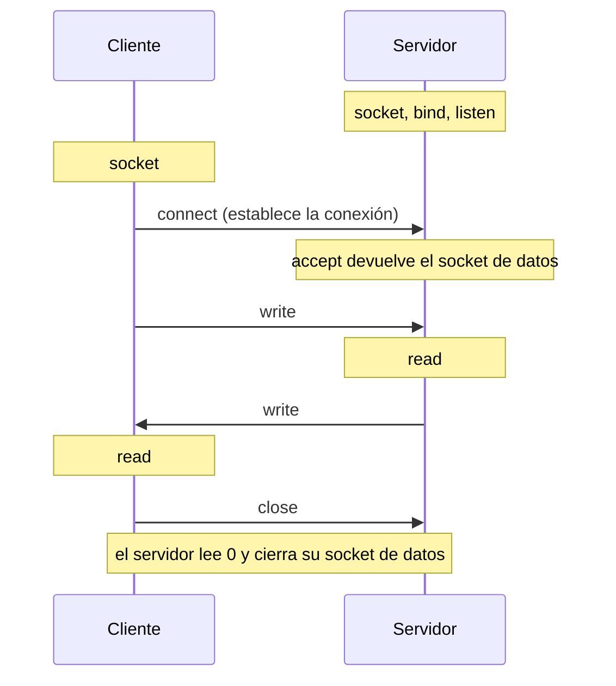

!!! warning

    El contenido de esta página no ha sido revisado ni corregido, por lo que puede
    estar incompleto, contener errores o presentar información desactualizada. Además,
    es posible que esté desordenado, carezca de una estructura clara o incluya notas
    copiadas directamente.

Este capítulo presenta la programación de aplicaciones de red en C mediante la API de
_sockets_ BSD, desde el modelo cliente-servidor y la representación de los datos hasta
los servidores concurrentes y la multiplexación con `select`. Todos los ejemplos se han
compilado con `gcc -Wall -Wextra` y se han ejecutado en `localhost`. La teoría de los
protocolos que hay debajo, como las capas, el direccionamiento, los rangos de puertos o
el establecimiento de la conexión, se desarrolla en el capítulo de
[TCP/IP](../../05_infrastructure/03_networking/section_1_tcpip.md), y aquí solo se
resume lo imprescindible para programar. Presupone los capítulos de
[procesos](section_3_processes.md), de [comunicación entre procesos](section_4_ipc.md),
de [señales](section_5_signals.md) y de
[máquinas de estados](section_6_state_machines.md).

## Introducción

Las señales y las tuberías solo comunican procesos de una misma máquina. Cuando los
procesos se ejecutan en máquinas distintas conectadas por una red aparecen tres
cuestiones nuevas: dónde está el proceso, de qué tipo es esa máquina (Linux, Windows,
Intel, ARM...) y cómo representa los datos, porque un entero no tiene por qué ocupar el
mismo espacio ni almacenarse igual en ambos extremos.

Un **_socket_** es el punto de comunicación por el que un proceso envía o recibe
información hacia o desde otro proceso, local o remoto. Lo proporciona el sistema
operativo: el proceso solicita el _socket_ al _kernel_, que lo gestiona y devuelve un
descriptor de archivo con el que se identifica. El canal es bidireccional. El _kernel_
mantiene dos colas independientes, una para los datos que se envían y otra para los que
se reciben, pero el proceso usa el mismo descriptor para escribir y para leer.

Los _sockets_ son el conjunto de funciones con el que un programa accede a los servicios
de la capa de transporte, y constituyen un estándar de facto presente en todos los
sistemas operativos. Según el protocolo se distinguen dos tipos:

- **_Stream sockets_** (`SOCK_STREAM`, TCP): intercambian secuencias de bytes de forma
  fiable. Su uso se parece a una llamada telefónica. Hay que establecer una conexión
  antes de hablar y el _socket_ sirve solo como canal entre los dos procesos conectados.
- **_Datagram sockets_** (`SOCK_DGRAM`, UDP): intercambian mensajes completos sin
  garantizar la fiabilidad. Su uso se parece a enviar una carta. No hace falta conexión.
  Cada envío indica la dirección del destinatario, y un mismo _socket_ puede enviar a
  varios destinatarios y recibir de varios emisores, como un buzón.

Las diferencias de fiabilidad, orden y cabeceras entre ambos protocolos se resumen en la
[comparativa entre UDP y TCP](../../05_infrastructure/03_networking/section_1_tcpip.md)
del capítulo de TCP/IP. Aquí interesa cómo se programan.

## Modelo cliente-servidor

Las comunicaciones en Internet siguen el **modelo cliente-servidor**. El **servidor** es
un proceso que espera peticiones de servicio y responde a ellas. El **cliente** es el
proceso que necesita ese servicio, lo solicita y espera la respuesta. Para que la
comunicación funcione se cumplen siempre tres reglas:

- El servidor se ejecuta antes que el cliente, porque debe estar esperando cuando este
  llegue.
- El cliente conoce los datos del servidor, es decir, su IP y su puerto.
- Ambos utilizan el mismo protocolo de aplicación, con la misma sintaxis y el mismo
  significado para los mensajes.

### Direccionamiento

Una **dirección de _socket_** se compone de una dirección IP y un puerto. La IP
identifica la interfaz de red de la máquina y el puerto identifica al proceso dentro de
ella. En IPv4 la IP ocupa 32 bits y el puerto 16, con valores de 0 a 65535. Desde el
punto de vista de la programación importan cuatro consecuencias:

- Dos procesos no pueden escuchar a la vez en el mismo puerto y protocolo. El puerto
  debe estar libre en el momento de vincularlo.
- Vincular un puerto por debajo de 1024 requiere privilegios de superusuario. Los
  ejemplos de este capítulo utilizan puertos altos, entre el 5050 y el 5099.
- La IP `127.0.0.1` es la dirección de _loopback_ de la propia máquina. Los datos
  enviados a ella no salen a la red, de modo que cliente y servidor pueden ejecutarse en
  el mismo equipo.
- El servidor obtiene la IP y el puerto del cliente del propio mensaje o de la conexión
  que recibe, mientras que el cliente debe conocer los del servidor de antemano.

El puerto de un cliente es opcional. Si el programa no vincula ninguno, el sistema
operativo elige uno libre, llamado efímero, en el primer envío. Los puertos ocupados en
un momento dado se consultan con `ss -tunl`, donde `-t` muestra los _sockets_ TCP, `-u`
los UDP, `-n` los números de puerto sin traducir y `-l` solo los que escuchan.

## Representación de los datos

Los procesos que se comunican pueden ejecutarse en plataformas con representaciones
distintas de los datos. Tres aspectos importan al intercambiarlos: el tamaño de los
enteros, el orden de los bytes y el alineamiento en memoria.

### Enteros de ancho fijo

El tamaño de `int`, `short` o `long` depende de la plataforma, de modo que un `int`
puede ocupar 4 bytes en un proceso y 8 en otro. Para evitar esa dependencia, los datos
que viajan por la red se declaran con los tipos de `stdint.h`: `int8_t`, `int16_t`,
`int32_t` e `int64_t` para enteros con signo de 8, 16, 32 y 64 bits, y `uint8_t`,
`uint16_t`, `uint32_t` y `uint64_t` para los mismos tipos sin signo. Para imprimirlos
con `printf` en cualquier plataforma, `inttypes.h` define macros como `PRIu64`, que se
concatenan con la cadena de formato: `printf("valor = %" PRIu64 "\n", v)`.

### Orden de los bytes

Un valor que ocupa más de un byte, como un `uint16_t` o un `uint32_t`, se almacena en
memoria en un orden que depende de la arquitectura del procesador. En el orden
**_big-endian_** el byte más significativo se guarda en la posición más baja. En el
orden **_little-endian_** se guarda primero el menos significativo. La tabla muestra el
valor `0x0A0B0C0D` en ambas arquitecturas a partir de la dirección `0x1100`:

| Dirección | _Big-endian_ | _Little-endian_ |
| --------- | ------------ | --------------- |
| `0x1100`  | `0x0A`       | `0x0D`          |
| `0x1101`  | `0x0B`       | `0x0C`          |
| `0x1102`  | `0x0C`       | `0x0B`          |
| `0x1103`  | `0x0D`       | `0x0A`          |

Ningún proceso puede saber de antemano qué orden usa el otro extremo. Por eso existe un
acuerdo: todo dato de más de un byte se transmite en _big-endian_, que recibe el nombre
de **orden de red** (_network byte order_). Antes de enviar se convierte del orden del
equipo (_host byte order_) al de red, y al recibir se hace la conversión contraria.
Cuatro funciones de `arpa/inet.h` realizan estas conversiones:

| Función | Conversión                                | Tamaño del argumento |
| ------- | ----------------------------------------- | -------------------- |
| `htons` | Del orden del equipo al de red (_short_). | 16 bits              |
| `htonl` | Del orden del equipo al de red (_long_).  | 32 bits              |
| `ntohs` | Del orden de red al del equipo (_short_). | 16 bits              |
| `ntohl` | Del orden de red al del equipo (_long_).  | 32 bits              |

Las letras indican el sentido (`h` por _host_ y `n` por _network_) y el tamaño (`s` por
16 bits y `l` por 32). Las funciones se aplican a enteros y no a las cadenas ni a los
_arrays_ de bytes: una cadena no se ve afectada por el orden de los bytes, porque cada
carácter ocupa un único byte.

### Alineamiento y relleno

La mayoría de los procesadores exigen o favorecen que una palabra se almacene en una
posición alineada. Un `uint32_t` se coloca en una dirección múltiplo de 4 y un
`uint16_t` en una múltiplo de 2. Para cumplir esta restricción, el compilador inserta
bytes de **relleno** (_padding_) entre los campos de un `struct` y al final. Cada
compilador decide cómo hacerlo, así que dos programas pueden representar la misma
estructura con tamaños y desplazamientos distintos. De ahí la regla práctica: un
`struct` nunca se envía entero por la red, sino campo a campo, convirtiendo cada uno al
orden de red.

???+ example "Orden de bytes y relleno en una estructura"

    El programa muestra los bytes de un entero en el orden del equipo y en el de red, y
    compara el tamaño de una estructura con la suma de sus campos.

    ```c linenums="1"
    #include <arpa/inet.h>
    #include <stddef.h>
    #include <stdint.h>
    #include <stdio.h>

    // Estructura con campos de distinto tamaño: el compilador añade relleno
    struct Mensaje {
        uint16_t codigo;
        uint8_t subcampo;
        uint32_t longitud;
        uint8_t version;
        uint16_t destino;
    };

    // Muestra los bytes de un entero de 32 bits tal y como están en memoria
    static void mostrar_bytes(const char *nombre, uint32_t valor) {
        const uint8_t *p = (const uint8_t *)&valor;

        printf("%-10s", nombre);
        for (int i = 0; i < 4; i++) {
            printf(" %02X", p[i]);
        }
        printf("\n");
    }

    int main(void) {
        uint32_t valor = 0x0A0B0C0D;

        mostrar_bytes("host", valor);
        mostrar_bytes("red", htonl(valor));
        printf("sizeof(struct Mensaje) = %zu\n", sizeof(struct Mensaje));
        printf("campos: 2 + 1 + 4 + 1 + 2 = %d bytes\n", 2 + 1 + 4 + 1 + 2);
        printf("offsetof(longitud) = %zu\n", offsetof(struct Mensaje, longitud));
        return 0;
    }
    ```

    La salida corresponde a un procesador x86-64 con GCC, que es _little-endian_. En una
    arquitectura _big-endian_ las dos primeras líneas serían idénticas.

    ```plaintext title="Expected output"
    host       0D 0C 0B 0A
    red        0A 0B 0C 0D
    sizeof(struct Mensaje) = 12
    campos: 2 + 1 + 4 + 1 + 2 = 10 bytes
    offsetof(longitud) = 4
    ```

## Direcciones de _socket_

Las funciones de la API aceptan un tipo genérico de dirección, `struct sockaddr`, cuyo
campo `sa_family` indica el tipo y cuyo contenido depende de él. Para direcciones IPv4
se usa en su lugar `struct sockaddr_in`, con los campos preparados para la IP y el
puerto, y se convierte al tipo genérico con un _cast_ al llamar a las funciones. Su
definición simplificada es la siguiente:

```c linenums="1"
struct in_addr {
    uint32_t s_addr;
};

struct sockaddr_in {
    sa_family_t sin_family;
    uint16_t sin_port;
    struct in_addr sin_addr;
    uint8_t sin_zero[8];
};
```

Los campos que se rellenan son tres. `sin_family` vale `AF_INET`, la familia de
direcciones de Internet. `sin_port` contiene el puerto en orden de red, por lo que se
asigna con `htons`, y nunca con `htonl`, porque el puerto tiene 16 bits. `sin_addr`
contiene la IP en orden de red. El campo `sin_zero` es relleno y debe quedar a cero,
razón por la que la estructura se inicializa por completo con `memset` antes de usarla.

Un servidor que quiere atender peticiones por cualquier interfaz de red del equipo
indica solo el puerto y usa la constante `INADDR_ANY` como IP. Para escribir una IP a
partir de texto existen `inet_addr` e `inet_pton`. La primera devuelve `-1` ante una
cadena mal escrita, valor que coincide con la dirección válida `255.255.255.255`, de
modo que los programas de este capítulo usan `inet_pton`. La conversión inversa, de
entero a cadena, la hace `inet_ntop`.

## La API de _sockets_

La tabla resume las llamadas que se utilizan en el resto del capítulo. Todas devuelven
`-1` en caso de error y dejan el código en `errno`, de modo que se comprueban con
`perror` según la convención descrita en el capítulo de
[fundamentos de C](section_1_fundamentals.md).

| Llamada                            | Función                                                                  | Devuelve                   |
| ---------------------------------- | ------------------------------------------------------------------------ | -------------------------- |
| `socket(familia, tipo, protocolo)` | Crea el _socket_. Con protocolo 0 elige TCP o UDP según el tipo.         | Descriptor o `-1`.         |
| `bind(sd, dir, longitud)`          | Vincula el _socket_ a un puerto local y, si se desea, a una IP.          | `0` o `-1`.                |
| `listen(sd, cola)`                 | Pone un _socket_ TCP en modo pasivo, a la espera de clientes.            | `0` o `-1`.                |
| `accept(sd, dir, &longitud)`       | Acepta un cliente y crea un _socket_ para hablar con él.                 | Descriptor nuevo o `-1`.   |
| `connect(sd, dir, longitud)`       | Solicita la conexión con un servidor TCP.                                | `0` o `-1`.                |
| `read`, `write`, `recv`, `send`    | Transfieren bytes por un _socket_ TCP conectado.                         | Bytes transferidos o `-1`. |
| `sendto`, `recvfrom`               | Envían y reciben datagramas indicando la dirección del otro extremo.     | Bytes transferidos o `-1`. |
| `shutdown(sd, modo)`               | Cierra solo un sentido de la conexión.                                   | `0` o `-1`.                |
| `close(sd)`                        | Libera el _socket_ y sus recursos.                                       | `0` o `-1`.                |
| `setsockopt`, `getpeername`        | Ajustan opciones del _socket_ y consultan la dirección del otro extremo. | `0` o `-1`.                |

Los ejemplos comparten unas pocas cabeceras pequeñas y cada programa se compila por
separado, con las cabeceras en el mismo directorio:

```bash linenums="1"
gcc -Wall -Wextra -o servidor_eco servidor_eco.c
```

No se usa `-std=c11` porque desactivaría `sigaction` y `SA_RESTART`, como se explica en
el capítulo de [fundamentos de C](section_1_fundamentals.md).

### Cabecera común

La primera cabecera es `io_util.h`, con las funciones `readn` y `writen` del capítulo de
[comunicación entre procesos](section_4_ipc.md), que leen y escriben exactamente `n`
bytes. La segunda es `red.h`, que incluye la anterior junto con las cabeceras de red
habituales y añade dos funciones. `leer_puerto` convierte el argumento de la línea de
órdenes en un puerto y sustituye a `atoi` porque rechaza los textos no numéricos y los
valores fuera del rango de 1024 a 65535. `crear_direccion` rellena una `sockaddr_in` a
partir de una IP y un puerto en texto, y con una IP nula usa `INADDR_ANY`, la dirección
de un servidor que atiende por todas las interfaces.

???+ example "Cabecera `red.h`"

    Las funciones se declaran `static inline` para que cada programa pueda incluir la
    cabecera sin errores de enlace ni avisos por funciones no usadas.

    ```c linenums="1"
    #ifndef RED_H
    #define RED_H

    #include <arpa/inet.h>
    #include <netinet/in.h>
    #include <stdint.h>
    #include <stdio.h>
    #include <stdlib.h>
    #include <string.h>
    #include <sys/socket.h>
    #include "io_util.h"

    // Convierte el argumento de la línea de órdenes en un puerto válido (1024-65535)
    static inline uint16_t leer_puerto(const char *texto) {
        char *fin;
        long puerto = strtol(texto, &fin, 10);

        if (*texto == '\0' || *fin != '\0' || puerto < 1024 || puerto > 65535) {
            fprintf(stderr, "Puerto no válido: %s\n", texto);
            exit(EXIT_FAILURE);
        }
        return (uint16_t)puerto;
    }

    // Rellena una dirección IPv4 a partir de textos (IP y puerto)
    // Con una IP nula, la dirección es INADDR_ANY (todas las interfaces)
    static inline struct sockaddr_in crear_direccion(const char *ip, const char *puerto) {
        struct sockaddr_in direccion;

        memset(&direccion, 0, sizeof(direccion));
        direccion.sin_family = AF_INET;
        direccion.sin_port = htons(leer_puerto(puerto));
        if (ip == NULL) {
            direccion.sin_addr.s_addr = htonl(INADDR_ANY);
        } else if (inet_pton(AF_INET, ip, &direccion.sin_addr) != 1) {
            fprintf(stderr, "IP no válida: %s\n", ip);
            exit(EXIT_FAILURE);
        }
        return direccion;
    }

    #endif
    ```

## _Sockets_ UDP

En UDP no hay conexión. Cada datagrama es un mensaje independiente y completo: las colas
de envío y de recepción del _socket_ no son tuberías de bytes, sino que guardan cada
mensaje separado del resto. El servidor crea el _socket_, lo vincula a un puerto y se
queda esperando datagramas. El cliente crea el _socket_ y envía al servidor indicando su
dirección. El servidor obtiene la dirección del cliente del propio datagrama y puede
responderle.

Un _socket_ UDP se crea con `socket(PF_INET, SOCK_DGRAM, 0)`, donde `PF_INET` vale lo
mismo que `AF_INET`. El `bind` es obligatorio en el servidor, porque el puerto debe ser
conocido por los clientes, y opcional en el cliente. Los datagramas se envían con
`sendto` y se reciben con `recvfrom`:

```c linenums="1"
ssize_t sendto(int sd, const void *datos, size_t longitud, int opciones,
               const struct sockaddr *destino, socklen_t longitud_dir);

ssize_t recvfrom(int sd, void *datos, size_t longitud, int opciones,
                 struct sockaddr *origen, socklen_t *longitud_dir);
```

Los tres primeros argumentos de ambas funciones coinciden con los de `write` y `read`, y
las `opciones` normalmente valen 0. En `sendto`, `destino` contiene la IP y el puerto
del receptor. `recvfrom` bloquea el proceso mientras la cola de recepción esté vacía. Al
volver, `origen` contiene la IP y el puerto del emisor y la función devuelve el tamaño
del datagrama. El argumento `longitud_dir` es de entrada y salida, de modo que debe
inicializarse con `sizeof` de la estructura antes de cada llamada. Si el _buffer_ es más
pequeño que el datagrama, el resto se descarta sin aviso. Un datagrama vacío es un
mensaje válido, de modo que un `0` en UDP no significa que el otro extremo haya cerrado.
Como UDP no garantiza la entrega, la aplicación que la necesita implementa por su cuenta
un plazo de espera y un reenvío.

???+ example "Servidor de eco UDP"

    El servidor vincula el puerto, recibe datagramas de cualquier cliente y devuelve
    cada uno a la dirección de la que procede, que muestra por pantalla.

    ```c linenums="1"
    #include <unistd.h>
    #include "red.h"

    #define MAX_DATAGRAMA 512

    int main(int argc, char *argv[]) {
        if (argc != 2) {
            fprintf(stderr, "Uso: %s puerto\n", argv[0]);
            return EXIT_FAILURE;
        }

        // Socket de datagramas: no hay listen ni accept
        int sd = socket(PF_INET, SOCK_DGRAM, 0);

        if (sd < 0) {
            perror("socket");
            return EXIT_FAILURE;
        }

        struct sockaddr_in local = crear_direccion(NULL, argv[1]);

        // En un servidor UDP el bind es obligatorio
        if (bind(sd, (struct sockaddr *)&local, sizeof(local)) < 0) {
            perror("bind");
            return EXIT_FAILURE;
        }

        char datagrama[MAX_DATAGRAMA];

        while (1) {
            struct sockaddr_in origen;
            socklen_t longitud = sizeof(origen);
            ssize_t recibidos = recvfrom(sd, datagrama, sizeof(datagrama), 0,
                                         (struct sockaddr *)&origen, &longitud);

            if (recibidos < 0) {
                perror("recvfrom");
                break;
            }

            char ip[INET_ADDRSTRLEN];

            inet_ntop(AF_INET, &origen.sin_addr, ip, sizeof(ip));
            printf("Datagrama de %s (%zd bytes)\n", ip, recibidos);

            // El eco vuelve a la dirección que devolvió recvfrom
            if (sendto(sd, datagrama, (size_t)recibidos, 0, (struct sockaddr *)&origen,
                       longitud) < 0) {
                perror("sendto");
            }
        }
        close(sd);
        return EXIT_FAILURE;
    }
    ```

???+ example "Cliente de eco UDP"

    El cliente lee líneas del teclado, las envía como datagramas y muestra el eco. Como
    UDP no avisa de las pérdidas, configura un plazo de dos segundos con la opción
    `SO_RCVTIMEO`, para que `recvfrom` no quede bloqueado si el servidor no responde.

    ```c linenums="1"
    #include <sys/time.h>
    #include <unistd.h>
    #include "red.h"

    #define MAX_DATAGRAMA 512

    int main(int argc, char *argv[]) {
        if (argc != 3) {
            fprintf(stderr, "Uso: %s ip puerto\n", argv[0]);
            return EXIT_FAILURE;
        }

        struct sockaddr_in servidor = crear_direccion(argv[1], argv[2]);

        // Sin bind: el sistema asigna un puerto efímero en el primer sendto
        int sd = socket(PF_INET, SOCK_DGRAM, 0);

        if (sd < 0) {
            perror("socket");
            return EXIT_FAILURE;
        }

        // UDP no avisa de las pérdidas: sin plazo, recvfrom podría bloquear siempre
        struct timeval plazo = {.tv_sec = 2, .tv_usec = 0};

        setsockopt(sd, SOL_SOCKET, SO_RCVTIMEO, &plazo, sizeof(plazo));

        char linea[MAX_DATAGRAMA];

        while (fgets(linea, sizeof(linea), stdin) != NULL) {
            linea[strcspn(linea, "\n")] = '\0';
            if (sendto(sd, linea, strlen(linea), 0, (struct sockaddr *)&servidor,
                       sizeof(servidor)) < 0) {
                perror("sendto");
                break;
            }

            char eco[MAX_DATAGRAMA];
            ssize_t recibidos = recvfrom(sd, eco, sizeof(eco) - 1, 0, NULL, NULL);

            if (recibidos < 0) {
                printf("Sin respuesta del servidor (pérdida o servidor caído)\n");
                continue;
            }
            eco[recibidos] = '\0';
            printf("Eco: %s\n", eco);
        }
        close(sd);
        return EXIT_SUCCESS;
    }
    ```

Con el servidor en segundo plano, el cliente se ejecuta con dos líneas. El fin de la
entrada termina el programa:

```bash linenums="1"
./servidor_udp 5052 &
printf 'hola udp\nsegundo\n' | ./cliente_udp 127.0.0.1 5052
```

El cliente muestra los ecos recibidos:

```plaintext title="Expected output"
Eco: hola udp
Eco: segundo
```

El servidor registra el origen y el tamaño de cada datagrama:

```plaintext title="Expected output"
Datagrama de 127.0.0.1 (8 bytes)
Datagrama de 127.0.0.1 (7 bytes)
```

Si el servidor no está en marcha, el cliente envía el datagrama sin error y, pasados dos
segundos, informa de que no hay respuesta:

```plaintext title="Expected output"
Sin respuesta del servidor (pérdida o servidor caído)
```

## _Sockets_ TCP

TCP ofrece un canal fiable. Antes de intercambiar datos se establece una conexión entre
cliente y servidor, y los bytes llegan ordenados y sin pérdidas. Los dos canales que el
_kernel_ mantiene para cada _socket_ se comportan como tuberías de bytes, a diferencia
de los datagramas de UDP, que conservan los límites entre mensajes. Cliente y servidor
se sincronizan en `connect` y `accept`: `connect` no vuelve hasta que la conexión queda
establecida y `accept` espera hasta que hay una conexión establecida. El intercambio de
segmentos que la crea se describe en el capítulo de
[TCP/IP](../../05_infrastructure/03_networking/section_1_tcpip.md).



### Llamadas del servidor

El servidor crea el _socket_ con `socket(PF_INET, SOCK_STREAM, 0)`, rellena una
`sockaddr_in` con el puerto e `INADDR_ANY` y llama a `bind`. A continuación,
`listen(sd, cola)` pone el _socket_ en modo pasivo. El segundo argumento es el tamaño de
la cola de clientes que pueden esperar a ser aceptados (el _backlog_), cuyo máximo es
`SOMAXCONN`, y si un cliente encuentra la cola llena, Linux descarta su solicitud y el
cliente la reintenta. `listen` falla en un _socket_ UDP, porque no admite el modo
pasivo.

`accept` bloquea al proceso hasta que aparece un cliente que solicita la conexión. Si
todo va bien devuelve un descriptor nuevo y, si se le pasa una `sockaddr_in` y su
longitud, la rellena con la IP y el puerto del otro extremo. Hay así dos tipos de
_socket_ en un servidor. El **_socket_ de conexiones** (`sd`) solo sirve para aceptar
clientes, y un `read` o `write` sobre él falla. El **_socket_ de datos** (`csd`)
representa la conexión con un cliente concreto y es el que se usa para leer y escribir.
Cuando termina el servicio se cierra `csd`, y el de conexiones se deja abierto mientras
el servidor siga aceptando clientes. `accept` puede fallar con `EINTR` si una señal lo
interrumpe, y en ese caso se reintenta. La dirección de un cliente ya conectado se
consulta después con `getpeername`.

Los servidores repiten la secuencia `socket`, `bind` y `listen`, por lo que se agrupa en
una función de la cabecera `escucha.h`. Incluye una opción de `setsockopt`, explicada en
el apartado de errores típicos, que permite volver a vincular el puerto aunque queden
conexiones anteriores en el sistema.

???+ example "Función `crear_escucha`"

    La función crea el _socket_ de conexiones y lo deja escuchando. Termina el programa
    si algún paso falla, ya que un servidor sin _socket_ no tiene nada que hacer.

    ```c linenums="1"
    #ifndef ESCUCHA_H
    #define ESCUCHA_H

    #include "red.h"

    // Crea un socket de conexiones TCP escuchando en todas las interfaces
    // Devuelve el descriptor o termina el programa si algo falla
    static inline int crear_escucha(const char *puerto, int cola) {
        int sd = socket(PF_INET, SOCK_STREAM, 0);

        if (sd < 0) {
            perror("socket");
            exit(EXIT_FAILURE);
        }

        int si = 1;

        setsockopt(sd, SOL_SOCKET, SO_REUSEADDR, &si, sizeof(si));

        struct sockaddr_in direccion = crear_direccion(NULL, puerto);

        if (bind(sd, (struct sockaddr *)&direccion, sizeof(direccion)) < 0
            || listen(sd, cola) < 0) {
            perror("bind/listen");
            exit(EXIT_FAILURE);
        }
        return sd;
    }

    #endif
    ```

### Llamadas del cliente

El cliente crea el _socket_ igual, rellena una dirección con la IP y el puerto del
servidor y llama a `connect(sd, dir, longitud)`. La llamada bloquea hasta que la
conexión queda establecida, lo que puede ocurrir antes de que el servidor llame a
`accept`. Devuelve `0` si todo ha ido bien o `-1` si no se ha podido conectar, y no crea
un descriptor nuevo. El descriptor original `sd` queda conectado y se usa a partir de
entonces para leer y escribir.

### Lectura y escritura en un flujo de bytes

Con `read` y `write`, o con `recv` y `send`, que añaden un argumento de opciones que
normalmente vale 0, se transfieren los datos por un _socket_ conectado. Sus resultados
siguen reglas que conviene tener presentes:

- `read` devuelve un número de bytes mayor que cero, que puede ser menor que el pedido.
  TCP no conserva los límites de los envíos, así que dos escrituras de 10 bytes pueden
  llegar como una lectura de 20 o como tres lecturas de 7, 7 y 6.
- `read` devuelve `0` cuando el otro extremo ha cerrado la conexión y ya no llegarán más
  datos. Un `-1` indica error.
- `write` devuelve los bytes que ha aceptado el _kernel_, no los que han llegado al
  destino. Si devuelve menos de lo pedido, hay que reintentar con lo que falta. Con `-1`
  hay un error, por ejemplo porque el otro extremo cerró.

Por eso, cuando se conoce de antemano cuántos bytes hay que leer o escribir, se usan
`readn` y `writen`, que repiten la llamada hasta completar la transferencia y la
reintentan si una señal la interrumpe (`EINTR`). `readn` devuelve menos bytes de los
pedidos solo cuando el otro extremo cierra antes, de modo que quien la llama distingue
un cierre limpio (0 bytes) de un cierre en mitad de un mensaje.

`close` cierra los dos sentidos de la conexión. Cuando un extremo debe anunciar que no
enviará más datos pero sigue necesitando leer, por ejemplo para recibir una respuesta
tras enviar un archivo entero, se usa `shutdown(sd, SHUT_WR)`. El otro extremo recibe
entonces el fin de archivo en su lectura y puede responder por el sentido que sigue
abierto.

### Protocolo con cabecera de longitud

Como TCP entrega un flujo sin fronteras, el receptor no sabe dónde termina un mensaje de
longitud variable. La solución es la cabecera de longitud que describe el capítulo de
[comunicación entre procesos](section_4_ipc.md), aplicada ahora a la red. Cada mensaje
viaja como un entero `uint32_t` de 4 bytes en orden de red (`htonl`) con el tamaño de
los datos, seguido de los propios datos sin terminador `\0`. El receptor lee primero 4
bytes con `readn`, los convierte con `ntohl` y lee después exactamente esa cantidad.
Cliente y servidor comparten la lógica en la cabecera `protocolo.h`.

???+ example "Envío y recepción de mensajes con longitud"

    `enviar_mensaje` y `recibir_mensaje` implementan el protocolo. La segunda rechaza
    cualquier longitud que no quepa en el _buffer_ y distingue el cierre limpio del
    error.

    ```c linenums="1"
    #ifndef PROTOCOLO_H
    #define PROTOCOLO_H

    #include "red.h"

    #define MAX_MENSAJE 512
    #define MSG_CERRADO (-2)

    // Envía un mensaje: longitud en 4 bytes big-endian seguida de los datos
    // Devuelve 0 si todo va bien y -1 si falla
    static inline int enviar_mensaje(int fd, const char *texto, uint32_t longitud) {
        uint32_t cabecera = htonl(longitud);

        if (writen(fd, &cabecera, sizeof(cabecera)) < 0) {
            return -1;
        }
        if (writen(fd, texto, longitud) < 0) {
            return -1;
        }
        return 0;
    }

    // Recibe un mensaje completo en buffer (capacidad bytes) y lo termina en '\0'
    // Devuelve la longitud, MSG_CERRADO si el otro extremo cerró antes de enviar
    // nada, o -1 si hay error o el mensaje no es válido
    static inline int recibir_mensaje(int fd, char *buffer, size_t capacidad) {
        uint32_t cabecera;
        ssize_t leidos = readn(fd, &cabecera, sizeof(cabecera));

        if (leidos == 0) {
            return MSG_CERRADO;
        }
        if (leidos != (ssize_t)sizeof(cabecera)) {
            return -1;
        }

        uint32_t longitud = ntohl(cabecera);

        // Nunca se confía en una longitud recibida de la red
        if (longitud >= capacidad) {
            fprintf(stderr, "Mensaje demasiado largo: %u bytes\n", longitud);
            return -1;
        }
        if (readn(fd, buffer, longitud) != (ssize_t)longitud) {
            return -1;
        }
        buffer[longitud] = '\0';
        return (int)longitud;
    }

    #endif
    ```

!!! warning

    La longitud recibida es un dato controlado por el otro extremo y nunca se usa sin
    validar. Si se pasa directamente a `readn` sobre un _array_ de tamaño fijo, un
    cliente malicioso o defectuoso provoca un desbordamiento de la pila, y escribir
    `buffer[longitud] = '\0'` sin comprobar antes que `longitud` es menor que la
    capacidad escribe fuera del _array_. `recibir_mensaje` cumple ambas condiciones. Un
    servidor que escucha en `INADDR_ANY` sin autenticación queda además expuesto a
    cualquier equipo de la red.

### Servidor y cliente de eco

El servicio de eco devuelve cada mensaje al cliente que lo envió. La función
`atender_eco` encapsula el diálogo con un cliente ya conectado, de modo que se reutiliza
en los servidores iterativo y concurrente.

???+ example "Diálogo de eco con un cliente"

    La función lee mensajes hasta que el cliente cierra la conexión y envía cada uno de
    vuelta.

    ```c linenums="1"
    #ifndef ECO_H
    #define ECO_H

    #include "protocolo.h"

    // Atiende a un cliente conectado: devuelve cada mensaje hasta que cierre
    static inline void atender_eco(int fd) {
        char buffer[MAX_MENSAJE];
        int longitud;

        while ((longitud = recibir_mensaje(fd, buffer, sizeof(buffer))) >= 0) {
            printf("Mensaje recibido (%d bytes): %s\n", longitud, buffer);
            if (enviar_mensaje(fd, buffer, (uint32_t)longitud) < 0) {
                perror("Error al enviar el eco");
                return;
            }
        }
        if (longitud == MSG_CERRADO) {
            printf("El cliente ha cerrado la conexión\n");
        }
    }

    #endif
    ```

El servidor iterativo crea el _socket_ con `crear_escucha` y atiende a los clientes de
uno en uno.

???+ example "Servidor de eco TCP iterativo"

    Cada vuelta del bucle acepta un cliente, ejecuta el diálogo completo y cierra el
    _socket_ de datos antes de aceptar el siguiente.

    ```c linenums="1"
    #include <unistd.h>
    #include "eco.h"
    #include "escucha.h"

    int main(int argc, char *argv[]) {
        if (argc != 2) {
            fprintf(stderr, "Uso: %s puerto\n", argv[0]);
            return EXIT_FAILURE;
        }

        int sd = crear_escucha(argv[1], 5);

        while (1) {
            printf("Servidor esperando conexión...\n");

            // Socket de datos: uno nuevo por cada cliente aceptado
            int csd = accept(sd, NULL, NULL);

            if (csd < 0) {
                if (errno == EINTR) {
                    continue;
                }
                perror("accept");
                break;
            }
            atender_eco(csd);
            close(csd);
        }
        close(sd);
        return EXIT_FAILURE;
    }
    ```

???+ example "Cliente de eco TCP"

    El cliente se conecta y envía cada línea como un mensaje con cabecera de longitud.
    Termina con el fin de la entrada.

    ```c linenums="1"
    #include <unistd.h>
    #include "protocolo.h"

    int main(int argc, char *argv[]) {
        if (argc != 3) {
            fprintf(stderr, "Uso: %s ip puerto\n", argv[0]);
            return EXIT_FAILURE;
        }

        struct sockaddr_in servidor = crear_direccion(argv[1], argv[2]);
        int sd = socket(PF_INET, SOCK_STREAM, 0);

        if (sd < 0 || connect(sd, (struct sockaddr *)&servidor, sizeof(servidor)) < 0) {
            perror("conexión");
            return EXIT_FAILURE;
        }

        char linea[MAX_MENSAJE];

        // Cada línea escrita viaja como un mensaje con cabecera de longitud
        while (fgets(linea, sizeof(linea), stdin) != NULL) {
            linea[strcspn(linea, "\n")] = '\0';
            if (enviar_mensaje(sd, linea, (uint32_t)strlen(linea)) < 0
                || recibir_mensaje(sd, linea, sizeof(linea)) < 0) {
                fprintf(stderr, "Error de comunicación con el servidor\n");
                close(sd);
                return EXIT_FAILURE;
            }
            printf("Eco: %s\n", linea);
        }
        close(sd);
        return EXIT_SUCCESS;
    }
    ```

Con el servidor en segundo plano, el cliente mantiene el siguiente diálogo. La línea
vacía viaja como un mensaje de longitud 0, y la longitud de `adiós` es de 6 bytes porque
la `ó` ocupa dos en UTF-8.

```bash linenums="1"
./servidor_eco 5050 &
printf 'hola mundo\n\nadiós\n' | ./cliente_eco 127.0.0.1 5050
```

```plaintext title="Expected output"
Eco: hola mundo
Eco:
Eco: adiós
```

La salida del servidor refleja el orden de los acontecimientos:

```plaintext title="Expected output"
Servidor esperando conexión...
Mensaje recibido (10 bytes): hola mundo
Mensaje recibido (0 bytes):
Mensaje recibido (6 bytes): adiós
El cliente ha cerrado la conexión
Servidor esperando conexión...
```

## Arquitecturas de servidor

Un servidor iterativo, como el de eco anterior, da el servicio completo a un cliente
antes de aceptar el siguiente. Es el diseño más sencillo, pero los clientes que llegan
mientras otro está siendo atendido esperan en la cola de `listen`, y si el servicio es
largo la experiencia es mala. Para atender a varios a la vez hay dos técnicas clásicas,
que se resumen en la tabla.

| Característica               | Un proceso por cliente (`fork`) | Multiplexación de E/S (`select`) |
| ---------------------------- | ------------------------------- | -------------------------------- |
| Procesos                     | Uno por cada cliente.           | Uno solo para todos.             |
| Coste                        | Más pesado.                     | Más ligero.                      |
| Servicios largos             | Adecuado.                       | Inadecuado, bloquea al resto.    |
| Servicios cortos y numerosos | Sobrecarga de procesos.         | Adecuado.                        |

Una tercera arquitectura asigna un hilo a cada conexión. Al compartir el espacio de
direcciones del proceso, crear un hilo resulta menos costoso que crear un proceso con
`fork`, y los hilos pueden intercambiar datos directamente. Esa misma memoria compartida
obliga a sincronizar los accesos a cualquier estructura común, como una lista de
clientes conectados. Los fundamentos de los hilos se explican en el capítulo de
[fundamentos de concurrencia](../07_concurrency/section_1_fundamentals.md) y los
mecanismos de sincronización en el de
[memoria compartida](../07_concurrency/section_2_shared_memory.md).

### Servidor concurrente con fork

En un servidor concurrente el proceso padre acepta las conexiones y cada una se delega
en un hijo creado con `fork`. El `accept` siempre se hace antes del `fork`. El padre
vuelve a esperar al siguiente cliente mientras el hijo atiende al suyo. El esquema
general se describe en el capítulo de [procesos](section_3_processes.md), y aquí se
completa con la conexión de red. Importan tres detalles:

- Tras el `fork`, el descriptor del cliente existe en ambos procesos. El padre cierra
  `csd` y el hijo cierra `sd`. Si el padre no cierra `csd`, el _socket_ sigue abierto
  aunque el hijo lo cierre, y el cliente nunca recibe el fin de archivo.
- Los hijos terminados quedan como zombis hasta que el padre recoge su estado. Un
  manejador de `SIGCHLD` que llama a `waitpid` con `WNOHANG` en bucle los recoge todos.
- La llegada de `SIGCHLD` puede interrumpir un `accept` bloqueado, que devuelve `-1` con
  `errno` igual a `EINTR`. La bandera `SA_RESTART` reanuda la llamada automáticamente
  (véase el capítulo de [señales](section_5_signals.md)), y el bucle comprueba `EINTR`
  de todos modos para ser portable.

???+ example "Servidor de eco concurrente"

    El servidor reutiliza `atender_eco` y delega cada conexión en un proceso hijo.
    Primero se define el manejador de `SIGCHLD`.

    ```c linenums="1"
    #include <signal.h>
    #include <sys/wait.h>
    #include <unistd.h>
    #include "eco.h"
    #include "escucha.h"

    // Recoge a todos los hijos terminados para que no queden zombis
    static void recoger_hijos(int senal) {
        (void)senal;
        int guardado = errno;

        while (waitpid(-1, NULL, WNOHANG) > 0) {
        }
        errno = guardado;
    }
    ```

    A continuación, el programa principal instala el manejador, ignora `SIGPIPE` y lanza
    un hijo por cada cliente.

    ```c linenums="16"
    int main(int argc, char *argv[]) {
        if (argc != 2) {
            fprintf(stderr, "Uso: %s puerto\n", argv[0]);
            return EXIT_FAILURE;
        }

        struct sigaction accion;

        memset(&accion, 0, sizeof(accion));
        accion.sa_handler = recoger_hijos;
        accion.sa_flags = SA_RESTART | SA_NOCLDSTOP;
        sigaction(SIGCHLD, &accion, NULL);

        // Escribir en un socket cerrado devolverá EPIPE en lugar de matar al proceso
        signal(SIGPIPE, SIG_IGN);

        int sd = crear_escucha(argv[1], 5);

        while (1) {
            int csd = accept(sd, NULL, NULL);

            if (csd < 0) {
                if (errno == EINTR) {
                    continue;
                }
                perror("accept");
                break;
            }

            pid_t pid = fork();

            if (pid < 0) {
                perror("fork");
                close(csd);
            } else if (pid == 0) {
                // Hijo: no necesita el socket de conexiones
                close(sd);
                printf("[%d] Cliente atendido\n", (int)getpid());
                atender_eco(csd);
                close(csd);
                exit(EXIT_SUCCESS);
            } else {
                // Padre: el socket de datos pertenece ya al hijo
                close(csd);
            }
        }
        close(sd);
        return EXIT_FAILURE;
    }
    ```

Para comprobar la concurrencia, un primer cliente se conecta, envía un mensaje y espera
dos segundos antes de enviar el siguiente. Mientras tanto, un segundo cliente completa
su sesión. Con un servidor iterativo, el segundo cliente tendría que esperar al primero.

```bash linenums="1"
./servidor_fork 5051 &
(echo uno; sleep 2; echo dos) | ./cliente_eco 127.0.0.1 5051 &
sleep 1; echo otro | ./cliente_eco 127.0.0.1 5051
```

El servidor atiende al segundo cliente antes de que el primero termine. Esta es la
salida del servidor, y los identificadores de proceso cambian en cada ejecución:

```plaintext title="Expected output"
[2582220] Cliente atendido
Mensaje recibido (3 bytes): uno
[2582232] Cliente atendido
Mensaje recibido (4 bytes): otro
El cliente ha cerrado la conexión
Mensaje recibido (3 bytes): dos
El cliente ha cerrado la conexión
```

### Multiplexación con select

En un servidor de un solo proceso las llamadas `accept` y `read` bloquean, de modo que
no es posible atender a un cliente mientras se espera a otro. La función `select`
resuelve el problema: bloquea el proceso hasta que alguno de un conjunto de descriptores
está listo para una operación, y así el servidor lee o acepta solo cuando no va a
bloquearse. Este patrón se conoce como **reactor**.

```c linenums="1"
int select(int nfds, fd_set *lectura, fd_set *escritura, fd_set *excepciones,
           struct timeval *plazo);
```

El primer argumento es el descriptor más alto de los vigilados más uno. Los tres
conjuntos siguientes indican los descriptores que se vigilan para lectura, escritura y
condiciones excepcionales, y `NULL` omite uno. El último es el tiempo máximo de espera,
y `NULL` lo hace indefinido. Devuelve el número de descriptores listos, `0` si venció el
plazo sin actividad y `-1` si hubo un error, por ejemplo `EINTR`. Los conjuntos son del
tipo `fd_set` y se manipulan con cuatro macros: `FD_ZERO` vacía el conjunto, `FD_SET` y
`FD_CLR` añaden y quitan un descriptor, y `FD_ISSET` indica si un descriptor está en el
conjunto, esto es, si está listo tras `select`.

`select` modifica los conjuntos que recibe, que a su vuelta contienen solo los
descriptores listos, y en Linux también el plazo, que pasa a ser el tiempo restante. Por
eso el programa mantiene un conjunto base con todos los descriptores vigilados y, antes
de cada llamada, trabaja sobre una copia, que se hace con una simple asignación.

Un descriptor de lectura está listo si hay datos que leer, si el otro extremo ha cerrado
(en cuyo caso `read` devuelve `0` sin bloquear) o, para el _socket_ de conexiones, si
hay un cliente esperando, de forma que `accept` no bloquea. Cuando `read` devuelve `0`
se cierra el descriptor y se retira con `FD_CLR` del conjunto base. El servidor mantiene
además un _array_ con los descriptores de los clientes, con `-1` en las casillas libres.

El ejemplo es un eco multiplexado. Como el servidor no interpreta los mensajes y se
limita a devolver los bytes que lee, funciona con el mismo cliente de eco TCP que el
servidor concurrente.

???+ example "Servidor de eco con select"

    Las dos funciones auxiliares aceptan un cliente nuevo y atienden a uno que tiene
    datos, y el bucle principal solo decide a cuál llamar tras cada `select`.

    ```c linenums="1"
    #include <signal.h>
    #include <sys/select.h>
    #include <unistd.h>
    #include "escucha.h"

    #define MAX_CLIENTES 8
    #define TAM_BUFFER 512

    // Acepta una conexión (accept no bloquea: select ya la ha detectado) y la guarda
    // en la primera casilla libre. Si no hay hueco, la rechaza cerrándola
    static void aceptar_cliente(int sd, int clientes[], fd_set *conjunto, int *maximo) {
        int csd = accept(sd, NULL, NULL);
        int libre = 0;

        if (csd < 0) {
            return;
        }
        while (libre < MAX_CLIENTES && clientes[libre] != -1) {
            libre++;
        }
        if (libre == MAX_CLIENTES) {
            close(csd);
            return;
        }
        clientes[libre] = csd;
        FD_SET(csd, conjunto);
        if (csd > *maximo) {
            *maximo = csd;
        }
        printf("Cliente %d conectado\n", libre);
    }

    // Devuelve al cliente i lo que ha enviado. Si cerró o falla, lo retira
    static void atender_cliente(int clientes[], int i, fd_set *conjunto) {
        char buffer[TAM_BUFFER];
        ssize_t leidos = read(clientes[i], buffer, sizeof(buffer));

        if (leidos > 0 && writen(clientes[i], buffer, (size_t)leidos) == leidos) {
            return;
        }
        printf("Cliente %d desconectado\n", i);
        FD_CLR(clientes[i], conjunto);
        close(clientes[i]);
        clientes[i] = -1;
    }

    int main(int argc, char *argv[]) {
        if (argc != 2) {
            fprintf(stderr, "Uso: %s puerto\n", argv[0]);
            return EXIT_FAILURE;
        }
        signal(SIGPIPE, SIG_IGN);

        int sd = crear_escucha(argv[1], 5);
        int clientes[MAX_CLIENTES];
        int maximo = sd;
        fd_set conjunto_base;

        for (int i = 0; i < MAX_CLIENTES; i++) {
            clientes[i] = -1;
        }
        FD_ZERO(&conjunto_base);
        FD_SET(sd, &conjunto_base);

        while (1) {
            // select modifica el conjunto: se trabaja sobre una copia
            fd_set conjunto_listo = conjunto_base;

            if (select(maximo + 1, &conjunto_listo, NULL, NULL, NULL) < 0) {
                if (errno == EINTR) {
                    continue;
                }
                perror("select");
                break;
            }
            if (FD_ISSET(sd, &conjunto_listo)) {
                aceptar_cliente(sd, clientes, &conjunto_base, &maximo);
            }
            for (int i = 0; i < MAX_CLIENTES; i++) {
                if (clientes[i] != -1 && FD_ISSET(clientes[i], &conjunto_listo)) {
                    atender_cliente(clientes, i, &conjunto_base);
                }
            }
        }
        return EXIT_FAILURE;
    }
    ```

La comprobación es la misma que con `fork`: un primer cliente envía un mensaje, espera
dos segundos y envía otro, y un segundo cliente completa su sesión entre medias. Un solo
proceso atiende a ambos:

```bash linenums="1"
./servidor_select 5055 &
(echo uno; sleep 2; echo dos) | ./cliente_eco 127.0.0.1 5055 &
sleep 1; echo otro | ./cliente_eco 127.0.0.1 5055
```

```plaintext title="Expected output"
Cliente 0 conectado
Cliente 1 conectado
Cliente 1 desconectado
Cliente 0 desconectado
```

!!! warning

    Un servidor `select` atiende a todos los clientes en el mismo hilo de ejecución.
    Cualquier operación lenta, como una espera con `sleep`, retrasa al resto, incluida
    la aceptación de conexiones nuevas. El bucle comprueba que la casilla está ocupada
    antes de llamar a `FD_ISSET`, porque pasar `-1` a las macros de `fd_set` tiene un
    comportamiento indefinido. Además, `fd_set` admite como máximo `FD_SETSIZE`
    descriptores, normalmente 1024, y para más conexiones existen `poll` y `epoll`.

`select` sirve igualmente con tuberías y FIFO, que son descriptores de archivo como
cualquier otro. El capítulo de [máquinas de estados](section_6_state_machines.md) trata
la combinación con señales para despertar un bucle `select` y la organización de un
programa en torno a un bucle de eventos.

## Errores típicos

Los fallos más habituales al programar con _sockets_ tienen causas conocidas y
soluciones que conviene aplicar desde el principio.

### Escritura en una conexión cerrada

Escribir en un _socket_ cuyo otro extremo ya ha cerrado provoca que el sistema envíe al
proceso la señal `SIGPIPE`, igual que ocurre con las tuberías según describe el capítulo
de [comunicación entre procesos](section_4_ipc.md). Un servidor no puede caerse porque
uno de sus clientes se desconecte, y por eso ignora la señal con
`signal(SIGPIPE, SIG_IGN)`, de modo que `write` devuelva `-1` con `errno` igual a
`EPIPE` y el programa cierre solo esa conexión. En `send`, la opción `MSG_NOSIGNAL`
logra lo mismo para una única llamada.

Con los _sockets_ hay una particularidad. El primer `write` sobre una conexión que el
otro extremo ya ha cerrado suele tener éxito, porque el _kernel_ solo se entera al
recibir la respuesta del otro lado, y el fallo aparece en la escritura siguiente.

### Puertos ocupados

`bind` falla con `EADDRINUSE` («Address already in use») por dos motivos distintos. El
primero es que otro proceso esté escuchando de verdad en ese puerto, caso en el que
conviene elegir otro puerto o terminar ese proceso, y `ss -tunl` ayuda a identificarlo.
El segundo es más sutil. Tras cerrar una conexión TCP, el extremo que la cierra primero
mantiene el puerto en estado `TIME_WAIT` durante un tiempo, lo que impide volver a
vincularlo aunque ya no haya ningún proceso. Un servidor que se reinicia justo después
de caerse se encuentra con este fallo.

La opción `SO_REUSEADDR` permite vincular un puerto que solo tiene conexiones en
`TIME_WAIT`. Se activa con `setsockopt` antes de `bind`, como hace `crear_escucha`. No
permite que dos procesos escuchen en el mismo puerto a la vez, y para que funcione deben
usarla todos los _sockets_ que han ocupado el puerto, incluidas las instancias previas
del servidor.

### Lecturas parciales y límites de mensaje

El error más frecuente es suponer que un `read` devuelve exactamente lo que un `write`
envió. TCP no conserva los límites, de modo que un mensaje puede llegar en varios
trozos, y varios mensajes pueden llegar juntos. Los remedios son los ya vistos: leer
longitudes conocidas con `readn` y delimitar los mensajes con una cabecera de longitud.
Se puede comprobar con `bash`, que abre un _socket_ TCP con `/dev/tcp` y envía la
cabecera del mensaje y el texto en tres fragmentos separados por pausas:

```bash linenums="1"
./servidor_eco 5059 &
bash -c 'exec 3<>/dev/tcp/127.0.0.1/5059
printf "\x00\x00" >&3; sleep 1
printf "\x00\x04ho" >&3; sleep 1
printf "la" >&3
od -An -c -N8 <&3'
```

El servidor recompone el mensaje y devuelve el eco completo, con la cabecera y el texto.
Lo que ve el servidor y lo que devuelve `od` es lo siguiente:

```plaintext title="Expected output"
Mensaje recibido (4 bytes): hola
  \0  \0  \0 004   h   o   l   a
```

### Otros errores frecuentes

La tabla reúne los fallos que más se repiten al escribir código de _sockets_, junto con
su corrección.

| Error                                             | Consecuencia                                 | Corrección                                        |
| ------------------------------------------------- | -------------------------------------------- | ------------------------------------------------- |
| No comprobar el valor de `read` antes de indexar. | Escritura en `buffer[-1]` con `0` o `-1`.    | Tratar `0` y `-1` antes de usar el _buffer_.      |
| No terminar con `'\0'` el texto recibido.         | `printf` o `strcmp` leen fuera de los datos. | Reservar un byte más y escribir el terminador.    |
| No cerrar `csd` en el padre tras `fork`.          | Fuga de descriptores y EOF que no llega.     | Cerrar `csd` en el padre y `sd` en el hijo.       |
| No recoger a los hijos terminados con `fork`.     | Procesos zombis, visibles con `ps`.          | Manejador de `SIGCHLD` con `waitpid` o `SIG_IGN`. |
| Enviar un `struct` o un `int` directamente.       | Incompatibilidad entre plataformas.          | Serializar campo a campo con tipos de ancho fijo. |
| Ignorar `EINTR` en `accept`, `read` o `select`.   | Salida del servidor por una señal inocua.    | Repetir la llamada si `errno == EINTR`.           |

## Cierre

Este capítulo ha mostrado cómo una aplicación en C crea un extremo de comunicación,
intercambia datos con UDP y TCP y atiende a varios clientes con `fork` o con `select`.
Los protocolos y el direccionamiento sobre los que se apoya todo esto se explican en el
capítulo de [TCP/IP](../../05_infrastructure/03_networking/section_1_tcpip.md), y la
coordinación de procesos mediante mensajes y eventos, en el de
[paso de mensajes y eventos](../07_concurrency/section_3_message_passing_events.md).
