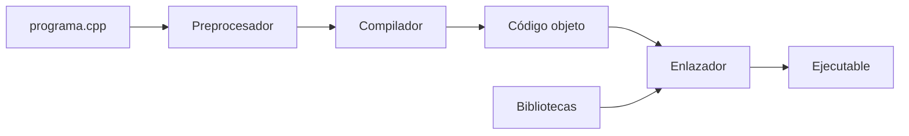

!!! warning

    El contenido de esta página no ha sido revisado ni corregido, por lo que puede
    estar incompleto, contener errores o presentar información desactualizada. Además,
    es posible que esté desordenado, carezca de una estructura clara o incluya notas
    copiadas directamente.

Este capítulo introduce C++ como lenguaje compilado y recorre el núcleo del lenguaje: la
estructura de un programa, la compilación con g++, los tipos de datos, la entrada y
salida, los operadores y las estructuras de control. Las funciones, los _arrays_, las
cadenas, las estructuras y los enumerados se tratan en el
[siguiente capítulo](section_2_functions_and_data.md). Los archivos, las clases y los
punteros con la memoria dinámica se estudian en capítulos posteriores del módulo.

## Introducción

**C++** es un lenguaje de programación compilado, de tipado estático y multiparadigma,
creado por Bjarne Stroustrup a principios de la década de 1980 como extensión de C. Su
código fuente se traduce a instrucciones nativas del procesador antes de ejecutarse, lo
que elimina la interpretación en tiempo de ejecución y permite un control directo sobre
la memoria y el hardware. Esa combinación lo convierte en la elección habitual para
sistemas operativos, motores gráficos, aplicaciones de alto rendimiento y los núcleos de
numerosas bibliotecas de cálculo numérico y aprendizaje automático.

Como C++ nació como extensión de C, buena parte de la sintaxis y del modelo de memoria
procede de este último. El capítulo de
[fundamentos de C](../05_c_systems/section_1_fundamentals.md) trata ese núcleo con más
detalle, incluidos los punteros, las cadenas de estilo C y la compilación con `gcc`, y
conviene leerlo antes cuando se desconoce C.

El lenguaje está estandarizado por ISO y se revisa cada pocos años, con versiones
identificadas por el año de publicación (C++11, C++14, C++17, C++20 y C++23). Todo el
capítulo usa **C++17**, una versión ampliamente soportada que aporta, entre otras
mejoras, los enlaces estructurados, la sentencia `if` con inicializador y el atributo
`[[fallthrough]]`.

### Convenciones de los ejemplos

Todos los ejemplos son programas completos que se compilan con
`g++ -std=c++17 -Wall -Wextra` sin avisos. Por brevedad, el código incluye
`using namespace std;`, una costumbre aceptable en archivos `.cpp` pequeños pero
desaconsejada en los archivos de cabecera. Los bloques de salida esperada proceden de
ejecuciones reales. Cuando un programa lee del teclado, el texto previo al ejemplo
indica la entrada utilizada. Como lo que se teclea no forma parte de la salida del
programa, las indicaciones que este muestra aparecen una a continuación de otra.

Los índices y los tamaños se declaran como `int` en la mayoría de los ejemplos. Así se
evitan las comparaciones entre tipos con y sin signo y los bucles descendentes que nunca
terminan, un error que se analiza en la sección de bucles.

## Estructura de un programa

Un programa C++ es un texto, el **código fuente**, que se guarda en un archivo con
extensión `.cpp`. Las sentencias terminan en `;`, los bloques se delimitan con llaves y
el lenguaje distingue entre mayúsculas y minúsculas. Un programa mínimo contiene tres
elementos:

- **Directivas `#include`**: Incorporan las declaraciones de una biblioteca. La
  biblioteca `<iostream>` aporta `cout` y `cin`, `<cmath>` las funciones matemáticas y
  `<string>` el tipo de cadena.
- **Espacio de nombres**: `using namespace std;` permite escribir `cout` en lugar de
  `std::cout`, ya que toda la biblioteca estándar vive en el espacio de nombres `std`.
- **Función `main`**: Es el punto de entrada. Su valor de retorno es el código de salida
  del proceso: `0` indica éxito y cualquier otro valor señala un error que el _shell_
  puede consultar con `echo $?`.

Los comentarios no se ejecutan. Existen de línea, con `//`, y de bloque, con
`/* ... */`. Dentro de un literal de texto, las **secuencias de escape** representan
caracteres que no se pueden escribir directamente.

| Secuencia | Significado                                  |
| --------- | -------------------------------------------- |
| `\n`      | Salto de línea.                              |
| `\t`      | Tabulador.                                   |
| `\b`      | Retroceso de un carácter.                    |
| `\r`      | Retorno de carro, sobrescribe la línea.      |
| `\\`      | Barra invertida.                             |
| `\"`      | Comilla doble dentro de un literal de texto. |

???+ example "Primer programa"

    El programa escribe dos líneas por la salida estándar.

    ```cpp linenums="1"
    #include <iostream>

    using namespace std;

    int main() {
        // Escribe una línea y finaliza con el manipulador endl
        cout << "Hola, mundo" << endl;
        // Las secuencias de escape forman parte del literal de texto
        cout << "Primera línea\nSegunda línea\n";
        return 0;
    }
    ```

    ```plaintext title="Expected output"
    Hola, mundo
    Primera línea
    Segunda línea
    ```

## Compilación con g++

El procesador no entiende C++, de modo que el código fuente pasa por varias fases antes
de ejecutarse. El **preprocesador** expande las directivas `#include` y las macros. El
**compilador** traduce cada archivo a código objeto, y el **enlazador** (_linker_) une
esos objetos con las bibliotecas necesarias para producir el ejecutable.



El compilador de referencia en Linux es **g++**, la interfaz de GCC (_GNU Compiler
Collection_) para C++. La compilación y la ejecución de un programa se resumen en dos
órdenes:

```bash linenums="1"
g++ -std=c++17 -Wall -Wextra -o programa programa.cpp
./programa
```

Las opciones más habituales son las siguientes.

| Opción       | Función                                               |
| ------------ | ----------------------------------------------------- |
| `-std=c++17` | Selecciona la versión del estándar.                   |
| `-Wall`      | Activa el grupo principal de avisos.                  |
| `-Wextra`    | Añade avisos adicionales.                             |
| `-pedantic`  | Avisa de las extensiones que no son estándar.         |
| `-o nombre`  | Fija el nombre del ejecutable.                        |
| `-g`         | Incluye información de depuración.                    |
| `-O2`        | Activa optimizaciones, que además revelan más avisos. |
| `-c`         | Compila sin enlazar y genera un archivo objeto `.o`.  |

Los **errores** impiden generar el ejecutable. Los **avisos** (_warnings_) no lo
impiden, pero señalan código que casi siempre es incorrecto, por lo que conviene tratar
cada uno como un fallo. Un error de sintaxis típico es olvidar un `;`. El compilador
suele informar de la línea siguiente a la que contiene la falta, porque es allí donde
deja de tener sentido la sentencia.

```cpp linenums="1"
#include <iostream>

using namespace std;

int main() {
    int x = 5
    cout << x << endl;
    return 0;
}
```

```plaintext title="Expected output"
programa.cpp: In function ‘int main()’:
programa.cpp:7:5: error: expected ‘,’ or ‘;’ before ‘cout’
    7 |     cout << x << endl;
      |     ^~~~
programa.cpp:6:9: warning: unused variable ‘x’ [-Wunused-variable]
    6 |     int x = 5
      |         ^
```

Algunos avisos solo aparecen con ciertas opciones. La comparación `i >= 0` sobre un
entero sin signo, que nunca puede ser falsa, se señala con `-Wextra` (aviso
`-Wtype-limits`), y la lectura de una variable local sin inicializar se detecta con
`-Wall` en los casos sencillos y en más casos al optimizar con `-O2`.

Para probar un programa que lee datos sin teclearlos cada vez, la entrada se redirige
desde un archivo con `./programa < entrada.txt`. Cuando el proyecto crece a varios
archivos, `g++ -std=c++17 -Wall -Wextra -o programa principal.cpp otro.cpp` compila y
enlaza todos a la vez.

## Variables y tipos

Una **variable** es un nombre asociado a una posición de memoria que almacena un valor
de un tipo determinado. El tipo fija qué valores admite la variable, cuánta memoria
ocupa y qué operaciones se pueden aplicar. Los tipos fundamentales son los siguientes.

| Tipo                                | Contenido                                             | Tamaño habitual       |
| ----------------------------------- | ----------------------------------------------------- | --------------------- |
| `bool`                              | `true` o `false`.                                     | 1 byte                |
| `char`                              | Un carácter, almacenado como entero de un byte.       | 1 byte                |
| `short`, `int`, `long`, `long long` | Enteros con signo.                                    | 2, 4, 8 y 8           |
| `unsigned` delante de un entero     | El mismo entero sin signo, solo valores no negativos. | Igual que el original |
| `float`                             | Real de coma flotante, precisión simple.              | 4 bytes               |
| `double`                            | Real de coma flotante, precisión doble.               | 8 bytes               |

El estándar no fija los tamaños exactos sino solo un orden entre ellos. Los valores de
la tabla corresponden a Linux sobre procesadores de 64 bits, y el operador `sizeof`
permite comprobarlos en cada plataforma.

???+ example "Tamaño y rango de los tipos"

    El programa muestra el tamaño de cada tipo y los límites de `int` y `unsigned`.

    ```cpp linenums="1"
    #include <iostream>
    #include <limits>

    using namespace std;

    int main() {
        // sizeof devuelve el tamaño en bytes de un tipo
        cout << "char: " << sizeof(char) << endl;
        cout << "bool: " << sizeof(bool) << endl;
        cout << "short: " << sizeof(short) << endl;
        cout << "int: " << sizeof(int) << endl;
        cout << "long: " << sizeof(long) << endl;
        cout << "long long: " << sizeof(long long) << endl;
        cout << "float: " << sizeof(float) << endl;
        cout << "double: " << sizeof(double) << endl;

        // numeric_limits expone el rango de cada tipo
        cout << "int mínimo: " << numeric_limits<int>::min() << endl;
        cout << "int máximo: " << numeric_limits<int>::max() << endl;
        cout << "unsigned máximo: " << numeric_limits<unsigned>::max() << endl;
        return 0;
    }
    ```

    ```plaintext title="Expected output"
    char: 1
    bool: 1
    short: 2
    int: 4
    long: 8
    long long: 8
    float: 4
    double: 8
    int mínimo: -2147483648
    int máximo: 2147483647
    unsigned máximo: 4294967295
    ```

### Declaración e inicialización

Declarar una variable consiste en indicar su tipo y su nombre. El nombre puede contener
letras, dígitos y guiones bajos, no puede empezar por un dígito, no puede coincidir con
una palabra reservada ni repetirse dentro del mismo ámbito. Por portabilidad se limita a
caracteres ASCII, de modo que se evitan `ñ` y las vocales con tilde. Una variable local
sin inicializar contiene un valor indeterminado, por lo que conviene asignarle un valor
en la misma declaración, con `=` o con llaves. La palabra `auto` delega en el compilador
la deducción del tipo a partir del valor inicial.

Los literales reales admiten **notación científica**: `3e3` equivale a $3 \cdot 10^{3}$
y `1.222e-3` a $1{,}222 \cdot 10^{-3}$.

???+ example "Declaraciones"

    El programa declara variables de los tipos fundamentales con distintas formas de
    inicialización.

    ```cpp linenums="1"
    #include <iostream>

    using namespace std;

    int main() {
        // Declaración con inicialización mediante igual o mediante llaves
        int edad = 25;
        unsigned contador{0};
        double altura = 1.75;
        char inicial = 'D';
        bool mayor_de_edad = edad >= 18;

        // auto deduce el tipo a partir del valor inicial
        auto precio = 19.99;
        auto unidades = 3;

        // Notación científica: 3e3 = 3 * 10^3 y 1.222e-3 = 1.222 * 10^-3
        double grande = 3e3;
        double pequeno = 1.222e-3;

        // Una variable sin inicializar contendría un valor indeterminado
        cout << edad << " " << contador << " " << altura << " " << inicial << " "
             << mayor_de_edad << endl;
        cout << precio * unidades << " " << grande << " " << pequeno << endl;

        // Las llaves rechazan conversiones que pierden información:
        // int truncado{3.5}; no compila, mientras que int truncado = 3.5; sí
        return 0;
    }
    ```

    ```plaintext title="Expected output"
    25 0 1.75 D 1
    59.97 3000 0.001222
    ```

### Conversiones entre tipos

Cuando una expresión mezcla tipos, el compilador convierte los operandos de forma
implícita al tipo más amplio. Asignar un real a una variable entera trunca la parte
decimal sin redondear, y asignar a un entero con signo un valor entero fuera de su rango
produce una conversión cuyo resultado define la implementación del compilador. La
conversión explícita se escribe con `static_cast<tipo>(valor)`, que deja constancia de
la intención y es más segura que las conversiones estilo C.

Los caracteres son enteros pequeños. El carácter `'0'` vale 48 en la tabla ASCII y los
dígitos son consecutivos, de modo que `c - '0'` convierte un dígito en su valor numérico
y `'a' + k` obtiene la letra de índice `k`.

???+ example "Conversiones, desbordamiento y truncamiento"

    El programa recorre las conversiones que más sorprenden a quien empieza.

    ```cpp linenums="1"
    #include <iostream>

    using namespace std;

    int main() {
        short corto = 10000;
        // El producto se evalúa como int, de modo que no desborda
        cout << corto * corto << endl;
        // Al guardarlo en un short se pierden los bits que no caben
        corto = static_cast<short>(corto * corto);
        cout << corto << endl;

        // Convertir un real a entero descarta la parte decimal
        cout << static_cast<int>(1.8 + 1.9) << endl;
        cout << static_cast<int>(1.6) + static_cast<int>(1.9) << endl;

        // Un char es un entero pequeño: '0' vale 48 en ASCII
        cout << '0' << " " << static_cast<int>('0') << endl;
        // Restar '0' convierte un dígito carácter en su valor numérico
        char digito = '7';
        cout << digito - '0' << endl;

        // Un negativo convertido a unsigned da la vuelta al rango
        cout << static_cast<unsigned>(-20) << endl;

        // División entera frente a división real
        cout << 7 / 2 << " " << 7 / 2.0 << endl;
        return 0;
    }
    ```

    ```plaintext title="Expected output"
    100000000
    -7936
    3
    2
    0 48
    7
    4294967276
    3 3.5
    ```

    El producto `corto * corto` se evalúa como `int`, por lo que no desborda. Al guardar
    el resultado en un `short`, que solo admite valores entre -32768 y 32767, se
    conservan los 16 bits inferiores y se obtiene -7936.

!!! warning "Desbordamiento de enteros"

    El desbordamiento de un entero con signo es comportamiento indefinido, de modo que
    el compilador puede asumir que nunca ocurre y generar código inesperado. Los enteros
    sin signo, en cambio, dan la vuelta de forma definida. Ninguno de los dos casos
    produce un error visible: la ejecución continúa con un valor incorrecto. Los
    factoriales y los productos de varios términos desbordan un `int` con valores
    sorprendentemente pequeños, por lo que conviene usar `unsigned long long` o
    replantear el cálculo.

### Constantes

Un valor que no cambia durante la ejecución se declara con `const`, y el compilador
rechaza cualquier intento de modificarlo. Cuando el valor se conoce al compilar, como el
tamaño de un _array_, se usa `constexpr`. Ambos son preferibles a la directiva
`#define`, que sustituye texto sin comprobar tipos ni ámbitos.

```cpp linenums="1"
#include <iostream>

using namespace std;

int main() {
    const double pi = 3.14159;
    pi = 3.0;
    cout << pi << endl;
    return 0;
}
```

```plaintext title="Expected output"
programa.cpp: In function ‘int main()’:
programa.cpp:7:8: error: assignment of read-only variable ‘pi’
    7 |     pi = 3.0;
      |     ~~~^~~~~
```

El modificador `const` reaparece en los parámetros de las
[funciones](section_2_functions_and_data.md), donde evita copias sin permitir
modificaciones.

## Entrada y salida

La entrada y la salida se realizan mediante **flujos** (_streams_). El objeto `cout`
representa la salida estándar y se usa con el operador de inserción `<<`. El objeto
`cin` representa la entrada estándar y se usa con el de extracción `>>`. Ambos
operadores se encadenan, y `cin >> a >> b` lee dos valores separados por espacios,
tabuladores o saltos de línea. El manipulador `endl` escribe un salto de línea y vacía
el _buffer_ de salida. El carácter `'\n'` solo escribe el salto, por lo que resulta más
rápido cuando no hace falta vaciar.

El formato de los números se controla con manipuladores de `<iomanip>` y de
`<iostream>`.

| Manipulador       | Efecto                                                             |
| ----------------- | ------------------------------------------------------------------ |
| `setw(n)`         | Reserva un ancho mínimo de `n` caracteres para el siguiente valor. |
| `setprecision(n)` | Fija la cantidad de cifras, o de decimales si se usa `fixed`.      |
| `fixed`           | Escribe los reales con notación decimal fija.                      |
| `boolalpha`       | Escribe `true` y `false` en lugar de `1` y `0`.                    |

???+ example "Lectura y formato"

    Con la entrada `19.99 3`, el programa lee un precio y una cantidad y muestra el
    total con dos decimales y una columna alineada.

    ```cpp linenums="1"
    #include <iomanip>
    #include <iostream>

    using namespace std;

    int main() {
        double precio = 0.0;
        int unidades = 0;

        cout << "Precio y unidades: ";
        // Una sola sentencia puede encadenar varias lecturas
        cin >> precio >> unidades;

        // fixed y setprecision fijan dos decimales en la salida
        cout << fixed << setprecision(2);
        cout << "Total: " << precio * unidades << " euros" << endl;
        // setw reserva un ancho mínimo para alinear columnas
        cout << setw(10) << precio << setw(6) << unidades << endl;
        return 0;
    }
    ```

    ```plaintext title="Expected output"
    Precio y unidades: Total: 59.97 euros
         19.99     3
    ```

Además de `>>`, existen otras formas de leer que difieren en lo que consideran un dato.

| Instrucción              | Lee                                                              |
| ------------------------ | ---------------------------------------------------------------- |
| `cin >> x`               | Un valor del tipo de `x`, saltando los espacios previos.         |
| `cin.get()`              | Un único carácter, sea cual sea, incluidos espacios y saltos.    |
| `getline(cin, texto)`    | Una línea completa hasta el salto de línea, que se descarta.     |
| `cin.getline(cadena, n)` | Una línea en un _array_ de caracteres, con un máximo de `n - 1`. |
| `cin.ignore(n, '\n')`    | Nada, descarta hasta `n` caracteres o hasta el salto de línea.   |

### Errores de lectura

Si `cin >> x` encuentra un texto que no corresponde al tipo de `x`, la lectura falla. La
variable pasa a valer `0` desde C++11 y el flujo queda en estado de error, de modo que
todas las lecturas posteriores se ignoran. Para recuperar el control se restablece el
estado con `cin.clear()` y se descarta la línea defectuosa con `cin.ignore`. La
expresión `cin >> x` se puede usar como condición, ya que equivale a `false` cuando la
lectura ha fallado o la entrada ha terminado.

???+ example "Recuperación tras una lectura fallida"

    Con las líneas `abc` y `42` como entrada, el programa detecta el texto no numérico,
    limpia el flujo y lee después el número correcto.

    ```cpp linenums="1"
    #include <iostream>
    #include <limits>

    using namespace std;

    int main() {
        int numero = -1;

        cout << "Número: ";
        // El flujo se convierte en false si la lectura falla
        if (!(cin >> numero)) {
            cout << "Entrada no numérica, valor leído: " << numero << endl;
            // Restablece el estado de error del flujo
            cin.clear();
            // Descarta el resto de la línea para poder leer de nuevo
            cin.ignore(numeric_limits<streamsize>::max(), '\n');
        }

        cout << "Otro número: ";
        cin >> numero;
        cout << "Leído: " << numero << endl;
        return 0;
    }
    ```

    ```plaintext title="Expected output"
    Número: Entrada no numérica, valor leído: 0
    Otro número: Leído: 42
    ```

### Mezcla de `>>` y `getline`

El operador `>>` deja en el _buffer_ el salto de línea que acompaña al último valor. Si
a continuación se llama a `getline`, esta función encuentra de inmediato ese salto y
devuelve una cadena vacía. El problema afecta a cualquier lectura de línea posterior a
una numérica.

???+ example "El salto de línea pendiente"

    Con las líneas `25` y `Ana Pérez` como entrada, el programa pierde el nombre.

    ```cpp linenums="1"
    #include <iostream>
    #include <string>

    using namespace std;

    int main() {
        int edad = 0;
        string nombre;

        cout << "Edad: ";
        cin >> edad;
        cout << "Nombre: ";
        // getline consume el salto de línea que dejó la lectura anterior
        getline(cin, nombre);

        cout << "Edad=" << edad << " nombre=[" << nombre << "]" << endl;
        return 0;
    }
    ```

    ```plaintext title="Expected output"
    Edad: Nombre: Edad=25 nombre=[]
    ```

    La corrección consiste en descartar el resto de la línea con
    `cin.ignore(numeric_limits<streamsize>::max(), '\n')` antes de llamar a `getline`,
    como en la sección anterior. Con la misma entrada se conserva entonces el nombre.

## Operadores y expresiones

Una **expresión** combina valores, variables y operadores y produce un resultado. Los
operadores aritméticos son `+`, `-`, `*`, `/` y `%`. Cuando ambos operandos de `/` son
enteros, la división es entera y descarta la parte decimal, de modo que `7 / 2` vale `3`
mientras que `7 / 2.0` vale `3.5`. El operador `%` calcula el resto y solo admite
enteros. La división entera trunca hacia cero y el resto toma el signo del dividendo,
así que `-7 / 2` vale `-3` y `-7 % 2` vale `-1`.

Los operadores se agrupan por precedencia, de mayor a menor. Entre operadores de igual
precedencia se evalúa de izquierda a derecha, salvo en los operadores unarios y en la
asignación, que lo hacen de derecha a izquierda. Los paréntesis alteran el orden. Por
debajo de `&&` quedan, por este orden, la disyunción lógica `||`, el operador ternario y
la asignación.

| Precedencia | Operadores                        | Descripción                        |
| ----------- | --------------------------------- | ---------------------------------- |
| 1           | `()`                              | Paréntesis.                        |
| 2           | `++`, `--`, `!`, `-` unario       | Incremento, decremento y negación. |
| 3           | `*`, `/`, `%`                     | Multiplicación, división y resto.  |
| 4           | `+`, `-`                          | Suma y resta.                      |
| 5           | `<`, `<=`, `>`, `>=`              | Comparación de orden.              |
| 6           | `==`, `!=`                        | Igualdad y desigualdad.            |
| 7           | `&&`                              | Conjunción lógica.                 |
| 8           | `=`, `+=`, `-=`, `*=`, `/=`, `%=` | Asignación y asignación compuesta. |

Los operadores lógicos `&&` (y), `||` (o) y `!` (no) trabajan con valores booleanos y se
evalúan en **cortocircuito**: si el operando izquierdo basta para decidir el resultado,
el derecho no se evalúa. Esta propiedad permite proteger una operación peligrosa con una
comprobación previa, como `x != 0 && 10 / x > 1`. Un `bool` se muestra como `1` o `0` y
admite `boolalpha` para obtener `true` o `false`. El **operador ternario**
`condicion ? valor_si_cierta : valor_si_falsa` elige entre dos valores en una sola
expresión.

???+ example "Precedencia, restos y cortocircuito"

    El programa evalúa expresiones aritméticas, de incremento y lógicas.

    ```cpp linenums="1"
    #include <iostream>

    using namespace std;

    int main() {
        // Primero se evalúan / y *, de izquierda a derecha, y luego + y -
        cout << 14 - 8 / 2 * 3 + 1 << endl;
        // La división entera trunca hacia cero y % conserva el signo del dividendo
        cout << -7 / 2 << " " << -7 % 2 << " " << 7 % 3 << endl;

        int x = 5;
        // Posfijo: devuelve el valor y después incrementa
        int antes = x++;
        cout << antes << " " << x << endl;
        // Prefijo: incrementa y después devuelve el valor
        int despues = ++x;
        cout << despues << " " << x << endl;
        // Asignación compuesta equivalente a x = x * 2
        x *= 2;
        cout << x << endl;

        // boolalpha escribe true y false en lugar de 1 y 0
        cout << boolalpha;
        cout << (3 < 5 && 5 < 4) << " " << (3 < 5 || 5 < 4) << " ";
        cout << !(3 == 3) << endl;

        // Si x vale 0, la división no se evalúa gracias al cortocircuito
        x = 0;
        cout << (x != 0 && 10 / x > 1) << endl;
        return 0;
    }
    ```

    ```plaintext title="Expected output"
    3
    -3 -1 1
    5 6
    7 7
    14
    false true false
    false
    ```

    La primera línea ilustra la precedencia: `14 - 8 / 2 * 3 + 1` se evalúa como
    `14 - 4 * 3 + 1`, luego `14 - 12 + 1` y finalmente `3`.

!!! warning "Asignación frente a comparación"

    La expresión `x = 5` asigna y vale `5`, mientras que `x == 5` compara. Escribir `=`
    dentro de un `if` es válido para el compilador y siempre resulta verdadero con un
    valor distinto de cero. Las comparaciones de igualdad entre números reales
    (`0.1 + 0.2 == 0.3`) tampoco son fiables, porque los reales se almacenan de forma
    aproximada. En su lugar se compara el valor absoluto de la diferencia con una
    tolerancia.

### La biblioteca cmath

La biblioteca `<cmath>` agrupa las funciones matemáticas. Los ángulos de las funciones
trigonométricas se expresan en radianes, y las funciones devuelven `double`.

| Función                      | Resultado                                         |
| ---------------------------- | ------------------------------------------------- |
| `pow(b, e)`                  | Potencia $b^{e}$.                                 |
| `sqrt(x)`                    | Raíz cuadrada.                                    |
| `sin(x)`, `cos(x)`, `tan(x)` | Funciones trigonométricas.                        |
| `atan2(y, x)`                | Arcotangente de $y/x$ que distingue el cuadrante. |
| `round(x)`                   | Redondeo al entero más cercano.                   |
| `ceil(x)`                    | Redondeo hacia arriba.                            |
| `floor(x)`                   | Redondeo hacia abajo.                             |
| `fabs(x)`                    | Valor absoluto de un real.                        |
| `fmax(a, b)`, `fmin(a, b)`   | Mayor y menor de dos valores.                     |

El estándar C++17 no define la constante $\pi$. Una forma portable de obtenerla es
`4.0 * atan(1.0)`, porque $\arctan(1) = \pi / 4$.

!!! tip "Cuadrados y potencias enteras"

    Para elevar al cuadrado un entero resulta más claro y exacto escribir `i * i` que
    `pow(i, 2)`. La función `pow` trabaja con `double` y puede introducir errores de
    redondeo al convertir de nuevo a entero. Para evitar nombres en conflicto, las
    funciones propias no deben llamarse como las de la biblioteca (`sqrt`, `pow`,
    `abs`).

## Estructuras condicionales

Las sentencias condicionales deciden qué código se ejecuta según el valor de una
condición. La forma básica es `if (condicion) { ... } else { ... }`, donde la rama
`else` es opcional. Varias alternativas excluyentes se encadenan con `else if`, y se
ejecuta solo la primera rama cuya condición sea cierta. Conviene escribir siempre las
llaves, incluso con una sola sentencia, porque evitan errores al añadir código después.

???+ example "Clasificación por tramos"

    El programa pondera dos notas y clasifica el resultado. Las ramas se ordenan de
    menor a mayor y cada una comprueba solo el límite superior, porque las anteriores ya
    descartaron los valores menores.

    ```cpp linenums="1"
    #include <iostream>

    using namespace std;

    int main() {
        double nota_a = 7.5, nota_b = 9.0;
        // Ponderación 70 % y 30 %
        double final = 0.7 * nota_a + 0.3 * nota_b;

        cout << "Nota final: " << final << " -> ";
        // Cada rama solo se evalúa si fallaron las anteriores
        if (final < 5.0) {
            cout << "suspenso" << endl;
        } else if (final < 7.0) {
            cout << "aprobado" << endl;
        } else if (final < 9.0) {
            cout << "notable" << endl;
        } else if (final < 10.0) {
            cout << "sobresaliente" << endl;
        } else {
            cout << "matrícula" << endl;
        }
        return 0;
    }
    ```

    ```plaintext title="Expected output"
    Nota final: 7.95 -> notable
    ```

!!! tip "Tramos sin huecos"

    Al clasificar números reales, los límites se expresan con `<` sobre el extremo
    superior de cada tramo (`final < 9.0`). Una comparación como `final <= 8.99` deja
    sin clasificar valores como `8.995`, que quedan entre dos tramos.

Cuando varias ramas dependen de los distintos valores de una misma variable entera o de
tipo carácter, la sentencia `switch` es más legible. Cada `case` etiqueta un valor, y la
ejecución continúa hacia abajo hasta encontrar `break`, de modo que su omisión provoca
que se ejecuten también las ramas siguientes. Esa propiedad se aprovecha a propósito
para agrupar etiquetas que comparten sentencias. Cuando la continuación es deliberada,
el atributo `[[fallthrough]];` lo declara y evita el aviso del compilador. La rama
`default`, opcional pero recomendable, recoge los valores que ninguna etiqueta
contempla.

???+ example "Días de un mes"

    Con la entrada `2 2024`, el programa calcula si el año es bisiesto y devuelve los
    días del mes mediante `switch`. Un año es bisiesto si es múltiplo de 400, o múltiplo
    de 4 pero no de 100.

    ```cpp linenums="1"
    #include <iostream>

    using namespace std;

    int main() {
        int mes = 0, anio = 0;
        cout << "Mes y año: ";
        cin >> mes >> anio;

        // Un año es bisiesto si es múltiplo de 400, o de 4 pero no de 100
        bool bisiesto = anio % 400 == 0 || (anio % 4 == 0 && anio % 100 != 0);

        int dias = 0;
        switch (mes) {
        // Varias etiquetas pueden compartir las mismas sentencias
        case 4:
        case 6:
        case 9:
        case 11:
            dias = 30;
            break;
        case 2:
            dias = bisiesto ? 29 : 28;
            break;
        case 1:
        case 3:
        case 5:
        case 7:
        case 8:
        case 10:
        case 12:
            dias = 31;
            break;
        // default cubre los valores que ninguna etiqueta contempla
        default:
            cout << "Mes inválido" << endl;
            return 1;
        }
        cout << "Días: " << dias << endl;
        return 0;
    }
    ```

    ```plaintext title="Expected output"
    Mes y año: Días: 29
    ```

La condición de un `if` admite desde C++17 un inicializador, como en
`if (int y = f(); y > 3)`, de modo que la variable solo existe dentro de la sentencia.

## Bucles

Un bucle repite un bloque de sentencias mientras se cumpla una condición. C++ ofrece
tres formas clásicas y una cuarta basada en rangos.

- **`while`**: Comprueba la condición antes de cada vuelta, de modo que el cuerpo puede
  no ejecutarse nunca.
- **`do { ... } while (condicion);`**: Comprueba la condición al final, por lo que el
  cuerpo se ejecuta al menos una vez.
- **`for (inicio; condicion; paso)`**: Reúne en la cabecera la inicialización del
  contador, el límite y el incremento. Es la forma natural cuando se conoce el número de
  vueltas.
- **`for (tipo elemento : coleccion)`**: Recorre todos los elementos de un _array_ o de
  una cadena sin gestionar el índice.

Dentro del cuerpo, `break` abandona el bucle y `continue` salta a la siguiente vuelta.
Un **contador** es una variable que se incrementa en cada vuelta, y un **acumulador** es
una variable que se inicializa antes del bucle y combina los valores que se procesan,
como la suma o el producto.

???+ example "Las tres formas de bucle"

    El programa suma los números del 1 al 5 con cada bucle y, a continuación, muestra
    los impares menores que 8 con `continue` y `break`.

    ```cpp linenums="1"
    #include <iostream>

    using namespace std;

    int main() {
        const int n = 5;

        // while: comprueba la condición antes de cada vuelta
        int suma_while = 0;
        int i = 1;
        while (i <= n) {
            suma_while += i;
            i++;
        }

        // do-while: el cuerpo se ejecuta al menos una vez
        int suma_do = 0;
        int j = 1;
        do {
            suma_do += j;
            j++;
        } while (j <= n);

        // for: inicialización, condición e incremento en la cabecera
        int suma_for = 0;
        for (int k = 1; k <= n; k++) {
            suma_for += k;
        }

        cout << suma_while << " " << suma_do << " " << suma_for << endl;

        // continue salta a la siguiente vuelta y break abandona el bucle
        for (int k = 1; k <= 10; k++) {
            if (k % 2 == 0) {
                continue;
            }
            if (k > 7) {
                break;
            }
            cout << k << " ";
        }
        cout << endl;
        return 0;
    }
    ```

    ```plaintext title="Expected output"
    15 15 15
    1 3 5 7
    ```

### Bucle con centinela

Cuando no se conoce de antemano cuántos datos llegan, un valor especial, el
**centinela**, indica el final. El centinela no forma parte de los datos, por lo que no
debe contarse ni sumarse. Combinar la lectura con la condición, como en
`while (cin >> valor && valor != 0.0)`, también termina el bucle si la entrada se agota.

???+ example "Media hasta un centinela"

    Con la entrada `4 8 6 0`, el programa calcula la media de los valores anteriores al
    cero. La comprobación de `contador == 0` evita una división por cero.

    ```cpp linenums="1"
    #include <iostream>

    using namespace std;

    int main() {
        double suma = 0.0;
        int contador = 0;
        double valor = 0.0;

        cout << "Valores terminados en 0: ";
        // El 0 es el centinela y no se cuenta, y una lectura fallida también corta
        while (cin >> valor && valor != 0.0) {
            suma += valor;
            contador++;
        }

        if (contador == 0) {
            cout << "No se introdujo ningún valor" << endl;
        } else {
            cout << "Media de " << contador << " valores: ";
            cout << suma / contador << endl;
        }
        return 0;
    }
    ```

    ```plaintext title="Expected output"
    Valores terminados en 0: Media de 3 valores: 6
    ```

### Bucles anidados

Para generar tablas y recorrer matrices se colocan unos bucles dentro de otros. El bucle
externo suele representar las filas y el interno las columnas, y el interno se ejecuta
completo en cada vuelta del externo.

???+ example "Tabla de multiplicar"

    El programa escribe una tabla de 4 por 4 con una columna de ancho fijo.

    ```cpp linenums="1"
    #include <iomanip>
    #include <iostream>

    using namespace std;

    int main() {
        const int n = 4;

        for (int fila = 1; fila <= n; fila++) {
            for (int columna = 1; columna <= n; columna++) {
                // setw alinea cada producto en una columna de ancho fijo
                cout << setw(4) << fila * columna;
            }
            cout << '\n';
        }
        return 0;
    }
    ```

    ```plaintext title="Expected output"
       1   2   3   4
       2   4   6   8
       3   6   9  12
       4   8  12  16
    ```

### Errores frecuentes en los bucles

- **Error por uno** (_off-by-one_): Recorrer un _array_ de `n` elementos con `i <= n`
  accede a una posición inexistente. Los índices válidos son de `0` a `n - 1`.
- **Bucle infinito**: La condición nunca deja de cumplirse porque el contador no se
  actualiza o porque se actualiza en el sentido contrario.
- **Contador `unsigned` descendente**: La condición `i >= 0` es siempre cierta para un
  tipo sin signo, ya que al decrementar desde `0` el valor da la vuelta al máximo.
- **Condición de validación con `&&`**: Para repetir la lectura de un dato fuera de
  rango, la condición `nota < 0 && nota > 10` nunca es cierta. Lo inválido se describe
  con `nota < 0 || nota > 10`. Los bucles de lectura deben comprobar además el estado de
  `cin`, porque ante texto no numérico o el fin de la entrada nunca terminan.

El compilador detecta el caso del contador sin signo con `-Wextra`. Hay dos formas de
descender sin riesgo: usar un índice con signo o escribir la condición como `i-- > 0`,
que compara antes de decrementar.

???+ example "Descenso con índice sin signo"

    El programa recorre cuatro posiciones en orden inverso con las dos alternativas.

    ```cpp linenums="1"
    #include <iostream>

    using namespace std;

    int main() {
        const unsigned n = 4;

        // Con índice unsigned, la condición i >= 0 sería siempre cierta.
        // La comparación i-- > 0 evalúa primero y decrementa después
        for (unsigned i = n; i-- > 0;) {
            cout << i << " ";
        }
        cout << endl;

        // Con un índice con signo la cabecera habitual funciona
        for (int i = static_cast<int>(n) - 1; i >= 0; i--) {
            cout << i << " ";
        }
        cout << endl;
        return 0;
    }
    ```

    ```plaintext title="Expected output"
    3 2 1 0
    3 2 1 0
    ```

## Cierre

Con los tipos, la entrada y salida, los operadores y las estructuras de control ya se
pueden escribir programas completos, pero todo el código vive en `main`. El
[siguiente capítulo](section_2_functions_and_data.md) divide los programas en funciones,
presenta la recursión y trata los _arrays_, las cadenas, las estructuras y los
enumerados.
