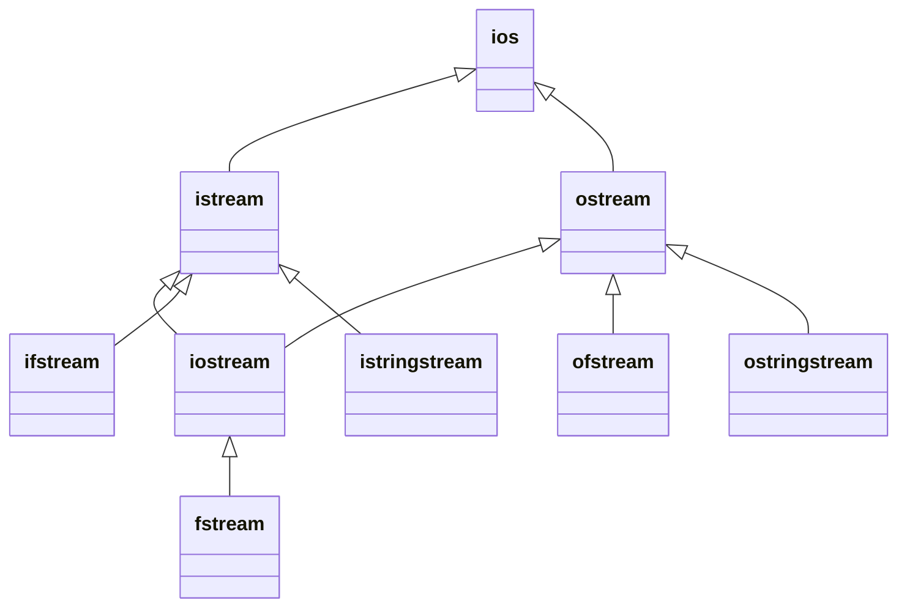
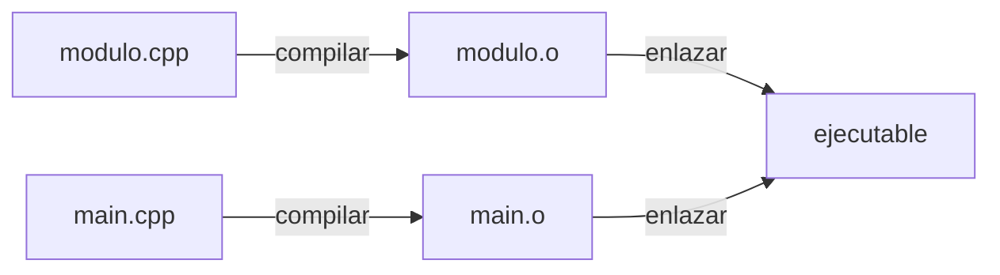

!!! warning

    El contenido de esta página no ha sido revisado ni corregido, por lo que puede
    estar incompleto, contener errores o presentar información desactualizada. Además,
    es posible que esté desordenado, carezca de una estructura clara o incluya notas
    copiadas directamente.

Este capítulo explica cómo un programa en C++ guarda y recupera información en archivos
mediante los flujos de la biblioteca estándar, desde la lectura secuencial de texto
hasta el acceso aleatorio a registros binarios, y cómo se reparte el código de un
programa en módulos que se compilan por separado. Presupone la sintaxis, las funciones y
las estructuras presentadas en los capítulos de [fundamentos](section_1_fundamentals.md)
y de [funciones y estructuras de datos](section_2_functions_and_data.md), y prepara el
capítulo de [programación orientada a objetos](section_4_oop.md).

## Introducción

### Memoria secundaria y sistema de archivos

Durante su ejecución, un programa mantiene los datos en la **memoria principal**
(_random access memory_, RAM), que es rápida pero volátil: su contenido desaparece al
terminar el programa. Para conservar la información entre ejecuciones se recurre a la
**memoria secundaria** (discos duros, unidades de estado sólido o memorias _flash_),
persistente, de mayor capacidad y menor coste por byte, aunque más lenta.

La memoria secundaria se organiza de forma jerárquica en un **sistema de archivos**. Una
carpeta puede contener archivos y otras carpetas. Desde el punto de vista del
programador, un **archivo** es una secuencia de bytes con un nombre y una ruta, que el
programa abre, recorre y cierra.

### Archivos de texto y binarios

Los archivos se clasifican según cómo se interpretan sus bytes. Un archivo de texto
contiene caracteres y está pensado para que lo lean tanto personas como programas. Un
archivo binario contiene los bits tal como los representa la máquina y no pasa por
ninguna conversión intermedia.

| Aspecto      | Archivo de texto                         | Archivo binario                      |
| ------------ | ---------------------------------------- | ------------------------------------ |
| Naturaleza   | Secuencia de caracteres.                 | Secuencia de bits.                   |
| Codificación | ASCII (1 byte) o UTF-8 (de 1 a 4 bytes). | Depende de la máquina y del código.  |
| Lectura      | Legible con cualquier editor.            | Requiere un programa que lo conozca. |
| Ejemplos     | `.txt`, `.csv`, código fuente.           | Imágenes, ejecutables, volcados.     |

### Flujos y manejadores

La entrada y la salida de un programa en C++ se modelan con **flujos** (_streams_), que
son secuencias de datos con un origen o un destino. El teclado y la pantalla ya son
flujos: `std::cin` maneja la entrada del teclado y `std::cout` la salida a pantalla. Un
archivo se trata del mismo modo, mediante un **manejador**, que es una variable
vinculada a un flujo de datos. Lo que cambia entre un tipo de flujo y otro es el
destino. Los operadores `<<` y `>>` funcionan igual en todos.

| Clase                                      | Cabecera    | Uso                                         |
| ------------------------------------------ | ----------- | ------------------------------------------- |
| `std::ifstream`                            | `<fstream>` | Lectura de un archivo.                      |
| `std::ofstream`                            | `<fstream>` | Escritura de un archivo.                    |
| `std::fstream`                             | `<fstream>` | Lectura y escritura de un archivo.          |
| `std::istringstream`, `std::ostringstream` | `<sstream>` | Lectura y escritura sobre un `std::string`. |

Las clases de flujo forman una jerarquía, de modo que todo lo que se aprende de
`std::cin` y `std::cout` se aplica a los archivos.



## Lectura de archivos de texto

La lectura de un archivo sigue siempre la misma secuencia:

1. Incluir la cabecera `<fstream>`.
2. Declarar el manejador de entrada, de tipo `std::ifstream`.
3. Abrir el archivo con su nombre, bien con el método `open` o bien directamente en la
   construcción del manejador. El nombre puede ser un `std::string`.
4. Comprobar que la apertura no ha fallado, con `if (!f)` o con `f.fail()`.
5. Leer los datos y procesarlos.
6. Cerrar el archivo con `close()`. El destructor del manejador también lo cierra al
   salir de su ámbito, pero cerrarlo de forma explícita permite reutilizar el manejador
   con otro archivo.

El siguiente ejemplo recorre un archivo de enteros. Devuelve `false` tanto si el archivo
no se puede abrir como si contiene un dato que no es un entero.

```cpp linenums="1"
#include <fstream>
#include <iostream>
#include <string>

// Muestra todos los enteros de un archivo. Devuelve false si no se puede abrir
// o si aparece un dato con formato incorrecto antes del final.
bool mostrar_enteros(const std::string &nombre) {
    std::ifstream f(nombre);
    if (f.fail()) {
        return false;
    }

    // Lectura anticipada: se lee antes de comprobar y al final de cada vuelta
    int n;
    f >> n;
    while (!f.fail()) {
        std::cout << n << ' ';
        f >> n;
    }
    std::cout << '\n';

    // Si el bucle terminó por fallo pero sin llegar al final, el formato era erróneo
    return f.eof();
}

int main() {
    // El archivo temporal se crea y se cierra al terminar la sentencia
    std::ofstream("numeros.txt") << "10 20 30\n40 50\n";
    std::ofstream("mal.txt") << "1 2 tres 4\n";

    std::cout << std::boolalpha;
    for (const char *nombre : {"numeros.txt", "no_existe.txt", "mal.txt"}) {
        std::cout << nombre << ": ";
        bool ok = mostrar_enteros(nombre);
        std::cout << "ok = " << ok << '\n';
    }
    return 0;
}
```

```plaintext title="Expected output"
numeros.txt: 10 20 30 40 50
ok = true
no_existe.txt: ok = false
mal.txt: 1 2
ok = false
```

La lectura es **anticipada**. Se lee un primer valor antes del bucle y, al final de cada
vuelta, el siguiente. De este modo la condición `!f.fail()` siempre se evalúa justo
después de una lectura. Tras el bucle, `f.eof()` distingue las dos causas de salida. Si
es verdadero se consumió todo el archivo, y si es falso la lectura se detuvo ante un
dato con formato incorrecto.

!!! note

    Los manejadores de archivo no se pueden copiar. Una función que recibe un flujo como
    parámetro lo declara siempre como referencia, por ejemplo `std::ifstream &f`. Con
    frecuencia es más sencillo que la función reciba el nombre del archivo y lo abra por
    sí misma, como en los ejemplos de este capítulo.

### Estados del flujo

Cada flujo mantiene un conjunto de bits de estado que registran lo ocurrido en la última
operación. Las funciones de consulta los resumen.

| Función  | Es verdadera cuando                                               |
| -------- | ----------------------------------------------------------------- |
| `good()` | No hay ningún bit de error activo.                                |
| `eof()`  | Se intentó leer más allá del final del archivo.                   |
| `fail()` | Una operación falló, por formato incorrecto o por falta de datos. |
| `bad()`  | Ocurrió un error irrecuperable de entrada y salida.               |

Además, `!f` equivale a `f.fail()` y `if (f)` a `!f.fail()`. Mientras el flujo está en
fallo, las lecturas posteriores no hacen nada. Para continuar hay que llamar a
`clear()`, que restablece el estado, igual que con `std::cin` en el capítulo de
[fundamentos](section_1_fundamentals.md). El siguiente programa muestra cómo cambian los
bits.

```cpp linenums="1"
#include <fstream>
#include <iostream>
#include <string>

// Imprime los cuatro bits de estado del flujo
void estado(const std::string &momento, const std::ios &f) {
    std::cout << momento << ": good=" << f.good() << " eof=" << f.eof()
              << " fail=" << f.fail() << " bad=" << f.bad() << '\n';
}

int main() {
    std::ofstream("estados.txt") << "7 8\n";

    std::ifstream f("estados.txt");
    int n;
    f >> n;
    estado("tras leer 7", f);
    f >> n;
    estado("tras leer 8", f);
    f >> n;
    estado("tercer intento", f);

    // Un flujo con error no se recupera solo: hay que limpiar los bits
    f.clear();
    estado("tras clear", f);
    return 0;
}
```

```plaintext title="Expected output"
tras leer 7: good=1 eof=0 fail=0 bad=0
tras leer 8: good=1 eof=0 fail=0 bad=0
tercer intento: good=0 eof=1 fail=1 bad=0
tras clear: good=1 eof=0 fail=0 bad=0
```

Las dos primeras lecturas dejan el flujo en buen estado, incluso la del último dato,
porque aún no se ha intentado leer más allá del final. El tercer intento activa `eofbit`
y `failbit` a la vez. En cambio, un dato con formato incorrecto, como en `mal.txt`,
activa solo `failbit`, sin llegar al final del archivo.

!!! warning "Condición de fin con `eof()`"

    El fin de archivo no se detecta antes de intentar leer, por lo que el bucle
    `while (!f.eof())` procesa una vez más el último valor. Tras leer el último dato el
    flujo sigue en buen estado y se entra de nuevo. La lectura falla y la variable
    conserva el valor anterior. Se procesa así un registro que no existe. La forma
    correcta es usar la propia lectura como condición, `while (f >> x)`, o la lectura
    anticipada vista antes. En ambos casos el cuerpo del bucle solo se ejecuta con datos
    válidos.

### Lectura de caracteres y de líneas

El operador `>>` descarta los espacios y los saltos de línea antes de leer un valor, y
se detiene en el siguiente separador. Cuando hay que conservar esos separadores se usan
otras operaciones.

| Operación               | Comportamiento                                                    |
| ----------------------- | ----------------------------------------------------------------- |
| `f >> x`                | Salta los blancos iniciales y lee un valor del tipo de `x`.       |
| `f.get(c)`              | Lee un carácter cualquiera, incluidos espacios y saltos de línea. |
| `std::getline(f, s)`    | Lee hasta el siguiente `'\n'`, que se consume pero no se guarda.  |
| `std::getline(f, s, d)` | Igual que la anterior, con el delimitador `d`.                    |
| `f.ignore(n, d)`        | Descarta hasta `n` caracteres o hasta `d`, incluido este.         |
| `f >> std::ws`          | Descarta los blancos iniciales sin leer ningún valor.             |

La lectura carácter a carácter con `get` sirve para contar, filtrar o copiar archivos.
La función `copiar` transcribe un archivo y devuelve `false` si falla alguna de las
aperturas o la propia copia. Para trabajar con líneas completas se usa `std::getline`.
El bucle `while (std::getline(...))` trata bien la última línea aunque no termine en
`'\n'`.

```cpp linenums="1"
#include <fstream>
#include <iostream>
#include <limits>
#include <string>

// Copia un archivo carácter a carácter. get() no se salta los espacios
bool copiar(const std::string &origen, const std::string &destino) {
    std::ifstream ent(origen);
    std::ofstream sal(destino);
    if (!ent || !sal) {
        return false;
    }

    char ch;
    while (ent.get(ch)) {
        sal.put(ch);
    }
    // La lectura debe terminar por fin de archivo y la escritura no debe fallar
    return ent.eof() && static_cast<bool>(sal);
}

int main() {
    std::ofstream("lineas.txt") << "primera\nsegunda con espacios\ntercera";

    std::cout << std::boolalpha << copiar("lineas.txt", "copia.txt") << ' '
              << copiar("nada.txt", "x.txt") << '\n';

    // getline lee la última línea aunque no termine en '\n'
    std::ifstream copia("copia.txt");
    std::string linea;
    while (std::getline(copia, linea)) {
        std::cout << '[' << linea << "]\n";
    }

    // Mezclar >> con getline: >> deja el '\n' sin consumir
    std::ofstream("persona.txt") << "42\nAna Pérez\n";
    std::ifstream f("persona.txt");
    int edad;
    std::string nombre;
    f >> edad;
    std::getline(f, nombre);
    std::cout << "sin ignore: [" << nombre << "]\n";

    // Vuelve al inicio del archivo para leerlo de nuevo
    f.clear();
    f.seekg(0);
    f >> edad;
    f.ignore(std::numeric_limits<std::streamsize>::max(), '\n');
    std::getline(f, nombre);
    std::cout << "con ignore: [" << nombre << "] edad " << edad << '\n';
    return 0;
}
```

```plaintext title="Expected output"
true false
[primera]
[segunda con espacios]
[tercera]
sin ignore: []
con ignore: [Ana Pérez] edad 42
```

!!! warning "Mezcla de `>>` y `getline`"

    Después de `f >> edad` queda sin consumir el salto de línea que sigue al número. La
    siguiente llamada a `getline` lo encuentra enseguida y devuelve una cadena vacía. La
    solución es descartar el resto de la línea con `f.ignore(...)` o los blancos con
    `f >> std::ws` antes de leer el texto. Es el mismo problema que con `std::cin`.

## Escritura de archivos de texto

La escritura sigue los mismos pasos con un `std::ofstream`. La apertura se controla con
un segundo argumento, formado por uno o varios modos combinados con `|`.

| Modo          | Efecto                                                                       |
| ------------- | ---------------------------------------------------------------------------- |
| `ios::out`    | Escritura. Es el modo por defecto de `ofstream`. Vacía el archivo si existe. |
| `ios::trunc`  | Vacía el contenido existente. Está implícito con `ios::out`.                 |
| `ios::app`    | Conserva el contenido y escribe siempre al final.                            |
| `ios::in`     | Lectura. Es el modo por defecto de `ifstream`.                               |
| `ios::binary` | Sin traducción de caracteres, para archivos binarios.                        |

!!! danger "Apertura para escritura"

    Abrir un archivo existente en modo de escritura lo deja vacío. No se pide
    confirmación ni se puede deshacer. Si el contenido anterior debe conservarse, hay
    que usar `ios::app` o escribir en un archivo con otro nombre.

Los datos se escriben con `<<`, igual que en `std::cout`. Los manipuladores de la
cabecera `<iomanip>` controlan el formato: `std::fixed` y `std::setprecision(n)` fijan
los decimales, y `std::setw(n)` reserva un ancho de columna.

```cpp linenums="1"
#include <fstream>
#include <iomanip>
#include <iostream>
#include <string>

// Vuelca un archivo de texto por pantalla
void mostrar(const std::string &nombre) {
    std::ifstream f(nombre);
    std::string linea;
    while (std::getline(f, linea)) {
        std::cout << "| " << linea << '\n';
    }
}

int main() {
    {
        // Modo por defecto (out): si el archivo existe, se vacía al abrirlo
        std::ofstream f("tabla.txt");
        // fixed y setprecision fijan los decimales y setw reserva ancho de columna
        f << std::fixed << std::setprecision(2);
        f << std::left << std::setw(10) << "tornillo" << std::right << std::setw(8)
          << 0.5 << '\n';
        f << std::left << std::setw(10) << "tuerca" << std::right << std::setw(8)
          << 12.256 << '\n';
    }
    {
        // ios::app conserva el contenido y escribe siempre al final
        std::ofstream f("tabla.txt", std::ios::app);
        f << "fin de tabla\n";
    }
    mostrar("tabla.txt");
    return 0;
}
```

```plaintext title="Expected output"
| tornillo      0.50
| tuerca       12.26
| fin de tabla
```

Dos detalles de la escritura merecen atención:

- `'\n'` termina una línea sin más. `std::endl` además vacía el _buffer_ en cada
  llamada, lo que ralentiza la escritura de muchas líneas.
- Los valores consecutivos necesitan un separador. Con `f << a << b`, los enteros `10` y
  `20` se escriben como `1020` y ya no se pueden recuperar por separado.

Tras escribir conviene comprobar `if (f)`, porque el disco puede llenarse a mitad de la
operación y el fallo no se detecta al abrir.

## Formatos de datos

Un archivo de texto no tiene estructura por sí mismo. El formato es el acuerdo sobre
cómo se disponen los datos, y condiciona la forma del código que los lee. Los dos
patrones esenciales son los registros con campos separados por espacios y los valores
separados por delimitadores. Los demás, como los registros de varias líneas o los
bloques precedidos por un recuento, combinan las mismas herramientas de lectura.

### Un registro por línea

Cada línea contiene los campos de un registro separados por espacios. El último campo
puede ser un texto con espacios, como el nombre del titular, porque se lee con `getline`
hasta el final de la línea. Tras el número que precede al texto queda un espacio, que
`std::ws` descarta.

```cpp linenums="1"
#include <fstream>
#include <iostream>
#include <string>
#include <vector>

struct Cuenta {
    unsigned numero;
    double saldo;
    std::string titular;
};

// Lee registros con formato «numero saldo titular con espacios» por línea
bool leer_cuentas(const std::string &nombre, std::vector<Cuenta> &cuentas) {
    std::ifstream f(nombre);
    if (!f) {
        return false;
    }

    Cuenta c;
    while (f >> c.numero >> c.saldo) {
        // ws descarta el espacio que separa el saldo del titular
        f >> std::ws;
        std::getline(f, c.titular);
        cuentas.push_back(c);
    }
    return f.eof();
}

int main() {
    std::ofstream("cuentas.txt") << "111 1234.56 Ana Gil\n222 2.5 Luis Mora Ruiz\n";

    std::vector<Cuenta> cuentas;
    if (!leer_cuentas("cuentas.txt", cuentas)) {
        return 1;
    }
    for (const Cuenta &c : cuentas) {
        std::cout << c.numero << " | " << c.saldo << " | " << c.titular << '\n';
    }
    return 0;
}
```

```plaintext title="Expected output"
111 | 1234.56 | Ana Gil
222 | 2.5 | Luis Mora Ruiz
```

### Valores separados por comas

En el formato CSV (_comma-separated values_, valores separados por comas) cada línea es
un registro y una coma separa los campos. La primera línea suele ser una cabecera con
los nombres de los campos. Para analizar cada línea se crea un `std::istringstream`, que
es un flujo cuyo origen es una cadena en memoria y admite todas las operaciones de
lectura. Con `getline` y la coma como delimitador se extrae cada campo como texto, y
`std::stoi` y `std::stod` lo convierten al tipo numérico. Estas funciones lanzan una
excepción si el campo no es un número, de modo que la lectura las captura para señalar
el fallo.

```cpp linenums="1"
#include <fstream>
#include <iostream>
#include <sstream>
#include <string>
#include <vector>

struct Muestra {
    std::string id;
    int edad;
    double nota;
};

// Lee el archivo saltando la cabecera. Devuelve false ante un campo no numérico
bool leer_csv(const std::string &nombre, std::vector<Muestra> &datos) {
    std::ifstream f(nombre);
    std::string linea;
    if (!f || !std::getline(f, linea)) {
        return false;
    }

    try {
        while (std::getline(f, linea)) {
            // Un flujo en memoria permite analizar la línea con las mismas herramientas
            std::istringstream campos(linea);
            std::string campo;
            Muestra m;
            std::getline(campos, m.id, ',');
            std::getline(campos, campo, ',');
            m.edad = std::stoi(campo);
            std::getline(campos, campo, ',');
            m.nota = std::stod(campo);
            datos.push_back(m);
        }
    } catch (const std::exception &) {
        return false;
    }
    return f.eof();
}

int main() {
    std::ofstream("notas.csv") << "id,edad,nota\nana,21,8.5\nluis,23,6.0\n";
    std::ofstream("roto.csv") << "id,edad,nota\nana,veinte,8.5\n";

    std::vector<Muestra> leidas, rotas;
    std::cout << "notas: " << leer_csv("notas.csv", leidas) << ", leídas "
              << leidas.size() << ", segunda nota " << leidas[1].nota << '\n';
    std::cout << "roto: " << leer_csv("roto.csv", rotas) << '\n';
    return 0;
}
```

```plaintext title="Expected output"
notas: 1, leídas 2, segunda nota 6
roto: 0
```

Este análisis sirve para CSV sencillos. Cuando un campo puede contener comas, comillas
escapadas o saltos de línea, se necesita un analizador específico y no basta con
`getline`.

## Archivos binarios y acceso aleatorio

Un archivo binario guarda los bytes de los datos tal como están en memoria. Se abre con
`ios::binary` y se usan `write` y `read`, que reciben un puntero a `char` y un número de
bytes. Como un registro ocupa siempre el mismo espacio, la posición de cada registro se
calcula directamente y no hace falta recorrer los anteriores. A esta forma de acceder se
le llama **acceso aleatorio**.

| Función                     | Acción                                                                 |
| --------------------------- | ---------------------------------------------------------------------- |
| `seekg(pos)`, `seekp(pos)`  | Colocan la posición de lectura o de escritura en el byte `pos`.        |
| `seekg(desp, ios::end)`     | Colocan la posición a `desp` bytes del final (`ios::beg`, `ios::cur`). |
| `tellg()`, `tellp()`        | Devuelven la posición actual de lectura o de escritura.                |
| `read(p, n)`, `write(p, n)` | Transfieren `n` bytes desde o hacia el puntero `p`.                    |

El registro del ejemplo no contiene `std::string` ni punteros, porque estos guardan una
dirección y no el contenido. Solo se pueden volcar tal cual los tipos _trivially
copyable_, y `static_assert` lo comprueba en tiempo de compilación. La función
`ingresar` abre el archivo con `std::fstream` para leer y escribir, lee un registro, lo
modifica y vuelve a la misma posición para sobrescribirlo, sin tocar el resto.

```cpp linenums="1"
#include <cstdint>
#include <fstream>
#include <iostream>
#include <string>
#include <type_traits>
#include <vector>

// Registro de tamaño fijo: sin std::string ni punteros, para poder volcarlo tal cual
struct Registro {
    std::uint32_t numero;
    double saldo;
    char titular[32];
};
static_assert(std::is_trivially_copyable_v<Registro>, "no se puede volcar en binario");

bool guardar(const std::string &nombre, const std::vector<Registro> &registros) {
    std::ofstream f(nombre, std::ios::binary);
    for (const Registro &r : registros) {
        f.write(reinterpret_cast<const char *>(&r), sizeof(Registro));
    }
    return static_cast<bool>(f);
}

// Acceso aleatorio: el registro i empieza en el byte i * sizeof(Registro)
bool leer_registro(const std::string &nombre, std::size_t i, Registro &r) {
    std::ifstream f(nombre, std::ios::binary);
    f.seekg(static_cast<std::streamoff>(i * sizeof(Registro)));
    f.read(reinterpret_cast<char *>(&r), sizeof(Registro));
    return static_cast<bool>(f);
}

// Modifica un registro sin reescribir el resto del archivo
bool ingresar(const std::string &nombre, std::size_t i, double cantidad) {
    std::fstream f(nombre, std::ios::in | std::ios::out | std::ios::binary);
    Registro r;
    auto pos = static_cast<std::streamoff>(i * sizeof(Registro));
    f.seekg(pos);
    if (!f.read(reinterpret_cast<char *>(&r), sizeof(Registro))) {
        return false;
    }
    r.saldo += cantidad;
    f.seekp(pos);
    f.write(reinterpret_cast<const char *>(&r), sizeof(Registro));
    return static_cast<bool>(f);
}

int main() {
    std::vector<Registro> registros = {
        {111, 1234.56, "Ana Gil"}, {222, 2.5, "Luis Mora"}, {333, 99.0, "Eva Ríos"}};
    guardar("cuentas.bin", registros);

    std::cout << "sizeof(Registro) = " << sizeof(Registro) << '\n';

    ingresar("cuentas.bin", 1, 100.0);

    Registro r;
    leer_registro("cuentas.bin", 1, r);
    std::cout << r.numero << ' ' << r.saldo << ' ' << r.titular << '\n';
    std::cout << "registro 7 existe: " << leer_registro("cuentas.bin", 7, r) << '\n';
    return 0;
}
```

```plaintext title="Expected output"
sizeof(Registro) = 48
222 102.5 Luis Mora
registro 7 existe: 0
```

El tamaño de `Registro` es 48 bytes y no 44, que sería la suma de sus campos, porque el
compilador inserta relleno para alinear el `double`. Ese detalle, junto con el orden de
los bytes de cada tipo, depende de la plataforma. A cambio, el formato binario es más
compacto que el texto y permite el acceso directo a cada registro con `seekg`, mientras
que el texto exige un recorrido secuencial.

!!! warning "Portabilidad de los binarios"

    Un archivo binario escrito con este método solo se garantiza legible por un programa
    compilado con el mismo compilador, la misma arquitectura y la misma definición del
    registro. Para intercambiar datos entre sistemas se prefieren los formatos de texto
    o un formato binario con especificación propia.

## Módulos y compilación separada

### Interfaz e implementación

Un programa grande no se escribe en un solo archivo. Se divide en **módulos**, que son
agrupaciones de constantes, tipos de datos y subprogramas con una finalidad común. Un
módulo no es lo mismo que un archivo, pero en C++ cada módulo se materializa en dos:

| Parte          | Extensiones                 | Contenido                                                     |
| -------------- | --------------------------- | ------------------------------------------------------------- |
| Interfaz       | `.hpp`, `.hh`, `.hxx`, `.h` | Constantes, tipos y cabeceras de los subprogramas.            |
| Implementación | `.cpp`, `.cxx`, `.cc`       | Definiciones auxiliares e implementación de los subprogramas. |

La interfaz es la parte pública. Quien use el módulo solo necesita su archivo de
cabecera para saber qué ofrece. La implementación es la parte privada, que puede cambiar
sin afectar al resto siempre que la interfaz se mantenga. Los módulos aportan
reutilización, ocultación de los detalles y compilación separada. Las bibliotecas como
`<iostream>` o `<fstream>` también son módulos, con su interfaz y su código ya
compilado.

Un archivo se incluye con `#include`. Los nombres entre ángulos, como `<iostream>`, se
buscan en las bibliotecas del sistema. Los nombres entre comillas, como
`"racional.hpp"`, se buscan primero en la carpeta del archivo que los incluye, y se usan
para los módulos propios.

!!! note

    En este capítulo, «módulo» designa el par `.hpp` y `.cpp`, la compilación separada
    de siempre. No se refiere a los módulos de C++20 (`import`), que sustituyen a las
    cabeceras con otro mecanismo y no se tratan aquí.

### Proceso de compilación

Cada archivo `.cpp` se compila de forma independiente y produce un archivo objeto `.o`
con su código máquina. Después, el enlazador une los objetos con las bibliotecas y
genera el ejecutable. Las cabeceras no se compilan por separado. El preprocesador las
copia en cada `.cpp` que las incluye.



La compilación separada tiene una consecuencia práctica. Si cambia un `.cpp`, solo se
vuelve a compilar ese archivo y se repite el enlazado. Si cambia una cabecera, hay que
recompilar todos los `.cpp` que la incluyen. Herramientas como Make automatizan este
cálculo, como se describe en el capítulo de
[Makefile](../../02_dev_tools/02_scripting/section_2_makefile.md).

Las opciones básicas de `g++` se describen en el capítulo de
[fundamentos](section_1_fundamentals.md). Para compilar por módulos son especialmente
útiles dos de ellas. La opción `-c` compila un `.cpp` sin enlazar y genera su archivo
objeto `.o`, y `-Werror` convierte los avisos en errores, de modo que un aviso detiene
la compilación.

El ejemplo siguiente es un módulo de números racionales con funciones libres. La
interfaz declara el tipo y las operaciones, con la precondición documentada junto a la
declaración de `crear`.

```cpp linenums="1" title="racional.hpp"
#ifndef RACIONAL_HPP
#define RACIONAL_HPP

namespace racionales {

struct Racional {
    int num;
    int den;
};

// Precondición: den != 0
// Devuelve la fracción irreducible con denominador positivo
Racional crear(int num, int den);

// Muestra la fracción como num/den
void escribir(const Racional &r);

}

#endif
```

La implementación incluye su propia cabecera y define las funciones. La función auxiliar
`mcd` queda en un espacio de nombres anónimo, lo que la hace invisible fuera de este
archivo.

```cpp linenums="1" title="racional.cpp"
#include "racional.hpp"

#include <cassert>
#include <iostream>

// Espacio de nombres anónimo: funciones auxiliares privadas del módulo
namespace {

// Máximo común divisor por el algoritmo de Euclides
int mcd(int a, int b) {
    while (b != 0) {
        int resto = a % b;
        a = b;
        b = resto;
    }
    return a < 0 ? -a : a;
}

}

namespace racionales {

Racional crear(int num, int den) {
    assert(den != 0);
    int divisor = mcd(num, den);
    if (den < 0) {
        divisor = -divisor;
    }
    return Racional{num / divisor, den / divisor};
}

void escribir(const Racional &r) {
    std::cout << r.num << '/' << r.den << '\n';
}

}
```

El programa cliente solo conoce la interfaz.

```cpp linenums="1" title="main.cpp"
#include "racional.hpp"

int main() {
    racionales::escribir(racionales::crear(2, -6));

    // El cliente puede saltarse crear() y fabricar una fracción inválida
    racionales::Racional mala = {3, 0};
    racionales::escribir(mala);
    return 0;
}
```

La compilación y el enlazado se hacen por pasos.

```bash linenums="1"
g++ -std=c++17 -c racional.cpp -Wall -Wextra -Werror -o racional.o
g++ -std=c++17 -c main.cpp -Wall -Wextra -Werror -o main.o
g++ -o main main.o racional.o
./main
```

```plaintext title="Expected output"
-1/3
3/0
```

Si se olvida pasar `racional.o` al enlazador, la compilación de `main.cpp` no da error,
porque las declaraciones de la cabecera bastan para compilar. El fallo aparece al
enlazar, con un mensaje `undefined reference to 'racionales::crear(int, int)'`, que
indica siempre un problema de enlazado y no de compilación. La solución es incluir en la
orden todos los objetos necesarios.

### Guardas de inclusión

Una cabecera puede acabar incluida varias veces en el mismo `.cpp`, de forma directa o a
través de otra cabecera. Si `main.cpp` incluye `figura.hpp` y también `dibujo.hpp`, que
a su vez la incluye, el compilador ve dos veces la definición de `Figura` y la rechaza
con el error `redefinition of 'struct Figura'`.

La solución son las **guardas de inclusión**. Se rodea el contenido de la cabecera con
directivas del preprocesador que impiden que su texto se procese una segunda vez. El
nombre de la guarda suele derivarse del nombre del archivo.

```cpp linenums="1"
#ifndef FIGURA_HPP
#define FIGURA_HPP

struct Figura {
    int lados;
};

#endif
```

!!! tip "Nombre de las guardas"

    Los identificadores que empiezan por guion bajo seguido de una minúscula, como
    `_figura_hpp`, están reservados en el ámbito global. Es preferible usar el nombre
    del archivo en mayúsculas sin guion bajo inicial, como `FIGURA_HPP`.

La cabecera solo debe contener constantes, definiciones de tipos y declaraciones de
subprogramas. Las definiciones de funciones van en el `.cpp`, porque si estuvieran en la
cabecera se repetirían en cada archivo objeto que la incluye y el enlazador las
rechazaría.

### Espacios de nombres

Dos módulos pueden usar el mismo nombre para cosas distintas. Un **espacio de nombres**
(_namespace_) agrupa declaraciones y definiciones bajo un nombre propio y evita las
colisiones. En el ejemplo, dos módulos definen cada uno una estructura `Alumno`. Sin
espacios de nombres, un programa que incluyese ambas cabeceras no compilaría por la
redefinición. Al encerrar cada definición en el suyo, los dos tipos coexisten y el
cliente los distingue con el operador de resolución de ámbito `::`. Cada espacio
aparecería en la cabecera de su propio módulo, y aquí se reúnen para abreviar.

```cpp linenums="1"
#include <iostream>
#include <string>

// Contenido de biblioteca.hpp
namespace biblioteca {

struct Alumno {
    unsigned prestamos;
};

}

// Contenido de secretaria.hpp
namespace secretaria {

struct Alumno {
    std::string nombre;
    unsigned edad;
};

}

int main() {
    // Cada nombre se califica con su espacio de nombres
    secretaria::Alumno a = {"Marta", 20};
    biblioteca::Alumno b = {3};
    std::cout << a.nombre << ' ' << a.edad << ' ' << b.prestamos << '\n';
    return 0;
}
```

```plaintext title="Expected output"
Marta 20 3
```

El espacio de nombres anónimo, `namespace { ... }`, tiene una función distinta. Las
declaraciones que contiene solo son visibles dentro del archivo donde aparece, por lo
que sirve para las funciones auxiliares privadas de la implementación, como `mcd`.

!!! warning "Directivas `using` en cabeceras"

    En un archivo de cabecera no debe escribirse `using namespace std;` ni ninguna otra
    directiva `using namespace`. La cabecera se copia en cada archivo que la incluye, de
    modo que la directiva impondría esos nombres a todos los clientes sin que lo
    decidan. En las cabeceras los nombres se escriben calificados, como `std::string`.

### De los módulos a las clases

El módulo de racionales tiene un punto débil. El tipo `Racional` es una estructura
pública y cualquier cliente puede saltarse la función `crear` y construir una fracción
inválida.

La última línea de la salida del programa, `3/0`, procede de la declaración
`racionales::Racional mala = {3, 0};`. El módulo ofrece operaciones, pero no impide que
se rompa la regla que las hace correctas, que es mantener el denominador distinto de
cero y la fracción irreducible. Para resolverlo, los datos y las operaciones deben
unirse en un mismo tipo que oculte su representación y garantice sus propias reglas. Ese
es el objetivo de los tipos abstractos de datos y de las clases, que se estudian en el
[siguiente capítulo](section_4_oop.md), dedicado a la programación orientada a objetos.
