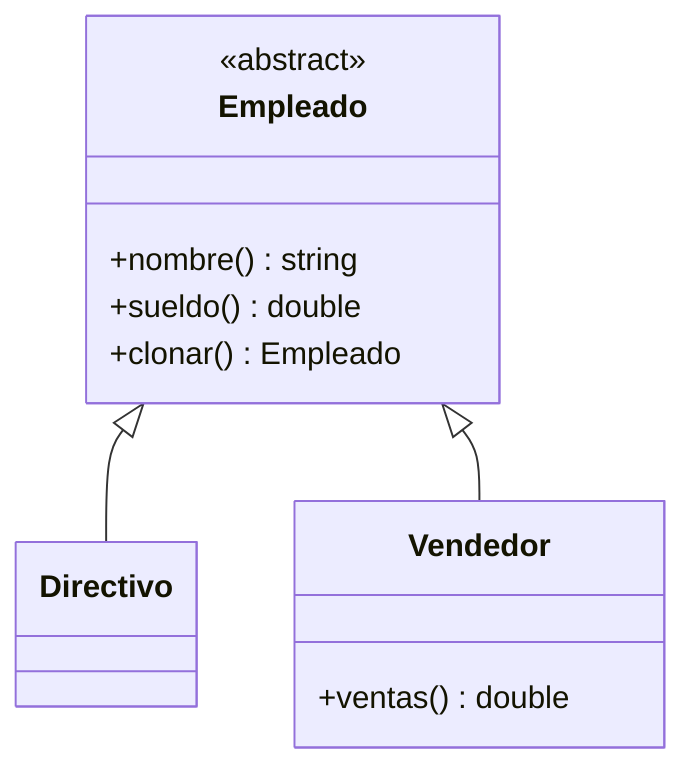

!!! warning

    El contenido de esta página no ha sido revisado ni corregido, por lo que puede
    estar incompleto, contener errores o presentar información desactualizada. Además,
    es posible que esté desordenado, carezca de una estructura clara o incluya notas
    copiadas directamente.

Este capítulo estudia cómo C++ agrupa datos y operaciones en tipos abstractos mediante
clases, cómo se construyen jerarquías de clases con herencia y polimorfismo, y cómo se
comprueba su comportamiento con pruebas unitarias sencillas. Parte de la organización en
módulos descrita en el capítulo de [archivos y módulos](section_3_files.md), en el que
se aplican las cabeceras, las implementaciones y los espacios de nombres que aquí se dan
por conocidos. También se suponen los punteros básicos, descritos en el capítulo de
[fundamentos de C](../05_c_systems/section_1_fundamentals.md), porque la herencia los
usa antes de que el capítulo siguiente trate la memoria dinámica.

## Introducción

### Niveles de abstracción

La programación procedimental descompone un problema en subprogramas por refinamientos
sucesivos, siguiendo un diseño descendente. La programación modular da un paso más.
Reúne un conjunto de datos y el conjunto de operaciones que se aplican sobre ellos en un
mismo módulo, aunque los datos siguen a la vista de quien use el módulo.

El siguiente nivel es el **tipo abstracto de datos** (TAD). Un TAD define un tipo
mediante las operaciones que admite y oculta cómo se representan sus valores. Quien lo
usa lo trata como una caja negra, ya que solo conoce los datos de entrada y el
resultado, y no lo que hay dentro. En C++ un TAD se implementa con una **clase**, que
además se comporta como cualquier otro tipo de dato del lenguaje.

### Atributos, métodos y objetos

Los miembros de una clase son de dos tipos:

- **Atributos**: Variables que codifican el estado de un objeto.
- **Métodos**: Subprogramas que describen el comportamiento de un objeto.

Una clase es la definición del tipo. Un **objeto** es cada instancia de esa clase. Todos
los objetos de una clase comparten los mismos métodos, pero cada uno tiene su propio
estado. Dos fracciones, por ejemplo, tienen cada una su numerador y su denominador, y
ambas se suman con la misma operación.

La propiedad que da sentido a este diseño es la **encapsulación**: los atributos se
declaran privados y solo se modifican a través de los métodos públicos. Así la clase
puede garantizar su **invariante**, una condición que se cumple siempre para cualquier
objeto válido, como que un denominador nunca sea cero.

El código cliente, que es el que usa la clase, no conoce lo que hay en la parte privada,
de modo que no puede leer ni escribir los atributos directamente. Una sentencia como
`std::cout << r.num;` sobre un atributo privado no compila y el compilador informa de
que el miembro es privado en ese contexto (`is private within this context`).

## Clases y encapsulación

### Interfaz de una clase

La definición de la clase va en el archivo de cabecera y constituye su interfaz. Declara
los atributos, los métodos y las constantes, y reparte el acceso con tres etiquetas.

| Etiqueta    | Quién puede acceder                                          |
| ----------- | ------------------------------------------------------------ |
| `public`    | El código cliente, la implementación y las clases derivadas. |
| `protected` | Los métodos de la clase y de sus clases derivadas.           |
| `private`   | Solo los métodos de la propia clase.                         |

`struct` y `class` se distinguen por el acceso por defecto, que es público en la primera
y privado en la segunda. Por convención, `struct` se reserva para agregados de datos sin
comportamiento y `class` para tipos con invariantes. Los métodos privados son auxiliares
de la implementación de un método público. Una búsqueda interna o una normalización son
candidatos habituales.

La implementación va en el archivo `.cpp`. Cada método se define con el nombre de la
clase seguido de `::`. Dentro del método, los atributos se refieren al objeto que lo
recibe, que es accesible mediante el puntero `this`. La expresión `*this` designa al
propio objeto.

### De funciones libres a métodos

La conversión de un módulo procedimental a una clase sigue una regla. El objeto que
recibe la llamada sustituye a uno de los parámetros de la función, y por eso desaparece
de la lista de parámetros.

| Función libre                                      | Método equivalente                   |
| -------------------------------------------------- | ------------------------------------ |
| `bool iguales(const C &a, const C &b)`             | `bool iguales(const C &b) const`     |
| `void escribir(const C &a)`                        | `void escribir() const`              |
| `void leer(C &a)`                                  | `void leer()`                        |
| `void sumar(const C &a, const C &b, C &resultado)` | `void sumar(const C &a, const C &b)` |

En la primera fila el receptor ocupa el lugar del primer operando. En la última ocupa el
del parámetro de salida, que es la variable sobre la que recae el resultado. El
calificador `const` tras la lista de parámetros indica que el método no altera el estado
del objeto.

### Contratos y precondiciones

Cada método debe documentar su contrato. Las **precondiciones** son lo que el cliente
debe cumplir antes de invocarlo, y las **postcondiciones** son lo que el método
garantiza al terminar. Se escriben en un comentario junto a la declaración en la
cabecera, como en `// Precondición: d != 0`. Para hacerlas cumplir durante el desarrollo
se usa `assert` de `<cassert>`, que detiene el programa si la condición es falsa.

Hay dos formas de tratar una operación que puede fallar. Si la causa es un error de
programación del cliente, como acceder a una posición inexistente, se declara una
precondición y se comprueba con `assert`. Si el fallo forma parte del funcionamiento
normal, como retirar más dinero del disponible, la operación devuelve un resultado que
el cliente debe consultar, sea un `bool` o un código de resultado.

### Un ejemplo: los racionales como clase

El módulo de racionales del capítulo anterior permitía fabricar una fracción inválida
como `{3, 0}`. Como clase, la construcción normaliza la fracción y los atributos no son
accesibles desde fuera, por lo que ningún objeto válido tiene denominador cero ni signo
en el denominador. Los constructores y la lista de inicialización se explican en las
secciones siguientes. Los métodos `numerador` y `denominador` son **consultoras**: leen
el estado sin modificarlo. La interfaz va en `racional.hpp`. La cabecera `<iosfwd>`
basta para declarar el operador de salida sin cargar todas las definiciones de los
flujos.

```cpp linenums="1"
#ifndef RACIONAL_HPP
#define RACIONAL_HPP

#include <iosfwd>

namespace mat {

// Invariante de la clase: den > 0 y la fracción es irreducible
class Racional {
public:
    // Constructor por defecto: 0/1
    Racional();
    // Un entero es una fracción con denominador 1: permite escribir 1 + Racional(1, 2)
    Racional(int n);
    // Precondición: d != 0
    Racional(int n, int d);

    // Consultoras: no modifican el estado, por eso son const
    int numerador() const;
    int denominador() const;

private:
    int num;
    int den;

    // Divide ambos atributos por su máximo común divisor y deja den positivo
    void normalizar();
};

// Operadores simétricos como funciones libres: así el entero puede ir a la izquierda
Racional operator+(const Racional &a, const Racional &b);
Racional operator*(const Racional &a, const Racional &b);
// Precondición: b distinto de cero
Racional operator/(const Racional &a, const Racional &b);
bool operator==(const Racional &a, const Racional &b);
bool operator<(const Racional &a, const Racional &b);
std::ostream &operator<<(std::ostream &out, const Racional &r);

}

#endif
```

La implementación, en `racional.cpp`, define los métodos con el prefijo `Racional::`. La
función auxiliar `mcd` queda en un espacio de nombres anónimo. Como la fracción está
normalizada, la igualdad se reduce a comparar atributos.

```cpp linenums="1"
#include "racional.hpp"

#include <cassert>
#include <iostream>

namespace {

// Máximo común divisor por el algoritmo de Euclides
int mcd(int a, int b) {
    while (b != 0) {
        int resto = a % b;
        a = b;
        b = resto;
    }
    return a < 0 ? -a : a;
}

}

namespace mat {

// La lista de inicialización construye los atributos antes de entrar al cuerpo
Racional::Racional() : num(0), den(1) {}

Racional::Racional(int n) : num(n), den(1) {}

Racional::Racional(int n, int d) : num(n), den(d) {
    assert(d != 0);
    normalizar();
}

int Racional::numerador() const {
    return num;
}

int Racional::denominador() const {
    return den;
}

void Racional::normalizar() {
    int divisor = mcd(num, den);
    if (den < 0) {
        divisor = -divisor;
    }
    num /= divisor;
    den /= divisor;
}

Racional operator+(const Racional &a, const Racional &b) {
    return Racional(a.numerador() * b.denominador() + a.denominador() * b.numerador(),
                    a.denominador() * b.denominador());
}

Racional operator*(const Racional &a, const Racional &b) {
    return Racional(a.numerador() * b.numerador(), a.denominador() * b.denominador());
}

Racional operator/(const Racional &a, const Racional &b) {
    assert(b.numerador() != 0);
    return Racional(a.numerador() * b.denominador(), a.denominador() * b.numerador());
}

bool operator==(const Racional &a, const Racional &b) {
    return a.numerador() == b.numerador() && a.denominador() == b.denominador();
}

bool operator<(const Racional &a, const Racional &b) {
    return a.numerador() * b.denominador() < a.denominador() * b.numerador();
}

std::ostream &operator<<(std::ostream &out, const Racional &r) {
    return out << r.numerador() << '/' << r.denominador();
}

}
```

Un programa cliente, `main_racional.cpp`, crea objetos, los combina y los muestra. Para
compilar todo se genera primero el objeto de la clase y después se enlaza con el
programa.

```cpp linenums="1"
#include "racional.hpp"

#include <iostream>

using mat::Racional;

int main() {
    // Constructor por defecto
    Racional a;
    // Constructor específico: la fracción se normaliza
    Racional b(2, -6);
    // Constructor de copia, con dos sintaxis equivalentes
    Racional c(b);
    Racional d = b;
    // Asignación sobre un objeto que ya existe
    a = Racional(1, 2);

    std::cout << "a = " << a << ", b = " << b << '\n';
    std::cout << a + b << ' ' << a * b << ' ' << a / b << '\n';
    std::cout << std::boolalpha << (b < a) << ' ' << (Racional(2, 4) == a) << ' '
              << (c == d) << '\n';
    // La conversión implícita de entero permite mezclar ambos tipos
    std::cout << 1 + a << '\n';
    return 0;
}
```

```bash linenums="1"
g++ -std=c++17 -Wall -Wextra -c racional.cpp -o racional.o
g++ -std=c++17 -Wall -Wextra main_racional.cpp racional.o -o main
./main
```

```plaintext title="Expected output"
a = 1/2, b = -1/3
1/6 -1/6 -3/2
true true true
3/2
```

Los operadores simétricos se escriben como funciones libres. Con un método miembro, la
expresión `1 + a` no compilaría, porque el operando izquierdo, un `int`, no tiene
métodos. Como el constructor `Racional(int)` no es `explicit`, el entero se convierte en
un racional y la función libre se aplica sin más.

## Constructores

Un **constructor** tiene el nombre de la clase, no declara tipo de retorno y se ejecuta
al crear un objeto, con el fin de inicializarlo. Existen tres familias.

- **Constructor por defecto**: No recibe argumentos. Si la clase no declara ningún
  constructor, el compilador genera uno que no inicializa los atributos numéricos.
- **Constructor específico**: Recibe valores para inicializar los atributos. Puede haber
  varios con distinto número o tipo de parámetros.
- **Constructor de copia**: Recibe otro objeto de la misma clase por referencia
  constante y crea un duplicado.

La sintaxis de creación determina cuál se invoca.

| Sentencia             | Constructor invocado                                       |
| --------------------- | ---------------------------------------------------------- |
| `Racional a;`         | Por defecto.                                               |
| `Racional b(2, -6);`  | Específico.                                                |
| `Racional c(b);`      | De copia.                                                  |
| `Racional d = b;`     | De copia. Es una inicialización y no una asignación.       |
| `a = Racional(1, 2);` | Se crea un temporal con el específico y después se asigna. |

Una declaración como `Racional e();` no crea un objeto. Declara una función llamada `e`
que devuelve un `Racional`. El constructor por defecto se invoca sin paréntesis.

### Lista de inicialización

La lista que sigue a los dos puntos construye los atributos antes de ejecutar el cuerpo
del constructor. Es la forma de inicializar un atributo y no de asignarlo después, y es
obligatoria para los atributos constantes, las referencias y los objetos miembro sin
constructor por defecto. Los atributos se inicializan siempre en el orden en que se
declaran en la clase, con independencia del orden en que aparezcan en la lista. El
compilador avisa con `-Wall` cuando ambos órdenes difieren (`-Wreorder`). Los atributos
de tipos básicos no tienen valor por defecto, de modo que cada constructor debe darles
uno. Los atributos de tipo `std::string` o de otras clases se construyen solos, aunque
inicializarlos de forma explícita aclara la intención.

!!! warning "Constructores específicos y constructor por defecto"

    Al declarar cualquier constructor, el compilador deja de generar el constructor por
    defecto. Una clase con solo `Cuenta(unsigned n)` no admite la declaración
    `Cuenta c;` y el compilador informa de que no encuentra una función coincidente
    (`no matching function for call to 'Cuenta::Cuenta()'`). Cuando se necesita, hay que
    declararlo de forma explícita.

Un constructor con un único parámetro actúa también como conversión implícita desde ese
tipo. `Racional(int)` lo aprovecha a propósito. Para evitarlo se marca como `explicit`,
como hacen los constructores de `Empleado` en el ejemplo de clases abstractas.

## Asignación

El operador de asignación `operator=` define cómo se copia un objeto sobre otro que ya
existe. Se distingue de la copia en la creación: en `int x = 8, y; y = x;` primero se
crea `y` y después se le asigna un valor. El patrón habitual es el siguiente:

1. Comprobar la autoasignación con `this != &otro`, para no destruir el origen al
   copiarlo sobre sí mismo.
2. Copiar los atributos.
3. Devolver `*this` por referencia, lo que permite encadenar asignaciones.

```cpp linenums="1"
// Forma explícita, solo por ilustración: la versión generada ya hace lo mismo
Racional &Racional::operator=(const Racional &otro) {
    if (this != &otro) {
        num = otro.num;
        den = otro.den;
    }
    return *this;
}
```

Cuando una clase gestiona recursos, como la memoria dinámica, la asignación debe
escribirse junto con el constructor de copia y el destructor, lo que se conoce como
**regla de tres** y se desarrolla en el capítulo de
[memoria dinámica](section_5_memory.md). Para una clase de valores como `Racional` valen
las versiones que genera el compilador.

## Destructores y vida de los objetos

El **destructor**, escrito con el nombre de la clase precedido de `~`, se ejecuta de
forma automática cuando un objeto termina su vida. Una variable local se destruye al
salir de su bloque, de modo que en un bucle se crea y se destruye un objeto en cada
iteración. Su función es liberar los recursos que el objeto tenga, y en las clases de
valores puede quedar vacío.

El programa siguiente muestra el ciclo de vida con una clase que anuncia cada paso. La
clase `Pareja` ilustra también el orden dentro de un objeto compuesto. Primero se
construyen los atributos, en orden de declaración, y después se ejecuta el cuerpo del
constructor. La destrucción sigue el orden inverso.

```cpp linenums="1"
#include <iostream>
#include <string>

// Clase auxiliar que anuncia cuándo se construye, se copia y se destruye
class Traza {
public:
    explicit Traza(const std::string &n) : nombre(n) {
        std::cout << "construye " << nombre << '\n';
    }
    Traza(const Traza &otra) : nombre(otra.nombre + " (copia)") {
        std::cout << "copia de " << otra.nombre << '\n';
    }
    ~Traza() {
        std::cout << "destruye " << nombre << '\n';
    }

private:
    std::string nombre;
};

// Composición: los atributos se construyen antes que el cuerpo del constructor
// y se destruyen después del cuerpo del destructor, en orden inverso
class Pareja {
public:
    Pareja() : primero("primero"), segundo("segundo") {
        std::cout << "construye Pareja\n";
    }
    ~Pareja() {
        std::cout << "destruye Pareja\n";
    }

private:
    Traza primero;
    Traza segundo;
};

int main() {
    Traza a("a");
    {
        Pareja p;
    }
    Traza c(a);
    std::cout << "fin de main\n";
    return 0;
}
```

```plaintext title="Expected output"
construye a
construye primero
construye segundo
construye Pareja
destruye Pareja
destruye segundo
destruye primero
copia de a
fin de main
destruye a (copia)
destruye a
```

Las variables locales de `main` también se destruyen en orden inverso a su creación. Se
ve en las dos últimas líneas, donde la copia de `a` se destruye antes que `a`.

## Constantes y _const-correctness_

La palabra `const` documenta y hace cumplir qué partes del código pueden modificar el
estado de un objeto. Aplicarla de forma sistemática se llama _const-correctness_. Los
usos principales son los siguientes.

| Uso                                    | Significado                                                                                                  |
| -------------------------------------- | ------------------------------------------------------------------------------------------------------------ |
| `double coord_x() const;`              | El método no modifica el objeto. Los objetos constantes solo pueden llamar a estos.                          |
| `double distancia(const Punto &p);`    | El parámetro se pasa sin copiar y la función no puede modificarlo.                                           |
| `const std::string &titular() const;`  | Devuelve el atributo sin copiarlo y sin permitir que se modifique.                                           |
| `static constexpr unsigned MAX = 100;` | Constante de la clase: `static` la comparte entre todos los objetos y `constexpr` fija su valor al compilar. |

Los tipos básicos devueltos por valor, como `double`, no llevan `const` en el tipo de
retorno porque lo devuelto es una copia. Una consultora puede devolver un objeto de una
clase por valor, como hacen `origen()` y `destino()` de `Segmento` en el apartado de
composición.

El compilador comprueba la propagación de `const`. Un objeto constante no puede llamar a
un método que no lo sea, y un método `const` no puede llamar a otro que no lo sea. Si un
`const Punto` invoca `desplazar`, el error resultante es
`passing 'const Punto' as 'this' argument discards qualifiers`.

!!! tip "Cuándo marcar un método como const"

    Todo método que no modifica atributos debe ser `const`, incluidas las consultoras,
    las comparaciones y los métodos que escriben en un flujo. Si no lo es, no se puede
    invocar sobre los parámetros `const Clase &`, que son los más habituales.

## Sobrecarga de operadores

Un operador es una función con un nombre especial. `a + b` es la llamada
`operator+(a, b)` o, si el operador es un método, `a.operator+(b)`. La sobrecarga
permite definirlos para las clases propias, con estas restricciones: al menos un
operando es de una clase propia, no se pueden inventar operadores nuevos y no se cambian
su precedencia ni su número de operandos. La regla de diseño es que el operador conserve
el significado esperado, de modo que `+` sume y `==` compare.

| Operador             | Forma habitual                  | Observaciones                                    |
| -------------------- | ------------------------------- | ------------------------------------------------ |
| `=`                  | Método.                         | Devuelve `*this` para encadenar asignaciones.    |
| `+`, `-`, `*`, `/`   | Método `const` o función libre. | Devuelve un valor nuevo sin modificar operandos. |
| `==`, `!=`           | Método `const` o función libre. | `!=` se escribe como la negación de `==`.        |
| `<`, `<=`, `>`, `>=` | Método `const` o función libre. | Definen un orden, normalmente por una clave.     |
| `[]`                 | Método.                         | Con una versión `const` para leer.               |
| `<<`, `>>`           | Función libre.                  | El operando izquierdo es el flujo.               |

El operador `<<` es una función libre porque su operando izquierdo es `std::ostream`,
que no se puede modificar para añadirle un método. Devuelve el flujo por referencia para
poder encadenar escrituras, como en `std::cout << a << b`. Si la función necesita
acceder a la parte privada, la clase la declara `friend`, lo que le concede ese acceso,
aunque es preferible que use solo la interfaz pública, como hace el operador de
`Racional`. El operador `[]` se define para clases que se comportan como una colección.
El ejemplo siguiente combina ambos en una colección de teléfonos. La versión `const` de
`[]` devuelve el elemento por valor, de modo que sirve para leer en objetos constantes.

```cpp linenums="1"
#include <cassert>
#include <cstddef>
#include <iostream>
#include <vector>

// Colección con acceso por índice, como un array pero con comprobación
class Telefonos {
public:
    void insertar(unsigned t) { datos.push_back(t); }

    // Versión const: permite leer en objetos constantes
    unsigned operator[](std::size_t i) const {
        assert(i < datos.size());
        return datos[i];
    }

    // Con friend, la función libre accede a la parte privada: solo si es necesario
    friend std::ostream &operator<<(std::ostream &out, const Telefonos &t) {
        for (std::size_t i = 0; i < t.datos.size(); ++i) {
            out << (i > 0 ? " " : "") << t.datos[i];
        }
        return out;
    }

private:
    std::vector<unsigned> datos;
};

int main() {
    Telefonos t;
    t.insertar(952111111);
    t.insertar(610222222);
    const Telefonos &ref = t;
    std::cout << ref[1] << " | " << ref << '\n';
    return 0;
}
```

```plaintext title="Expected output"
610222222 | 952111111 610222222
```

Para ordenar objetos de una clase, `operator<` se define sobre su clave. Una clase
`Persona` identificada por su DNI (documento nacional de identidad) compara solo ese
atributo, de modo que dos personas con el mismo DNI son iguales con independencia del
resto de datos.

## Composición

Una clase puede tener como atributos objetos de otras clases. Esta relación de
**composición** expresa que un objeto «tiene» otros. El constructor del objeto
contenedor inicializa a los contenidos en su lista de inicialización, y su destructor
los destruye de forma automática. Un segmento está formado por dos puntos. `Punto` no
declara constructor de copia ni asignación propios, porque los que genera el compilador
son correctos. Los métodos de `Segmento` delegan en los de `Punto`, y las consultoras
devuelven copias para que el cliente no modifique los atributos privados. Para abreviar,
las clases se definen completas en un solo bloque.

```cpp linenums="1"
#include <cmath>
#include <iostream>

class Punto {
public:
    Punto() : px(0.0), py(0.0) {}
    Punto(double x, double y) : px(x), py(y) {}

    void desplazar(double dx, double dy) {
        px += dx;
        py += dy;
    }
    // La distancia depende de este punto y del parámetro: solo se pasa uno
    double distancia(const Punto &otro) const {
        return std::hypot(otro.px - px, otro.py - py);
    }
    double coord_x() const { return px; }
    double coord_y() const { return py; }

private:
    double px;
    double py;
};

// Un segmento «tiene» dos puntos: relación de composición
class Segmento {
public:
    Segmento(const Punto &a, const Punto &b) : org(a), dst(b) {}

    // El segmento delega en sus puntos
    void desplazar(double dx, double dy) {
        org.desplazar(dx, dy);
        dst.desplazar(dx, dy);
    }
    double longitud() const { return org.distancia(dst); }
    // Se devuelven copias: el cliente no puede modificar los atributos privados
    Punto origen() const { return org; }
    Punto destino() const { return dst; }

private:
    Punto org;
    Punto dst;
};

void mostrar(const Punto &p) {
    std::cout << '(' << p.coord_x() << ", " << p.coord_y() << ")\n";
}

int main() {
    Punto a(0.0, 0.0);
    // Copia del punto a
    Punto b(a);
    b.desplazar(3.0, 4.0);
    std::cout << "distancia a-b: " << a.distancia(b) << '\n';

    Segmento s(a, b);
    s.desplazar(-1.0, 2.0);
    mostrar(s.origen());
    mostrar(s.destino());
    std::cout << "longitud tras desplazar: " << s.longitud() << '\n';
    return 0;
}
```

```plaintext title="Expected output"
distancia a-b: 5
(-1, 2)
(2, 6)
longitud tras desplazar: 5
```

La composición también aparece en las colecciones. Una clase que guarda un
`std::vector<Punto>` o un `std::array<Punto, N>` es propietaria de sus puntos y los
destruye con ella.

## Pruebas unitarias sencillas

Una **prueba unitaria** comprueba el comportamiento de una pieza pequeña de código, como
una clase, de forma automática y repetible. No necesita ningún marco de pruebas. Basta
con un programa propio por módulo, llamado por convención `test_nombre.cpp`, con la
estructura siguiente:

- Una función `void test_algo()` por cada comportamiento, que crea sus propios objetos,
  ejecuta una operación y comprueba el resultado con `assert`.
- Un `main` que llama a todas las funciones y, si ninguna falla, imprime un mensaje de
  éxito como `--- OK.`.

Las pruebas de `Racional` ilustran la estructura. Se prueba la construcción, cada
operación y la salida.

```cpp linenums="1"
#include "racional.hpp"

#include <cassert>
#include <iostream>
#include <sstream>

using mat::Racional;

void test_constructores() {
    Racional r;
    assert(r.numerador() == 0 && r.denominador() == 1);

    // La construcción normaliza: signo en el numerador y fracción irreducible
    Racional s(2, -6);
    assert(s.numerador() == -1 && s.denominador() == 3);

    Racional copia(s);
    assert(copia == s);
}

void test_operaciones() {
    Racional a(1, 2), b(1, 3);
    assert(a + b == Racional(5, 6));
    assert(a * b == Racional(1, 6));
    // Dividir por b deshace la multiplicación
    assert((a * b) / b == a);
    assert(b < a);
}

void test_conversion_desde_entero() {
    assert(1 + Racional(1, 2) == Racional(3, 2));
}

void test_salida() {
    // ostringstream recoge lo que se escribiría en pantalla
    std::ostringstream ss;
    ss << Racional(3, -6);
    assert(ss.str() == "-1/2");
}

int main() {
    test_constructores();
    test_operaciones();
    test_conversion_desde_entero();
    test_salida();

    std::cout << "--- OK." << std::endl;
    return 0;
}
```

```bash linenums="1"
g++ -std=c++17 -Wall -Wextra test_racional.cpp racional.o -o test
./test
```

```plaintext title="Expected output"
--- OK.
```

Algunos criterios ayudan a escribir pruebas útiles:

- Probar los casos límite, como una lista vacía, una lista llena o la última posición.
- Comprobar que una operación inválida devuelve `false` y deja el objeto sin cambios.
- Comparar los números reales con una tolerancia, y nunca con `==` exacto.
- Dejar el sistema como estaba, borrando los archivos temporales.

### Fallos y NDEBUG

Cuando una comprobación falla, `assert` interrumpe el programa e informa de la función,
el archivo, la línea y la expresión que no se cumplió.

!!! warning "Pruebas con NDEBUG"

    Si el programa se compila con `-DNDEBUG`, las llamadas a `assert` desaparecen y la
    prueba que fallaba termina con éxito. Las pruebas deben compilarse sin esa opción.
    En cambio, es habitual activarla en la versión final del programa, y en ese caso las
    precondiciones comprobadas con `assert` dejan de verificarse.

### Pruebas de la salida por pantalla

Probar una función que escribe en `std::cout` exige capturar su salida. La solución más
limpia es hacer que la función reciba un `std::ostream &`, como el operador `<<` de
`Racional`. Cuando eso no es posible se redirige el _buffer_ de `std::cout` hacia un
flujo en memoria mientras dura la prueba.

```cpp linenums="1"
#include <cassert>
#include <iostream>
#include <sstream>
#include <string>

// Función que escribe en std::cout, difícil de probar directamente
void saludar(const std::string &nombre) {
    std::cout << "Hola, " << nombre << "!\n";
}

void test_saludar() {
    std::ostringstream ss;
    // Se redirige std::cout al flujo en memoria y se restaura al terminar
    std::streambuf *original = std::cout.rdbuf(ss.rdbuf());
    saludar("Ana");
    std::cout.rdbuf(original);

    assert(ss.str() == "Hola, Ana!\n");
}

int main() {
    test_saludar();
    std::cout << "--- OK." << std::endl;
    return 0;
}
```

```plaintext title="Expected output"
--- OK.
```

El _buffer_ original se restaura siempre antes de las comprobaciones, para que un fallo
de `assert` no deje la salida estándar redirigida.

## Herencia

La **herencia** crea una clase nueva, la **derivada**, a partir de otra existente, la
**base**. La derivada hereda los atributos y métodos de la base, puede añadir los suyos
y puede redefinir los que necesite. Expresa una relación «es un». Un directivo es un
empleado, de modo que se puede usar un directivo en cualquier sitio donde se espere un
empleado. Es la relación contraria a la composición, donde un segmento «tiene» puntos.

La herencia pública, que es la habitual, se declara con `class Derivada : public Base`.
Los miembros de la base se ven desde la derivada y desde el cliente según su etiqueta de
acceso.

| Miembro de la base | Visible en la clase derivada | Visible para el cliente |
| ------------------ | ---------------------------- | ----------------------- |
| `public`           | Sí.                          | Sí.                     |
| `protected`        | Sí.                          | No.                     |
| `private`          | No.                          | No.                     |

Al crear un objeto derivado se construye primero la parte de la base, para lo cual el
constructor de la derivada invoca el de la base en su lista de inicialización, y después
la parte propia. La destrucción sigue el orden inverso.

El ejemplo que se desarrolla en los apartados siguientes modela los empleados de una
empresa. Todos tienen un nombre y un sueldo, pero este se calcula de forma distinta
según la categoría. Los vendedores añaden además el total de sus ventas.



## Polimorfismo

El **polimorfismo** permite que una misma llamada ejecute código distinto según el tipo
real del objeto. Con un método normal, la versión que se ejecuta se decide en
compilación según el tipo del puntero o la referencia, que es el enlace estático. Si el
método se declara `virtual`, la decisión se toma en ejecución según el objeto apuntado,
y es el enlace dinámico.

```cpp linenums="1"
#include <iostream>
#include <string>

class Animal {
public:
    virtual ~Animal() {}
    // Sin virtual: se resuelve en compilación según el tipo del puntero
    std::string tipo() const { return "animal"; }
    // Con virtual: se resuelve en ejecución según el objeto apuntado
    virtual std::string sonido() const { return "..."; }
};

class Perro : public Animal {
public:
    std::string tipo() const { return "perro"; }
    std::string sonido() const override { return "guau"; }
};

void presentar(const Animal &a) {
    std::cout << a.tipo() << " dice " << a.sonido() << '\n';
}

int main() {
    Perro p;
    Animal *ptr = &p;
    std::cout << p.tipo() << '/' << ptr->tipo() << '\n';
    // La referencia permite el polimorfismo sin copiar el objeto
    presentar(p);

    // Copia por valor: se copia solo la parte Animal (rebanado u object slicing)
    Animal copia = p;
    std::cout << copia.sonido() << '\n';
    return 0;
}
```

```plaintext title="Expected output"
perro/animal
animal dice guau
...
```

`tipo()` no es virtual, así que a través de `Animal` se ejecuta siempre la versión de la
base. `sonido()` sí lo es y responde según el objeto real. Las últimas líneas muestran
una limitación: el polimorfismo solo funciona con **punteros o referencias**. Al copiar
por valor, `Animal copia = p;` copia únicamente la parte `Animal` del perro, lo que se
conoce como rebanado (_object slicing_).

Tres reglas completan el mecanismo:

- **`override`**: Al final de la firma de un método de la derivada, pide al compilador
  que compruebe que redefine uno virtual de la base. Sin él, un error en la firma, como
  olvidar un `const`, crea un método nuevo en lugar de redefinir el existente. Si el
  método marcado no existe en la base, el compilador lo rechaza con el error
  `marked 'override', but does not override`.
- **Tipo de retorno covariante**: Un método virtual que devuelve un puntero a la base
  puede redefinirse devolviendo un puntero a la derivada, como hace `clonar()`.
- **Destructor virtual**: Lo necesita toda clase que se use como base de una jerarquía
  polimórfica. Sin él, borrar un objeto derivado a través de un puntero a la base
  ejecuta solo el destructor de la base, y el comportamiento resultante es indefinido.
  El compilador avisa con `-Wdelete-non-virtual-dtor`.

## Clases abstractas

Una **clase abstracta** define una interfaz y no se puede instanciar. Se obtiene al
declarar al menos un método **virtual puro**, que es un método virtual sin
implementación, marcado con `= 0`. Las clases derivadas están obligadas a implementarlo
para poder crear objetos. De lo contrario, siguen siendo abstractas.

En el ejemplo, `Empleado` declara `sueldo()` y `clonar()` como virtuales puros, ya que
una clase base no puede saber cómo calcular el sueldo de un empleado genérico ni qué
objeto copiar. `Directivo` y `Vendedor` son las clases concretas, y cada una implementa
las dos operaciones. La palabra `override` asegura que cada método coincide con el
virtual puro de la base, y `clonar()` devuelve un puntero a la clase concreta, que se
convierte sin más en un puntero a `Empleado`. Los tres bloques de código de este
apartado y del siguiente forman un único programa.

```cpp linenums="1"
#include <cassert>
#include <iostream>
#include <string>
#include <vector>

// Clase base abstracta: las dos operaciones puras no tienen implementación
class Empleado {
public:
    explicit Empleado(const std::string &n) : nom(n) {}
    // Imprescindible: se destruirá a través de punteros a Empleado
    virtual ~Empleado() {}

    // Constructor virtual (patrón prototipo): cada clase devuelve una copia de sí misma
    virtual Empleado *clonar() const = 0;
    virtual double sueldo() const = 0;
    const std::string &nombre() const { return nom; }

private:
    std::string nom;
};

class Directivo : public Empleado {
public:
    explicit Directivo(const std::string &n) : Empleado(n) {}
    // Tipo de retorno covariante: devuelve un puntero a la clase derivada
    Directivo *clonar() const override { return new Directivo(*this); }
    double sueldo() const override { return 5000.0; }
};

class Vendedor : public Empleado {
public:
    Vendedor(const std::string &n, double v) : Empleado(n), total(v) {}
    Vendedor *clonar() const override { return new Vendedor(*this); }
    // Fijo de 1000 más el 5 % de las ventas
    double sueldo() const override { return 1000.0 + 0.05 * total; }
    double ventas() const { return total; }

private:
    double total;
};
```

## Fábricas y propiedad de los objetos

Las jerarquías polimórficas se manejan a través de punteros a la clase base, y los
objetos se crean con `new` en el montón. Surgen dos cuestiones: quién decide la clase
concreta que se crea y quién libera los objetos.

Una **fábrica** responde a la primera. Es una función, o una clase, que recibe los datos
que identifican una categoría, como una letra, crea el objeto de la clase concreta y lo
entrega como un puntero a la base. El resto del programa no necesita conocer las clases
concretas. La función `nuevo_empleado` del ejemplo cumple este papel.

La segunda se resuelve con el concepto de **propiedad**. La clase `Nomina` guarda
punteros a empleados y es la responsable de liberarlos, de modo que su destructor hace
`delete` sobre cada uno. Una consecuencia es que no basta con copiar los punteros al
copiar la nómina, porque dos nóminas intentarían liberar el mismo objeto. La **copia
profunda**, que duplica los objetos apuntados y no solo los punteros, se hace con el
método virtual `clonar()`, que es el patrón prototipo (_prototype_) y funciona como un
constructor de copia virtual. Cada empleado sabe duplicarse sin que quien lo copia
conozca su clase concreta.

```cpp linenums="1"
// Colección polimórfica que es propietaria de los empleados que contiene
class Nomina {
public:
    Nomina() {}
    Nomina(const Nomina &otra) { copiar(otra); }
    ~Nomina() { destruir(); }

    Nomina &operator=(const Nomina &otra) {
        if (this != &otra) {
            destruir();
            copiar(otra);
        }
        return *this;
    }

    // Si devuelve true, la nómina pasa a ser responsable de liberarlo
    bool anyadir(Empleado *e) {
        if (e == nullptr) {
            return false;
        }
        lista.push_back(e);
        return true;
    }

    // La llamada a sueldo() ejecuta la versión de la clase real de cada empleado
    void sueldos(std::ostream &out) const {
        for (const Empleado *e : lista) {
            out << e->nombre() << ": " << e->sueldo() << '\n';
        }
    }

private:
    std::vector<Empleado *> lista;

    void destruir() {
        for (Empleado *e : lista) {
            delete e;
        }
        lista.clear();
    }

    // Copia profunda: se clona cada empleado en lugar de copiar el puntero
    void copiar(const Nomina &otra) {
        for (const Empleado *e : otra.lista) {
            lista.push_back(e->clonar());
        }
    }
};
```

`Nomina` cumple la regla de tres, con constructor de copia, asignación y destructor
propios, porque gestiona recursos. La función fábrica concentra los `new` y devuelve
`nullptr` ante una categoría desconocida. El resultado de `anyadir` indica si la nómina
ha tomado posesión del objeto, y solo es `false` con un puntero nulo, como el que
devuelve la fábrica. El programa final comprueba además que una copia sobrevive al
borrado de la original.

```cpp linenums="1"
// Función fábrica: concentra los new y devuelve la clase base
Empleado *nuevo_empleado(char categoria, const std::string &nombre, double ventas = 0.0) {
    switch (categoria) {
    case 'D': return new Directivo(nombre);
    case 'V': return new Vendedor(nombre, ventas);
    default: return nullptr;
    }
}

int main() {
    Nomina p;
    p.anyadir(nuevo_empleado('D', "Ana"));
    p.anyadir(nuevo_empleado('V', "Pepe", 4000.0));
    // Una categoría desconocida no añade nada
    std::cout << std::boolalpha << p.anyadir(nuevo_empleado('Z', "Raro")) << '\n';

    // La copia es independiente: sobrevive a la destrucción del original
    Nomina *original = new Nomina(p);
    Nomina copia(*original);
    delete original;
    copia.sueldos(std::cout);
    return 0;
}
```

```plaintext title="Expected output"
false
Ana: 5000
Pepe: 1200
```

!!! tip "Punteros inteligentes"

    En código nuevo, el propietario suele ser un `std::unique_ptr<Empleado>` de la
    biblioteca estándar, que libera el objeto de forma automática y hace innecesario
    escribir el destructor a mano, aunque la copia profunda sigue necesitando
    `clonar()`. El ejemplo usa punteros simples para mostrar de forma explícita quién
    libera cada objeto. Los punteros inteligentes se describen en el capítulo de
    [memoria](section_5_memory.md).

Las clases de este capítulo guardan sus datos en tipos básicos y en objetos de la
biblioteca estándar, salvo `Nomina`, que ya ha mostrado el primer uso de `new` y
`delete`, con sus reglas de propiedad y copia. El capítulo siguiente, sobre
[punteros y memoria dinámica](section_5_memory.md), estudia cómo se reserva y se libera
la memoria en ejecución, y cómo con ella se construyen listas enlazadas, pilas y colas
que crecen según las necesidades del programa.
