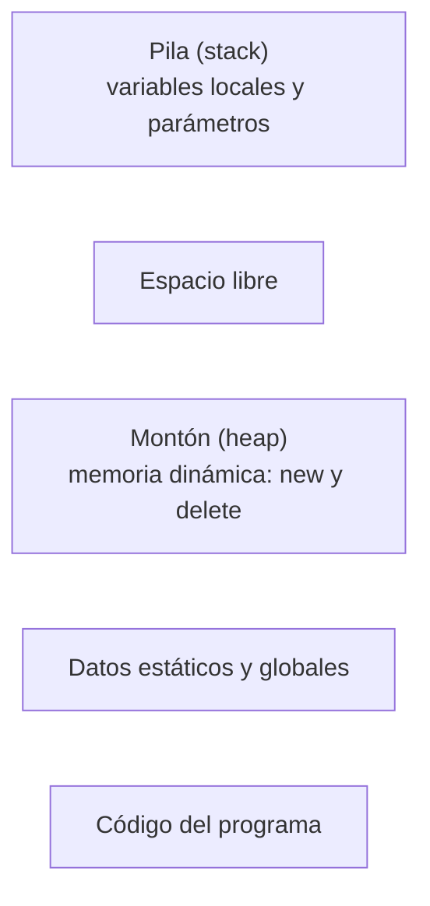

!!! warning

    El contenido de esta página no ha sido revisado ni corregido, por lo que puede
    estar incompleto, contener errores o presentar información desactualizada. Además,
    es posible que esté desordenado, carezca de una estructura clara o incluya notas
    copiadas directamente.

Este capítulo recorre la gestión de la memoria en C++: la diferencia entre pila y
montón, los punteros, la reserva y liberación dinámicas con `new` y `delete`, los
errores que provoca un uso incorrecto y la regla de tres que obliga a seguir toda clase
que posee recursos. Sobre esa base se construyen una lista enlazada, una pila, una cola
y un contenedor genérico con plantillas. El capítulo termina con los contenedores y los
punteros inteligentes de la biblioteca estándar, que sustituyen a estas implementaciones
en el código real. Presupone la sintaxis descrita en los capítulos de
[fundamentos](section_1_fundamentals.md) y de
[funciones y estructuras de datos](section_2_functions_and_data.md) y las clases del
capítulo de [programación orientada a objetos](section_4_oop.md).

## Introducción

C++ conserva el control de la memoria en manos del programador. Las variables locales
las gestiona el compilador, que las crea al entrar en su bloque y las destruye al salir.
Cuando el tamaño de los datos solo se conoce en ejecución, o cuando un objeto debe
sobrevivir al bloque que lo creó, el programa solicita memoria de forma explícita y es
responsable de devolverla. Esa **memoria dinámica** es la base de las estructuras
enlazadas y también la fuente de los errores más difíciles de depurar del lenguaje.

Los punteros, su aritmética y `malloc` y `free` se describen en el capítulo de
[fundamentos de C](../05_c_systems/section_1_fundamentals.md), por lo que aquí solo se
añade lo específico de C++. Los ejemplos se compilan con C++17 y con los desinfectores
(_sanitizers_) de GCC, que instrumentan el programa para detectar en ejecución accesos a
memoria liberada, dobles liberaciones, desbordamientos y fugas.

```bash linenums="1"
g++ -std=c++17 -Wall -Wextra -fsanitize=address,undefined -g programa.cpp -o programa
./programa
```

La opción `-fsanitize=address` activa _AddressSanitizer_ (ASan), que además de los
accesos inválidos informa de las fugas al terminar el programa mediante _LeakSanitizer_.
La opción `-fsanitize=undefined` activa _UndefinedBehaviorSanitizer_, que señala
operaciones de comportamiento indefinido como la desreferencia de un puntero nulo. La
opción `-g` añade números de línea a los informes. La instrumentación ralentiza la
ejecución, por lo que se reserva para el desarrollo y las pruebas.

## Memoria de un programa

Un programa en ejecución organiza su memoria en regiones con funciones distintas. El
código compilado y los datos estáticos o globales ocupan regiones de tamaño fijo. Para
los datos que cambian durante la ejecución existen dos regiones: la **pila** (_stack_),
que almacena variables locales y parámetros de las funciones, y el **montón** (_heap_),
que se reserva a petición del programa.



Las variables **automáticas** o locales viven en la pila: el compilador reserva su
espacio al declararlas y lo libera al terminar el bloque. Las variables **dinámicas**
viven en el montón y su tiempo de vida lo decide el programa, desde que se reservan con
`new` hasta que se liberan con `delete`. La variable dinámica no tiene nombre y se
accede a ella a través de un puntero, que sí es una variable automática y guarda la
dirección del objeto del montón.

| Característica | Pila (_stack_)                                       | Montón (_heap_)                                  |
| :------------- | :--------------------------------------------------- | :----------------------------------------------- |
| Gestión        | Automática, a cargo del compilador.                  | Manual, mediante `new` y `delete`.               |
| Tiempo de vida | Hasta salir del bloque donde se declara.             | Hasta que se libera de forma explícita.          |
| Tamaño         | Limitado y fijo, del orden de unos pocos MiB.        | Limitado por la memoria disponible.              |
| Acceso         | Por el nombre de la variable.                        | Solo mediante punteros, sin nombre propio.       |
| Coste          | Muy bajo.                                            | Mayor, porque el gestor busca un hueco libre.    |
| Error habitual | Desbordamiento por recursión o _arrays_ muy grandes. | Fugas, punteros colgantes y dobles liberaciones. |

## Punteros

Un **puntero** es una variable que almacena una dirección de memoria. Los operadores
`&`, que devuelve la dirección de una variable, y `*`, que accede al objeto apuntado
(**desreferenciar**), funcionan igual que en C. C++ añade el literal `nullptr` y los
alias de tipo con `using`.

???+ example "Direcciones y desreferencia"

    El programa declara un puntero a un entero, modifica la variable a través de él y lo
    compara con `nullptr`.

    ```cpp linenums="1"
    #include <iostream>

    // Alias del tipo "puntero a int".
    using PInt = int *;

    int main() {
        int x = 3;
        // px almacena la dirección de x.
        PInt px = &x;
        // Escribir a través del puntero modifica x.
        *px = 5;
        std::cout << "x = " << x << ", *px = " << *px << "\n";
        std::cout << std::boolalpha << "px apunta a x: " << (px == &x) << "\n";

        // Un puntero nulo no apunta a ningún objeto.
        PInt nulo = nullptr;
        std::cout << "nulo es nullptr: " << (nulo == nullptr) << "\n";
    }
    ```

    ```plaintext title="Expected output"
    x = 5, *px = 5
    px apunta a x: true
    nulo es nullptr: true
    ```

La comparación entre punteros del mismo tipo compara direcciones, no contenidos. La
macro heredada de C `NULL` cumple el mismo papel que `nullptr`, pero este último tiene
tipo propio y evita ambigüedades en la sobrecarga de funciones. Cuando el objeto
apuntado es una estructura o una clase, sus miembros se acceden con el operador flecha:
`ptr->nombre` equivale a `(*ptr).nombre`. Los paréntesis son imprescindibles en la
segunda forma porque el operador punto tiene mayor precedencia que el asterisco.

La palabra `const` puede aplicarse al objeto apuntado, al puntero o a ambos. Se lee de
derecha a izquierda a partir del identificador.

| Declaración          | Qué no puede modificarse         | Ejemplo de uso                           |
| :------------------- | :------------------------------- | :--------------------------------------- |
| `const int *p`       | El entero apuntado.              | `*p = 1;` no compila, `p = &y;` sí.      |
| `int *const p`       | El propio puntero.               | `p = &y;` no compila, `*p = 1;` sí.      |
| `const int *const p` | Tanto el entero como el puntero. | Ninguna de las dos asignaciones compila. |

!!! warning "Punteros sin inicializar"

    Un puntero declarado sin valor, como `int *p;`, apunta a una zona indeterminada.
    Leerlo o desreferenciarlo es comportamiento indefinido, y el programa puede imprimir
    basura, funcionar por casualidad o terminar con un fallo de segmentación. La
    disciplina correcta consiste en inicializar siempre el puntero, con la dirección de
    un objeto válido o con `nullptr`, y comprobar que no es nulo antes de
    desreferenciarlo.

## Aritmética de punteros y _arrays_

La expresión `p + n` avanza `n` elementos del tipo apuntado y no `n` bytes. El nombre de
un _array_ se convierte en un puntero a su primer elemento, de modo que `a[i]` equivale
a `*(a + i)`, y la resta de dos punteros al mismo _array_ devuelve el número de
elementos que los separa, con tipo `std::ptrdiff_t`.

???+ example "Aritmética sobre un _array_"

    El programa recorre un _array_ con un puntero, mide una distancia y suma un tramo.

    ```cpp linenums="1"
    #include <cstddef>
    #include <iostream>

    // El parámetro es un puntero: el tamaño del array no viaja con él.
    int sumar(const int *v, std::size_t n) {
        int total = 0;
        // v + n apunta una posición después del último elemento.
        for (const int *p = v; p != v + n; ++p) {
            total += *p;
        }
        return total;
    }

    int main() {
        int a[5] = {10, 20, 30, 40, 50};
        // El nombre del array se convierte en un puntero a su primer elemento.
        int *p = a;
        std::cout << *p << " " << *(p + 2) << " " << a[2] << "\n";

        // La resta de punteros cuenta elementos, no bytes.
        std::ptrdiff_t distancia = &a[4] - &a[1];
        std::cout << "distancia: " << distancia << "\n";

        // Con el array original, sizeof sí conoce el tamaño total.
        std::size_t n = sizeof(a) / sizeof(a[0]);
        std::cout << "suma = " << sumar(a, n) << "\n";

        // Avanzar el puntero permite pasar solo un tramo del array.
        std::cout << "suma de los tres últimos = " << sumar(a + 2, 3) << "\n";
    }
    ```

    ```plaintext title="Expected output"
    10 30 30
    distancia: 3
    suma = 150
    suma de los tres últimos = 120
    ```

El recorrido de `sumar` se detiene en `v + n`, el puntero que apunta una posición
después del último elemento. Esa dirección es válida para comparar, pero no para
desreferenciar. Al pasar un _array_ a una función solo viaja la dirección del primer
elemento, y dentro de la función `sizeof(v)` devuelve el tamaño de un puntero, por lo
que la longitud debe acompañarlo como parámetro adicional. Es una de las razones para
preferir `std::array` y `std::vector`, que conservan su tamaño.

!!! warning "Salirse del _array_"

    Avanzar un puntero más allá de la posición siguiente al último elemento, o
    desreferenciar esa posición, es comportamiento indefinido. El compilador no
    comprueba los límites y el fallo puede pasar inadvertido durante las pruebas.
    ASan detecta estos accesos en tiempo de ejecución, y `std::vector::at()` los
    comprueba siempre.

## Paso de punteros a funciones

Un puntero es un valor más y se puede pasar a funciones, devolver desde ellas y
almacenar en estructuras. La forma de pasarlo determina qué puede modificar la función.
En C la misma necesidad se resuelve con un puntero a puntero, mientras que C++ dispone
además de la referencia a puntero.

| Forma del parámetro | Qué puede modificar la función                       | Cuándo usarla                                  |
| :------------------ | :--------------------------------------------------- | :--------------------------------------------- |
| `T *p`              | El objeto apuntado, pero no el puntero del llamador. | Modificar el contenido de un objeto existente. |
| `T *&p`             | El puntero del llamador, además del objeto.          | Crear, reasignar o anular el puntero.          |
| `const T *p`        | Nada, solo lectura del objeto.                       | Consultar sin modificar.                       |

???+ example "Formas de pasar un puntero"

    El programa modifica el contenido de una `Persona` mediante un puntero, comprueba
    que reasignar el parámetro no afecta al llamador y crea un objeto con una referencia
    a puntero.

    ```cpp linenums="1"
    #include <iostream>
    #include <string>

    struct Persona {
        std::string nombre;
        unsigned edad;
    };

    // Modifica el objeto apuntado: el cambio es visible para el llamador.
    void renombrar(Persona *p) {
        p->nombre = "Juan";
    }

    // La asignación al parámetro solo afecta a la copia local del puntero.
    void reasignar(Persona *p) {
        p = nullptr;
        std::cout << "en reasignar, p es nulo: " << std::boolalpha << (p == nullptr)
                  << "\n";
    }

    // Referencia al puntero: la función puede hacerlo apuntar a un objeto nuevo.
    void crear(Persona *&p) {
        p = new Persona{"Paquito", 20};
    }

    int main() {
        Persona *p1 = new Persona{"Alba", 5};
        renombrar(p1);
        std::cout << p1->nombre << "\n";
        reasignar(p1);
        std::cout << "p1 válido: " << std::boolalpha << (p1 != nullptr) << "\n";
        delete p1;

        Persona *p2 = nullptr;
        crear(p2);
        std::cout << p2->nombre << ", " << p2->edad << " años\n";
        delete p2;
    }
    ```

    ```plaintext title="Expected output"
    Juan
    en reasignar, p es nulo: true
    p1 válido: true
    Paquito, 20 años
    ```

La función `renombrar` recibe una copia de la dirección, pero ambas copias apuntan al
mismo objeto, así que el cambio es visible desde `main`. En cambio, `reasignar` modifica
solo su copia local, y `crear` sí puede cambiar hacia dónde apunta el puntero del
llamador porque recibe un alias. Esta última forma es la necesaria cuando una función
debe modificar la cabeza de una lista enlazada.

Una función que devuelve o crea un puntero a memoria dinámica transfiere con él la
responsabilidad de liberarla. Dejar claro quién es el propietario de cada objeto es el
problema central de la gestión manual, y los punteros inteligentes del final del
capítulo lo resuelven en el propio tipo.

## Memoria dinámica con `new` y `delete`

El operador `new` reserva memoria en el montón para un objeto del tipo indicado, invoca
a su constructor y devuelve un puntero a él. El operador `delete` ejecuta el destructor
y devuelve la memoria al gestor del montón. A diferencia de `malloc` y `free`, que no
invocan constructores ni destructores, `new` y `delete` son la forma correcta de
gestionar objetos en C++. Cada forma de reserva exige su liberación correspondiente.

| Reserva       | Liberación    | Observación                                                                  |
| :------------ | :------------ | :--------------------------------------------------------------------------- |
| `new T(args)` | `delete p;`   | Un único objeto, construido con `args`.                                      |
| `new T[n]`    | `delete[] p;` | Un _array_ de `n` objetos. Con `{}` los tipos básicos se inicializan a cero. |

???+ example "Reserva y liberación"

    El programa reserva un objeto y un _array_ en el montón y los libera con `delete` y
    `delete[]`.

    ```cpp linenums="1"
    #include <iostream>

    class Numero {
    public:
        explicit Numero(int v) : val(v) {}
        int consulta() const { return val; }

    private:
        int val;
    };

    int main() {
        // new reserva memoria en el montón e invoca al constructor.
        Numero *ptr = new Numero(5);
        std::cout << "Valor: " << ptr->consulta() << "\n";
        // delete libera el objeto, pero no modifica el puntero.
        delete ptr;
        // Se anula para que no quede colgante: delete sobre nullptr no hace nada.
        ptr = nullptr;
        delete ptr;

        // Los arrays dinámicos usan new[] y delete[].
        int n = 4;
        int *v = new int[n]{};
        for (int i = 0; i < n; ++i) {
            v[i] = i * i;
            std::cout << v[i] << (i + 1 < n ? " " : "\n");
        }
        delete[] v;
    }
    ```

    ```plaintext title="Expected output"
    Valor: 5
    0 1 4 9
    ```

Dos punteros que contienen la misma dirección son **alias** del mismo objeto: si se
libera por uno, el otro queda apuntando a memoria que ya no es válida.

### Errores habituales

El manejo manual de la memoria admite un conjunto reducido de errores que se repiten en
casi todos los programas.

| Error                     | Causa                                                                    | Consecuencia                                      |
| :------------------------ | :----------------------------------------------------------------------- | :------------------------------------------------ |
| Fuga de memoria (_leak_)  | Se pierde la última dirección de un objeto sin llamar a `delete`.        | El consumo de memoria crece durante la ejecución. |
| Puntero colgante          | Se usa un puntero después de liberar el objeto al que apuntaba.          | Datos antiguos, basura o fallo de segmentación.   |
| Doble liberación          | Se aplica `delete` dos veces a la misma dirección, por alias o copias.   | Corrupción del gestor de memoria y aborto.        |
| Emparejamiento incorrecto | Se libera con `delete` memoria de `new[]`, o con `delete[]` la de `new`. | Comportamiento indefinido.                        |

El primer ejemplo es una fuga. Asignar `nullptr` al único puntero que referencia al
objeto parece una forma de liberarlo, pero en realidad lo pierde, y el `delete`
posterior actúa sobre un puntero nulo.

???+ example "Fuga por anular el único puntero"

    El programa reserva una `Persona`, asigna `nullptr` a su único puntero y después
    llama a `delete`.

    ```cpp linenums="1"
    #include <iostream>
    #include <string>

    struct Persona {
        std::string nombre;
        unsigned edad;
    };

    int main() {
        Persona *ptr = new Persona{"Alba", 18};
        std::cout << "Ptr apunta a " << ptr->nombre << "\n";
        // Se pierde la única dirección del objeto sin liberarlo.
        ptr = nullptr;
        // delete sobre nullptr no libera nada.
        delete ptr;
    }
    ```

    ```plaintext title="Expected output"
    Ptr apunta a Alba

    ==4165412==ERROR: LeakSanitizer: detected memory leaks

    Direct leak of 40 byte(s) in 1 object(s) allocated from:
        #0 0x754083eb61e7 in operator new(unsigned long)
        #1 0x60a0d791e713 in main fuga.cpp:10

    SUMMARY: AddressSanitizer: 40 byte(s) leaked in 1 allocation(s).
    ```

El orden correcto es liberar primero y anular después: `delete ptr; ptr = nullptr;`.
LeakSanitizer informa de 40 bytes perdidos, el tamaño de una `Persona`.

El segundo ejemplo es un puntero colgante. El acceso posterior a `delete` puede mostrar
el contenido antiguo, basura o terminar con un fallo de segmentación, sin que nada
garantice cuál de los tres ocurre. ASan lo detecta en ejecución.

???+ example "Acceso tras liberar"

    El programa lee un campo de un objeto después de haberlo liberado con `delete`.

    ```cpp linenums="1"
    #include <iostream>
    #include <string>

    struct Persona {
        std::string nombre;
        unsigned edad;
    };

    int main() {
        Persona *ptr = new Persona{"Pepe", 5};
        std::cout << ptr->nombre << "\n";
        delete ptr;
        // El puntero conserva la dirección, pero el objeto ya no existe.
        std::cout << ptr->edad << "\n";
    }
    ```

    ```plaintext title="Expected output"
    Pepe
    ==4165420==ERROR: AddressSanitizer: heap-use-after-free on address 0x504000000030
    READ of size 4 at 0x504000000030 thread T0
        #0 0x57c372ed6a65 in main uaf.cpp:14

    0x504000000030 is located 32 bytes inside of 40-byte region
    freed by thread T0 here:
        #1 0x57c372ed691e in main uaf.cpp:12

    previously allocated by thread T0 here:
        #1 0x57c372ed6773 in main uaf.cpp:10

    SUMMARY: AddressSanitizer: heap-use-after-free uaf.cpp:14 in main
    ```

!!! note "Lectura de los informes"

    Los informes de AddressSanitizer se leen de arriba abajo. La primera línea indica la
    clase de error. El primer bloque de pila señala la instrucción que lo provoca, y los
    bloques `freed by` y `previously allocated by` indican dónde se liberó y dónde se
    reservó el objeto. En los extractos del capítulo se han abreviado las rutas y se han
    omitido las direcciones de las bibliotecas del sistema.

## Clases con memoria dinámica y regla de tres

Una clase que posee memoria dinámica, es decir, que reserva en su constructor y debe
liberar en su destructor, no puede apoyarse en las operaciones de copia que el
compilador genera por defecto. Esas operaciones copian los atributos uno a uno, incluido
el puntero, y producen una **copia superficial** (_shallow copy_): dos objetos que
apuntan al mismo recurso y lo liberan los dos.

???+ example "Copia superficial"

    La clase `Numero` guarda su entero en el montón y lo libera en el destructor, pero
    no define constructor de copia.

    ```cpp linenums="1"
    #include <iostream>

    class Numero {
    public:
        explicit Numero(int v) : val(new int(v)) {}
        ~Numero() { delete val; }
        int consulta() const { return *val; }

    private:
        int *val;
    };

    int main() {
        Numero a(1);
        // La copia generada por el compilador duplica el puntero, no el entero.
        Numero b(a);
        std::cout << a.consulta() << " " << b.consulta() << "\n";
    }
    ```

    ```plaintext title="Expected output"
    1 1
    ==4165428==ERROR: AddressSanitizer: attempting double-free on 0x502000000010
        #0 0x7b93f82b724f in operator delete(void*, unsigned long)
        #1 0x62c60557c9c7 in Numero::~Numero() copia.cpp:6
        #2 0x62c60557c70d in main copia.cpp:18

    0x502000000010 is located 0 bytes inside of 4-byte region
    freed by thread T0 here:
        #1 0x62c60557c9c7 in Numero::~Numero() copia.cpp:6

    previously allocated by thread T0 here:
        #1 0x62c60557c89b in Numero::Numero(int) copia.cpp:5

    SUMMARY: AddressSanitizer: double-free in operator delete(void*, unsigned long)
    ```

El objeto `b` comparte con `a` el entero del montón. Al salir de `main`, el destructor
de `b` lo libera y el de `a` intenta liberarlo de nuevo. La solución es la **regla de
tres**: si una clase necesita definir uno de estos tres miembros especiales, casi con
seguridad necesita definir los tres.

| Miembro                                           | Se invoca cuando                                                                     | Responsabilidad                                         |
| :------------------------------------------------ | :----------------------------------------------------------------------------------- | :------------------------------------------------------ |
| Constructor de copia `T(const T &o)`              | Se crea un objeto a partir de otro: `T b(a);`, `T b = a;`, paso o retorno por valor. | Reservar recursos propios y copiar el contenido de `o`. |
| Operador de asignación `T &operator=(const T &o)` | Se asigna a un objeto que ya existe: `c = a;`.                                       | Evitar la autoasignación, liberar lo anterior y copiar. |
| Destructor `~T()`                                 | El objeto sale de ámbito o se aplica `delete` a un puntero a él.                     | Liberar los recursos que posee el objeto.               |

La distinción entre copia en la creación y asignación sobre un objeto existente tiene
consecuencias prácticas con memoria dinámica. `Numero b(a)` crea `b` ya como copia,
mientras que `c = a` actúa sobre un `c` que ya posee un recurso, y por eso la asignación
debe liberarlo o reutilizarlo. La guarda `if (this != &o)` evita que `a = a` destruya el
contenido antes de copiarlo.

???+ example "Numero con la regla de tres"

    La clase completa los tres miembros especiales, de modo que cada objeto posee su
    propio entero.

    ```cpp linenums="1"
    #include <iostream>

    class Numero {
    public:
        explicit Numero(int v) : val(new int(v)) {}
        // Constructor de copia: el nuevo objeto reserva su propio entero.
        Numero(const Numero &o) : val(new int(*o.val)) {}
        // Asignación: reutiliza la memoria ya reservada y evita a = a.
        Numero &operator=(const Numero &o) {
            if (this != &o) {
                *val = *o.val;
            }
            return *this;
        }
        // Destructor: libera la memoria que posee el objeto.
        ~Numero() { delete val; }

        int consulta() const { return *val; }
        void modificar(int v) { *val = v; }

    private:
        int *val;
    };

    int main() {
        Numero a(1);
        Numero b(a);
        b.modificar(2);
        std::cout << "a = " << a.consulta() << ", b = " << b.consulta() << "\n";

        Numero c(3);
        c = a;
        a.modificar(7);
        std::cout << "a = " << a.consulta() << ", c = " << c.consulta() << "\n";

        // La autoasignación es segura.
        a = a;
        std::cout << "a = " << a.consulta() << "\n";
    }
    ```

    ```plaintext title="Expected output"
    a = 1, b = 2
    a = 7, c = 1
    a = 7
    ```

Cada objeto conserva ahora su propio entero y, con ASan, el programa termina sin
informes. Definir solo dos de los tres miembros deja la clase defectuosa. Si falta
`operator=`, el operador generado copia el puntero y reaparece la doble liberación, un
fallo frecuente al guardar esos objetos en un `std::vector`, que copia y asigna sus
elementos con frecuencia. El patrón de adquirir el recurso en el constructor y liberarlo
en el destructor se denomina **RAII** (_Resource Acquisition Is Initialization_) y es la
base de los contenedores y los punteros inteligentes de las últimas secciones.

!!! note "Regla de cero y regla de cinco"

    Cuando todos los atributos de una clase se gestionan solos, como ocurre con
    `std::string`, `std::vector` o los punteros inteligentes, la **regla de cero**
    indica que no hay que escribir ninguno de los tres miembros, y es el objetivo en
    código moderno. Una clase con un `std::vector<int>` como atributo se copia en
    profundidad y se libera sola con los miembros que genera el compilador. En el
    extremo opuesto, desde C++11 las clases que gestionan recursos suelen añadir además
    un constructor de movimiento y una asignación por movimiento, lo que amplía la regla
    de tres a una **regla de cinco**. Este capítulo se limita a los tres miembros
    clásicos.

## Listas enlazadas

Una **lista enlazada** es una colección de **nodos** donde cada nodo contiene un dato y
un puntero al nodo siguiente. La lista se identifica por un puntero a su primer nodo, la
cabeza, y el último nodo apunta a `nullptr`, que actúa como marca de final. Los nodos no
están contiguos en memoria. El capítulo de
[estructuras de datos](../../04_software_engineering/section_1_data_structures.md)
describe las propiedades y los costes de esta estructura. Aquí se implementa con
punteros.


Un nodo contiene un puntero a otro nodo del mismo tipo. Para usar el alias de puntero
dentro de la propia definición de `Nodo`, hace falta que el nombre exista antes. La
**declaración anticipada** `struct Nodo;` crea un tipo incompleto sobre el que ya se
puede definir el alias. Las funciones que no modifican la cabeza, como `mostrar` y
`buscar`, la reciben por valor. Las que pueden cambiar cuál es el primer nodo, como las
inserciones y `destruir`, la reciben por referencia.

La eliminación usa un **puntero a puntero**. La variable `enlace` apunta al puntero que
referencia al nodo actual, que es la cabeza al inicio y el campo `sig` del nodo anterior
después. Como la cabeza y los campos `sig` son punteros del mismo tipo, borrar un nodo
es siempre `*enlace = borrar->sig`, sin tratar de forma especial el primero ni la lista
vacía.

???+ example "Operaciones sobre una lista de nodos"

    El programa inserta por ambos extremos, busca un dato, elimina todas sus apariciones
    y libera la lista.

    ```cpp linenums="1"
    #include <cstddef>
    #include <iostream>

    // Declaración anticipada: permite que Nodo contenga un puntero a Nodo.
    struct Nodo;
    using PNodo = Nodo *;

    struct Nodo {
        int dato;
        PNodo sig;
    };

    // Muestra la lista desde la cabeza hasta el último nodo.
    void mostrar(PNodo lista) {
        for (PNodo p = lista; p != nullptr; p = p->sig) {
            std::cout << p->dato << (p->sig != nullptr ? " " : "");
        }
        std::cout << "\n";
    }

    // Devuelve el primer nodo con el dato buscado, o nullptr si no existe.
    PNodo buscar(PNodo lista, int dt) {
        PNodo p = lista;
        // El orden importa: primero se comprueba p != nullptr.
        while (p != nullptr && p->dato != dt) {
            p = p->sig;
        }
        return p;
    }

    // Inserta al principio en tiempo constante.
    void insertar_principio(PNodo &lista, int dt) {
        lista = new Nodo{dt, lista};
    }

    // Inserta al final recorriendo la lista hasta el último nodo.
    void insertar_final(PNodo &lista, int dt) {
        PNodo nuevo = new Nodo{dt, nullptr};
        if (lista == nullptr) {
            lista = nuevo;
        } else {
            PNodo act = lista;
            while (act->sig != nullptr) {
                act = act->sig;
            }
            act->sig = nuevo;
        }
    }

    // Elimina todas las apariciones del dato y devuelve cuántas había.
    // enlace apunta al puntero que referencia al nodo actual (cabeza o sig).
    std::size_t eliminar(PNodo &lista, int dt) {
        std::size_t borrados = 0;
        PNodo *enlace = &lista;
        while (*enlace != nullptr) {
            if ((*enlace)->dato == dt) {
                PNodo borrar = *enlace;
                *enlace = borrar->sig;
                delete borrar;
                ++borrados;
            } else {
                enlace = &(*enlace)->sig;
            }
        }
        return borrados;
    }

    // Libera todos los nodos. La cabeza es una referencia y acaba en nullptr.
    void destruir(PNodo &lista) {
        while (lista != nullptr) {
            PNodo aux = lista;
            lista = lista->sig;
            delete aux;
        }
    }

    int main() {
        PNodo lista = nullptr;
        for (int v : {4, 8, 15, 8, 16}) {
            insertar_final(lista, v);
        }
        insertar_principio(lista, 1);
        mostrar(lista);

        std::cout << std::boolalpha;
        std::cout << "buscar 15: " << (buscar(lista, 15) != nullptr) << "\n";
        std::cout << "eliminados 8: " << eliminar(lista, 8) << "\n";
        std::cout << "eliminados 1: " << eliminar(lista, 1) << "\n";
        mostrar(lista);
        destruir(lista);
    }
    ```

    ```plaintext title="Expected output"
    1 4 8 15 8 16
    buscar 15: true
    eliminados 8: 2
    eliminados 1: 1
    4 15 16
    ```

Los costes de las operaciones dependen de si hay que recorrer la lista.

| Operación                                         | Coste  |
| :------------------------------------------------ | :----- |
| Insertar o eliminar al principio.                 | $O(1)$ |
| Insertar al final sin puntero al último nodo.     | $O(n)$ |
| Insertar al final con puntero al último nodo.     | $O(1)$ |
| Eliminar el último nodo.                          | $O(n)$ |
| Buscar, situar, insertar o eliminar por posición. | $O(n)$ |

Eliminar el último nodo cuesta $O(n)$ en una lista simple porque hay que llegar al
penúltimo para dejar su puntero en `nullptr`. Las listas doblemente enlazadas, descritas
en el capítulo de estructuras de datos, evitan ese recorrido.

!!! warning "Errores frecuentes al manipular nodos"

    - Crear un nodo con `new Nodo` sin asignar `dato` y `sig` deja campos con basura.
      Por eso el nodo se inicializa en la propia reserva con `new Nodo{dt, nullptr}`.
    - Un puntero al último nodo queda colgante si ese nodo se elimina. Mezclar esa
      eliminación con la inserción por el final exige actualizar o anular el puntero.

### Clase lista con posiciones

Encapsular la lista en una clase oculta los punteros al cliente y concentra la gestión
de memoria en un único lugar. La clase `ListaInt` simula un _array_ de enteros sin
límite, con operaciones por posición. Mantiene el tamaño lógico `sz` junto con la
cabeza, aplica la regla de tres mediante dos auxiliares privados, `duplicar` y
`destruir`, y expresa las precondiciones con `assert`.

`insertar` y `eliminar` usan la técnica del puntero a puntero, de modo que ninguna trata
de forma especial la posición cero. La auxiliar `enlace_a` devuelve el puntero (la
cabeza o un campo `sig`) que referencia a la posición dada. `duplicar` mantiene un
puntero al enlace donde debe colgar el siguiente nodo, lo que evita también el caso
especial del primer nodo.

???+ example "Lista enlazada con regla de tres"

    El programa comprueba que las copias, tanto por constructor como por asignación, son
    independientes de la lista original.

    ```cpp linenums="1"
    #include <cassert>
    #include <cstddef>
    #include <iostream>

    class ListaInt {
        struct Nodo {
            int num;
            Nodo *sig;
        };
        using PNodo = Nodo *;

    public:
        ListaInt() : lista(nullptr), sz(0) {}
        // Constructor de copia: duplica los nodos.
        ListaInt(const ListaInt &o) : lista(duplicar(o.lista)), sz(o.sz) {}
        // Destructor: libera todos los nodos.
        ~ListaInt() { destruir(lista); }
        // Asignación: libera los nodos actuales y duplica los del otro objeto.
        ListaInt &operator=(const ListaInt &o) {
            if (this != &o) {
                destruir(lista);
                lista = duplicar(o.lista);
                sz = o.sz;
            }
            return *this;
        }

        std::size_t size() const { return sz; }

        // Precondición: pos <= size(), pues insertar en size() añade al final.
        void insertar(std::size_t pos, int dato) {
            assert(pos <= sz);
            PNodo *enlace = enlace_a(pos);
            *enlace = new Nodo{dato, *enlace};
            ++sz;
        }

        // Precondición: pos < size().
        void eliminar(std::size_t pos) {
            assert(pos < sz);
            PNodo *enlace = enlace_a(pos);
            PNodo borrar = *enlace;
            *enlace = borrar->sig;
            delete borrar;
            --sz;
        }

        void escribir(std::ostream &os) const {
            for (PNodo p = lista; p != nullptr; p = p->sig) {
                os << p->num << (p->sig != nullptr ? " " : "");
            }
            os << "\n";
        }

    private:
        PNodo lista;
        std::size_t sz;

        // Libera la cadena de nodos y deja la cabeza en nullptr.
        static void destruir(PNodo &l) {
            while (l != nullptr) {
                PNodo aux = l;
                l = l->sig;
                delete aux;
            }
        }

        // Copia profunda. fin apunta al enlace donde colgar el siguiente nodo.
        static PNodo duplicar(PNodo origen) {
            PNodo copia = nullptr;
            PNodo *fin = &copia;
            for (PNodo p = origen; p != nullptr; p = p->sig) {
                *fin = new Nodo{p->num, nullptr};
                fin = &(*fin)->sig;
            }
            return copia;
        }

        // Devuelve el puntero (cabeza o campo sig) que referencia a la posición.
        PNodo *enlace_a(std::size_t pos) {
            PNodo *enlace = &lista;
            for (std::size_t i = 0; i < pos; ++i) {
                enlace = &(*enlace)->sig;
            }
            return enlace;
        }
    };

    int main() {
        ListaInt a;
        a.insertar(0, 10);
        a.insertar(1, 30);
        a.insertar(1, 20);
        a.escribir(std::cout);

        // Copia profunda: b tiene sus propios nodos.
        ListaInt b(a);
        b.eliminar(0);
        a.escribir(std::cout);
        b.escribir(std::cout);

        // La asignación también copia en profundidad y libera lo anterior.
        ListaInt c;
        c.insertar(0, 1);
        c = a;
        a.eliminar(2);
        a.escribir(std::cout);
        c.escribir(std::cout);

        // La autoasignación no destruye la lista.
        c = c;
        std::cout << "tamaño de c: " << c.size() << "\n";
    }
    ```

    ```plaintext title="Expected output"
    10 20 30
    10 20 30
    20 30
    10 20
    10 20 30
    tamaño de c: 3
    ```

!!! warning "Precondiciones con límites erróneos"

    Una condición como `assert(pos <= size())` es correcta para insertar, pero
    incorrecta para eliminar. Con `pos == size()` supera la comprobación y el acceso
    posterior desreferencia un puntero nulo, por lo que las operaciones sobre un
    elemento existente exigen `pos < size()`. Conviene además usar `std::size_t` en
    todas las posiciones, porque mezclar `int` y `unsigned` obliga a conversiones y
    llega a producir condiciones siempre verdaderas, como `pos >= 0` con un tipo sin
    signo.

## Pilas y colas con nodos

Las pilas y las colas restringen el acceso a los extremos de una secuencia. La **pila**
sigue el orden LIFO (_last in, first out_): el último elemento apilado es el primero en
salir. La **cola** sigue el orden FIFO (_first in, first out_): se extrae por el frente
en el orden en que se insertó por el final. Sus propiedades y costes se tratan en el
capítulo de
[estructuras de datos](../../04_software_engineering/section_1_data_structures.md). Con
nodos, ambas se obtienen por diferencia respecto a `ListaInt` y aplican la regla de tres
con el mismo esquema de auxiliares privados.

La pila es una lista en la que solo se opera en la cabeza, que es la cima. Las tres
operaciones tienen coste constante y no necesitan el puntero a puntero.

```cpp linenums="1"
// Pila LIFO de enteros. Por brevedad se omiten el constructor de copia, la asignación y
// el destructor, que siguen el esquema de ListaInt.
class Pila {
    struct Nodo {
        int elem;
        Nodo *sig;
    };

public:
    void apilar(int elem) { cabeza = new Nodo{elem, cabeza}; }

    // Precondición: la pila no está vacía.
    void desapilar() {
        assert(cabeza != nullptr);
        Nodo *ptr = cabeza;
        cabeza = cabeza->sig;
        delete ptr;
    }

    // Precondición: la pila no está vacía.
    int cima() const {
        assert(cabeza != nullptr);
        return cabeza->elem;
    }

private:
    Nodo *cabeza = nullptr;
};
```

La cola necesita dos punteros, `ini` al primer nodo y `fin` al último, para que insertar
por el final y extraer por el frente sean $O(1)$. El mantenimiento coherente de ambos
punteros es la única dificultad. Al encolar en una cola vacía hay que fijar `ini` y
`fin`, y en caso contrario enlazar tras `fin`. Al desencolar el último elemento, ambos
pasan a `nullptr`. La copia se resuelve reutilizando `encolar` sobre los elementos de la
otra cola, de modo que `fin` se mantiene siempre actualizado. La cola completa se
presenta en la sección siguiente como plantilla.

!!! warning "Errores en las colas con nodos"

    Invertir la condición de `encolar` sobrescribe `ini` con la dirección del último
    nodo y pierde la cola, o ejecuta `fin->sig` sobre `nullptr` con la cola vacía.

## Plantillas

Las clases anteriores almacenan siempre enteros. Para almacenar cadenas, estructuras u
otros tipos sería necesario duplicar el código. Una **plantilla** (_template_) resuelve
este problema parametrizando por uno o varios tipos. Las plantillas de función se
presentaron en el capítulo de
[funciones y estructuras de datos](section_2_functions_and_data.md), y las de clase
siguen el mismo principio aplicado a una clase completa. El parámetro `typename T`
representa un tipo cualquiera, y el compilador genera una clase concreta cada vez que se
usa con un tipo distinto. Esa generación se denomina **instanciación**.

La cola genérica `Cola<T>` conserva exactamente la lógica de una cola de enteros,
sustituyendo `int` por `T`. Dado que `T` puede ser un tipo costoso de copiar, los datos
se reciben por referencia constante y el frente se devuelve igualmente por referencia
constante.

???+ example "Cola genérica con nodos"

    El programa instancia la cola con enteros y con cadenas y define una plantilla de
    función cuyo parámetro `T` se deduce a partir del argumento.

    ```cpp linenums="1"
    #include <cassert>
    #include <iostream>
    #include <string>

    // Cola FIFO genérica: T es un parámetro de la plantilla.
    template <typename T>
    class Cola {
        struct Nodo {
            T dato;
            Nodo *sig;
        };

    public:
        Cola() : ini(nullptr), fin(nullptr) {}
        // Delegar en Cola() garantiza ini y fin inicializados antes de copiar.
        Cola(const Cola &o) : Cola() { copiar(o); }
        ~Cola() { vaciar(); }
        Cola &operator=(const Cola &o) {
            if (this != &o) {
                vaciar();
                copiar(o);
            }
            return *this;
        }

        bool esta_vacia() const { return ini == nullptr; }

        void encolar(const T &elem) {
            Nodo *nuevo = new Nodo{elem, nullptr};
            if (esta_vacia()) {
                ini = nuevo;
            } else {
                fin->sig = nuevo;
            }
            fin = nuevo;
        }

        // Precondición: la cola no está vacía.
        void desencolar() {
            assert(!esta_vacia());
            Nodo *ptr = ini;
            ini = ini->sig;
            // Al extraer el último elemento, fin deja de apuntar a un nodo liberado.
            if (ini == nullptr) {
                fin = nullptr;
            }
            delete ptr;
        }

        // Precondición: la cola no está vacía.
        const T &frente() const {
            assert(!esta_vacia());
            return ini->dato;
        }

    private:
        Nodo *ini;
        Nodo *fin;

        void vaciar() {
            while (!esta_vacia()) {
                desencolar();
            }
        }

        // Reutiliza encolar, que mantiene fin actualizado.
        void copiar(const Cola &o) {
            for (const Nodo *p = o.ini; p != nullptr; p = p->sig) {
                encolar(p->dato);
            }
        }
    };

    // Plantilla de función: T se deduce a partir del argumento.
    // La cola se recibe por valor para consumir una copia y dejar la original.
    template <typename T>
    void imprimir(Cola<T> c) {
        while (!c.esta_vacia()) {
            std::cout << c.frente();
            c.desencolar();
            std::cout << (c.esta_vacia() ? "\n" : " ");
        }
    }

    int main() {
        // El compilador genera una clase distinta para cada tipo usado.
        Cola<int> numeros;
        for (int v : {3, 1, 4}) {
            numeros.encolar(v);
        }
        Cola<std::string> mensajes;
        mensajes.encolar("hola");
        mensajes.encolar("adiós");

        imprimir(numeros);
        imprimir(mensajes);
        std::cout << "frente original: " << numeros.frente() << "\n";
    }
    ```

    ```plaintext title="Expected output"
    3 1 4
    hola adiós
    frente original: 3
    ```

`Cola<int>` y `Cola<std::string>` son tipos distintos sin relación entre sí, y cada uno
tiene su propia copia del código. El compilador necesita el cuerpo completo de los
métodos para instanciar la plantilla, de modo que su definición se escribe en el archivo
de cabecera y no en un `.cpp` aparte. La `Pila` de la sección anterior se generaliza del
mismo modo. Los errores en el cuerpo de una plantilla suelen detectarse al instanciarla,
y los mensajes del compilador son largos, por lo que conviene leerlos de arriba hacia
abajo hasta la primera línea que menciona un archivo propio.

## Biblioteca estándar

Las estructuras construidas en las secciones anteriores existen ya, probadas y
optimizadas, en la biblioteca estándar. Implementarlas a mano sirve para comprender cómo
funcionan por dentro, pero en un programa real se utilizan las versiones de la
biblioteca. Estos contenedores gestionan su propia memoria, copian en profundidad y
liberan al destruirse, por lo que una clase que los use como atributos puede seguir la
regla de cero.

| Estructura propia                          | Equivalente estándar                            | Cuándo elegirlo                                                        |
| :----------------------------------------- | :---------------------------------------------- | :--------------------------------------------------------------------- |
| _Array_ dinámico con tamaño lógico         | `std::vector<T>`                                | Opción por defecto: acceso por índice $O(1)$ y memoria contigua.       |
| Secuencia con inserción por ambos extremos | `std::deque<T>`                                 | Inserción y extracción eficientes por ambos extremos con índices.      |
| Lista enlazada con nodos                   | `std::list<T>` (doble) o `std::forward_list<T>` | Inserciones y borrados frecuentes en el medio con iteradores estables. |
| `Pila` con nodos                           | `std::stack<T>`                                 | Comportamiento LIFO.                                                   |
| `Cola<T>` con nodos                        | `std::queue<T>`                                 | Comportamiento FIFO.                                                   |

### Vectores

El contenedor `std::vector<T>`, un _array_ dinámico que conoce su tamaño y crece con
`push_back`, se presentó en el capítulo de
[funciones y estructuras de datos](section_2_functions_and_data.md). Aquí solo se añaden
dos detalles. `resize` recorta o amplía el vector, y los elementos nuevos toman el valor
indicado o el valor por defecto del tipo. Cualquier operación que reasigne la memoria
interna, como `push_back` con la capacidad agotada, invalida los iteradores, descritos a
continuación, y las referencias a los elementos.

### Iteradores, deques y listas

Los contenedores estándar se recorren con **iteradores**, objetos que generalizan el
puntero. `c.begin()` devuelve un iterador al primer elemento y `c.end()` devuelve uno
que apunta a la posición siguiente al último, igual que el puntero `v + n` de los
_arrays_. Se avanza con `++it`, se accede al elemento con `*it` y a sus miembros con
`it->`. Los algoritmos de `<algorithm>`, como `std::reverse` o `std::sort`, trabajan
sobre rangos delimitados por dos iteradores. `std::sort` exige iteradores de acceso
aleatorio, así que sirve para `vector` y `deque`, pero no para `list`, que ofrece su
propio método `sort`.

???+ example "Iteradores en `deque` y `list`"

    El programa recorre un `std::deque` con iteradores, lo invierte y ordena con
    algoritmos, y elimina elementos de un `std::list` durante un recorrido.

    ```cpp linenums="1"
    #include <algorithm>
    #include <deque>
    #include <iostream>
    #include <iterator>
    #include <list>
    #include <string>

    template <typename Contenedor>
    void mostrar(const Contenedor &c) {
        // El iterador cumple el papel del puntero que recorría la lista.
        for (auto it = c.begin(); it != c.end(); ++it) {
            std::cout << *it << (std::next(it) != c.end() ? " " : "");
        }
        std::cout << "\n";
    }

    int main() {
        std::deque<int> d{3, 1, 2};
        // deque admite inserción eficiente por ambos extremos.
        d.push_front(5);
        d.push_back(4);
        mostrar(d);
        std::reverse(d.begin(), d.end());
        mostrar(d);
        std::sort(d.begin(), d.end());
        mostrar(d);

        // list es una lista doblemente enlazada: no ofrece acceso por índice.
        std::list<std::string> l{"a", "b", "a", "c"};
        // insert coloca el elemento antes de la posición indicada por el iterador.
        l.insert(std::next(l.begin()), "x");
        mostrar(l);

        // erase devuelve el iterador al siguiente elemento válido.
        for (auto it = l.begin(); it != l.end();) {
            it = (*it == "a") ? l.erase(it) : std::next(it);
        }
        mostrar(l);
    }
    ```

    ```plaintext title="Expected output"
    5 3 1 2 4
    4 2 1 3 5
    1 2 3 4 5
    a x b a c
    x b c
    ```

`std::list` ofrece `push_front`, `push_back`, `pop_front`, `insert` y `erase`, todas en
tiempo constante una vez que se dispone del iterador. La devolución de `erase` es la
forma correcta de eliminar durante un recorrido, porque usar el iterador borrado después
de `erase` es un caso más de puntero colgante.

### Pilas y colas estándar

`std::stack` y `std::queue` son **adaptadores**: ofrecen una interfaz restringida
construida sobre otro contenedor, por defecto un `std::deque`. La pila expone `push`,
`pop`, `top`, `empty` y `size`. La cola expone `push`, `pop`, `front`, `back`, `empty` y
`size`. Igual que en las clases propias, `pop` retira el elemento sin devolverlo, de
modo que se consulta primero con `top` o `front`.

???+ example "Pila y cola estándar"

    El programa usa `std::stack` de enteros y `std::queue` de cadenas.

    ```cpp linenums="1"
    #include <iostream>
    #include <queue>
    #include <stack>
    #include <string>

    int main() {
        std::stack<int> pila;
        for (int v : {1, 2, 3}) {
            pila.push(v);
        }
        // top consulta la cima y pop la retira sin devolverla.
        std::cout << "cima: " << pila.top() << "\n";
        pila.pop();
        std::cout << "cima: " << pila.top() << ", tamaño: " << pila.size() << "\n";

        std::queue<std::string> cola;
        cola.push("uno");
        cola.push("dos");
        std::cout << "frente: " << cola.front() << ", final: " << cola.back() << "\n";
        cola.pop();
        std::cout << "frente: " << cola.front() << "\n";
    }
    ```

    ```plaintext title="Expected output"
    cima: 3
    cima: 2, tamaño: 2
    frente: uno, final: dos
    frente: dos
    ```

Consultar o retirar un elemento de un adaptador vacío es comportamiento indefinido, por
lo que se comprueba `empty()` antes. Con esto desaparece la necesidad de implementar la
estructura, aunque no la obligación de respetar sus precondiciones.

### Punteros inteligentes

La gestión manual con `new` y `delete` falla porque la responsabilidad de liberar
depende de la disciplina del programador. Los **punteros inteligentes** (_smart
pointers_) la trasladan al tipo mediante RAII: el recurso se adquiere en la construcción
del puntero y se libera en su destructor, que el compilador invoca siempre al salir del
ámbito, incluso si se lanza una excepción. Las _C++ Core Guidelines_ recomiendan no
escribir `new` ni `delete` directamente en el código de aplicación.

- **`std::unique_ptr<T>`**: Propietario exclusivo. No se puede copiar, solo transferir
  con `std::move`, y su coste es el de un puntero normal. Es la opción por defecto.
- **`std::shared_ptr<T>`**: Propiedad compartida con recuento de referencias. El objeto
  se libera cuando desaparece el último propietario. Los ciclos entre `shared_ptr`
  impiden la liberación y se rompen con `std::weak_ptr`.
- **Puntero crudo `T *`**: Solo para observar un objeto cuyo propietario es otro. No se
  libera nunca a través de él.

Se crean con `std::make_unique<T>(args)` y `std::make_shared<T>(args)`, que construyen
el objeto y el puntero en una sola operación segura frente a excepciones.

???+ example "Propiedad con punteros inteligentes"

    El programa transfiere un `unique_ptr`, lo guarda en un vector y comparte un objeto
    con `shared_ptr`. El destructor de `Persona` anuncia cuándo se libera cada objeto.

    ```cpp linenums="1"
    #include <iostream>
    #include <memory>
    #include <string>
    #include <utility>
    #include <vector>

    struct Persona {
        explicit Persona(std::string n) : nombre(std::move(n)) {}
        ~Persona() { std::cout << "destruida " << nombre << "\n"; }
        std::string nombre;
    };

    // Devuelve la propiedad exclusiva del objeto al llamador.
    std::unique_ptr<Persona> crear(const std::string &nombre) {
        return std::make_unique<Persona>(nombre);
    }

    int main() {
        std::unique_ptr<Persona> p = crear("Alba");
        // unique_ptr no se copia: la propiedad solo se puede transferir.
        std::unique_ptr<Persona> q = std::move(p);
        std::cout << std::boolalpha << "p nulo: " << (p == nullptr) << "\n";

        // Un vector de unique_ptr libera cada objeto al destruirse.
        std::vector<std::unique_ptr<Persona>> v;
        v.push_back(crear("Juan"));
        v.push_back(std::move(q));

        // shared_ptr cuenta cuántos propietarios comparten el objeto.
        std::shared_ptr<Persona> s1 = std::make_shared<Persona>("Pepe");
        {
            std::shared_ptr<Persona> s2 = s1;
            std::cout << "propietarios: " << s1.use_count() << "\n";
        }
        std::cout << "propietarios: " << s1.use_count() << "\n";
        std::cout << "fin de main\n";
    }
    ```

    ```plaintext title="Expected output"
    p nulo: true
    propietarios: 2
    propietarios: 1
    fin de main
    destruida Pepe
    destruida Juan
    destruida Alba
    ```

La función `crear` devuelve un `unique_ptr`, y con él la propiedad del objeto, que ya no
necesita liberarse a mano. Tras `std::move(p)`, `p` queda nulo y `q` pasa a ser el
propietario. Al terminar `main` se destruyen los objetos en orden inverso a la
declaración de sus propietarios: primero `s1` y después los elementos del vector, que
GCC destruye en el orden en que se insertaron. Un vector de `unique_ptr` es también la
forma moderna de guardar una colección de objetos polimórficos. Sustituye al
`std::vector` de punteros crudos con liberación manual en el destructor, como el que usa
la clase `Nomina` del capítulo de [programación orientada a objetos](section_4_oop.md).
En ese caso la herencia exige además un destructor virtual en la clase base. La
liberación pasa a ser automática, aunque la copia profunda de la colección sigue
necesitando un método como `clonar()`.

Una lista enlazada también puede apoyarse en `unique_ptr`, de modo que cada nodo es
propietario del siguiente. No hay `delete` explícito, y copiar la lista queda prohibido
de forma automática.

!!! warning "Destrucción recursiva de listas largas"

    Con `std::unique_ptr<Nodo> sig` en cada nodo, la liberación de la lista es
    recursiva, porque destruir un nodo destruye su `sig`, que destruye el suyo, y así
    hasta el final. Con un millón de nodos y la pila de 8 MiB habitual en Linux, esa
    cadena de destructores la agota y el programa termina con un fallo de segmentación.
    El destructor de la lista debe desenlazar los nodos de uno en uno con
    `while (cabeza != nullptr) { cabeza = std::move(cabeza->sig); }`. Los contenedores
    estándar, como `std::list`, ya liberan sus nodos de forma iterativa.

## Criterios de elección

En la práctica, la colección de tamaño variable con acceso por índice es un
`std::vector`, y el comportamiento LIFO o FIFO se obtiene con `std::stack` o
`std::queue`. Un objeto dinámico con un único propietario se gestiona con
`std::unique_ptr` y `std::make_unique`, y uno compartido por varios propietarios con
`std::shared_ptr` y `std::make_shared`. Las implementaciones propias con regla de tres
quedan para aprender el modelo de memoria o para estructuras que la biblioteca no
ofrece, y siempre se comprueban con AddressSanitizer.

Los contenedores y punteros inteligentes eliminan casi todos los errores descritos en
este capítulo, pero no sustituyen la comprensión del modelo de memoria. Las fugas, los
punteros colgantes y las dobles liberaciones reaparecen en cuanto se usan punteros
crudos, y los desinfectores siguen siendo la forma más rápida de localizarlos. Las
estructuras de datos más avanzadas que se apoyan en estos fundamentos, como árboles y
tablas _hash_, se describen en el capítulo de
[estructuras de datos](../../04_software_engineering/section_1_data_structures.md).
Cuando varios hilos comparten estos objetos y estructuras, aparecen además las
condiciones de carrera que estudia el capítulo de
[concurrencia](../07_concurrency/section_1_fundamentals.md).
