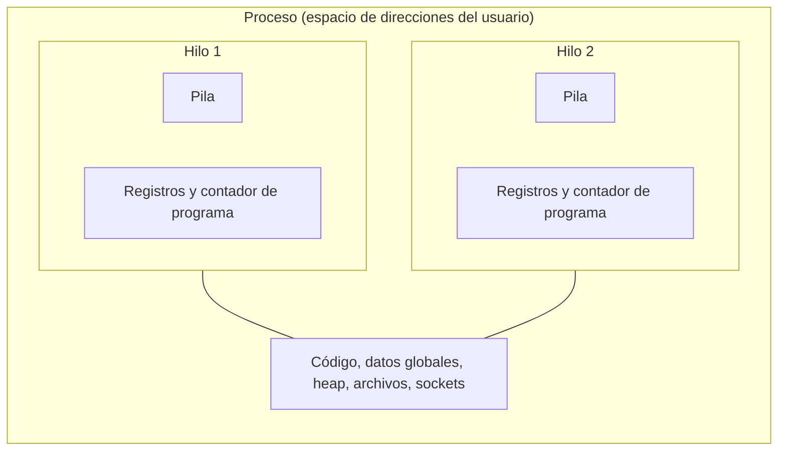
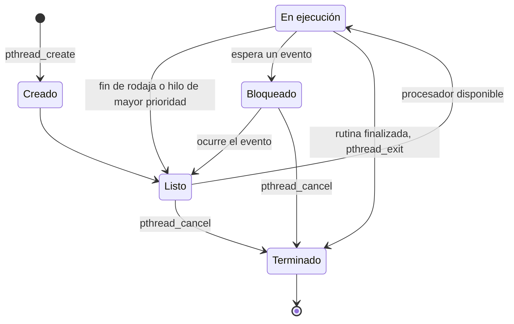

!!! warning

    El contenido de esta página no ha sido revisado ni corregido, por lo que puede
    estar incompleto, contener errores o presentar información desactualizada. Además,
    es posible que esté desordenado, carezca de una estructura clara o incluya notas
    copiadas directamente.

Este capítulo presenta los fundamentos de la programación concurrente. Parte del modelo
secuencial, introduce la semántica de intercalación y los problemas que origina (la
atomicidad, las condiciones de carrera, la sección crítica y la exclusión mutua), repasa
las plataformas y los sistemas de tiempo real donde se ejecutan estos programas y
termina con la representación de procesos e hilos y su soporte en el sistema operativo
mediante la interfaz de hilos POSIX. Los mecanismos de sincronización con memoria
compartida se desarrollan en la sección de
[memoria compartida](section_2_shared_memory.md), el paso de mensajes y los eventos en
la de [paso de mensajes y eventos](section_3_message_passing_events.md) y los problemas
clásicos en la de [problemas clásicos](section_4_classic_problems.md). Los ejemplos
están escritos en C y presuponen el capítulo de
[fundamentos de C](../05_c_systems/section_1_fundamentals.md).

## Introducción

La **programación concurrente** es la disciplina que estudia cómo escribir programas
cuyas partes pueden progresar de forma solapada en el tiempo. Se distingue del
**paralelismo**, que se refiere a la ejecución simultánea real sobre varios
procesadores. Un programa concurrente puede ejecutarse en paralelo si el hardware lo
permite, pero su corrección no debe depender de ello. Esta distinción guía todo el
capítulo: el diseño se razona sobre un modelo abstracto de ejecución y la plataforma
concreta solo decide cuánto se acelera.

### Programación secuencial

Los lenguajes secuenciales reflejan el funcionamiento de la máquina de Von Neumann. En
cada ciclo de reloj se trae una instrucción de la memoria, se decodifica y se ejecuta,
lo que da un único flujo de control. Si $P = p_1 \circ p_2 \circ \dots \circ p_n$ es un
programa secuencial, donde $\circ$ significa «precede a», en toda ejecución $p_i$
precede a $p_j$ para cualesquiera índices $i < j$. Las instrucciones están totalmente
ordenadas, y esa propiedad se conserva con selecciones y bucles, cuyas ejecuciones
posibles solo dependen de los datos de entrada.

La consecuencia es que un programa secuencial es **determinista**. Dados una instrucción
y unos datos de entrada, siempre se conoce la siguiente instrucción a ejecutar.

### Programación concurrente

El lenguaje secuencial obliga a fijar un orden incluso cuando no es necesario. En
`x = 0; y = 0; z = 0;` las tres asignaciones son independientes, y cualquiera de las
seis permutaciones produce el mismo resultado. Si se dispusiera de tres procesadores,
cada asignación podría ir a uno distinto. Para expresarlo se introduce el operador
$\parallel$:

$$
x = 0 \parallel y = 0 \parallel z = 0
$$

De forma general, $P \parallel Q$ indica que existe una ejecución válida de $P$ y $Q$ en
la que ambos códigos se solapan en el tiempo, y que cualquiera de los dos órdenes $P
\circ Q$ y $Q \circ P$ también es admisible.

Exigir procesadores reales para que exista solapamiento haría depender el programa de la
arquitectura. En su lugar se supone que cada código lo ejecuta un **procesador lógico**,
que puede coincidir con uno real o, si no hay suficientes procesadores físicos, repartir
el tiempo de los disponibles. Cada una de las partes que se ejecutan concurrentemente se
denomina **proceso** o **hilo** (_thread_). Cada una es secuencial y la concurrencia
surge al combinar varias. El modelo tiene dos consecuencias prácticas. El operador es
conmutativo, de modo que $P \parallel Q$ y $Q \parallel P$ describen el mismo conjunto
de ejecuciones, y no se puede suponer nada sobre la velocidad relativa de los
procesadores lógicos.

### Intercalación

Con un solo procesador físico, la ejecución de $P \parallel Q$ se obtiene
**intercalando** (_interleaving_) las instrucciones de ambos. En cada instante puede
haber varias instrucciones candidatas, por lo que la ejecución concurrente es, por
definición, **indeterminista**. No vale cualquier mezcla, porque una ejecución correcta
mantiene el orden relativo de las instrucciones dentro de cada proceso. Entre una
instrucción de $P$ y otra de $Q$ no hay ningún orden establecido, de modo que las
instrucciones de $P \parallel Q$ están **parcialmente ordenadas**.

Cada ejecución posible se denomina **traza**, y la ejecución secuencial $P \circ Q$ es
una traza más, no la única. Si $P$ y $Q$ tienen $n$ y $m$ instrucciones, el número de
trazas es el de formas de elegir en qué $n$ de las $n + m$ posiciones aparecen las
instrucciones de $P$:

$$
\frac{(n + m)!}{n!\,m!}
$$

Para $n = 2$ y $m = 3$ resultan $5! / (2!\,3!) = 10$ trazas, desde `ppqqq` hasta
`qqqpp`, donde `p` y `q` son pasos de $P$ y de $Q$. Para que $P \parallel Q$ sea
correcto deben serlo **todas** sus trazas, y no basta con que lo sea la que se observa
al probar. El número de trazas crece muy deprisa con la longitud de los procesos (con
dos procesos de 20 instrucciones ya hay más de $10^{11}$), por lo que la prueba
exhaustiva no es viable y el razonamiento debe ser más abstracto.

## Beneficios y usos

La programación concurrente se adopta por cuatro motivos principales:

- Aprovechar los ciclos del procesador que de otro modo quedarían ociosos, por ejemplo
  mientras un hilo espera una operación de entrada y salida y otro puede calcular.
- Explotar las arquitecturas multiprocesador y obtener ganancias de tiempo.
- Atender a varios usuarios o peticiones desde la misma máquina.
- Simplificar el modelado de sistemas que son concurrentes por naturaleza, como una red
  de sensores o un conjunto de taquillas.

### Comunicación y sincronización

Los procesos de un programa concurrente rara vez son independientes. Habitualmente se
**comunican**, intercambiando datos, y se **sincronizan**, coordinando el momento en que
actúan. Existen dos mecanismos básicos de comunicación. En el modelo de **memoria
compartida** los procesos escriben y leen variables globales. En el de **paso de
mensajes** se envían datos explícitamente.

```plaintext linenums="1"
// Memoria compartida
global x
emisor   { ...  x = m ... }
receptor { local y ... y = x ... }

// Paso de mensajes
emisor   { ... send m to receptor ... }
receptor { local y ... receive y from emisor ... }
```

En ambos esquemas el receptor no debe leer el mensaje antes de que el emisor lo haya
producido. Esa restricción es una **condición de sincronización**, y su cumplimiento
requiere una primitiva específica. Los mecanismos con memoria compartida se estudian en
[memoria compartida](section_2_shared_memory.md) y los basados en mensajes en
[paso de mensajes y eventos](section_3_message_passing_events.md).

## Problemas de la programación concurrente

La comunicación por memoria compartida es cómoda, pero origina los errores más difíciles
de la concurrencia. Se ilustra con varias taquillas que venden entradas de un teatro.
Cada taquilla es un proceso. Todas ejecutan el mismo código y comparten un _array_
`asientos` que indica qué butacas están vendidas.

```plaintext linenums="1"
while (1) {
    mostrar butacas libres al usuario
    a = asiento seleccionado
    asientos[a] = 1
    emitir la entrada
}
```

Esta solución es incorrecta. Una traza posible es que dos taquillas muestren el estado
de las butacas, ambas seleccionen el asiento 22, ambas ejecuten `asientos[22] = 1` y
ambas emitan la entrada: el asiento se ha vendido a dos clientes. Una sola traza que
viole la especificación basta para demostrar que el programa es incorrecto. Comprobar
antes de vender (`if (!asientos[a]) { asientos[a] = 1; ... }`) tampoco lo arregla,
porque ambas taquillas pueden comprobar el asiento y verlo libre antes de que ninguna lo
marque. Se ha localizado el fallo, pero no eliminado.

### Instrucciones atómicas

Una instrucción es **atómica** cuando el procesador la ejecuta sin que pueda ser
interrumpida a mitad. Como mucho lo es una instrucción máquina. Una sentencia de un
lenguaje de alto nivel se compila en varias de ellas, y el sistema puede cambiar de
proceso entre dos cualesquiera. La sentencia `if (!asientos[a]) asientos[a] = 1;`
equivale a una secuencia como esta:

```plaintext linenums="1"
load asientos[a] to CPU register
test the value of CPU register
jump to L1 if true
set asientos[a] to true
emitir la entrada
L1: ...
```

El error aparece porque otro proceso puede intercalarse entre `load` y `set`. Si
comprobar y marcar se ejecutaran como una sola unidad indivisible, la única
intercalación posible ocurriría antes o después del bloque, y la traza errónea ya no
sería posible. La atomicidad que se necesita es, por tanto, de **nivel superior** a la
de una instrucción máquina.

### Sección crítica y exclusión mutua

Una **sección crítica** es la parte del código de un proceso que debería ejecutarse de
forma atómica. En el ejemplo de las taquillas es el bloque que comprueba y marca el
asiento. Cuando las secciones críticas de dos procesos no pueden solaparse en el tiempo
se dice que se ejecutan en **exclusión mutua**. Si $SC_i$ y $SC_j$ son secciones
críticas de dos procesos, la exclusión mutua exige que toda traza cumpla:

$$
SC_i \circ SC_j \quad \text{o} \quad SC_j \circ SC_i
$$

Es decir, uno termina antes de que empiece el otro. Fuera de las secciones críticas los
procesos siguen intercalándose libremente. Esta idea resume el problema central de la
concurrencia con memoria compartida: garantizar la exclusión mutua en las secciones
críticas sin renunciar a la concurrencia del resto del programa. Las primitivas que lo
logran (espera activa, semáforos, monitores) se desarrollan en
[memoria compartida](section_2_shared_memory.md).

### Una condición de carrera real

La condición de carrera deja de ser abstracta al programarla con hilos POSIX. El ejemplo
más pequeño es un contador global que incrementan varios hilos. Cada hilo suma un millón
de veces, de modo que con cuatro hilos el resultado esperado es 4000000.

???+ example "Contador compartido sin protección"

    Cuatro hilos incrementan la misma variable global. `pthread_create` lanza un hilo
    que ejecuta la función indicada y `pthread_join` espera a que termine, como se
    detalla más adelante en la API de hilos. Se compila con
    `gcc -Wall -Wextra -pthread -o carrera carrera.c` y se ejecuta con `./carrera`.

    ```c linenums="1"
    #include <pthread.h>
    #include <stdio.h>

    #define NUM_HILOS 4
    #define ITERACIONES 1000000

    // Variable global compartida por todos los hilos
    long contador = 0;

    void *incrementar(void *arg)
    {
        (void)arg;
        for (int i = 0; i < ITERACIONES; i++) {
            contador++;
        }
        return NULL;
    }

    int main(void)
    {
        pthread_t hilos[NUM_HILOS];

        for (int i = 0; i < NUM_HILOS; i++) {
            pthread_create(&hilos[i], NULL, incrementar, NULL);
        }
        for (int i = 0; i < NUM_HILOS; i++) {
            pthread_join(hilos[i], NULL);
        }

        printf("Esperado: %d\n", NUM_HILOS * ITERACIONES);
        printf("Obtenido: %ld\n", contador);
        return 0;
    }
    ```

El valor obtenido es casi siempre inferior a 4000000 y distinto en cada ejecución, por
lo que no se reproduce aquí. La causa es que `contador++` no es una instrucción atómica.
Compilada sin optimización para x86-64 (`gcc -S`), el cuerpo del bucle contiene tres
instrucciones sobre esa variable:

```plaintext linenums="1"
movq  contador(%rip), %rax
addq  $1, %rax
movq  %rax, contador(%rip)
```

Cada hilo lee el valor a un registro, le suma uno y lo escribe de vuelta. Si dos hilos
leen el mismo valor antes de que cualquiera escriba, ambos escriben el mismo resultado y
se pierde un incremento. La tabla muestra una intercalación así con `contador = 5`:

| Paso | Hilo A          | Hilo B          | `contador` en memoria |
| ---- | --------------- | --------------- | --------------------- |
| 1    | Lee 5 en `%rax` |                 | 5                     |
| 2    |                 | Lee 5 en `%rax` | 5                     |
| 3    | Calcula 6       |                 | 5                     |
| 4    |                 | Calcula 6       | 5                     |
| 5    | Escribe 6       |                 | 6                     |
| 6    |                 | Escribe 6       | 6                     |

Dos incrementos han producido una sola suma. Cuando el resultado de un programa depende
del orden relativo, no controlado, de acceso de varios hilos a un dato compartido, y al
menos uno de los accesos es una escritura, se habla de **condición de carrera** (_race
condition_), y de _data race_ cuando los accesos no usan ninguna sincronización.

!!! warning

    Compilar con optimización puede ocultar la carrera sin eliminarla. Con `-O2`, el
    compilador sustituye el bucle por una única suma y el resultado sale correcto. Eso
    no hace correcto el programa: sigue habiendo un acceso concurrente sin protección,
    que según el estándar de C es comportamiento indefinido, y otro compilador, otro
    nivel de optimización u otra arquitectura pueden hacer reaparecer el error.

Para eliminar la carrera hay que convertir la actualización del contador en una sección
crítica. Con un **_mutex_** (_mutual exclusion_) de POSIX basta rodearla con
`pthread_mutex_lock` y `pthread_mutex_unlock`, cuyo funcionamiento se explica en
[memoria compartida](section_2_shared_memory.md). Solo cambia la función de los hilos:

```c linenums="1"
pthread_mutex_t mutex = PTHREAD_MUTEX_INITIALIZER;

void *incrementar(void *arg)
{
    (void)arg;
    for (int i = 0; i < ITERACIONES; i++) {
        // La sección crítica es solo la actualización de contador
        pthread_mutex_lock(&mutex);
        contador++;
        pthread_mutex_unlock(&mutex);
    }
    return NULL;
}
```

Con este cambio el resultado es siempre 4000000. La corrección tiene un coste: los hilos
se serializan en la sección crítica y el bucle tarda más que uno sin protección. Una
sección crítica debe ser lo más pequeña posible.

## Plataformas de ejecución concurrente

El mismo programa concurrente puede ejecutarse sobre arquitecturas muy distintas. La
elección determina cómo se comunican los procesos y qué ganancia de tiempo cabe esperar.

| Plataforma                           | Concurrencia     | Comunicación natural |
| ------------------------------------ | ---------------- | -------------------- |
| Monoprocesador                       | Intercalación    | Memoria compartida   |
| Multiprocesador fuertemente acoplado | Paralelismo real | Memoria compartida   |
| Multiprocesador débilmente acoplado  | Paralelismo real | Paso de mensajes     |

En un **monoprocesador** la concurrencia se implementa siempre mediante intercalación.
Resulta útil para dar servicio a varios usuarios y para aprovechar los ciclos mientras
algún proceso espera una operación de entrada y salida. En un **multiprocesador
fuertemente acoplado** varias CPU comparten una misma memoria principal, hay paralelismo
real y el coste de la comunicación es bajo, por lo que las ganancias de tiempo son
buenas. En un **multiprocesador débilmente acoplado**, o sistema distribuido, cada nodo
tiene su propia memoria y se conecta a los demás mediante una red. La comunicación se
realiza mediante paso de mensajes y su coste es relevante, hasta el punto de que puede
degradar la ganancia de la ejecución paralela.

## Concurrencia y sistemas de tiempo real

Un **sistema de tiempo real** es un sistema reactivo que interacciona de forma continua
con su entorno físico y responde a los estímulos dentro de un plazo determinado. La
corrección tiene entonces dos componentes, la funcional y la temporal: no basta con que
las acciones sean correctas, sino que deben ejecutarse dentro del intervalo
especificado. Son ejemplos el sistema antibloqueo de frenos (ABS) o el control del nivel
de un depósito mediante un sensor, un algoritmo de control y una servoválvula. Los
sistemas se clasifican según las consecuencias de incumplir un plazo.

| Tipo              | Consecuencia de un plazo incumplido                   |
| ----------------- | ----------------------------------------------------- |
| Crítico (_hard_)  | Una sola respuesta tardía hace incorrecto el sistema. |
| Acrítico (_soft_) | Se tolera superar algún plazo de forma ocasional.     |
| Firme (_firm_)    | Se tolera, pero un resultado tardío carece de valor.  |

En un mismo sistema pueden coexistir partes críticas y acríticas. Un sistema operativo
de tiempo real parte de uno de tiempo compartido con cambio rápido y predecible entre
procesos o hilos, respuesta acotada a interrupciones, herramientas de comunicación como
semáforos y señales y, sobre todo, un **planificador** con prioridades expulsivas. La
tabla compara las políticas habituales cuando llega una solicitud de un proceso de
tiempo real mientras otro se está ejecutando. Una **rodaja** de tiempo es el intervalo
máximo que un proceso ocupa el procesador seguido.

| Política                          | Comportamiento ante un proceso de tiempo real que llega           |
| --------------------------------- | ----------------------------------------------------------------- |
| Turno rotatorio (_round robin_)   | Espera su turno. Todos los procesos reciben rodajas iguales.      |
| Prioridades no expulsiva          | Espera a que el proceso actual termine o ceda el procesador.      |
| Prioridades con rodajas de tiempo | Espera al fin de la rodaja en curso y pasa delante por prioridad. |
| Prioridades expulsiva             | Desaloja de inmediato al proceso actual si tiene más prioridad.   |

En POSIX, `SCHED_FIFO` y `SCHED_RR` son políticas de prioridades expulsivas. `SCHED_RR`
añade rodajas de tiempo solo entre los procesos de igual prioridad, mientras que
`SCHED_OTHER` es la política de tiempo compartido por defecto.

## Representación de procesos

El modelo anterior supone procesos que se ejecutan concurrentemente. Esta sección
describe cómo los lenguajes y los sistemas operativos los representan. Una composición
$P \parallel Q \parallel R$ significa que la ejecución de los tres puede solaparse, cada
uno como un hilo de ejecución secuencial con su procesador lógico asociado. Los
lenguajes y sistemas difieren en cinco aspectos:

- **Estructura**: Es **estática** si el número de procesos se fija en compilación y
  **dinámica** si se crean en ejecución, de modo que el total solo se conoce entonces.
- **Jerarquía**: Un proceso puede crear otros, lo que establece una relación de padre e
  hijo. En algunos lenguajes un padre no puede terminar hasta que lo hayan hecho sus
  hijos, porque podrían usar recursos suyos.
- **Inicialización**: Un proceso puede recibir sus valores iniciales por **paso de
  parámetros** o por **paso de mensajes**, cuando el padre le envía uno justo tras
  crearlo. Como valores distintos producen comportamientos distintos, es natural definir
  un **tipo de proceso** que se instancia varias veces con parámetros diferentes.
- **Terminación**: Un proceso termina al agotar su código, por un error, por una
  instrucción de autodestrucción o cuando otro lo aborta. También puede no terminar
  nunca, bien porque es su comportamiento esperado, como en un servidor, bien por un
  error de diseño.
- **Creación y representación**: La creación es **explícita** si se invoca al proceso
  como a un procedimiento e **implícita** si empieza al ejecutarse el módulo que lo
  contiene. La representación es **explícita** si el lenguaje ofrece un constructor
  específico e **implícita** si cualquier procedimiento o instrucción puede ser un
  proceso.

### Procesos e hilos en Unix

En Unix un **proceso** lo crea el sistema operativo y contiene la información de los
recursos y del estado del programa. Entre otros elementos incluye los identificadores,
el entorno, el directorio de trabajo, las instrucciones del programa, la pila, el
_heap_, los descriptores de archivo, las acciones ante señales y los mecanismos de
comunicación entre procesos (colas de mensajes, semáforos y memoria compartida).

Los **hilos** existen dentro de los procesos y son entidades que el sistema operativo
puede planificar de forma independiente. Duplican solo los recursos mínimos que
necesitan para ello y comparten el resto con el proceso al que pertenecen.

| Recurso                          | Compartido entre hilos | Propio de cada hilo |
| -------------------------------- | ---------------------- | ------------------- |
| Código del programa              | Sí                     | No                  |
| Datos globales y _heap_          | Sí                     | No                  |
| Descriptores de archivo          | Sí                     | No                  |
| Identificadores del proceso      | Sí                     | No                  |
| Pila                             | No                     | Sí                  |
| Contador de programa y registros | No                     | Sí                  |
| Prioridad y política             | No                     | Sí                  |



De esta organización se deducen las propiedades de los hilos. Pertenecen a un proceso y
mueren cuando este termina. Son «ligeros» porque su coste de creación y de memoria es
menor que el de un proceso. Al compartir memoria, la comunicación entre hilos es
directa, y por eso mismo requiere mecanismos de sincronización para controlar los
accesos. El tratamiento de los procesos a nivel de llamadas al sistema (`fork`, `exec`,
tuberías y señales) se desarrolla en el capítulo sobre
[procesos en C](../05_c_systems/section_3_processes.md).

### Hilos POSIX

Antes de POSIX cada fabricante de Unix ofrecía su propio modelo de hilos, con
diferencias en comportamiento e interfaz. **POSIX** (_Portable Operating System
Interface_) es una familia de estándares del IEEE cuyo objetivo es la portabilidad de
las aplicaciones a nivel de código fuente. La interfaz de hilos se especifica en el
estándar IEEE POSIX 1003.1c (1995), y sus implementaciones se denominan **POSIX
threads** o **pthreads**.

### Ciclo de vida de un hilo

Un hilo pasa por una serie de estados desde que se crea hasta que termina. El estado
**ejecutable** se divide en dos situaciones: en ejecución y listo. En un sistema
monoprocesador, o con más hilos que procesadores, como mucho hay un hilo en ejecución
por procesador. Los demás están **listos** y esperan.



Un hilo pasa de listo a en ejecución cuando el procesador queda disponible. Pasa de en
ejecución a listo según la política de planificación: en un sistema de tiempo compartido
(_time-sharing_) cuando agota su tiempo de ejecución, y en un sistema con prioridades
cuando otro hilo de más prioridad se hace ejecutable.

El cambio de un hilo por otro en el procesador se denomina **cambio de contexto**
(_context switch_) y tiene un coste computacional, porque hay que guardar los registros
de la CPU para que, cuando el hilo vuelva, el cambio no haya interferido en su
ejecución. Solo ocurre entre dos instrucciones máquina, nunca durante una de ellas, lo
que enlaza con la noción de atomicidad vista antes.

Un hilo está **bloqueado** cuando no puede continuar hasta que ocurra algún evento, por
ejemplo que un recurso quede disponible. Este estado es imprescindible para la
sincronización. Se llega a él mediante primitivas de POSIX como semáforos o variables de
condición, y para volver a estar disponible otro hilo debe usar la primitiva
correspondiente. Que el hilo vuelva a estar disponible no implica que se ejecute de
inmediato: pasa al conjunto de hilos listos y compite por el procesador.

### API de hilos

Todos los ejemplos usan la cabecera `<pthread.h>` y se compilan con
`gcc -Wall -Wextra -pthread`. La opción `-pthread` activa tanto las definiciones
necesarias en la compilación como la biblioteca de hilos en el enlazado.

| Función                       | Descripción                                                              |
| ----------------------------- | ------------------------------------------------------------------------ |
| `pthread_create`              | Crea un hilo que ejecuta una función.                                    |
| `pthread_exit`                | Termina el hilo que la invoca y devuelve un valor.                       |
| `pthread_cancel`              | Solicita la cancelación de otro hilo.                                    |
| `pthread_join`                | Bloquea hasta que termina el hilo indicado.                              |
| `pthread_attr_init`           | Inicializa un objeto de atributos con valores por defecto.               |
| `pthread_attr_destroy`        | Libera un objeto de atributos.                                           |
| `pthread_attr_setdetachstate` | Fija el hilo como `PTHREAD_CREATE_JOINABLE` o `PTHREAD_CREATE_DETACHED`. |

#### Creación y paso de parámetros

La función `pthread_create` tiene el prototipo:

```c linenums="1"
int pthread_create(pthread_t *thread, const pthread_attr_t *attr,
                   void *(*start_routine)(void *), void *arg);
```

Crea un hilo que ejecuta `start_routine` y escribe su identificador en `thread`. El
parámetro `attr` apunta a los atributos del hilo (separable o no, política de
planificación, tamaño de la pila) y con `NULL` se emplean los valores por defecto. El
parámetro `arg` es la dirección del único argumento que recibe la función, que lo
interpreta como `void *`. Devuelve 0 si tiene éxito y un código de error en caso
contrario, sin modificar `errno`. No hay jerarquía entre los hilos creados: cualquiera
puede esperar a cualquier otro.

Como solo se admite un argumento, varios datos se agrupan en una estructura y se pasa su
dirección. El ejemplo reparte la suma de un _array_ entre cuatro hilos. Cada hilo recibe
en su estructura el rango asignado y escribe en ella su resultado parcial.

???+ example "Suma parcial repartida entre hilos"

    Cada hilo suma un tramo distinto del _array_ y guarda el resultado en su propia
    estructura, de modo que no hay datos compartidos que se escriban a la vez. `main`
    espera con `pthread_join` y combina los resultados.

    ```c linenums="1"
    #include <pthread.h>
    #include <stdio.h>
    #include <stdlib.h>

    #define NUM_HILOS 4
    #define TAM 1000

    // Tramo del array asignado a cada hilo y su resultado parcial
    struct tarea {
        const int *v;
        int inicio;
        int fin;
        long suma;
    };

    // Suma v[inicio..fin-1] y deja el resultado en la estructura
    void *sumar(void *arg)
    {
        struct tarea *t = arg;

        t->suma = 0;
        for (int i = t->inicio; i < t->fin; i++) {
            t->suma += t->v[i];
        }
        return NULL;
    }

    int main(void)
    {
        int v[TAM];
        pthread_t hilos[NUM_HILOS];
        // Un elemento por hilo: la dirección de cada uno es distinta
        struct tarea tareas[NUM_HILOS];
        long total = 0;

        for (int i = 0; i < TAM; i++) {
            v[i] = i + 1;
        }
        for (int i = 0; i < NUM_HILOS; i++) {
            tareas[i] = (struct tarea){v, i * TAM / NUM_HILOS,
                                       (i + 1) * TAM / NUM_HILOS, 0};
            int rc = pthread_create(&hilos[i], NULL, sumar, &tareas[i]);
            if (rc != 0) {
                fprintf(stderr, "Error al crear el hilo: %d\n", rc);
                exit(EXIT_FAILURE);
            }
        }

        // Sin join, main podría terminar el proceso antes que los hilos
        for (int i = 0; i < NUM_HILOS; i++) {
            pthread_join(hilos[i], NULL);
            printf("Hilo %d: %ld\n", i, tareas[i].suma);
            total += tareas[i].suma;
        }
        printf("Total: %ld\n", total);
        return 0;
    }
    ```

```plaintext title="Expected output"
Hilo 0: 31375
Hilo 1: 93875
Hilo 2: 156375
Hilo 3: 218875
Total: 500500
```

!!! warning

    La dirección que se pasa a cada hilo debe seguir siendo válida mientras el hilo la
    lea. Pasar `&i`, la variable del bucle, haría que todos los hilos compartieran la
    misma dirección y leyeran valores repetidos o inesperados, y por eso se usa un
    _array_ `tareas` con una posición por hilo. Esas estructuras viven en la pila de
    `main`, de modo que solo es seguro pasarlas porque `main` espera con `pthread_join`
    y no sale de su ámbito antes de que los hilos acaben.

#### Terminación y espera

Un hilo termina cuando finaliza la rutina asociada, cuando invoca
`pthread_exit(void *value_ptr)`, cuando otro hilo lo cancela con `pthread_cancel` o
cuando el proceso entero acaba. Esto último es una fuente habitual de errores: si `main`
termina con `return` o llama a `exit()`, el proceso acaba y los hilos que no hayan
concluido se interrumpen. Para que `main` finalice sin matar a los hilos puede invocar
`pthread_exit` como última operación, pero lo habitual es esperarlos explícitamente.

La función `pthread_join(pthread_t thread, void **value_ptr)` bloquea al hilo que la
invoca hasta que el indicado termina, y recoge el valor que este devolvió con
`pthread_exit` o con `return`. Es un mecanismo de sincronización entre hilos, aunque no
el único. Si el valor devuelto es un puntero a memoria dinámica, quien lo recoge debe
liberarla. La función `pthread_attr_setdetachstate` fija en los atributos si el hilo se
puede esperar. Un hilo **_joinable_** (el valor por defecto) conserva sus recursos hasta
que otro hilo lo espera con `pthread_join`. Uno **_detached_** libera sus recursos al
terminar y no puede esperarse.

???+ example "Valor de retorno de un hilo"

    El hilo calcula un factorial, lo guarda en memoria dinámica y lo devuelve con
    `pthread_exit`. `main` lo recoge con `pthread_join` y libera la memoria.

    ```c linenums="1"
    #include <pthread.h>
    #include <stdio.h>
    #include <stdlib.h>

    // Calcula n! con n recibido por argumento y lo devuelve en el heap
    void *factorial(void *arg)
    {
        int n = *(int *)arg;
        long *resultado = malloc(sizeof *resultado);

        if (resultado == NULL) {
            pthread_exit(NULL);
        }
        *resultado = 1;
        for (int i = 2; i <= n; i++) {
            *resultado *= i;
        }
        pthread_exit(resultado);
    }

    int main(void)
    {
        pthread_t hilo;
        int n = 10;
        void *valor = NULL;

        pthread_create(&hilo, NULL, factorial, &n);
        pthread_join(hilo, &valor);
        if (valor != NULL) {
            printf("%d! = %ld\n", n, *(long *)valor);
            free(valor);
        }
        return 0;
    }
    ```

```plaintext title="Expected output"
10! = 3628800
```

## Cierre

La programación concurrente sustituye el orden total de la ejecución secuencial por un
orden parcial, y esa libertad es la que permite aprovechar mejor el hardware, pero
también la que introduce el indeterminismo. El programa debe ser correcto para todas las
trazas posibles, algo que las pruebas por sí solas no garantizan, como muestra el valor
cambiante del contador compartido. La solución pasa por identificar las secciones
críticas y protegerlas con mecanismos de sincronización. El siguiente capítulo, de
[memoria compartida](section_2_shared_memory.md), presenta esos mecanismos: la espera
activa, los semáforos y los monitores.
