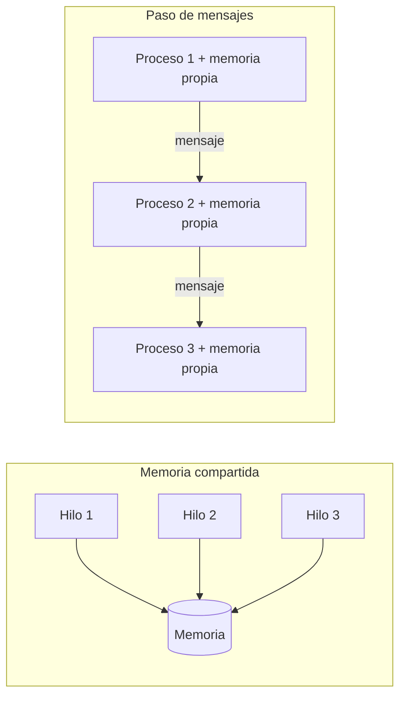
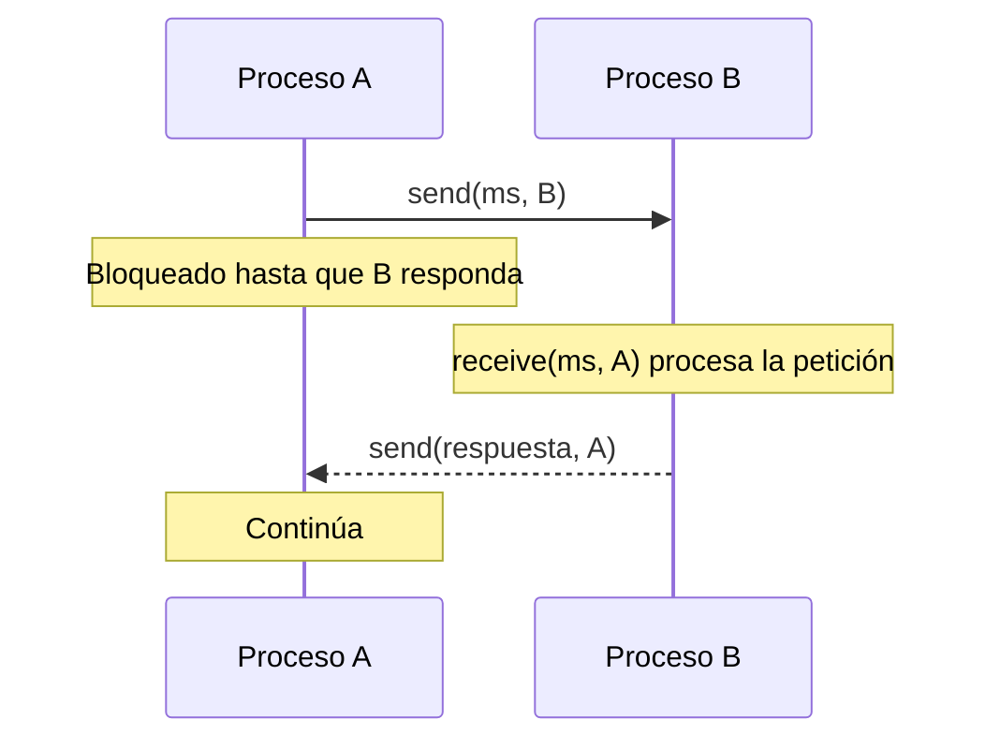
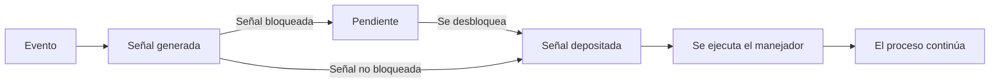

!!! warning

    El contenido de esta página no ha sido revisado ni corregido, por lo que puede
    estar incompleto, contener errores o presentar información desactualizada. Además,
    es posible que esté desordenado, carezca de una estructura clara o incluya notas
    copiadas directamente.

Este capítulo presenta los dos modelos de programación concurrente que prescinden de los
mecanismos de exclusión mutua sobre memoria compartida. El primero, el paso de mensajes,
describe cómo se comunican y sincronizan procesos que no comparten memoria, con las
colas de mensajes POSIX y la espera selectiva como herramientas de C. El segundo, la
programación dirigida por eventos, organiza el programa como un conjunto de manejadores
que reaccionan a sucesos y que se ejecutan de uno en uno, e incluye las señales POSIX
como mecanismo de eventos. Presupone los conceptos de
[fundamentos](section_1_fundamentals.md) y de
[memoria compartida](section_2_shared_memory.md).

## Introducción

En un sistema **débilmente acoplado** los procesos no comparten memoria. Lo mismo sucede
entre procesos de un mismo equipo con espacios de direcciones separados. En ese
escenario no existen variables comunes que proteger y los semáforos y monitores del
capítulo de [memoria compartida](section_2_shared_memory.md) dejan de ser aplicables. La
comunicación y la sincronización se resuelven con un único mecanismo, el **paso de
mensajes**.



Cada proceso es dueño de sus datos y el único modo de que otro los conozca es que se los
envíe. Esto elimina por construcción las condiciones de carrera sobre datos compartidos,
aunque no los interbloqueos, que reaparecen como procesos que esperan un mensaje que
nunca llegará.

La **programación dirigida por eventos** comparte la misma filosofía desde otro ángulo.
Un evento se comporta como un mensaje dirigido a un manejador, y el programa deja de
estar estructurado como una secuencia de instrucciones para pasar a ser un conjunto de
respuestas a sucesos. La segunda mitad del capítulo muestra que ambos modelos se
combinan con naturalidad.

## Paso de mensajes

### Primitivas y canales

Las dos primitivas básicas son `send(mensaje, destino)`, que entrega un mensaje, y
`receive(mensaje, origen)`, que lo recoge. Los lenguajes y bibliotecas se diferencian en
dos decisiones de diseño: cómo se **nombra** al interlocutor y cómo se **sincronizan**
emisor y receptor.

En el **nombrado directo** el emisor identifica al proceso destinatario y, según el
receptor sea o no específico, la comunicación es simétrica o asimétrica. En el
**nombrado indirecto** los procesos no se conocen entre sí, sino que se comunican a
través de una estructura intermedia que recibe el nombre de buzón o canal.

| Esquema            | Emisor            | Receptor                    |
| ------------------ | ----------------- | --------------------------- |
| Directo simétrico  | `send(ms, pidB)`  | `receive(ms, pidA)`         |
| Directo asimétrico | `send(ms, pidB)`  | `receive(ms)` de cualquiera |
| Indirecto          | `send(ms, buzon)` | `receive(ms, buzon)`        |

El nombrado indirecto desacopla emisor y receptor, de modo que uno puede sustituirse sin
que el otro lo advierta. Las colas de mensajes POSIX, las tuberías y los _sockets_
pertenecen a esta familia. El nombrado directo aparece, por ejemplo, en las señales
POSIX, que se dirigen a un identificador de proceso concreto (`kill`, `sigqueue`).

Un canal puede ser unidireccional o bidireccional, y uno bidireccional equivale a dos
unidireccionales en sentidos opuestos. Según cuántos procesos escriben y leen en él se
distinguen cuatro topologías: punto a punto (una tubería entre dos fases de un cálculo),
de uno a muchos (difusión de órdenes), de muchos a uno (un servidor central) y de muchos
a muchos (una cola de trabajo con varios productores y consumidores).

### Sincronización entre emisor y receptor

Además del nombrado, las primitivas se clasifican según si bloquean o no a cada extremo.

- **Comunicación asíncrona**: El emisor continúa sin esperar y nunca se bloquea en
  `send`. El receptor sí espera cuando intenta leer y todavía no hay ningún mensaje.
  Requiere almacenamiento intermedio, de modo que el canal actúa como una cola.
- **Comunicación síncrona** o **cita** (_rendezvous_): El emisor espera a que el
  receptor esté listo y viceversa. Ambos se encuentran en un punto común y solo entonces
  se transfiere el mensaje, de manera que no hace falta almacenamiento intermedio.
- **Comunicación síncrona extendida** o **cita extendida**: Además de la espera mutua,
  el emisor permanece bloqueado hasta recibir una respuesta del receptor. Equivale a una
  llamada a procedimiento remoto.



En la práctica, un canal asíncrono con capacidad acotada se comporta como asíncrono
mientras tiene hueco y como síncrono cuando se llena, porque el emisor se bloquea hasta
que el receptor libera espacio. Este comportamiento se denomina contrapresión. La cita
extendida se construye sobre canales asíncronos con dos colas, una para las peticiones y
otra para las respuestas: el cliente envía la petición y se bloquea en la cola de
respuestas hasta que el servidor contesta.

### Colas de mensajes POSIX

Las **colas de mensajes POSIX** (_message queues_) son el mecanismo de comunicación
asíncrona entre procesos e hilos que se utiliza en este capítulo. Se parecen a las
tuberías de UNIX, pero los mensajes conservan sus límites, de modo que se envían y
reciben completos y no como un flujo de bytes. Cada mensaje lleva una **prioridad** y se
extrae siempre el más prioritario. El programador controla la capacidad de la cola y su
comportamiento (bloqueante o no) y puede consultar su estado. Las funciones se declaran
en `mqueue.h`. En Linux se compilan con `-pthread` y, en versiones antiguas de glibc,
con `-lrt`.

| Función                              | Descripción                                                                           |
| ------------------------------------ | ------------------------------------------------------------------------------------- |
| `mq_open(nombre, flags, modo, attr)` | Crea o abre una cola con nombre y devuelve un descriptor `mqd_t`.                     |
| `mq_send(cola, msg, len, prio)`      | Inserta un mensaje con prioridad. Bloquea si la cola está llena, salvo `O_NONBLOCK`.  |
| `mq_receive(cola, msg, len, &prio)`  | Extrae el mensaje más prioritario. Bloquea si la cola está vacía, salvo `O_NONBLOCK`. |
| `mq_getattr(cola, &attr)`            | Devuelve los atributos y el estado actual de la cola.                                 |
| `mq_close(cola)`                     | Cierra el descriptor del proceso.                                                     |
| `mq_unlink(nombre)`                  | Elimina el nombre. La cola se destruye cuando todos los procesos la han cerrado.      |

El nombre de la cola debe empezar por `/`. Los atributos se pasan en una estructura
`mq_attr` cuyos campos principales son `mq_maxmsg` (número máximo de mensajes en la
cola), `mq_msgsize` (tamaño máximo de cada mensaje en bytes) y `mq_curmsgs` (mensajes
presentes en ese momento). El tercer argumento de `mq_open` es el modo de acceso, como
en un archivo: `0600` concede lectura y escritura solo al propietario.

!!! warning

    `mq_receive` exige que el búfer de recepción tenga al menos `mq_msgsize` bytes. Si
    es menor, falla con el error `EMSGSIZE` y el mensaje permanece en la cola. Además,
    el nombre de una cola persiste en el sistema aunque el proceso termine, por lo que
    conviene llamar a `mq_unlink` antes de crearla y al terminar.

El ejemplo básico es un productor que envía enteros y un consumidor que los retira, con
una cola de diez mensajes como único elemento compartido. Los dos hilos no comparten
variables salvo el descriptor de la cola, y el orden de los mensajes lo garantiza la
propia cola.

???+ example "Productor-consumidor con una cola de mensajes"

    El programa se compila con `gcc -Wall -Wextra -pthread pc.c -o pc`. El productor
    envía un número fijo de elementos, porque un bucle infinito nunca terminaría aunque
    `mq_send` se bloquee con la cola llena.

    ```c linenums="1"
    #include <fcntl.h>
    #include <mqueue.h>
    #include <pthread.h>
    #include <stdio.h>
    #include <stdlib.h>
    #include <sys/stat.h>

    #define NOMBRE_COLA "/cola_pc"
    #define TOTAL 5

    static mqd_t cola;

    // Envía TOTAL enteros a la cola
    static void *productor(void *arg)
    {
        (void)arg;
        for (int dato = 0; dato < TOTAL; dato++) {
            if (mq_send(cola, (const char *)&dato, sizeof dato, 0) == -1) {
                perror("mq_send");
                exit(EXIT_FAILURE);
            }
        }
        return NULL;
    }

    // Retira TOTAL enteros de la cola y los imprime
    static void *consumidor(void *arg)
    {
        (void)arg;
        for (int i = 0; i < TOTAL; i++) {
            int dato;
            unsigned int prio;
            if (mq_receive(cola, (char *)&dato, sizeof dato, &prio) == -1) {
                perror("mq_receive");
                exit(EXIT_FAILURE);
            }
            printf("Dato consumido = %d\n", dato);
        }
        return NULL;
    }

    int main(void)
    {
        struct mq_attr attr = {.mq_flags = 0, .mq_maxmsg = 10, .mq_msgsize = sizeof(int)};
        pthread_t th_prod, th_cons;

        // Elimina restos de una ejecución anterior
        mq_unlink(NOMBRE_COLA);
        cola = mq_open(NOMBRE_COLA, O_RDWR | O_CREAT, 0600, &attr);
        if (cola == (mqd_t)-1) {
            perror("mq_open");
            return EXIT_FAILURE;
        }

        pthread_create(&th_prod, NULL, productor, NULL);
        pthread_create(&th_cons, NULL, consumidor, NULL);
        pthread_join(th_prod, NULL);
        pthread_join(th_cons, NULL);

        mq_close(cola);
        mq_unlink(NOMBRE_COLA);
        return EXIT_SUCCESS;
    }
    ```

```plaintext title="Expected output"
Dato consumido = 0
Dato consumido = 1
Dato consumido = 2
Dato consumido = 3
Dato consumido = 4
```

La prioridad es un entero sin signo que se pasa a `mq_send`. `mq_receive` entrega
primero el mensaje de mayor prioridad y, entre los de igual prioridad, el más antiguo.

???+ example "Prioridades y estado de la cola"

    El programa envía tres mensajes, consulta el estado con `mq_getattr` y los recibe.

    ```c linenums="1"
    #include <fcntl.h>
    #include <mqueue.h>
    #include <stdio.h>
    #include <stdlib.h>
    #include <string.h>

    #define NOMBRE_COLA "/cola_prio"

    int main(void)
    {
        struct mq_attr attr = {.mq_flags = 0, .mq_maxmsg = 10, .mq_msgsize = 16};
        struct mq_attr estado;
        const char *textos[] = {"normal", "urgente", "baja"};
        const unsigned int prios[] = {5, 20, 1};
        char buffer[16];
        unsigned int prio;

        mq_unlink(NOMBRE_COLA);
        mqd_t cola = mq_open(NOMBRE_COLA, O_RDWR | O_CREAT, 0600, &attr);
        if (cola == (mqd_t)-1) {
            perror("mq_open");
            return EXIT_FAILURE;
        }

        for (int i = 0; i < 3; i++) {
            mq_send(cola, textos[i], strlen(textos[i]) + 1, prios[i]);
        }

        mq_getattr(cola, &estado);
        printf("Mensajes en cola: %ld de %ld\n", estado.mq_curmsgs, estado.mq_maxmsg);

        // Los mensajes salen por prioridad decreciente, no por orden de llegada
        for (int i = 0; i < 3; i++) {
            mq_receive(cola, buffer, sizeof buffer, &prio);
            printf("prioridad %2u: %s\n", prio, buffer);
        }

        mq_close(cola);
        mq_unlink(NOMBRE_COLA);
        return EXIT_SUCCESS;
    }
    ```

```plaintext title="Expected output"
Mensajes en cola: 3 de 10
prioridad 20: urgente
prioridad  5: normal
prioridad  1: baja
```

Las tuberías (_pipes_) son el canal indirecto más sencillo, unidireccional y sin
estructura de mensajes, pues transportan un flujo de bytes. Los _sockets_ permiten el
mismo patrón entre procesos de máquinas distintas. Ambos se tratan en el capítulo de
[comunicación entre procesos](../05_c_systems/section_4_ipc.md) y en el de
[_sockets_](../05_c_systems/section_7_sockets.md). Lo relevante aquí es que, en Linux,
tuberías, _sockets_ y colas POSIX son descriptores de archivo y se pueden esperar con
una única llamada a `select`.

### Espera selectiva

Un proceso que recibe por varios canales tiene un problema si lee siempre en un orden
fijo. Se considera un contador de visitantes de un jardín con dos puertas, cada una
conectada por su propio canal. Si el contador hace primero un `receive` del canal de la
puerta 1 y después otro del canal de la puerta 2, impone un orden de llegada que no
existe. Si entran veinte personas seguidas por la puerta 2, el contador sigue bloqueado
esperando un mensaje de la puerta 1 mientras los de la puerta 2 quedan sin atender.

La solución es una instrucción de **espera selectiva** (_select_) que permita atender
cualquier canal en cuanto sea posible completar la cita. Su sintaxis, escrita con la
notación de CSP (_Communicating Sequential Processes_), en la que `c?v` recibe un valor
del canal `c` en la variable `v`, es:

```plaintext linenums="1"
select
    c1?v;
    cont := cont + v;
or
    c2?v;
    cont := cont + v;
end;
```

Cada rama `or` comienza con una instrucción de cita, de lectura o de escritura, y puede
continuar con cualquier secuencia de instrucciones. Una rama está **abierta** si es
posible completar su cita de inmediato. Al ejecutar el `select`, el sistema elige **de
forma no determinista** una de las ramas abiertas, completa su cita y continúa por las
instrucciones de esa rama. Si todas las ramas están cerradas, el proceso se bloquea. El
no determinismo es deliberado: un programa correcto no debe depender de qué rama se
elige, y una elección imparcial evita que un canal muy activo deje sin atender a los
demás.

Una rama puede ir precedida de una **guarda**, una expresión booleana que modela una
condición de sincronización. La rama está abierta solo si la guarda es verdadera y,
además, se puede completar la cita.

```plaintext linenums="1"
select
    when expresion_booleana =>
        rama_or
or
    when expresion_booleana =>
        rama_or
end;
```

POSIX no ofrece una instrucción equivalente, pero en Linux un descriptor `mqd_t` es un
descriptor de archivo, por lo que `select` puede esperar a la vez en varias colas.
`select` modifica el conjunto de lectura y deja marcados solo los descriptores con datos
disponibles, y el programa elige después cuál leer. Los mensajes de las colas no
elegidas no se pierden, sino que se atienden en la siguiente espera. Las guardas se
simulan añadiendo al conjunto solo las colas cuya guarda es verdadera. Una cola omitida
no se escucha, y sus mensajes esperan hasta que la guarda se cumpla. Los argumentos de
`select` y las macros que manipulan el conjunto de descriptores se describen en el
capítulo de [_sockets_](../05_c_systems/section_7_sockets.md).

El ejemplo clásico es un _buffer_ acotado gestionado por un hilo servidor, con tres
canales. El productor envía datos por uno, el consumidor envía peticiones por otro y el
servidor responde por el tercero. Las guardas del servidor expresan la sincronización
sin ninguna primitiva adicional. Si el _buffer_ está lleno, no se aceptan datos del
productor, y si está vacío, no se aceptan peticiones del consumidor.

???+ example "_Buffer_ acotado con espera selectiva y guardas"

    La función `espera_selectiva` construye el conjunto de lectura con las colas de
    guarda verdadera, espera con `select` y elige al azar una de las ramas abiertas. El
    servidor comprueba que nunca supera su capacidad.

    ```c linenums="1"
    #include <fcntl.h>
    #include <mqueue.h>
    #include <pthread.h>
    #include <stdio.h>
    #include <stdlib.h>
    #include <sys/select.h>
    #include <sys/stat.h>

    #define CAPACIDAD 3
    #define TOTAL 6

    enum { C_DATOS, C_PETICIONES, C_RESPUESTAS, NUM_COLAS };
    static mqd_t colas[NUM_COLAS];
    static int ocupacion_maxima;

    // Bloquea hasta que alguna rama abierta (guarda distinta de 0 y cola con
    // mensaje) pueda completarse y devuelve el índice de una elegida al azar
    static int espera_selectiva(const mqd_t entradas[], const int guardas[], int n)
    {
        fd_set lectura;
        int listas[16], total = 0, maximo = -1;

        FD_ZERO(&lectura);
        for (int i = 0; i < n; i++) {
            if (guardas[i]) {
                FD_SET(entradas[i], &lectura);
                if (entradas[i] > maximo) {
                    maximo = entradas[i];
                }
            }
        }
        if (maximo < 0 || select(maximo + 1, &lectura, NULL, NULL, NULL) == -1) {
            return -1;
        }
        for (int i = 0; i < n; i++) {
            if (guardas[i] && FD_ISSET(entradas[i], &lectura)) {
                listas[total++] = i;
            }
        }
        return listas[rand() % total];
    }

    // Envía TOTAL enteros al buffer
    static void *productor(void *arg)
    {
        (void)arg;
        for (int i = 0; i < TOTAL; i++) {
            mq_send(colas[C_DATOS], (const char *)&i, sizeof i, 0);
        }
        return NULL;
    }

    // Pide un dato al buffer y espera la respuesta, TOTAL veces
    static void *consumidor(void *arg)
    {
        (void)arg;
        for (int i = 0; i < TOTAL; i++) {
            int peticion = 1, dato;
            unsigned int prio;
            mq_send(colas[C_PETICIONES], (const char *)&peticion, sizeof peticion, 0);
            mq_receive(colas[C_RESPUESTAS], (char *)&dato, sizeof dato, &prio);
            printf("Consumido %d\n", dato);
        }
        return NULL;
    }

    // Servidor del buffer circular: las guardas expresan las condiciones de espera
    static void *buffer(void *arg)
    {
        int datos[CAPACIDAD], entra = 0, sale = 0, cuenta = 0;
        int guardas[2], valor, servidos = 0;
        mqd_t entradas[2] = {colas[C_DATOS], colas[C_PETICIONES]};
        unsigned int prio;
        (void)arg;

        while (servidos < TOTAL) {
            // Acepta datos si hay hueco y peticiones si hay algo que servir
            guardas[0] = cuenta < CAPACIDAD;
            guardas[1] = cuenta > 0;
            int rama = espera_selectiva(entradas, guardas, 2);
            if (rama < 0) {
                perror("select");
                exit(EXIT_FAILURE);
            }
            mq_receive(entradas[rama], (char *)&valor, sizeof valor, &prio);
            if (rama == 0) {
                datos[entra] = valor;
                entra = (entra + 1) % CAPACIDAD;
                cuenta++;
                if (cuenta > ocupacion_maxima) {
                    ocupacion_maxima = cuenta;
                }
            } else {
                mq_send(colas[C_RESPUESTAS], (const char *)&datos[sale], sizeof(int), 0);
                sale = (sale + 1) % CAPACIDAD;
                cuenta--;
                servidos++;
            }
        }
        return NULL;
    }

    int main(void)
    {
        struct mq_attr attr = {.mq_flags = 0, .mq_maxmsg = 10, .mq_msgsize = sizeof(int)};
        const char *nombres[NUM_COLAS] = {"/buf_datos", "/buf_peticiones",
                                          "/buf_respuestas"};
        pthread_t th[3];

        for (int i = 0; i < NUM_COLAS; i++) {
            mq_unlink(nombres[i]);
            colas[i] = mq_open(nombres[i], O_RDWR | O_CREAT, 0600, &attr);
        }
        pthread_create(&th[0], NULL, productor, NULL);
        pthread_create(&th[1], NULL, consumidor, NULL);
        pthread_create(&th[2], NULL, buffer, NULL);
        for (int i = 0; i < 3; i++) {
            pthread_join(th[i], NULL);
        }
        printf("Capacidad respetada: %s\n", ocupacion_maxima <= CAPACIDAD ? "sí" : "no");
        for (int i = 0; i < NUM_COLAS; i++) {
            mq_close(colas[i]);
            mq_unlink(nombres[i]);
        }
        return 0;
    }
    ```

```plaintext title="Expected output"
Consumido 0
Consumido 1
Consumido 2
Consumido 3
Consumido 4
Consumido 5
Capacidad respetada: sí
```

Que `mqd_t` sea un descriptor de archivo es una característica de Linux, no del estándar
POSIX, por lo que este código no es portable a otros sistemas, y `select` admite como
máximo `FD_SETSIZE` descriptores, normalmente 1024.

Un `select` puede incluir además una rama `else`, siempre la última, que se ejecuta
cuando todas las ramas `or` están cerradas en ese momento, de modo que el proceso nunca
se bloquea. Se simula con el plazo (_timeout_) de `select`: con un plazo de cero
segundos la llamada retorna al instante y equivale a `else`, y con un plazo positivo
espera como máximo ese tiempo. Un `else` ejecutado en bucle produce **espera activa** y
consume CPU sin hacer trabajo útil, por lo que resulta preferible un plazo positivo o
bloquearse. La alternativa `terminate` indica que el proceso puede finalizar cuando
todos aquellos con los que podría comunicarse han terminado. POSIX no ofrece una
instrucción así y se emula con un mensaje centinela de fin, o cerrando el extremo de
escritura del canal.

## Programación dirigida por eventos

### Eventos frente a concurrencia

La programación dirigida por eventos es una alternativa a los hilos para construir
**sistemas reactivos**, aquellos que responden a estímulos externos como la pulsación de
un botón, la llegada de una petición de red o la lectura de un sensor. En el **modelo de
hilos** un proceso contiene varios hilos que el planificador puede ejecutar o bloquear
en cualquier instante, y un despachador asigna un hilo a cada petición. En el **modelo
de eventos** el proceso consiste en el tratamiento de un conjunto de eventos y, en cada
momento, solo se procesa uno: un planificador único recoge los eventos de las distintas
fuentes y hace avanzar la máquina de estados asociada a cada petición.

| Aspecto               | Hilos                          | Eventos                           |
| --------------------- | ------------------------------ | --------------------------------- |
| Unidad de trabajo     | Un hilo por petición           | Un manejador por tipo de evento   |
| Flujo de control      | Lineal y fácil de seguir       | Fragmentado entre manejadores     |
| Sincronización        | Necesaria                      | No hace falta: hay un único flujo |
| Modularización        | Mejor                          | Más difícil                       |
| Rendimiento con carga | Se degrada al crecer el número | Estable                           |

El rendimiento de un servidor con hilos alcanza un máximo con pocos hilos y cae al
aumentar su número, porque crecen el cambio de contexto y la contención, mientras que un
servidor con eventos mantiene un caudal casi constante. Cada modelo tiene ventajas e
inconvenientes: con hilos es más fácil programar, pero la sincronización es difícil, y
con eventos el rendimiento es mejor, pero se pierde el flujo de control lineal. Una
arquitectura mixta, como la de SEDA (_Staged Event-Driven Architecture_), procesa los
eventos de una cola con un conjunto de hilos (_thread pool_) y comunica etapas entre sí
mediante colas de eventos. Los eventos se usan sobre todo en interfaces gráficas y en
sistemas distribuidos, con un manejador por cada fuente de datos (un _socket_) que
procesa las solicitudes y envía las respuestas.

### Eventos y manejadores

El modelo tiene un único flujo de ejecución, por lo que los manejadores nunca se
solapan. El programa **se suscribe** a los eventos que le interesan, registrando para
cada uno una función de respuesta, el **manejador** o _callback_. Un bucle, el **bucle
de eventos** (_event loop_), espera a que ocurran y llama al manejador adecuado. Las
propiedades de los manejadores definen el estilo de programación.

- **No son interrumpibles** por otro manejador de la misma aplicación.
- **Son cortos**, porque mientras uno se ejecuta no se atiende ningún otro evento.
- **No pueden bloquearse**. Una espera dentro de un manejador paraliza todo el programa,
  y por eso no se usan primitivas de sincronización.
- **Comparten memoria sin condiciones de carrera**, porque nunca se ejecutan a la vez.
  Aun así, conviene que el trabajo pendiente se comunique mediante nuevos eventos.

El tratamiento de eventos se describe como un patrón de diseño con tres piezas. El flujo
de entrada son los eventos, el **despachador** (_dispatcher_) contiene el bucle de
eventos y un conjunto de manejadores contiene la lógica. Cuando los eventos se generan
más deprisa de lo que se tratan, el despachador puede estar ocupado y perder alguno. La
solución es una **cola de eventos**: los eventos se almacenan al llegar y el despachador
extrae el siguiente cada vez que termina con el anterior. El siguiente programa
implementa una cola de eventos circular, una tabla de manejadores indexada por el tipo
de evento y el bucle de eventos.

???+ example "Cola de eventos, manejadores y bucle de eventos"

    Se publican cuatro eventos antes de arrancar el bucle. Un manejador puede publicar
    nuevos eventos, que se ponen al final de la cola y se tratan después de los que ya
    esperaban.

    ```c linenums="1"
    #include <stdio.h>
    #include <stdlib.h>

    // Tipos de evento y estructura del evento
    typedef enum { EV_TECLA, EV_TEMPORIZADOR, EV_FIN, NUM_EVENTOS } tipo_evento_t;
    typedef struct {
        tipo_evento_t tipo;
        int dato;
    } evento_t;
    typedef void (*manejador_t)(const evento_t *);

    #define TAM_COLA 16
    static evento_t cola[TAM_COLA];
    static int cabeza, cuenta;
    static manejador_t manejadores[NUM_EVENTOS];
    static int ejecutando = 1;

    // Encola un evento. Falla si la cola está llena
    static int publicar(tipo_evento_t tipo, int dato)
    {
        if (cuenta == TAM_COLA) {
            return -1;
        }
        cola[(cabeza + cuenta++) % TAM_COLA] = (evento_t){tipo, dato};
        return 0;
    }

    // Suscribe un manejador a un tipo de evento
    static void suscribir(tipo_evento_t tipo, manejador_t fn)
    {
        manejadores[tipo] = fn;
    }

    // Bucle de eventos: un único flujo, un evento cada vez, sin interrupciones
    static void bucle_de_eventos(void)
    {
        while (ejecutando && cuenta > 0) {
            evento_t ev = cola[cabeza];
            cabeza = (cabeza + 1) % TAM_COLA;
            cuenta--;
            if (manejadores[ev.tipo]) {
                manejadores[ev.tipo](&ev);
            }
        }
    }

    static void al_pulsar(const evento_t *ev)
    {
        printf("Tecla '%c'\n", ev->dato);
        // Un manejador comunica trabajo pendiente publicando otro evento
        if (ev->dato == 'q') {
            publicar(EV_FIN, 0);
        }
    }

    static void al_temporizar(const evento_t *ev)
    {
        printf("Tic %d\n", ev->dato);
    }

    static void al_terminar(const evento_t *ev)
    {
        (void)ev;
        printf("Fin del bucle\n");
        ejecutando = 0;
    }

    int main(void)
    {
        suscribir(EV_TECLA, al_pulsar);
        suscribir(EV_TEMPORIZADOR, al_temporizar);
        suscribir(EV_FIN, al_terminar);

        publicar(EV_TECLA, 'a');
        publicar(EV_TEMPORIZADOR, 1);
        publicar(EV_TECLA, 'q');
        publicar(EV_TEMPORIZADOR, 2);
        bucle_de_eventos();
        return EXIT_SUCCESS;
    }
    ```

```plaintext title="Expected output"
Tecla 'a'
Tic 1
Tecla 'q'
Tic 2
Fin del bucle
```

El evento `EV_FIN` generado por el manejador de la tecla `q` se procesa después del
temporizador 2, porque este ya estaba en la cola. Este orden de atención es el que
garantiza la cola de eventos, y el diseño de un sistema real debe contar con él.

### Máquinas de estado reactivas

La programación con eventos se combina de forma natural con las **máquinas de estados**.
Un manejador sin memoria no sabe en qué punto de una conversación se encuentra, de
manera que el comportamiento que depende de lo ocurrido antes se representa con un
estado. Cada evento provoca una transición, una acción y, posiblemente, un cambio de
estado. Así, un servidor basado en eventos mantiene una máquina de estados por cada
petición en curso, y el planificador la hace avanzar cuando llega el evento que espera,
como la lectura de un disco terminada. La construcción sistemática de estas máquinas,
con diagramas, tablas de transición y generación de código, se desarrolla en el capítulo
de [máquinas de estado](../05_c_systems/section_6_state_machines.md).

### Fuentes de eventos externas

Los eventos no tienen por qué proceder del propio programa. Un patrón extendido,
conocido como _reactor_, asocia un manejador a cada descriptor de archivo y usa `select`
como bucle de eventos. El hilo se bloquea en una única llamada hasta que alguna fuente
tiene datos y despacha al manejador de esa fuente. Es el mismo mecanismo de la espera
selectiva, visto como un despachador. Con tuberías, _sockets_ o colas de mensajes como
fuentes, se obtiene la base de un servidor de red con eventos, que se describe en el
capítulo de [_sockets_](../05_c_systems/section_7_sockets.md).

### Patrones de interacción basados en eventos

El modelo de eventos aparece, de forma implícita o explícita, en muchas aproximaciones.

- **Programación orientada a objetos**: Los métodos de un objeto son manejadores de
  eventos. Llamar a `push` o `pop` en una pila equivale a enviarle un evento, aunque no
  haya un despachador y la invocación sea una llamada directa.
- **Sistemas de mensajes** (_messaging systems_): Los receptores son manejadores que
  obtienen los eventos, es decir los mensajes, de los emisores a través de un
  despachador. Emisor y receptor pueden estar en máquinas y plataformas distintas.
- **_Middleware_ orientado a mensajes** (_MOM_): Caso particular que comunica
  aplicaciones distintas, normalmente con el modelo de **publicación y suscripción**
  (_publish and subscribe_), en el que los emisores publican en un tema (_topic_) y el
  sistema entrega una copia a cada suscriptor.

Estos patrones muestran que paso de mensajes y programación con eventos son dos formas
muy próximas de describir lo mismo. El evento es el mensaje, el manejador es el receptor
y el despachador, con su cola, es el canal.

### Señales POSIX

El mecanismo nativo de POSIX para manejar eventos son las **señales**, cuyo uso básico
(envío, manejadores y temporizadores) se describe en el capítulo de
[señales](../05_c_systems/section_5_signals.md). Aquí se examinan como mecanismo de
eventos. Una señal es una notificación por software a un proceso o hilo de que ha
ocurrido un evento. El sistema operativo decide cuándo interrumpir el proceso y activa
la función asociada a la señal, el manejador. Una señal puede quedar encolada o
enmascarada antes de entregarse. Los eventos se clasifican en dos tipos.

- **Síncronos**: Se producen por estados anómalos durante la ejecución, como una
  división por cero, y se manejan en el hilo que los generó.
- **Asíncronos**: No son situaciones anómalas del código y pueden generarse
  explícitamente. Los recibe todo el proceso, de modo que los maneja el hilo que esté
  bloqueado esperándolos o el que no los tenga enmascarados. Son los que interesan para
  programación dirigida por eventos.



El intervalo entre la generación y la entrega es la **latencia de activación**. Mientras
la señal esté bloqueada permanece pendiente y no se pierde, aunque las señales estándar
no se acumulan, porque varias iguales pendientes se funden en una sola. Los
identificadores están definidos en `signal.h`. `SIGUSR1` y `SIGUSR2` quedan reservadas
para el usuario y el rango `SIGRTMIN` a `SIGRTMAX` corresponde a las **señales de tiempo
real** (POSIX 1b), que se encolan y transportan un valor asociado.

| Función o comando           | Descripción                                                            |
| --------------------------- | ---------------------------------------------------------------------- |
| `kill(pid, sig)`            | Envía una señal a un proceso. Equivale al comando `kill -s señal pid`. |
| `sigqueue(pid, sig, valor)` | Envía una señal de tiempo real encolada y con un valor asociado.       |
| `sigemptyset`, `sigaddset`  | Construyen un conjunto de señales (`sigset_t`).                        |
| `sigprocmask`               | Modifica la máscara de señales bloqueadas del proceso.                 |
| `pthread_sigmask`           | Modifica la máscara de un hilo, que hereda el hilo creado después.     |
| `sigaction`                 | Asocia un manejador a una señal.                                       |
| `sigwait`, `sigwaitinfo`    | Esperan de forma síncrona a una señal del conjunto.                    |

Bloquear una señal significa que, si se genera, no se pierde sino que se pospone su
atención. El bloqueo se realiza con la máscara de señales, y las constantes `SIG_BLOCK`
y `SIG_UNBLOCK` indican si el conjunto se añade o se quita de ella. Para eventos con
datos asociados interesa la versión extendida de `sigaction` (POSIX 1b), que se activa
con `SA_SIGINFO` en `sa_flags`, sustituye el campo `sa_handler` por `sa_sigaction` y
entrega una estructura `siginfo_t`. Su campo `si_code` indica el origen (`SI_USER` desde
`kill`, `SI_QUEUE` desde `sigqueue`, `SI_TIMER` desde un temporizador) y `si_value` el
valor transportado.

???+ example "Señales de tiempo real encoladas con valor asociado"

    El programa bloquea `SIGRTMIN`, instala un manejador extendido y se envía a sí mismo
    tres señales con valores distintos. Como están bloqueadas, se encolan y no se
    atienden hasta desbloquearlas, momento en que el manejador se ejecuta una vez por
    señal y en orden de llegada.

    ```c linenums="1"
    #include <signal.h>
    #include <stdio.h>
    #include <string.h>
    #include <unistd.h>

    #define MAX_REGISTROS 8

    static volatile sig_atomic_t registrados;
    static volatile sig_atomic_t valores[MAX_REGISTROS];
    static volatile sig_atomic_t codigos[MAX_REGISTROS];

    // Manejador mínimo: solo anota la información y regresa
    static void manejador(int signo, siginfo_t *info, void *contexto)
    {
        (void)signo;
        (void)contexto;
        if (registrados < MAX_REGISTROS) {
            valores[registrados] = info->si_value.sival_int;
            codigos[registrados] = info->si_code;
            registrados++;
        }
    }

    int main(void)
    {
        struct sigaction accion;
        sigset_t bloqueo, anterior;

        // Bloquea SIGRTMIN: las señales generadas quedan encoladas
        sigemptyset(&bloqueo);
        sigaddset(&bloqueo, SIGRTMIN);
        sigprocmask(SIG_BLOCK, &bloqueo, &anterior);

        // Instala el manejador en modo extendido (SA_SIGINFO)
        memset(&accion, 0, sizeof accion);
        accion.sa_sigaction = manejador;
        sigemptyset(&accion.sa_mask);
        accion.sa_flags = SA_SIGINFO;
        if (sigaction(SIGRTMIN, &accion, NULL) == -1) {
            perror("sigaction");
            return 1;
        }

        // Genera tres señales con valor asociado. Aún no se atienden
        for (int i = 1; i <= 3; i++) {
            sigqueue(getpid(), SIGRTMIN, (union sigval){.sival_int = i * 10});
        }
        printf("Atendidas antes de desbloquear: %d\n", (int)registrados);

        // Al desbloquear, el manejador se ejecuta una vez por señal encolada
        sigprocmask(SIG_SETMASK, &anterior, NULL);
        for (int i = 0; i < registrados; i++) {
            printf("Señal con valor %d, SI_QUEUE: %s\n", valores[i],
                   codigos[i] == SI_QUEUE ? "sí" : "no");
        }
        return 0;
    }
    ```

```plaintext title="Expected output"
Atendidas antes de desbloquear: 0
Señal con valor 10, SI_QUEUE: sí
Señal con valor 20, SI_QUEUE: sí
Señal con valor 30, SI_QUEUE: sí
```

Un manejador solo puede llamar a funciones seguras ante señales asíncronas, entre las
que no están `printf` ni `malloc`, y debe limitarse a anotar el dato en variables
`volatile sig_atomic_t`, como en el ejemplo. Las reglas completas se recogen en el
capítulo de [señales](../05_c_systems/section_5_signals.md).

Cuando un hilo debe esperar una señal, puede evitar el manejador asíncrono y bloquearla
para recogerla con `sigwait` o `sigwaitinfo`. La espera es síncrona, de modo que el hilo
despierta cuando llega la señal y la trata con total libertad, sin restricciones de
funciones seguras. La señal se bloquea antes de crear el hilo para que todos hereden la
máscara y solo la reciba el hilo que espera. La estructura es la de un bucle de eventos
cuya cola es la de señales pendientes del _kernel_.

???+ example "Un hilo como manejador de eventos con `sigwaitinfo`"

    El hilo espera señales `SIGRTMIN` y las trata en orden. El valor 0 hace de centinela
    de fin, equivalente a la alternativa `terminate` de la espera selectiva.

    ```c linenums="1"
    #include <pthread.h>
    #include <signal.h>
    #include <stdio.h>
    #include <unistd.h>

    static void *hilo_de_senales(void *arg)
    {
        sigset_t *conjunto = arg;
        siginfo_t info;

        for (;;) {
            // Espera de forma síncrona: no hay manejador asíncrono
            if (sigwaitinfo(conjunto, &info) == -1) {
                perror("sigwaitinfo");
                break;
            }
            printf("Evento con valor %d\n", info.si_value.sival_int);
            if (info.si_value.sival_int == 0) {
                break;
            }
        }
        return NULL;
    }

    int main(void)
    {
        sigset_t conjunto;
        pthread_t th;

        // Se bloquea antes de crear el hilo, que hereda la máscara
        sigemptyset(&conjunto);
        sigaddset(&conjunto, SIGRTMIN);
        pthread_sigmask(SIG_BLOCK, &conjunto, NULL);
        pthread_create(&th, NULL, hilo_de_senales, &conjunto);

        for (int valor = 3; valor >= 0; valor--) {
            sigqueue(getpid(), SIGRTMIN, (union sigval){.sival_int = valor});
        }

        pthread_join(th, NULL);
        return 0;
    }
    ```

```plaintext title="Expected output"
Evento con valor 3
Evento con valor 2
Evento con valor 1
Evento con valor 0
```

!!! warning

    `sigwait` devuelve 0 en caso de éxito y escribe el número de señal en su segundo
    argumento, que es un `int *`, por lo que no proporciona la información de la
    señal. Para acceder al valor asociado y al origen es necesario `sigwaitinfo`, que
    rellena una estructura `siginfo_t`. Confundir ambas es un error frecuente.

### Combinar eventos y concurrencia

Mensajes y eventos no compiten con los hilos, sino que se complementan. Algunos
criterios útiles para decidir cómo estructurar un programa son:

- Usar un bucle de eventos para el trabajo dominado por la espera de entrada y salida,
  con muchas conexiones o fuentes y poco cálculo por evento.
- Usar hilos cuando hay cálculo intensivo que aprovechar en varios núcleos, y repartir
  el trabajo con colas de mensajes en lugar de variables compartidas.
- Mantener los manejadores cortos y no bloqueantes. Si un evento requiere un cálculo
  largo, el manejador lo delega a un hilo trabajador y la respuesta vuelve como un nuevo
  evento o mensaje.
- Preferir la comunicación por canales a la memoria compartida siempre que sea posible,
  pues evita las condiciones de carrera y simplifica el razonamiento sobre el programa.

## Cierre

Los mecanismos de este capítulo y de los anteriores se ponen a prueba en el siguiente,
de [problemas clásicos de sincronización](section_4_classic_problems.md), que aplica los
semáforos, los monitores, las colas de mensajes y las señales a una colección de
problemas.
