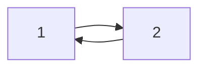

!!! warning

    El contenido de esta página no ha sido revisado ni corregido, por lo que puede
    estar incompleto, contener errores o presentar información desactualizada. Además,
    es posible que esté desordenado, carezca de una estructura clara o incluya notas
    copiadas directamente.

Este capítulo presenta las estructuras de datos fundamentales, describiendo la forma en
que organizan la información en memoria, las operaciones que ofrecen, el coste asociado
a cada una de ellas y una implementación de referencia en Python. Se recorren las pilas,
las colas, las listas enlazadas y doblemente enlazadas, los árboles binarios de búsqueda
y las tablas _hash_, con sus estrategias de resolución de colisiones. El análisis de la
complejidad de estas operaciones se apoya en la notación Big O, que se aborda en el
capítulo de [algoritmos](section_2_algorithms.md).

## Introducción

Una **estructura de datos** es una forma concreta de organizar información en memoria
con el objetivo de que un conjunto determinado de operaciones resulte eficiente. La
elección de la estructura adecuada condiciona directamente el rendimiento de un
programa, ya que cada organización interna favorece unos accesos y penaliza otros.

Resulta útil distinguir entre el **tipo abstracto de datos**, que describe qué
operaciones están disponibles y qué significan, y la **implementación**, que determina
cómo se almacenan los datos y qué coste tiene cada operación. Una pila, por ejemplo,
queda definida por las operaciones de apilar y desapilar, con independencia de que
internamente se apoye en un _array_ dinámico o en una lista enlazada.

El criterio de selección se basa en el patrón de uso previsto. Cuando predomina el
acceso por posición conviene una estructura contigua en memoria, mientras que si
predominan las inserciones y eliminaciones en los extremos resultan preferibles las
estructuras enlazadas. Cuando se requiere mantener los elementos ordenados y realizar
búsquedas frecuentes, las estructuras jerárquicas como los árboles ofrecen el mejor
compromiso.

Las secciones siguientes recorren estas alternativas en orden de complejidad creciente,
comenzando por las estructuras lineales de acceso restringido y terminando por las
estructuras jerárquicas.

## Pilas

Una **pila** (_stack_) es una estructura lineal que organiza los elementos siguiendo el
principio **LIFO** (_Last In, First Out_), de modo que el último elemento añadido es el
primero en ser retirado. El comportamiento equivale al de una pila de platos, donde
únicamente resulta accesible el que ocupa la posición superior.

La estructura expone tres operaciones esenciales. La operación de apilar (_push_)
inserta un elemento en la cima, la operación de desapilar (_pop_) extrae y devuelve el
elemento situado en la cima, y la consulta de la cima (_top_ o _peek_) devuelve ese
mismo elemento sin retirarlo. A estas se añaden habitualmente consultas auxiliares sobre
el número de elementos almacenados y sobre si la pila está vacía.

El acceso restringido a un único extremo permite que todas las operaciones se resuelvan
en tiempo constante:

| Operación                    | Complejidad temporal |
| :--------------------------- | :------------------- |
| Apilar (_push_)              | $O(1)$ amortizado    |
| Desapilar (_pop_)            | $O(1)$               |
| Consultar la cima (_top_)    | $O(1)$               |
| Consultar el tamaño (_size_) | $O(1)$               |

Dos situaciones de error resultan características de esta estructura. El
**desbordamiento** (_overflow_) ocurre al apilar sobre una pila que ha alcanzado su
capacidad máxima, mientras que el **subdesbordamiento** (_underflow_) ocurre al intentar
desapilar o consultar una pila vacía. Ambas condiciones se señalan mediante excepciones.

Las pilas aparecen de forma natural en la pila de llamadas de un programa, en la
implementación de la función de deshacer de un editor, en la evaluación de expresiones y
en el recorrido en profundidad de grafos y árboles.

La implementación siguiente utiliza una lista de Python como almacenamiento interno, ya
que las operaciones `append` y `pop` actúan sobre el final de la lista y ofrecen coste
constante amortizado.

???+ tip "Implementación"

    ```python linenums="1"
    class Pila:
        """
        Pila de enteros con capacidad opcional y comportamiento LIFO.
        """

        def __init__(self, capacidad: int | None = None) -> None:
            """
            Inicializa una pila vacía.

            Args:
                capacidad: Número máximo de elementos. None indica
                    capacidad ilimitada.
            """

            self.elementos: list[int] = []
            self.capacidad: int | None = capacidad

        def esta_vacia(self) -> bool:
            """
            Indica si la pila no contiene elementos.

            Returns:
                True si la pila está vacía y False en caso contrario.
            """

            return len(self.elementos) == 0

        def push(self, elem: int) -> None:
            """
            Inserta un elemento en la cima de la pila.

            Args:
                elem: Valor que se añade a la pila.

            Raises:
                OverflowError: Si la pila ha alcanzado su capacidad
                    máxima.
            """

            if self.capacidad is not None and len(self.elementos) >= self.capacidad:
                raise OverflowError("Pila llena.")

            self.elementos.append(elem)

        def pop(self) -> int:
            """
            Extrae y devuelve el elemento situado en la cima.

            Returns:
                El último elemento insertado.

            Raises:
                IndexError: Si la pila está vacía.
            """

            if self.esta_vacia():
                raise IndexError("Pila vacía.")

            return self.elementos.pop()

        def top(self) -> int:
            """
            Consulta el elemento situado en la cima sin retirarlo.

            Returns:
                El último elemento insertado.

            Raises:
                IndexError: Si la pila está vacía.
            """

            if self.esta_vacia():
                raise IndexError("Pila vacía.")

            return self.elementos[-1]

        def size(self) -> int:
            """
            Devuelve el número de elementos almacenados.

            Returns:
                Cantidad de elementos que contiene la pila.
            """

            return len(self.elementos)
    ```

    El siguiente fragmento apila tres valores y comprueba el orden en que se recuperan:

    ```python linenums="1"
    pila = Pila(capacidad=3)
    pila.push(1)
    pila.push(2)
    pila.push(3)

    print(f"Cima: {pila.top()}")
    print(f"Extraído: {pila.pop()}")
    print(f"Tamaño tras extraer: {pila.size()}")
    ```

    ```plaintext title="Expected output"
    Cima: 3
    Extraído: 3
    Tamaño tras extraer: 2
    ```

## Colas

Frente al acceso por un único extremo que caracteriza a las pilas, las colas separan el
punto de entrada del punto de salida. Una **cola** (_queue_) es una estructura lineal
que organiza los elementos bajo el principio **FIFO** (_First In, First Out_), por lo
que el primer elemento que entra es el primero en salir. Las inserciones se realizan por
un extremo, denominado final de la cola, y las extracciones por el opuesto, denominado
frente.

Las operaciones principales son la inserción de un elemento al final, la eliminación del
elemento situado en el frente y la consulta de ese frente sin retirarlo. Al igual que en
las pilas, la eliminación y la consulta sobre una cola vacía constituyen condiciones de
error.

| Operación                    | Complejidad temporal |
| :--------------------------- | :------------------- |
| Insertar al final            | $O(1)$               |
| Eliminar del frente          | $O(1)$               |
| Consultar el frente          | $O(1)$               |
| Consultar el tamaño (_size_) | $O(1)$               |

La implementación se apoya en `collections.deque` en lugar de una lista, porque eliminar
el primer elemento de una lista obliga a desplazar todos los restantes y tiene coste
$O(N)$, mientras que `deque` está diseñada como una cola doblemente terminada con coste
constante en ambos extremos.

Las colas modelan cualquier escenario de atención por orden de llegada, como la
planificación de tareas, los sistemas de mensajería, los búferes de entrada y salida o
el recorrido en anchura de un grafo.

???+ tip "Implementación"

    ```python linenums="1"
    from collections import deque


    class Cola:
        """
        Cola de enteros con capacidad opcional y comportamiento FIFO.
        """

        def __init__(self, capacidad: int | None = None) -> None:
            """
            Inicializa una cola vacía.

            Args:
                capacidad: Número máximo de elementos. None indica
                    capacidad ilimitada.
            """

            self.elementos: deque[int] = deque()
            self.capacidad: int | None = capacidad

        def esta_vacia(self) -> bool:
            """
            Indica si la cola no contiene elementos.

            Returns:
                True si la cola está vacía y False en caso contrario.
            """

            return len(self.elementos) == 0

        def insertar(self, elem: int) -> None:
            """
            Añade un elemento al final de la cola.

            Args:
                elem: Valor que se incorpora a la cola.

            Raises:
                OverflowError: Si la cola ha alcanzado su capacidad
                    máxima.
            """

            if self.capacidad is not None and len(self.elementos) >= self.capacidad:
                raise OverflowError("Cola llena.")

            self.elementos.append(elem)

        def eliminar(self) -> int:
            """
            Extrae y devuelve el elemento situado en el frente.

            Returns:
                El elemento que llegó primero a la cola.

            Raises:
                IndexError: Si la cola está vacía.
            """

            if self.esta_vacia():
                raise IndexError("Cola vacía.")

            return self.elementos.popleft()

        def frente(self) -> int:
            """
            Consulta el elemento situado en el frente sin retirarlo.

            Returns:
                El elemento que llegó primero a la cola.

            Raises:
                IndexError: Si la cola está vacía.
            """

            if self.esta_vacia():
                raise IndexError("Cola vacía.")

            return self.elementos[0]

        def size(self) -> int:
            """
            Devuelve el número de elementos almacenados.

            Returns:
                Cantidad de elementos que contiene la cola.
            """

            return len(self.elementos)
    ```

    El siguiente fragmento muestra cómo el orden de salida coincide con el de entrada:

    ```python linenums="1"
    cola = Cola()
    cola.insertar(1)
    cola.insertar(2)
    cola.insertar(3)

    print(f"Frente: {cola.frente()}")
    print(f"Eliminado: {cola.eliminar()}")
    print(f"Tamaño tras eliminar: {cola.size()}")
    ```

    ```plaintext title="Expected output"
    Frente: 1
    Eliminado: 1
    Tamaño tras eliminar: 2
    ```

## Listas enlazadas

Las estructuras anteriores restringen deliberadamente los puntos de acceso. Las listas
enlazadas, en cambio, permiten recorrer y modificar la secuencia completa a costa de
renunciar al acceso directo por posición.

Una **lista enlazada** (_linked list_) está formada por **nodos**, donde cada nodo
almacena un valor y una referencia al nodo siguiente. La estructura conserva una
referencia a la **cabeza**, que corresponde al primer nodo, y habitualmente también a la
**cola**, que corresponde al último. El final de la secuencia se identifica porque la
referencia al siguiente nodo es nula.

A diferencia de los _arrays_, los nodos no ocupan posiciones contiguas de memoria, por
lo que el acceso a un elemento concreto exige recorrer los enlaces de forma secuencial
desde la cabeza. En compensación, insertar o eliminar en los extremos no requiere
desplazar elementos y se resuelve en tiempo constante.

| Operación                     | Complejidad temporal |
| :---------------------------- | :------------------- |
| Insertar al principio         | $O(1)$               |
| Insertar al final             | $O(1)$               |
| Eliminar el primer nodo       | $O(1)$               |
| Buscar o acceder por posición | $O(N)$               |
| Recorrer la lista             | $O(N)$               |

El precio de esta flexibilidad es un consumo adicional de memoria por cada referencia
almacenada y una pérdida de localidad de _cache_, ya que los nodos se dispersan por la
memoria y el procesador no puede aprovechar la lectura de bloques contiguos.

???+ tip "Implementación"

    ```python linenums="1"
    class Nodo:
        """
        Nodo de una lista enlazada simple.
        """

        def __init__(self, dato: int) -> None:
            """
            Inicializa un nodo sin enlace posterior.

            Args:
                dato: Valor que almacena el nodo.
            """

            self.dato: int = dato
            self.siguiente: "Nodo | None" = None


    class ListaEnlazada:
        """
        Lista enlazada simple con referencias a la cabeza y a la cola.

        Attributes:
            cabeza: Primer nodo de la lista, o None si está vacía.
            cola: Último nodo de la lista, o None si está vacía.
        """

        def __init__(self) -> None:
            """
            Inicializa una lista vacía.
            """

            self.cabeza: Nodo | None = None
            self.cola: Nodo | None = None

        def esta_vacia(self) -> bool:
            """
            Indica si la lista no contiene nodos.

            Returns:
                True si la lista está vacía y False en caso contrario.
            """

            return self.cabeza is None

        def insertar_final(self, dato: int) -> None:
            """
            Añade un nodo al final de la lista.

            Args:
                dato: Valor que se almacena en el nuevo nodo.
            """

            nuevo_nodo = Nodo(dato)

            if self.cola is None:
                self.cabeza = self.cola = nuevo_nodo
            else:
                self.cola.siguiente = nuevo_nodo
                self.cola = nuevo_nodo

        def insertar_principio(self, dato: int) -> None:
            """
            Añade un nodo al principio de la lista.

            Args:
                dato: Valor que se almacena en el nuevo nodo.
            """

            nuevo_nodo = Nodo(dato)

            if self.cabeza is None:
                self.cabeza = self.cola = nuevo_nodo
            else:
                nuevo_nodo.siguiente = self.cabeza
                self.cabeza = nuevo_nodo

        def eliminar_primero(self) -> int:
            """
            Extrae el primer nodo de la lista y devuelve su valor.

            Returns:
                Valor almacenado en la cabeza de la lista.

            Raises:
                IndexError: Si la lista está vacía.
            """

            if self.cabeza is None:
                raise IndexError("Lista vacía.")

            dato: int = self.cabeza.dato

            if self.cabeza is self.cola:
                self.cabeza = self.cola = None
            else:
                self.cabeza = self.cabeza.siguiente

            return dato

        def recorrido(self) -> list[int]:
            """
            Recorre la lista desde la cabeza hasta el final.

            Returns:
                Lista con los valores en el orden en que aparecen
                    enlazados.
            """

            valores: list[int] = []
            nodo: Nodo | None = self.cabeza

            while nodo is not None:
                valores.append(nodo.dato)
                nodo = nodo.siguiente

            return valores
    ```

    La comprobación de la estructura se realiza insertando por ambos extremos y
    recorriendo después la secuencia resultante:

    ```python linenums="1"
    lista = ListaEnlazada()
    lista.insertar_final(2)
    lista.insertar_final(3)
    lista.insertar_principio(1)

    print(f"Contenido: {lista.recorrido()}")
    print(f"Eliminado: {lista.eliminar_primero()}")
    print(f"Contenido tras eliminar: {lista.recorrido()}")
    ```

    ```plaintext title="Expected output"
    Contenido: [1, 2, 3]
    Eliminado: 1
    Contenido tras eliminar: [2, 3]
    ```

## Listas doblemente enlazadas

La lista enlazada simple solo permite avanzar en un sentido, lo que obliga a recorrer la
estructura completa para eliminar el último elemento. La **lista doblemente enlazada**
resuelve esta limitación almacenando en cada nodo dos referencias, una al nodo siguiente
y otra al nodo anterior.

Esta duplicación de enlaces habilita el recorrido en ambos sentidos y convierte la
eliminación por el final en una operación de tiempo constante, ya que la referencia al
nodo previo está disponible de forma inmediata. El coste asociado es un mayor consumo de
memoria y una gestión más delicada de los enlaces, puesto que cada modificación debe
actualizar de forma coherente las dos direcciones.

| Operación                        | Complejidad temporal |
| :------------------------------- | :------------------- |
| Insertar al principio o al final | $O(1)$               |
| Eliminar el primer o el último   | $O(1)$               |
| Buscar o acceder por posición    | $O(N)$               |

Este diseño es el que sustenta estructuras como `collections.deque` y resulta apropiado
en escenarios que requieren desplazamientos en ambos sentidos, como el historial de
navegación de una aplicación o los algoritmos de gestión de _cache_ que reordenan
elementos según su uso reciente.

???+ tip "Implementación"

    ```python linenums="1"
    class Nodo:
        """
        Nodo de una lista doblemente enlazada.
        """

        def __init__(self, dato: int) -> None:
            """
            Inicializa un nodo sin enlaces.

            Args:
                dato: Valor que almacena el nodo.
            """

            self.dato: int = dato
            self.siguiente: "Nodo | None" = None
            self.anterior: "Nodo | None" = None


    class ListaDobleEnlazada:
        """
        Lista doblemente enlazada con acceso por ambos extremos.

        Attributes:
            cabeza: Primer nodo de la lista, o None si está vacía.
            cola: Último nodo de la lista, o None si está vacía.
        """

        def __init__(self) -> None:
            """
            Inicializa una lista vacía.
            """

            self.cabeza: Nodo | None = None
            self.cola: Nodo | None = None

        def esta_vacia(self) -> bool:
            """
            Indica si la lista no contiene nodos.

            Returns:
                True si la lista está vacía y False en caso contrario.
            """

            return self.cabeza is None

        def insertar_final(self, dato: int) -> None:
            """
            Añade un nodo al final de la lista.

            Args:
                dato: Valor que se almacena en el nuevo nodo.
            """

            nuevo_nodo = Nodo(dato)

            if self.cola is None:
                self.cabeza = self.cola = nuevo_nodo
            else:
                self.cola.siguiente = nuevo_nodo
                nuevo_nodo.anterior = self.cola
                self.cola = nuevo_nodo

        def insertar_principio(self, dato: int) -> None:
            """
            Añade un nodo al principio de la lista.

            Args:
                dato: Valor que se almacena en el nuevo nodo.
            """

            nuevo_nodo = Nodo(dato)

            if self.cabeza is None:
                self.cabeza = self.cola = nuevo_nodo
            else:
                nuevo_nodo.siguiente = self.cabeza
                self.cabeza.anterior = nuevo_nodo
                self.cabeza = nuevo_nodo

        def eliminar_ultimo(self) -> int:
            """
            Extrae el último nodo de la lista y devuelve su valor.

            Returns:
                Valor almacenado en la cola de la lista.

            Raises:
                IndexError: Si la lista está vacía.
            """

            if self.cola is None:
                raise IndexError("Lista vacía.")

            dato: int = self.cola.dato

            if self.cabeza is self.cola:
                self.cabeza = self.cola = None
            else:
                self.cola = self.cola.anterior
                self.cola.siguiente = None

            return dato

        def eliminar_primero(self) -> int:
            """
            Extrae el primer nodo de la lista y devuelve su valor.

            Returns:
                Valor almacenado en la cabeza de la lista.

            Raises:
                IndexError: Si la lista está vacía.
            """

            if self.cabeza is None:
                raise IndexError("Lista vacía.")

            dato: int = self.cabeza.dato

            if self.cabeza is self.cola:
                self.cabeza = self.cola = None
            else:
                self.cabeza = self.cabeza.siguiente
                self.cabeza.anterior = None

            return dato
    ```

    El siguiente fragmento comprueba que ambos extremos resultan accesibles de forma
    directa:

    ```python linenums="1"
    lista_doble = ListaDobleEnlazada()
    lista_doble.insertar_final(1)
    lista_doble.insertar_final(2)
    lista_doble.insertar_principio(0)

    print(f"Último: {lista_doble.eliminar_ultimo()}")
    print(f"Primero: {lista_doble.eliminar_primero()}")
    print(f"Vacía: {lista_doble.esta_vacia()}")
    ```

    ```plaintext title="Expected output"
    Último: 2
    Primero: 0
    Vacía: False
    ```

### Listas circulares

Una **lista circular simple** es una variante en la que cada nodo mantiene un único
enlace, igual que en la lista enlazada simple, con la particularidad de que el enlace
del último nodo apunta de nuevo al primero en lugar de ser nulo. El resultado es una
estructura sin extremos, donde el recorrido puede continuar indefinidamente.



Comparte las limitaciones de la lista enlazada simple: los nodos nuevos solo pueden
insertarse de forma eficiente a continuación de uno que ya se tenga referenciado, puesto
que no existe acceso directo por posición. Su utilidad aparece en escenarios de reparto
cíclico de turnos, como la planificación _round-robin_, donde interesa volver al primer
elemento tras agotar la secuencia sin comprobar explícitamente el final.

!!! warning

    La ausencia de un nodo terminal hace que cualquier recorrido escrito con la
    condición habitual de parada en el enlace nulo entre en bucle infinito. El recorrido
    debe detenerse al volver a alcanzar el nodo de partida.

## Árboles binarios de búsqueda

Las estructuras lineales examinadas hasta ahora obligan a recorrer los elementos uno a
uno para localizar un valor concreto. Las estructuras jerárquicas permiten descartar
grandes porciones de datos en cada comparación y reducir así el coste de la búsqueda.

Un **árbol binario de búsqueda** (_binary search tree_) es una estructura en la que cada
nodo posee como máximo dos descendientes, denominados hijo izquierdo e hijo derecho. La
propiedad que lo caracteriza establece que el valor de todo nodo del subárbol izquierdo
es menor que el del nodo padre, mientras que el valor de todo nodo del subárbol derecho
es mayor. Esta invariante permite dirigir la búsqueda hacia un único subárbol en cada
comparación y descartar el resto.

Cuando el árbol se mantiene equilibrado, su altura es proporcional a $\log N$, donde $N$
representa el número de nodos almacenados, por lo que la búsqueda, la inserción y la
eliminación presentan complejidad $O(\log N)$ en el caso promedio. Si los valores se
insertan en orden creciente o decreciente, el árbol degenera en una estructura
equivalente a una lista enlazada y las mismas operaciones pasan a costar $O(N)$ en el
peor caso. Evitar esta degradación es el objetivo de las variantes autoequilibradas.

| Operación | Caso promedio | Peor caso |
| :-------- | :------------ | :-------- |
| Búsqueda  | $O(\log N)$   | $O(N)$    |
| Inserción | $O(\log N)$   | $O(N)$    |
| Recorrido | $O(N)$        | $O(N)$    |

El acceso ordenado a los elementos se obtiene mediante recorridos sistemáticos del
árbol. Los tres recorridos en profundidad más habituales se diferencian por el momento
en que se visita la raíz respecto a sus subárboles:

- **En orden (_inorder_)**: Visita el hijo izquierdo, la raíz y el hijo derecho. Produce
  los elementos en orden creciente, lo que constituye la propiedad más útil de esta
  estructura.
- **En preorden (_preorder_)**: Visita la raíz, el hijo izquierdo y el hijo derecho.
  Resulta apropiado para copiar o serializar la estructura del árbol.
- **En postorden (_postorder_)**: Visita el hijo izquierdo, el hijo derecho y la raíz.
  Se emplea cuando cada nodo debe procesarse después de sus descendientes, como en la
  liberación de recursos.

La implementación siguiente resuelve la inserción y la búsqueda de forma recursiva,
delegando en métodos auxiliares privados que descienden por el subárbol correspondiente.
Los recorridos devuelven la secuencia de valores visitados, lo que facilita comprobar el
orden resultante.

???+ tip "Implementación"

    ```python linenums="1"
    class Nodo:
        """
        Nodo de un árbol binario de búsqueda.
        """

        def __init__(self, valor: int) -> None:
            """
            Inicializa un nodo hoja.

            Args:
                valor: Valor que almacena el nodo.
            """

            self.valor: int = valor
            self.izquierdo: "Nodo | None" = None
            self.derecho: "Nodo | None" = None


    class ArbolBinario:
        """
        Árbol binario de búsqueda de enteros.
        """

        def __init__(self) -> None:
            """
            Inicializa un árbol vacío.
            """

            self.raiz: Nodo | None = None

        def insertar(self, valor: int) -> None:
            """
            Inserta un valor respetando la propiedad de ordenación.

            Args:
                valor: Valor que se incorpora al árbol.
            """

            if self.raiz is None:
                self.raiz = Nodo(valor)
            else:
                self._insertar_recursivo(self.raiz, valor)

        def _insertar_recursivo(self, nodo: Nodo, valor: int) -> None:
            """
            Desciende por el subárbol adecuado hasta encontrar una
            posición libre.

            Args:
                nodo: Nodo desde el que continúa el descenso.
                valor: Valor que se incorpora al árbol.
            """

            if valor <= nodo.valor:
                if nodo.izquierdo is None:
                    nodo.izquierdo = Nodo(valor)
                else:
                    self._insertar_recursivo(nodo.izquierdo, valor)
            else:
                if nodo.derecho is None:
                    nodo.derecho = Nodo(valor)
                else:
                    self._insertar_recursivo(nodo.derecho, valor)

        def buscar(self, valor: int) -> Nodo | None:
            """
            Localiza el nodo que contiene un valor determinado.

            Args:
                valor: Valor que se desea localizar.

            Returns:
                El nodo que contiene el valor, o None si no está
                    presente.
            """

            return self._buscar_recursivo(self.raiz, valor)

        def _buscar_recursivo(self, nodo: Nodo | None, valor: int) -> Nodo | None:
            """
            Compara el valor con el nodo actual y desciende por un solo
            subárbol.

            Args:
                nodo: Nodo desde el que continúa la búsqueda.
                valor: Valor que se desea localizar.

            Returns:
                El nodo que contiene el valor, o None si no está
                    presente.
            """

            if nodo is None or nodo.valor == valor:
                return nodo

            if valor < nodo.valor:
                return self._buscar_recursivo(nodo.izquierdo, valor)

            return self._buscar_recursivo(nodo.derecho, valor)

        def inorden(self, nodo: Nodo | None) -> list[int]:
            """
            Recorre el árbol en orden izquierda, raíz, derecha.

            Args:
                nodo: Nodo raíz del subárbol que se recorre.

            Returns:
                Valores del subárbol en orden creciente.
            """

            if nodo is None:
                return []

            return (
                self.inorden(nodo.izquierdo)
                + [nodo.valor]
                + self.inorden(nodo.derecho)
            )

        def preorden(self, nodo: Nodo | None) -> list[int]:
            """
            Recorre el árbol en orden raíz, izquierda, derecha.

            Args:
                nodo: Nodo raíz del subárbol que se recorre.

            Returns:
                Valores del subárbol en orden de preorden.
            """

            if nodo is None:
                return []

            return (
                [nodo.valor]
                + self.preorden(nodo.izquierdo)
                + self.preorden(nodo.derecho)
            )

        def postorden(self, nodo: Nodo | None) -> list[int]:
            """
            Recorre el árbol en orden izquierda, derecha, raíz.

            Args:
                nodo: Nodo raíz del subárbol que se recorre.

            Returns:
                Valores del subárbol en orden de postorden.
            """

            if nodo is None:
                return []

            return (
                self.postorden(nodo.izquierdo)
                + self.postorden(nodo.derecho)
                + [nodo.valor]
            )
    ```

    Al insertar los valores 5, 3, 8, 1 y 4, el recorrido en orden devuelve la secuencia
    ordenada, mientras que los otros dos recorridos reflejan la estructura jerárquica
    del árbol:

    ```python linenums="1"
    arbol = ArbolBinario()

    for valor in [5, 3, 8, 1, 4]:
        arbol.insertar(valor)

    print(f"Inorden: {arbol.inorden(arbol.raiz)}")
    print(f"Preorden: {arbol.preorden(arbol.raiz)}")
    print(f"Postorden: {arbol.postorden(arbol.raiz)}")
    print(f"Búsqueda del 4: {arbol.buscar(4) is not None}")
    ```

    ```plaintext title="Expected output"
    Inorden: [1, 3, 4, 5, 8]
    Preorden: [5, 3, 1, 4, 8]
    Postorden: [1, 4, 3, 8, 5]
    Búsqueda del 4: True
    ```

## Tablas _hash_

Las estructuras anteriores requieren recorrer elementos o descender por niveles para
localizar un valor. Una **tabla _hash_** (_hash table_) elimina esa búsqueda calculando
directamente la posición donde reside el dato, lo que reduce el coste de acceso a $O(1)$
en el caso promedio frente al $O(N)$ de una búsqueda lineal.

El mecanismo se apoya en una **función _hash_** que transforma la clave en un índice
válido dentro de un _array_ de tamaño $N$:

$$
\mathrm{indice} = \mathrm{hash}(\mathrm{clave}) \bmod N
$$

De este modo, la clave `marcos` asociada al valor `7489` se convierte en un índice
concreto mediante la función _hash_, y tanto la inserción como la consulta acceden
directamente a esa posición.

### Funciones de dispersión

La eficiencia de una tabla _hash_ depende en gran medida de la función de dispersión.
Una buena función cumple tres propiedades:

- **Determinista**: La misma clave produce siempre el mismo índice.
- **Uniforme**: Reparte las claves de forma homogénea entre las casillas y evita
  acumulaciones, que causan colisiones (claves distintas con el mismo índice).
- **Eficiente**: Se evalúa en cada inserción, consulta y eliminación, por lo que su
  coste se suma al de todas las operaciones.

Para claves enteras, el método más habitual es el de la **división**, que corresponde a
la fórmula anterior con $\mathrm{hash}(k) = k$. Su calidad depende del tamaño $N$. Con
$N = 10$ solo interviene la última cifra decimal de la clave, de modo que un número de
identificación terminado en 5 comparte casilla con cualquier otro terminado en 5 con
independencia del resto de cifras. Algo análogo ocurre con las potencias de dos, que
solo conservan los bits menos significativos. Por ello se recomienda un número primo
alejado de una potencia de dos.

Para cadenas se evalúa un polinomio cuyos coeficientes son los códigos de los
caracteres. Si $c_i$ es el código del carácter $i$-ésimo de una cadena de longitud $L$ y
$B$ es una base fija, el índice es:

$$
h(s) = \left( \sum_{i=0}^{L-1} c_i \cdot B^{L-1-i} \right) \bmod N
$$

La suma ponderada por posición del ejemplo de la sección siguiente es una versión
simplificada de esta idea, con pesos lineales en lugar de potencias. En la práctica el
polinomio se evalúa con el esquema de Horner, que aplica el módulo en cada paso para
mantener los valores acotados y produce el mismo resultado que aplicarlo al final:

???+ tip "Implementación"

    ```python linenums="1"
    def hash_division(clave: int, n: int) -> int:
        """
        Calcula el índice de una clave entera por el método de la división.

        Args:
            clave: Clave entera no negativa.
            n: Número de casillas de la tabla.

        Returns:
            Índice comprendido entre 0 y n - 1.
        """

        return clave % n


    def hash_polinomico(texto: str, n: int, base: int = 31) -> int:
        """
        Calcula el índice de una cadena con un polinomio evaluado por Horner.

        Args:
            texto: Cadena que actúa como clave.
            n: Número de casillas de la tabla.
            base: Base del polinomio.

        Returns:
            Índice comprendido entre 0 y n - 1.
        """

        valor = 0

        for caracter in texto:
            valor = (valor * base + ord(caracter)) % n

        return valor
    ```

    El siguiente fragmento muestra el efecto del tamaño sobre claves que son
    múltiplos de 10 y comprueba que el polinomio distingue dos cadenas con las
    mismas letras:

    ```python linenums="1"
    claves = [10, 20, 30, 40, 50, 60]
    print(f"Con N = 10: {[hash_division(c, 10) for c in claves]}")
    print(f"Con N = 11: {[hash_division(c, 11) for c in claves]}")
    print(f"marcos: {hash_polinomico('marcos', 11)}")
    print(f"socram: {hash_polinomico('socram', 11)}")
    ```

    ```plaintext title="Expected output"
    Con N = 10: [0, 0, 0, 0, 0, 0]
    Con N = 11: [10, 9, 8, 7, 6, 5]
    marcos: 4
    socram: 7
    ```

!!! note

    La función `hash` incorporada en Python no es adecuada cuando el índice debe
    conservarse entre ejecuciones. Para las cadenas se inicializa con una semilla
    aleatoria distinta en cada proceso, de modo que el mismo texto produce valores
    diferentes en dos ejecuciones. Un índice calculado con ella no puede guardarse
    en un archivo ni compartirse entre procesos, caso en el que conviene una función
    propia como la anterior.

### Colisiones

El problema fundamental es que claves distintas pueden producir el mismo índice, lo que
se denomina **colisión**. Dos estrategias clásicas la resuelven, ambas con coste $O(N)$
en el peor caso.

El **direccionamiento abierto** busca la siguiente casilla libre a partir de la posición
calculada. En el peor caso puede recorrer la tabla completa sin encontrar hueco. El
**encadenamiento** mantiene en cada índice una lista enlazada con todos los elementos
que han colisionado, de modo que la consulta requiere recorrer la cadena
correspondiente.

Una tercera vía consiste en mejorar la propia función _hash_ para que distribuya las
claves de forma más uniforme. Cuando la clave es una cadena de texto, una técnica
habitual consiste en tomar el valor ASCII de cada carácter y multiplicarlo por la
posición que ocupa, lo que hace que el resultado dependa del orden de los caracteres y
no solo de su presencia.

???+ example "Función _hash_ sensible al orden de los caracteres"

    Aplicando esta técnica a las claves `marcos` y `socram`, que contienen exactamente
    los mismos caracteres en orden distinto, se obtienen índices diferentes sobre una
    tabla de tamaño 10.

    Para la clave `marcos`:

    | Carácter         | m     | a    | r     | c    | o     | s     |
    | ---------------- | ----- | ---- | ----- | ---- | ----- | ----- |
    | ASCII × posición | 109×1 | 97×2 | 114×3 | 99×4 | 111×5 | 115×6 |

    La suma total es 2286, de modo que el índice resultante es
    $2286 \bmod 10 = 6$.

    Para la clave `socram`:

    | Carácter         | s     | o     | c    | r     | a    | m     |
    | ---------------- | ----- | ----- | ---- | ----- | ---- | ----- |
    | ASCII × posición | 115×1 | 111×2 | 99×3 | 114×4 | 97×5 | 109×6 |

    La suma total es 2229, lo que da el índice $2229 \bmod 10 = 9$.

    Una función que sumase únicamente los valores ASCII sin ponderar por la posición
    produciría el mismo índice para ambas claves y por tanto una colisión evitable.

### Encadenamiento

En el encadenamiento, cada casilla de la tabla se denomina cubeta (_bucket_) y
referencia la colección de elementos que comparten índice. La inserción calcula el
índice, comprueba que la clave no figure ya en la cubeta y añade el elemento. La
consulta y la eliminación recorren únicamente la cubeta correspondiente. Si las claves
se reparten de forma uniforme, cada cubeta contiene en promedio $\alpha = n / N$
elementos, valor denominado factor de carga, siendo $n$ el número de registros y $N$ el
de cubetas. El coste medio de cada operación es por tanto $O(1 + \alpha)$.

Las cubetas pueden ser listas enlazadas o _arrays_ dinámicos. La implementación
siguiente usa listas de Python con pares clave-valor. Los nodos enlazados y los punteros
que exigiría una cubeta en forma de lista se desarrollan en C++ en el capítulo de
[memoria dinámica](../03_programming/06_cpp/section_5_memory.md).

???+ tip "Implementación"

    ```python linenums="1"
    class TablaHashEncadenada:
        """
        Tabla hash con encadenamiento y claves enteras.

        Attributes:
            cubetas: Una lista de pares (clave, valor) por cada índice.
        """

        def __init__(self, n_cubetas: int = 10) -> None:
            """
            Inicializa la tabla con todas las cubetas vacías.

            Args:
                n_cubetas: Número de casillas de la tabla.
            """

            self.cubetas: list[list[tuple[int, str]]] = [[] for _ in range(n_cubetas)]

        def _cubeta(self, clave: int) -> list[tuple[int, str]]:
            """Devuelve la cubeta que corresponde a una clave."""

            return self.cubetas[clave % len(self.cubetas)]

        def insertar(self, clave: int, valor: str) -> bool:
            """
            Inserta un par o actualiza el valor de una clave existente.

            Args:
                clave: Clave entera.
                valor: Valor asociado.

            Returns:
                True si la clave era nueva y False si se actualizó.
            """

            cubeta = self._cubeta(clave)

            for i, (otra, _) in enumerate(cubeta):
                if otra == clave:
                    cubeta[i] = (clave, valor)
                    return False

            cubeta.append((clave, valor))
            return True

        def consultar(self, clave: int) -> str | None:
            """
            Recupera el valor asociado a una clave.

            Args:
                clave: Clave entera que se busca.

            Returns:
                El valor almacenado, o None si la clave no existe.
            """

            for otra, valor in self._cubeta(clave):
                if otra == clave:
                    return valor

            return None

        def eliminar(self, clave: int) -> bool:
            """
            Elimina una clave de su cubeta.

            Args:
                clave: Clave entera que se elimina.

            Returns:
                True si existía y se eliminó, False en caso contrario.
            """

            cubeta = self._cubeta(clave)

            for i, (otra, _) in enumerate(cubeta):
                if otra == clave:
                    del cubeta[i]
                    return True

            return False

        def numero_registros(self) -> int:
            """Cuenta los registros almacenados en todas las cubetas."""

            return sum(len(cubeta) for cubeta in self.cubetas)

        def factor_carga(self) -> float:
            """Calcula la proporción entre registros y casillas."""

            return self.numero_registros() / len(self.cubetas)
    ```

    Las claves 5 y 15 terminan en 5 y colisionan en la misma cubeta, donde quedan
    encadenadas. La inserción de una clave repetida actualiza su valor:

    ```python linenums="1"
    tabla = TablaHashEncadenada()
    tabla.insertar(5, "a")
    tabla.insertar(22, "b")
    tabla.insertar(15, "c")

    print(f"Cubeta 5: {tabla.cubetas[5]}")
    print(f"Clave nueva: {tabla.insertar(22, 'd')}")
    print(f"Consulta 22: {tabla.consultar(22)}")
    print(f"Eliminada 5: {tabla.eliminar(5)}")
    print(f"Registros: {tabla.numero_registros()}")
    print(f"Factor de carga: {tabla.factor_carga()}")
    ```

    ```plaintext title="Expected output"
    Cubeta 5: [(5, 'a'), (15, 'c')]
    Clave nueva: False
    Consulta 22: d
    Eliminada 5: True
    Registros: 2
    Factor de carga: 0.2
    ```

### Direccionamiento abierto

El direccionamiento abierto almacena todos los elementos en el propio _array_ de la
tabla, sin estructuras auxiliares. Ante una colisión se examina una secuencia
determinista de casillas hasta encontrar una libre. El sondeo lineal avanza de una en
una a partir del índice calculado:

$$
h_i(k) = (\mathrm{hash}(k) + i) \bmod N, \qquad i = 0, 1, 2, \dots
$$

Una búsqueda termina al encontrar la clave o una casilla vacía, que indica que la clave
no existe. Esta regla condiciona la eliminación. Si una casilla ocupada se vaciara sin
más, cualquier clave insertada después de ella a causa de una colisión quedaría
inalcanzable. Por eso la casilla se marca con una señal de borrado (_tombstone_), que
las búsquedas atraviesan y que una inserción posterior puede reutilizar.

Otro inconveniente del sondeo lineal es que los elementos que colisionan tienden a
agruparse en rachas contiguas de casillas ocupadas, un fenómeno denominado agrupamiento
primario (_primary clustering_) que alarga las secuencias de sondeo. El sondeo
cuadrático, que usa desplazamientos $i^2$, y el doble _hash_, que calcula el paso con
una segunda función, reducen este efecto. En cualquier variante, la tabla debe conservar
casillas libres, por lo que ha de ampliarse antes de llenarse. La ventaja es la
contigüidad en memoria, que favorece la localidad de _cache_ frente a las cadenas de
nodos dispersos.

???+ tip "Implementación"

    ```python linenums="1"
    from collections.abc import Iterator
    from typing import Final

    # Marca que sustituye a una casilla cuyo registro fue eliminado.
    BORRADA: Final = object()


    class TablaHashAbierta:
        """
        Tabla hash con direccionamiento abierto y sondeo lineal.

        Attributes:
            casillas: Pares (clave, valor), None si está libre o BORRADA.
            ocupadas: Número de registros vivos.
        """

        def __init__(self, capacidad: int = 8) -> None:
            """
            Inicializa la tabla con todas las casillas libres.

            Args:
                capacidad: Número de casillas de la tabla.
            """

            self.casillas: list[tuple[int, str] | object | None] = [None] * capacidad
            self.ocupadas: int = 0

        def _sondeo(self, clave: int) -> Iterator[int]:
            """
            Genera la secuencia de casillas que se examinan para una clave.

            Args:
                clave: Clave entera que se busca o inserta.

            Yields:
                Índices a partir de clave mod N, avanzando de uno en uno.
            """

            n = len(self.casillas)

            for desplazamiento in range(n):
                yield (clave + desplazamiento) % n

        def insertar(self, clave: int, valor: str) -> None:
            """
            Inserta un par o actualiza el valor de una clave existente.

            Args:
                clave: Clave entera.
                valor: Valor asociado.

            Raises:
                OverflowError: Si no queda ninguna casilla disponible.
            """

            libre = None

            for i in self._sondeo(clave):
                casilla = self.casillas[i]

                if casilla is None:
                    libre = i if libre is None else libre
                    break

                if casilla is BORRADA:
                    libre = i if libre is None else libre
                elif casilla[0] == clave:
                    self.casillas[i] = (clave, valor)
                    return

            if libre is None:
                raise OverflowError("Tabla llena.")

            self.casillas[libre] = (clave, valor)
            self.ocupadas += 1

        def buscar(self, clave: int) -> str | None:
            """
            Recupera el valor asociado a una clave.

            Args:
                clave: Clave entera que se busca.

            Returns:
                El valor almacenado, o None si la clave no existe.
            """

            for i in self._sondeo(clave):
                casilla = self.casillas[i]

                if casilla is None:
                    return None

                if casilla is not BORRADA and casilla[0] == clave:
                    return casilla[1]

            return None

        def eliminar(self, clave: int) -> bool:
            """
            Elimina una clave dejando una marca de borrado.

            Args:
                clave: Clave entera que se elimina.

            Returns:
                True si existía y se eliminó, False en caso contrario.
            """

            for i in self._sondeo(clave):
                casilla = self.casillas[i]

                if casilla is None:
                    return False

                if casilla is not BORRADA and casilla[0] == clave:
                    self.casillas[i] = BORRADA
                    self.ocupadas -= 1
                    return True

            return False
    ```

    Las claves 3, 11 y 19 producen el mismo índice en una tabla de 8 casillas y
    ocupan tres casillas consecutivas. Tras eliminar la clave 11, la búsqueda de la
    19 sigue siendo posible gracias a la señal de borrado, y una inserción posterior
    reutiliza la casilla liberada:

    ```python linenums="1"
    tabla = TablaHashAbierta(8)

    for clave in (3, 11, 19):
        tabla.insertar(clave, f"valor{clave}")

    print(f"Casillas 3 a 5: {tabla.casillas[3:6]}")
    tabla.eliminar(11)
    print(f"Buscar 19 tras eliminar 11: {tabla.buscar(19)}")
    tabla.insertar(27, "valor27")
    print(f"Casilla 4 reutilizada: {tabla.casillas[4]}")
    ```

    ```plaintext title="Expected output"
    Casillas 3 a 5: [(3, 'valor3'), (11, 'valor11'), (19, 'valor19')]
    Buscar 19 tras eliminar 11: valor19
    Casilla 4 reutilizada: (27, 'valor27')
    ```

!!! warning

    Sustituir la casilla de una clave eliminada por un valor vacío en lugar de una
    señal de borrado rompe las búsquedas. En el ejemplo anterior, `buscar(19)`
    encontraría vacía la casilla 4 y devolvería `None` aunque la clave esté
    almacenada en la 5.

### Factor de carga y redispersión

El **factor de carga** (_load factor_) es la proporción entre los elementos almacenados
y las casillas disponibles:

$$
\alpha = \frac{n}{N}
$$

En el encadenamiento puede superar 1, ya que cada cubeta admite varios elementos. En el
direccionamiento abierto está acotado por 1, y el coste de las operaciones crece con
rapidez al acercarse a ese límite. Bajo la hipótesis de una función de dispersión
uniforme, el número medio de comparaciones es aproximadamente:

$$
C_{\text{encadenamiento, éxito}} \approx 1 + \frac{\alpha}{2}
$$

$$
C_{\text{lineal, éxito}} \approx \frac{1}{2} \left( 1 + \frac{1}{1 - \alpha} \right)
$$

$$
C_{\text{lineal, fracaso}} \approx
\frac{1}{2} \left( 1 + \frac{1}{(1 - \alpha)^2} \right)
$$

Las dos últimas fórmulas corresponden al sondeo lineal. El éxito o el fracaso indican si
la clave buscada está o no en la tabla, y en el encadenamiento el fracaso cuesta $1 +
\alpha$. La tabla siguiente evalúa las expresiones anteriores para varios factores de
carga:

| $\alpha$ | Encadenamiento, éxito | Sondeo lineal, éxito | Sondeo lineal, fracaso |
| :------- | :-------------------- | :------------------- | :--------------------- |
| 0,50     | 1,25                  | 1,50                 | 2,50                   |
| 0,75     | 1,38                  | 2,50                 | 8,50                   |
| 0,90     | 1,45                  | 5,50                 | 50,50                  |

El sondeo lineal pasa de resultar casi tan barato como el encadenamiento a ser inviable
en pocos puntos de carga, razón por la que las tablas de direccionamiento abierto se
amplían mucho antes de llenarse. Los umbrales habituales rondan 0,75 en tablas
encadenadas y entre 0,5 y 0,7 en las de direccionamiento abierto. El tipo `dict` de
CPython, por ejemplo, amplía su tabla al llegar a dos tercios de ocupación.

Al superar el umbral se aplica la **redispersión** (_rehashing_). Consiste en crear una
tabla mayor, habitualmente de tamaño doble, y reinsertar en ella todos los elementos. No
basta con copiar las casillas, porque el índice depende de $N$ y cada elemento debe
recalcularse. En una tabla con señales de borrado, la redispersión las elimina y
recupera el espacio que ocupaban. La operación cuesta $O(n)$, pero al duplicar el tamaño
sucede cada vez con menos frecuencia y el coste amortizado de la inserción sigue siendo
$O(1)$. El razonamiento es el mismo que justifica el coste amortizado de apilar en una
pila basada en _array_ dinámico.

???+ tip "Implementación"

    La clase siguiente extiende la tabla encadenada. Tras cada inserción comprueba
    el factor de carga y, si supera el umbral, reconstruye la tabla con $2N + 1$
    cubetas, un tamaño impar que evita las potencias de dos aunque no garantiza un
    número primo.

    ```python linenums="1"
    class TablaHashDinamica(TablaHashEncadenada):
        """
        Tabla hash encadenada que amplía su tamaño al superar un umbral.

        Attributes:
            umbral: Factor de carga a partir del cual se redispersa.
        """

        def __init__(self, n_cubetas: int = 4, umbral: float = 0.75) -> None:
            """
            Inicializa la tabla con un tamaño inicial y un umbral.

            Args:
                n_cubetas: Número inicial de casillas.
                umbral: Factor de carga máximo tolerado.
            """

            super().__init__(n_cubetas)
            self.umbral: float = umbral

        def redispersar(self, n_cubetas: int) -> None:
            """
            Reconstruye la tabla con un nuevo número de casillas.

            Args:
                n_cubetas: Nuevo número de casillas.
            """

            pares = [par for cubeta in self.cubetas for par in cubeta]
            self.cubetas = [[] for _ in range(n_cubetas)]

            for clave, valor in pares:
                super().insertar(clave, valor)

        def insertar(self, clave: int, valor: str) -> bool:
            """
            Inserta un par y redispersa si se supera el umbral.

            Args:
                clave: Clave entera.
                valor: Valor asociado.

            Returns:
                True si la clave era nueva y False si se actualizó.
            """

            insertada = super().insertar(clave, valor)

            if insertada and self.factor_carga() > self.umbral:
                self.redispersar(2 * len(self.cubetas) + 1)

            return insertada
    ```

    Con cuatro cubetas y un umbral de 0,75, la tabla se amplía al insertar el cuarto
    y el séptimo registro, y los registros siguen siendo localizables tras la
    reconstrucción:

    ```python linenums="1"
    tabla = TablaHashDinamica()
    tamano = len(tabla.cubetas)

    for clave in range(100, 112):
        tabla.insertar(clave, f"valor{clave}")

        if len(tabla.cubetas) != tamano:
            tamano = len(tabla.cubetas)
            print(f"Redispersión al insertar {clave}: {tamano} cubetas")

    print(f"Factor de carga final: {tabla.factor_carga():.2f}")
    print(f"Consulta 105: {tabla.consultar(105)}")
    ```

    ```plaintext title="Expected output"
    Redispersión al insertar 103: 9 cubetas
    Redispersión al insertar 106: 19 cubetas
    Factor de carga final: 0.63
    Consulta 105: valor105
    ```

En Python, el tipo `dict` y el tipo `set` están implementados internamente como tablas
_hash_, lo que explica el coste constante de sus operaciones de consulta y pertenencia.
Los mismos mecanismos sustentan las cachés y el _feature hashing_ del aprendizaje
automático, donde los nombres de las variables categóricas se transforman en índices de
un vector de tamaño fijo y se toleran las colisiones a cambio de no almacenar un
diccionario de categorías.

## Comparativa de estructuras

La elección entre las estructuras anteriores depende del patrón de operaciones que
predomine en el programa. La tabla siguiente resume el coste de las operaciones más
representativas y el criterio de uso asociado a cada estructura:

| Estructura                | Acceso por posición | Inserción en extremo | Búsqueda    | Uso característico                       |
| :------------------------ | :------------------ | :------------------- | :---------- | :--------------------------------------- |
| Pila                      | Solo la cima        | $O(1)$               | $O(N)$      | Deshacer, recorrido en profundidad       |
| Cola                      | Solo el frente      | $O(1)$               | $O(N)$      | Planificación, recorrido en anchura      |
| Lista enlazada            | $O(N)$              | $O(1)$               | $O(N)$      | Secuencias con inserciones frecuentes    |
| Lista doblemente enlazada | $O(N)$              | $O(1)$               | $O(N)$      | Recorridos bidireccionales, _cache_      |
| Árbol binario de búsqueda | $O(\log N)$         | $O(\log N)$          | $O(\log N)$ | Datos ordenados con búsquedas frecuentes |
| Tabla _hash_              | No aplica           | $O(1)$               | $O(1)$      | Acceso por clave, diccionarios           |

Los costes indicados para el árbol binario de búsqueda corresponden al caso promedio y
requieren que la estructura se mantenga razonablemente equilibrada. Los de la tabla
_hash_ también corresponden al caso promedio y degradan a $O(N)$ cuando las colisiones
se acumulan, algo que la redispersión limita al mantener acotado el factor de carga. El
capítulo de algoritmos profundiza en el análisis que sustenta estas cifras y en los
métodos clásicos de ordenación y búsqueda que operan sobre estas estructuras.
