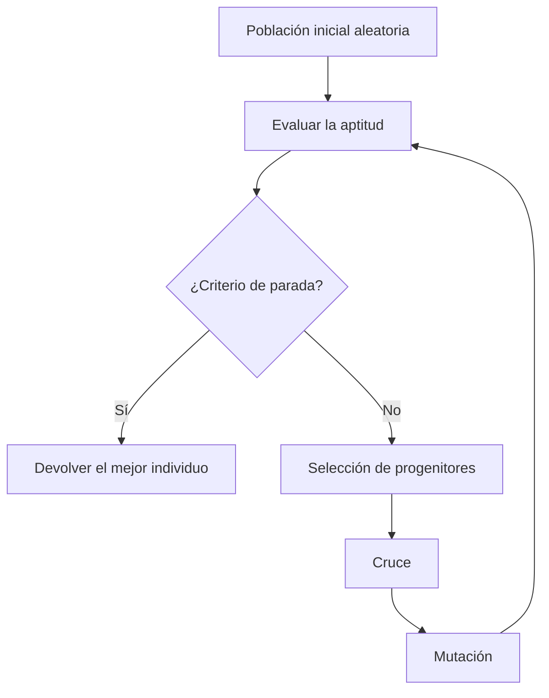

!!! warning

    El contenido de esta página no ha sido revisado ni corregido, por lo que puede
    estar incompleto, contener errores o presentar información desactualizada. Además,
    es posible que esté desordenado, carezca de una estructura clara o incluya notas
    copiadas directamente.

Este capítulo aborda la notación Big O como herramienta para analizar la eficiencia de
un algoritmo con independencia del lenguaje y del equipo donde se ejecuta, y aplica
después ese análisis a los métodos clásicos de ordenación y búsqueda. Las
implementaciones presentadas operan sobre listas de Python y complementan las
estructuras descritas en el capítulo de
[estructuras de datos](section_1_data_structures.md). El capítulo se completa con los
algoritmos genéticos, una técnica de optimización para problemas sin solución exacta
asumible, que se ilustra con el problema del viajante.

## Bibliografía

- Sciencestack. (s.f.). _Big-O Algorithm Complexity Cheat Sheet_.
  <https://www.bigocheatsheet.com/>

## Estrategia de resolución de problemas

Antes de analizar la eficiencia de un algoritmo conviene disponer de un método para
abordar el problema que resuelve. Un procedimiento sistemático reduce el riesgo de
implementar una solución que no cubra todos los casos y facilita el análisis posterior.
Consta de cuatro pasos:

1. Plantear el problema con claridad, identificando el formato de entrada y el de
   salida.
2. Establecer ejemplos concretos de entrada y salida, incluyendo todos los casos
   extremos.
3. Alcanzar una solución candidata, implementarla y probarla, corrigiendo los errores
   que surjan.
4. Analizar la complejidad del algoritmo resultante e identificar las ineficiencias.

Este último paso es el que motiva la notación que se describe a continuación.

## Notación Big O

La notación Big O se utiliza para evaluar la eficiencia de los algoritmos en términos de
complejidad temporal y espacial. La **complejidad temporal** describe cómo varía el
tiempo requerido por un algoritmo en función del número de elementos de entrada,
mientras que la **complejidad espacial** describe el uso de memoria en función del
número de variables utilizadas por el algoritmo.

El interés de esta notación reside en que describe el comportamiento **asintótico**, es
decir, la tendencia de crecimiento cuando el tamaño de la entrada aumenta. Por ese
motivo se descartan las constantes multiplicativas y los términos de menor orden, ya que
dejan de ser relevantes frente al término dominante. Un algoritmo cuyo coste es $3N +
10$ se clasifica simplemente como $O(N)$.

### Órdenes de complejidad

<figure markdown="span">
  
  <figcaption>Órdenes de complejidad más habituales en notación Big O. <a href="https://medium.com/@sysglobalsolutionsblog/notaci%C3%B3n-big-o-615bd1e0a227">Referencia</a></figcaption>
</figure>

Los órdenes de complejidad más frecuentes, ordenados de menor a mayor coste, son los
siguientes:

- $O(1)$: El tiempo de ejecución es constante, independientemente del tamaño de la
  entrada. Es típico en algoritmos que acceden a un número fijo de elementos, como
  devolver el primer elemento de una lista.
- $O(\log N)$: El tiempo de ejecución crece logarítmicamente con el tamaño de la
  entrada. Es común en algoritmos que dividen el problema a la mitad en cada paso, como
  la búsqueda binaria.
- $O(N)$: El tiempo de ejecución crece linealmente con el tamaño de la entrada. Es
  típico de algoritmos que realizan una operación en cada elemento de la entrada, como
  sumar todos los elementos de una lista.
- $O(N \log N)$: Representa una combinación de comportamiento lineal y logarítmico. Es
  común en algoritmos de ordenación eficientes, como _quicksort_.
- $O(N^2)$: El tiempo de ejecución crece cuadráticamente con el tamaño de la entrada. Se
  presenta en algoritmos que realizan operaciones sobre cada par de elementos, como la
  ordenación por burbuja.
- $O(2^N)$: El tiempo de ejecución crece exponencialmente con el tamaño de la entrada.
  Es típico de algoritmos que generan todas las combinaciones posibles de elementos,
  como el problema del viajante.

La diferencia práctica entre estos órdenes se aprecia al estimar el número aproximado de
operaciones para tamaños de entrada crecientes:

|    $N$ | $O(\log N)$ | $O(N)$ |  $O(N \log N)$ |  $O(N^2)$ |
| -----: | ----------: | -----: | -------------: | --------: |
|   $10$ |         $3$ |   $10$ |           $33$ |     $100$ |
| $1000$ |        $10$ | $1000$ |         $9966$ |    $10^6$ |
| $10^6$ |        $20$ | $10^6$ | $2 \cdot 10^7$ | $10^{12}$ |

En casos donde se realizan múltiples operaciones con diferentes costes temporales, la
notación Big O representa el peor caso, ya que interesa acotar el comportamiento más
desfavorable que puede presentar el algoritmo.

Es importante señalar que la notación Big O no está limitada a la letra $N$. Cualquier
letra puede representar el tamaño de la entrada en función del contexto del problema.

### Complejidad en algoritmos multipartes

En algoritmos que involucran múltiples estructuras de datos, la complejidad puede
depender de más de un parámetro. Distinguir si los bucles se ejecutan de forma
consecutiva o anidada resulta determinante, porque en el primer caso los costes se suman
y en el segundo se multiplican.

???+ example "Bucles secuenciales"

    ```python linenums="1"
    def funcion(array_a: list[int], array_b: list[int]) -> None:
        """
        Recorre dos listas de forma consecutiva.

        Args:
            array_a: Primera lista que se recorre.
            array_b: Segunda lista que se recorre.
        """

        for i in array_a:
            ...

        for i in array_b:
            ...
    ```

    Cada bucle tiene una complejidad de $O(N)$, pero como operan sobre _arrays_
    diferentes, la complejidad total es $O(A + B)$, donde $A$ y $B$ son los tamaños de
    `array_a` y `array_b` respectivamente.

???+ example "Bucles anidados"

    ```python linenums="1"
    def funcion(array_a: list[int], array_b: list[int]) -> None:
        """
        Recorre la segunda lista completa para cada elemento de la
        primera.

        Args:
            array_a: Lista recorrida por el bucle externo.
            array_b: Lista recorrida por el bucle interno.
        """

        for i in array_a:
            for j in array_b:
                ...
    ```

    En este caso, la complejidad es $O(A \times B)$, ya que los bucles anidados operan
    sobre _arrays_ diferentes. Constituye un error asumir $O(N^2)$ sin considerar los
    tamaños de los _arrays_ involucrados, puesto que esa expresión solo es válida cuando
    ambas dimensiones coinciden.

Una vez establecido el marco de análisis, las secciones siguientes lo aplican a dos
familias de algoritmos fundamentales. Los métodos de ordenación reorganizan los
elementos de una secuencia según un criterio, mientras que los métodos de búsqueda
localizan un valor dentro de ella, y ambos problemas están relacionados, ya que disponer
de una secuencia ordenada habilita estrategias de búsqueda considerablemente más
eficientes.

## Métodos de ordenación

Los métodos que se describen a continuación son algoritmos de ordenación **in situ**, es
decir, reorganizan los elementos dentro de la propia lista sin necesitar estructuras
auxiliares proporcionales al tamaño de la entrada, por lo que su complejidad espacial es
$O(1)$. Su interés es principalmente didáctico, ya que ilustran con claridad la relación
entre el número de comparaciones y el coste asintótico.

### Ordenación por burbuja (_Bubble Sort_)

La ordenación por burbuja compara pares adyacentes de elementos en una lista e
intercambia sus posiciones si están en orden incorrecto. Tras cada pasada completa, el
mayor de los elementos no colocados asciende hasta su posición definitiva, de forma
análoga a una burbuja que sube a la superficie. El proceso se repite hasta que no se
requieren más intercambios, lo que indica que la lista está ordenada.

El número de comparaciones en el peor caso se obtiene sumando las de cada pasada, lo que
da la suma de una serie aritmética:

$$
\frac{N(N-1)}{2}
$$

Ese término cuadrático es el que domina el comportamiento asintótico. Cuando la lista se
encuentra ya ordenada y la implementación detecta la ausencia de intercambios, basta una
única pasada, de modo que el mejor caso es lineal, $O(N)$.

- **Complejidad temporal**: $O(N^2)$ en el peor caso y $O(N)$ en el mejor.
- **Complejidad espacial**: $O(1)$.

???+ tip "Implementación"

    ```python linenums="1"
    def ordenacion_burbuja(lista: list[int]) -> list[int]:
        """
        Ordena una lista de enteros mediante comparaciones de pares
        adyacentes.

        Args:
            lista: Lista de enteros que se ordena in situ.

        Returns:
            La misma lista recibida, con sus elementos en orden
                creciente.
        """

        n: int = len(lista)

        for i in range(n):
            for j in range(n - 1):
                if lista[j] > lista[j + 1]:
                    lista[j], lista[j + 1] = lista[j + 1], lista[j]

        return lista
    ```

    ```python linenums="1"
    print(f"Resultado: {ordenacion_burbuja([5, 1, 4, 2, 8])}")
    ```

    ```plaintext title="Expected output"
    Resultado: [1, 2, 4, 5, 8]
    ```

### Ordenación por selección (_Selection Sort_)

La ordenación por selección divide conceptualmente la lista en una parte ordenada,
situada al principio, y otra pendiente de ordenar. En cada iteración busca el elemento
más pequeño de la parte no ordenada y lo intercambia con la primera posición de esa
parte, ampliando así el segmento ordenado. El proceso se repite hasta que la lista está
completamente ordenada.

Frente a la ordenación por burbuja, este método realiza el mismo número de
comparaciones, pero un número mucho menor de intercambios, ya que efectúa como máximo
uno por iteración.

- **Complejidad temporal**: $O(N^2)$ en el peor caso.
- **Complejidad espacial**: $O(1)$.

???+ tip "Implementación"

    ```python linenums="1"
    def ordenacion_seleccion(lista: list[int]) -> list[int]:
        """
        Ordena una lista de enteros seleccionando el mínimo en cada
        iteración.

        Args:
            lista: Lista de enteros que se ordena in situ.

        Returns:
            La misma lista recibida, con sus elementos en orden
                creciente.
        """

        n: int = len(lista)

        for i in range(n):
            idx_min: int = i

            for j in range(i + 1, n):
                if lista[j] < lista[idx_min]:
                    idx_min = j

            lista[i], lista[idx_min] = lista[idx_min], lista[i]

        return lista
    ```

    ```python linenums="1"
    print(f"Resultado: {ordenacion_seleccion([5, 1, 4, 2, 8])}")
    ```

    ```plaintext title="Expected output"
    Resultado: [1, 2, 4, 5, 8]
    ```

### Ordenación por inserción (_Insertion Sort_)

La ordenación por inserción también distingue una parte ordenada y otra desordenada,
pero en lugar de buscar el mínimo, toma el siguiente elemento pendiente y lo desplaza
hacia la izquierda hasta situarlo en la posición que le corresponde dentro de la parte
ordenada.

Este comportamiento explica su ventaja frente a los métodos anteriores cuando la entrada
está casi ordenada, ya que en el mejor caso, con la lista previamente ordenada, cada
elemento requiere una única comparación y el coste desciende a $O(N)$. Por esta razón se
emplea como caso base en implementaciones de algoritmos más avanzados cuando los
subproblemas resultan suficientemente pequeños.

- **Complejidad temporal**: $O(N^2)$ en el peor caso, $O(N)$ en el mejor caso.
- **Complejidad espacial**: $O(1)$.

???+ tip "Implementación"

    ```python linenums="1"
    def ordenacion_insercion(lista: list[int]) -> list[int]:
        """
        Ordena una lista insertando cada elemento en la parte ya
        ordenada.

        Args:
            lista: Lista de enteros que se ordena in situ.

        Returns:
            La misma lista recibida, con sus elementos en orden
                creciente.
        """

        for i in range(1, len(lista)):
            j: int = i

            while j > 0 and lista[j - 1] > lista[j]:
                lista[j - 1], lista[j] = lista[j], lista[j - 1]
                j -= 1

        return lista
    ```

    ```python linenums="1"
    print(f"Resultado: {ordenacion_insercion([5, 1, 4, 2, 8])}")
    ```

    ```plaintext title="Expected output"
    Resultado: [1, 2, 4, 5, 8]
    ```

La comparación de los tres métodos permite apreciar que un mismo orden de complejidad
asintótica admite comportamientos distintos según las características de la entrada:

| Método    | Mejor caso | Peor caso | Complejidad espacial | Comportamiento destacado                       |
| :-------- | :--------- | :-------- | :------------------- | :--------------------------------------------- |
| Burbuja   | $O(N^2)$   | $O(N^2)$  | $O(1)$               | Número elevado de intercambios                 |
| Selección | $O(N^2)$   | $O(N^2)$  | $O(1)$               | Como máximo un intercambio por iteración       |
| Inserción | $O(N)$     | $O(N^2)$  | $O(1)$               | Muy eficiente si la entrada está casi ordenada |

## Métodos de búsqueda

Los métodos de búsqueda determinan si un valor está presente en una secuencia y, en caso
afirmativo, en qué posición se encuentra. La estrategia aplicable depende de una
condición previa decisiva, que es si la secuencia está ordenada, ya que solo en ese caso
puede descartarse parte de los datos sin examinarlos.

### Búsqueda lineal (_Linear Search_)

La búsqueda lineal recorre cada elemento de la lista uno por uno hasta encontrar el
elemento buscado o hasta agotar todos los elementos. No impone ninguna condición sobre
la secuencia, lo que la convierte en la única opción viable cuando los datos no están
ordenados.

- **Complejidad temporal**: $O(N)$ en el peor caso.
- **Complejidad espacial**: $O(1)$.

???+ tip "Implementación"

    ```python linenums="1"
    def busqueda_lineal(lista: list[int], valor_buscar: int) -> int | None:
        """
        Busca un valor recorriendo la lista de forma secuencial.

        Args:
            lista: Lista de enteros donde se realiza la búsqueda.
            valor_buscar: Valor que se desea localizar.

        Returns:
            El índice de la primera aparición del valor, o None si no
                está presente.
        """

        for idx, valor in enumerate(lista):
            if valor_buscar == valor:
                return idx

        return None
    ```

    ```python linenums="1"
    print(f"Índice del 4: {busqueda_lineal([5, 1, 4, 2, 8], 4)}")
    print(f"Índice del 7: {busqueda_lineal([5, 1, 4, 2, 8], 7)}")
    ```

    ```plaintext title="Expected output"
    Índice del 4: 2
    Índice del 7: None
    ```

### Búsqueda binaria (_Binary Search_)

La búsqueda binaria divide repetidamente a la mitad la parte de la lista que podría
contener el elemento buscado, hasta reducir las posibles ubicaciones a una sola. En cada
iteración compara el valor buscado con el elemento central del intervalo vigente y,
según el resultado, descarta la mitad en la que el valor no puede encontrarse. Este
método requiere que la lista esté previamente ordenada.

Como el número de candidatos se reduce a la mitad en cada paso, el número de
comparaciones necesarias es proporcional a $\log_2 N$, donde $N$ representa el número de
elementos de la lista. Conviene tener presente que ordenar previamente la secuencia
tiene un coste asociado, por lo que la búsqueda binaria resulta ventajosa cuando sobre
los mismos datos se realizan muchas búsquedas.

La derivación formal de esta complejidad es inmediata. Partiendo de una longitud inicial
$N$, tras $k$ iteraciones el tramo explorado tiene longitud:

$$
\frac{N}{2^k}
$$

El proceso termina cuando ese tramo se reduce a un único elemento, de modo que igualando
a 1 y despejando se obtiene el número de iteraciones:

$$
\frac{N}{2^k} = 1 \;\Rightarrow\; N = 2^k \;\Rightarrow\; k = \log_2 N
$$

???+ example "El problema de localizar una carta"

    Un enunciado clásico que ilustra el método plantea la siguiente situación. Alicia
    dispone de un conjunto de cartas con números escritos, las ordena de mayor a menor y
    las coloca boca abajo sobre una mesa. El reto consiste en localizar la carta que
    contiene un número dado volteando el menor número posible de cartas.

    Partiendo de las cartas `[5, 8, 3, 9, 1, 4, 28]` y ordenándolas de forma decreciente
    se obtiene `[28, 9, 8, 5, 4, 3, 1]`. La estrategia consiste en voltear la carta
    central, en este caso el 5 situado en el índice 3, lo que permite descartar de
    inmediato la mitad del conjunto: si el valor buscado es mayor que 5 solo puede estar
    en la mitad izquierda, y si es menor solo en la derecha.

    Repitiendo el procedimiento sobre la mitad que queda, el número de cartas candidatas
    se reduce a la mitad en cada paso, lo que arroja la complejidad $O(\log_2 N)$
    derivada anteriormente. La única particularidad frente a la implementación habitual
    es que, al estar la secuencia ordenada de forma decreciente, las comparaciones que
    determinan hacia qué lado continuar quedan invertidas.

- **Complejidad temporal**: $O(\log N)$ en el peor caso.
- **Complejidad espacial**: $O(1)$.

???+ tip "Implementación"

    ```python linenums="1"
    def busqueda_binaria(lista: list[int], valor_buscar: int) -> int | None:
        """
        Busca un valor en una lista ordenada dividiendo el intervalo
        por la mitad.

        Args:
            lista: Lista de enteros ordenada de forma creciente.
            valor_buscar: Valor que se desea localizar.

        Returns:
            El índice donde se encuentra el valor, o None si no está
                presente.
        """

        izquierda: int = 0
        derecha: int = len(lista) - 1

        while izquierda <= derecha:
            punto_medio: int = (izquierda + derecha) // 2

            if valor_buscar == lista[punto_medio]:
                return punto_medio
            elif valor_buscar > lista[punto_medio]:
                izquierda = punto_medio + 1
            else:
                derecha = punto_medio - 1

        return None
    ```

    ```python linenums="1"
    print(f"Índice del 4: {busqueda_binaria([1, 2, 4, 5, 8], 4)}")
    print(f"Índice del 7: {busqueda_binaria([1, 2, 4, 5, 8], 7)}")
    ```

    ```plaintext title="Expected output"
    Índice del 4: 2
    Índice del 7: None
    ```

???+ warning "Requisito de ordenación"

    Aplicar la búsqueda binaria sobre una lista desordenada no produce un error de
    ejecución, sino un resultado incorrecto, ya que el algoritmo descarta intervalos
    asumiendo una ordenación que no existe. Verificar esta precondición es
    responsabilidad de quien invoca la función.

La elección entre ambos métodos depende, por tanto, del estado de los datos y del número
de consultas previstas:

| Método  | Requiere ordenación | Complejidad temporal | Situación recomendada                    |
| :------ | :------------------ | :------------------- | :--------------------------------------- |
| Lineal  | No                  | $O(N)$               | Datos desordenados o búsquedas puntuales |
| Binaria | Sí                  | $O(\log N)$          | Datos ordenados con búsquedas frecuentes |

Los métodos de ordenación y de búsqueda tienen solución exacta y eficiente. Otros
problemas, los de **optimización combinatoria**, buscan dentro de un conjunto finito
pero enorme de configuraciones la que minimiza o maximiza un criterio y carecen de un
algoritmo exacto asumible. Se renuncia entonces a garantizar el óptimo a cambio de
soluciones buenas en un tiempo razonable.

## Algoritmos genéticos

Un **algoritmo genético** mantiene una **población** de soluciones candidatas y la hace
evolucionar imitando la selección natural: los individuos mejor adaptados tienen más
probabilidad de transmitir su material a la siguiente generación, donde se combinan y
sufren pequeñas alteraciones aleatorias. Es una técnica de búsqueda de propósito
general, útil cuando el espacio es enorme, no hay un gradiente que seguir y conviene
manipular muchos parámetros a la vez. Por eso se emplea también en aprendizaje
automático, por ejemplo en la búsqueda de hiperparámetros.

### Problema de aplicación: el viajante

Para concretar los operadores se usa un problema clásico de optimización combinatoria,
el **problema del viajante** (_traveling salesman problem_, TSP). Consiste en encontrar
el recorrido cerrado de longitud mínima que visita cada uno de $N$ puntos exactamente
una vez y regresa al de partida. Una solución es una permutación $\pi$ de los puntos, y
su longitud es la suma de las distancias entre puntos consecutivos, incluido el regreso:

$$
L(\pi) = \sum_{i=0}^{N-1} d\left(\pi_i, \pi_{(i+1) \bmod N}\right)
$$

donde $d(a, b)$ es la distancia euclídea entre dos puntos. Fijar el punto de partida
deja $(N-1)!$ recorridos posibles, cantidad que supera a cualquier crecimiento
exponencial: con 20 puntos son unos $10^{17}$. Como no se conoce un algoritmo exacto
polinómico, se recurre a métodos como el genético, que no garantizan el óptimo.

Las coordenadas de ejemplo se generan con una semilla fija en un cuadrado de 100 por 100
unidades. Con 10 puntos todavía es viable enumerar los $9! = 362880$ recorridos, lo que
proporciona el óptimo exacto como referencia. Los bloques de código de esta sección
forman un único módulo, por lo que cada uno reutiliza las definiciones de los
anteriores.

???+ tip "Distancias y longitud de un recorrido"

    ```python linenums="1"
    import math
    import random
    from dataclasses import dataclass
    from itertools import permutations


    def generar_puntos(n: int, semilla: int) -> list[tuple[float, float]]:
        """
        Genera puntos aleatorios en un cuadrado de 100 por 100 unidades.

        Args:
            n: Número de puntos.
            semilla: Semilla del generador aleatorio.

        Returns:
            La lista de coordenadas (x, y).
        """

        rng = random.Random(semilla)

        return [
            (round(rng.uniform(0, 100), 1), round(rng.uniform(0, 100), 1))
            for _ in range(n)
        ]


    def matriz_distancias(puntos: list[tuple[float, float]]) -> list[list[float]]:
        """
        Precalcula la distancia euclídea entre todos los pares de puntos.

        Args:
            puntos: Coordenadas de los puntos.

        Returns:
            Matriz cuadrada con la distancia entre cada par de puntos.
        """

        return [[math.dist(a, b) for b in puntos] for a in puntos]


    def longitud_recorrido(orden: list[int], d: list[list[float]]) -> float:
        """
        Suma las distancias de un recorrido cerrado.

        Args:
            orden: Permutación de los índices de los puntos.
            d: Matriz de distancias.

        Returns:
            La longitud total, incluido el regreso al primer punto.
        """

        n: int = len(orden)

        return sum(d[orden[i]][orden[(i + 1) % n]] for i in range(n))


    def optimo_exacto(d: list[list[float]]) -> float:
        """
        Enumera todos los recorridos que parten del punto 0.

        Args:
            d: Matriz de distancias.

        Returns:
            La longitud del recorrido más corto. Solo es viable para pocos puntos.
        """

        n: int = len(d)

        return min(
            longitud_recorrido([0, *resto], d) for resto in permutations(range(1, n))
        )
    ```

    ```python linenums="1"
    puntos: list[tuple[float, float]] = generar_puntos(10, 42)
    d: list[list[float]] = matriz_distancias(puntos)

    orden_inicial: list[int] = list(range(10))

    print(f"Primer punto: {puntos[0]}")
    print(f"Orden inicial: {longitud_recorrido(orden_inicial, d):.3f}")
    print(f"Longitud óptima: {optimo_exacto(d):.3f}")
    ```

    ```plaintext title="Expected output"
    Primer punto: (63.9, 2.5)
    Orden inicial: 516.759
    Longitud óptima: 264.011
    ```

### Vocabulario y ciclo de evolución

La terminología procede de la biología. Un organismo contiene células, estas contienen
cromosomas y los cromosomas almacenan el ADN. Simplificando, el **genoma** es la
colección completa del material genético de un individuo y cada **gen** es una de sus
unidades. La tabla siguiente traduce esos conceptos al problema del viajante, con la
codificación por claves aleatorias que se describe en la sección siguiente:

| Concepto            | Significado en el algoritmo                 | En el viajante                       |
| :------------------ | :------------------------------------------ | :----------------------------------- |
| Gen                 | Un valor del genoma                         | Un número real asociado a un punto   |
| Genoma              | Secuencia completa de genes de un individuo | Un número real por cada punto        |
| Individuo           | Una solución candidata                      | Un orden de visita                   |
| Población           | Conjunto de individuos                      | Conjunto de órdenes candidatos       |
| Aptitud (_fitness_) | Calidad de un individuo                     | Función decreciente de la longitud   |
| Generación          | Una iteración del algoritmo                 | Una población nueva a partir de otra |

El algoritmo comienza con una población inicial aleatoria. Cada individuo se evalúa con
la función de aptitud, y los mejor puntuados se seleccionan como progenitores. Su
material genético se recombina mediante el cruce y se altera con la mutación. El
resultado, formado por los vástagos o descendientes, constituye la generación siguiente.
El ciclo se repite hasta cumplir un criterio de parada.



### Codificación del genoma

La **codificación** decide cómo se representa una solución en el genoma y condiciona qué
operadores son válidos. Para el viajante, la representación natural es la permutación.
Sin embargo, cruzar dos permutaciones cortando y empalmando segmentos suele producir
puntos repetidos y ausentes, de modo que el vástago no es un recorrido válido. Existen
operadores diseñados para permutaciones, como el cruce de orden y el cruce parcialmente
emparejado, que evitan ese problema a costa de una implementación más elaborada.

Una alternativa más simple es la codificación por **claves aleatorias** (_random keys_,
Bean, 1994). El genoma es un vector de $N$ números reales, uno por punto, y el orden de
visita se obtiene ordenando los puntos según el valor de su gen. Cualquier vector de
reales decodifica a una permutación válida, por lo que el cruce y la mutación de números
reales no necesitan reparación. Los empates se resuelven por orden de aparición, porque
la ordenación de Python es estable, y la decodificación siempre es determinista.

???+ tip "Implementación"

    ```python linenums="1"
    def decodificar(genes: list[float]) -> list[int]:
        """
        Convierte un genoma de claves reales en un orden de visita.

        Args:
            genes: Un valor real por punto.

        Returns:
            Los índices de los puntos ordenados por el valor de su gen.
        """

        return sorted(range(len(genes)), key=lambda i: genes[i])
    ```

    ```python linenums="1"
    genes_ejemplo: list[float] = [0.62, 0.11, 0.85, 0.40, 0.27]

    print(f"Orden decodificado: {decodificar(genes_ejemplo)}")
    ```

    ```plaintext title="Expected output"
    Orden decodificado: [1, 4, 3, 0, 2]
    ```

En el ejemplo, el punto 1 posee el gen más pequeño (0.11) y se visita primero, seguido
del punto 4 (0.27), y así sucesivamente.

### Función de aptitud

La **función de aptitud** puntúa a cada individuo y debe crecer cuando la solución
mejora, porque la selección favorece los valores altos. Como el objetivo es minimizar la
longitud $L$ del recorrido, se invierte:

$$
f = \frac{1}{L + 1}
$$

El sumando 1 evita la división por cero ante un recorrido de longitud nula.

???+ tip "Implementación"

    ```python linenums="1"
    def aptitud(longitud: float) -> float:
        """
        Transforma una longitud en una aptitud que crece al acortar el recorrido.

        Args:
            longitud: Longitud del recorrido.

        Returns:
            El valor 1 / (longitud + 1).
        """

        return 1.0 / (longitud + 1.0)
    ```

    ```python linenums="1"
    print(f"Aptitud con longitud 270: {aptitud(270.0):.5f}")
    print(f"Aptitud con longitud 264: {aptitud(264.0):.5f}")
    ```

    ```plaintext title="Expected output"
    Aptitud con longitud 270: 0.00369
    Aptitud con longitud 264: 0.00377
    ```

!!! note

    La diferencia de aptitud entre un recorrido de longitud 270 y otro de 264, valores
    próximos al óptimo de este ejemplo, es de solo un 2 %. Cuando la población ya
    contiene recorridos parecidos, la selección proporcional apenas distingue a los
    buenos de los mediocres, un fenómeno conocido como baja presión selectiva. La
    selección por torneo, la selección por rango o el escalado de la aptitud corrigen
    ese comportamiento.

### Selección por ruleta

En la **selección por ruleta**, la probabilidad de elegir al individuo $i$ es
proporcional a su aptitud:

$$
p_i = \frac{f_i}{\sum_{j=1}^{M} f_j}
$$

donde $M$ es el tamaño de la población. La imagen asociada es una ruleta cuyos sectores
miden lo que su aptitud, de modo que los individuos mejores se eligen más a menudo sin
excluir por completo a los peores, lo que preserva diversidad. Cada vástago necesita dos
progenitores distintos, porque cruzar un individuo consigo mismo solo produce una copia.
Tras elegir al primero se anula su peso y se vuelve a girar la ruleta.

???+ tip "Implementación"

    ```python linenums="1"
    def seleccionar_pareja(
        aptitudes: list[float], rng: random.Random
    ) -> tuple[int, int]:
        """
        Elige dos progenitores distintos por el método de la ruleta.

        Args:
            aptitudes: Aptitud de cada individuo.
            rng: Generador aleatorio.

        Returns:
            Los índices de los dos progenitores.
        """

        indices: range = range(len(aptitudes))
        madre: int = rng.choices(indices, weights=aptitudes)[0]

        # El primer progenitor recibe peso nulo para que no se repita
        pesos: list[float] = aptitudes.copy()
        pesos[madre] = 0.0
        padre: int = rng.choices(indices, weights=pesos)[0]

        return madre, padre
    ```

!!! warning

    Una implementación manual de la ruleta acumula aptitudes hasta superar un número
    aleatorio del intervalo $\lbrack 0, \sum f_j)$. Con coma flotante, la suma acumulada
    puede quedar ligeramente por debajo del total, y un bucle que no comprueba el límite
    del vector accede fuera de él, lo que en Python provoca un `IndexError`. La función
    `random.choices` encapsula esa búsqueda y elimina el riesgo.

### Cruce en k puntos

El **cruce** (_crossover_) combina el material de dos progenitores. En el cruce en $k$
puntos se eligen $k$ posiciones distintas del genoma y el vástago copia los genes de un
progenitor hasta el primer corte, del otro hasta el segundo, y así de forma alterna. Con
$k = 2$, el vástago hereda los extremos de un progenitor y el tramo central del otro.
Los cortes se sortean entre 1 y $N-1$, porque uno en el extremo no intercambiaría nada,
de modo que $k \le N - 1$. Con claves aleatorias, el cruce transmite valores de gen y,
con ellos, el orden relativo entre puntos, y no sus posiciones en el recorrido.

### Mutación

La **mutación** introduce variaciones aleatorias que reponen la diversidad perdida y
evitan que la población quede atrapada en soluciones mediocres, un efecto llamado
convergencia prematura. Se controla con tres parámetros: el porcentaje de individuos que
mutan en cada generación, el porcentaje de genes que se alteran dentro de cada individuo
mutado y la amplitud máxima $\delta$ de la perturbación. A cada gen elegido se le suma
un valor aleatorio uniforme:

$$
g_i' = g_i + u, \qquad u \sim \mathcal{U}(-\delta, \delta)
$$

Como la decodificación depende solo del orden relativo de los genes, una perturbación
pequeña intercambia puntos vecinos en el orden y una grande reordena el recorrido de
forma drástica.

???+ tip "Implementación del cruce y la mutación"

    ```python linenums="1"
    def cruzar(
        madre: list[float], padre: list[float], puntos: int, rng: random.Random
    ) -> list[float]:
        """
        Cruza dos genomas alternando segmentos entre puntos de corte.

        Args:
            madre: Genoma del primer progenitor.
            padre: Genoma del segundo progenitor.
            puntos: Número de puntos de corte.
            rng: Generador aleatorio.

        Returns:
            El genoma del vástago.
        """

        # Un corte en la posición p separa los genes p - 1 y p
        cortes: set[int] = set(rng.sample(range(1, len(madre)), puntos))
        fuente: list[float] = madre
        hijo: list[float] = []

        for posicion in range(len(madre)):
            if posicion in cortes:
                fuente = padre if fuente is madre else madre

            hijo.append(fuente[posicion])

        return hijo


    def mutar(
        genes: list[float], pct_genes: float, amplitud: float, rng: random.Random
    ) -> None:
        """
        Perturba in situ un porcentaje de los genes con ruido uniforme.

        Args:
            genes: Genoma que se modifica.
            pct_genes: Porcentaje de genes que se perturban.
            amplitud: Valor absoluto máximo de la perturbación.
            rng: Generador aleatorio.
        """

        cantidad: int = int(len(genes) * pct_genes / 100.0)

        for i in rng.sample(range(len(genes)), cantidad):
            genes[i] += rng.uniform(-amplitud, amplitud)
    ```

    ```python linenums="1"
    rng_demo = random.Random(3)
    madre_demo: list[float] = [0.1, 0.2, 0.3, 0.4, 0.5, 0.6]
    padre_demo: list[float] = [0.95, 0.85, 0.75, 0.65, 0.55, 0.45]
    hijo_demo: list[float] = cruzar(madre_demo, padre_demo, 2, rng_demo)

    print(f"Vástago: {hijo_demo}")
    print(f"Orden decodificado: {decodificar(hijo_demo)}")
    ```

    ```plaintext title="Expected output"
    Vástago: [0.1, 0.2, 0.75, 0.65, 0.55, 0.6]
    Orden decodificado: [0, 1, 4, 5, 3, 2]
    ```

Con los cortes 2 y 5 resultantes de la semilla, los genes 0 y 1 proceden de la madre,
los genes 2 a 4 del padre y el gen 5 de nuevo de la madre.

### Elitismo

El **elitismo** copia el mejor individuo de cada generación, sin cruce ni mutación, a la
siguiente. Garantiza que la mejor aptitud nunca empeore entre generaciones, algo que no
ocurre sin él porque la ruleta y la mutación pueden destruir la mejor solución
encontrada. El élite ocupa un puesto de la población, por lo que solo se generan $M - 1$
vástagos por cruce.

!!! warning

    Mutar al individuo élite anula su función. Es un error fácil de cometer cuando se
    identifica al élite por una posición que el sorteo de individuos mutantes sí puede
    alcanzar. En la implementación, el élite ocupa la posición 0 y esa posición se
    excluye del sorteo.

### Bucle principal y criterio de parada

Cada generación decodifica y evalúa a toda la población, registra al mejor individuo,
comprueba el criterio de parada y construye la siguiente población. Los criterios más
habituales son los siguientes:

- **Número máximo de generaciones**: Acota el coste del algoritmo.
- **Solución suficiente**: Se detiene al alcanzar una longitud o una aptitud objetivo.
- **Estancamiento**: Se detiene si la mejor solución no mejora durante un número fijo de
  generaciones, denominado paciencia.
- **Presupuesto agotado**: Se detiene al superar un tiempo o un número de evaluaciones.
- **Interrupción manual**: El usuario detiene la ejecución.

La implementación combina el límite de generaciones con el estancamiento. Los parámetros
se agrupan en un registro inmutable para poder variarlos sin tocar el código del
algoritmo.

???+ tip "Parámetros del algoritmo"

    ```python linenums="1"
    @dataclass(frozen=True)
    class Parametros:
        """
        Parámetros del algoritmo genético.

        Attributes:
            individuos: Tamaño de la población.
            generaciones: Número máximo de generaciones.
            puntos_corte: Puntos de corte del cruce.
            pct_individuos: Porcentaje de individuos que mutan por generación.
            pct_genes: Porcentaje de genes que mutan en un individuo mutado.
            amplitud: Valor absoluto máximo de la perturbación de un gen.
            elitismo: Si es True, el mejor individuo pasa intacto.
            paciencia: Generaciones sin mejora tras las que se detiene la
                búsqueda.
        """

        individuos: int = 100
        generaciones: int = 100
        puntos_corte: int = 2
        pct_individuos: float = 30.0
        pct_genes: float = 20.0
        amplitud: float = 0.2
        elitismo: bool = True
        paciencia: int = 30
    ```

???+ tip "Implementación"

    ```python linenums="1"
    def algoritmo_genetico(
        d: list[list[float]], p: Parametros, semilla: int
    ) -> tuple[list[int], float, list[float]]:
        """
        Busca un recorrido corto con un algoritmo genético de claves aleatorias.

        Args:
            d: Matriz de distancias.
            p: Parámetros del algoritmo.
            semilla: Semilla del generador aleatorio.

        Returns:
            El mejor orden, su longitud y la mejor longitud tras cada generación.
        """

        rng = random.Random(semilla)
        n: int = len(d)
        poblacion: list[list[float]] = [
            [rng.random() for _ in range(n)] for _ in range(p.individuos)
        ]
        mejor_orden: list[int] = []
        mejor_longitud: float = math.inf
        historial: list[float] = []
        sin_mejora: int = 0

        for _ in range(p.generaciones):
            ordenes = [decodificar(genes) for genes in poblacion]
            longitudes = [longitud_recorrido(orden, d) for orden in ordenes]
            mejor: int = min(range(p.individuos), key=longitudes.__getitem__)

            if longitudes[mejor] < mejor_longitud - 1e-9:
                mejor_orden, mejor_longitud = ordenes[mejor], longitudes[mejor]
                sin_mejora = 0
            else:
                sin_mejora += 1

            historial.append(mejor_longitud)

            if sin_mejora >= p.paciencia:
                break

            aptitudes = [aptitud(longitud) for longitud in longitudes]
            siguiente: list[list[float]] = []

            if p.elitismo:
                siguiente.append(poblacion[mejor].copy())

            while len(siguiente) < p.individuos:
                madre, padre = seleccionar_pareja(aptitudes, rng)
                progenitores = (poblacion[madre], poblacion[padre])
                siguiente.append(cruzar(*progenitores, p.puntos_corte, rng))

            # Con elitismo, la posición 0 guarda al mejor y no se muta
            primero: int = 1 if p.elitismo else 0
            mutantes: int = int(p.individuos * p.pct_individuos / 100.0)

            for i in rng.sample(range(primero, p.individuos), mutantes):
                mutar(siguiente[i], p.pct_genes, p.amplitud, rng)

            poblacion = siguiente

        return mejor_orden, mejor_longitud, historial
    ```

    ```python linenums="1"
    orden_ag, longitud_ag, historial = algoritmo_genetico(d, Parametros(), 1)

    for generacion in (1, 10, 20, len(historial)):
        print(f"Generación {generacion:2d}: {historial[generacion - 1]:.3f}")

    print(f"Orden: {orden_ag}")
    ```

    ```plaintext title="Expected output"
    Generación  1: 387.686
    Generación 10: 295.530
    Generación 20: 264.011
    Generación 48: 264.011
    Orden: [3, 7, 2, 8, 5, 6, 1, 4, 0, 9]
    ```

La mejor longitud parte de 387.686, el mejor de 100 órdenes al azar, y desciende hasta
264.011, el óptimo exacto calculado antes por enumeración. La ejecución se detiene en la
generación 48 por estancamiento, tras 30 generaciones sin mejora. En problemas reales no
puede comprobarse que se alcance el óptimo, y distintas semillas pueden terminar en
recorridos algo más largos. Para 10 puntos la enumeración es más sencilla, y el interés
del método está en los espacios de búsqueda donde esa enumeración es inviable.

!!! warning

    El generador aleatorio se crea una sola vez y se pasa a todas las funciones.
    Reiniciar el generador con la misma semilla en cada individuo, cruce o mutación
    genera una población inicial con individuos idénticos y decisiones aleatorias
    correlacionadas entre sí, lo que elimina la diversidad que el algoritmo necesita. La
    semilla fija solo debe usarse una vez, para que la ejecución completa sea
    reproducible.

### Efecto de los parámetros

El comportamiento del algoritmo depende de sus parámetros, y no existe una combinación
universal. La tabla resume el efecto habitual de cada uno:

| Parámetro                | Al aumentarlo                      | Riesgo                                         |
| :----------------------- | :--------------------------------- | :--------------------------------------------- |
| Tamaño de la población   | Más diversidad y exploración       | El coste por generación crece linealmente      |
| Número de generaciones   | Más tiempo de refinamiento         | Rendimientos decrecientes                      |
| Puntos de corte          | Mayor mezcla entre progenitores    | Rompe combinaciones de genes que funcionaban   |
| Individuos mutados       | Más diversidad                     | Se degrada hacia una búsqueda aleatoria        |
| Genes mutados y amplitud | Cambios mayores en cada individuo  | Se pierde lo ya aprendido por los progenitores |
| Elitismo                 | Conserva siempre la mejor solución | Con muchos élites, convergencia prematura      |

Los valores adecuados dependen del problema y no constituyen una regla general. En una
aplicación real, los parámetros se ajustan de forma empírica repitiendo la ejecución con
varias semillas.

El siguiente capítulo, sobre
[diseño y código sostenible](section_3_sustainable_code.md), pasa de la eficiencia de
los algoritmos a los principios que mantienen un código legible y fácil de modificar.
