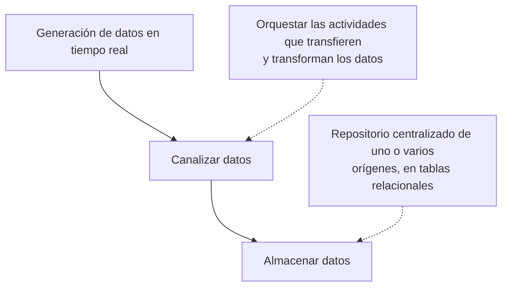

!!! warning

    El contenido de esta página no ha sido revisado ni corregido, por lo que puede
    estar incompleto, contener errores o presentar información desactualizada. Además,
    es posible que esté desordenado, carezca de una estructura clara o incluya notas
    copiadas directamente.

Este capítulo introduce los conceptos fundamentales de la computación en la nube, los
modelos de servicio y los principios de diseño de sistemas distribuidos.

## Bibliografía

- Donnemartin. (s.f.). _System Design Primer_ \[Repositorio\]. GitHub.
  <https://github.com/donnemartin/system-design-primer>
- Amazon Web Services. (s.f.). _AWS Cloud Practitioner Essentials_ \[Curso\]. AWS Skill
  Builder.
  <https://skillbuilder.aws/learn/94T2BEN85A/aws-cloud-practitioner-essentials/8D79F3AVR7>

## Introducción

La computación en la nube proporciona recursos bajo demanda (redes, almacenamiento,
cómputo) a través de Internet. Sus características principales son:

- **Autoservicio bajo demanda**: Provisión de recursos sin intervención humana.
- **Acceso amplio a la red**: Accesible desde cualquier dispositivo con conexión a
  Internet.
- **Elasticidad**: Escalado automático de recursos según la demanda.
- **Pago por uso**: Se factura únicamente por los recursos consumidos.

### Modelos de despliegue

| Modelo           | Descripción                                                              |
| :--------------- | :----------------------------------------------------------------------- |
| **Nube pública** | Infraestructura compartida gestionada por un proveedor (AWS, GCP, Azure) |
| **Nube privada** | Infraestructura dedicada a una única organización                        |
| **Nube híbrida** | Combinación de nube pública y privada                                    |

### Modelos de servicio

| Modelo                                 | Descripción                                         |
| :------------------------------------- | :-------------------------------------------------- |
| **IaaS** (Infrastructure as a Service) | Se gestiona desde el sistema operativo hacia arriba |
| **PaaS** (Platform as a Service)       | Se gestiona solo la aplicación y los datos          |
| **SaaS** (Software as a Service)       | Se consume el software directamente                 |

## Diseño de sistemas distribuidos

Un buen diseño de sistemas debe contemplar escalabilidad, mantenibilidad, eficiencia y
fiabilidad.

### Teorema CAP

En sistemas distribuidos, el teorema CAP establece que solo es posible garantizar dos de
las tres propiedades siguientes simultáneamente:

| Propiedad                                          | Descripción                                                 |
| :------------------------------------------------- | :---------------------------------------------------------- |
| **Consistencia** (Consistency)                     | Todos los nodos reflejan el mismo dato en el mismo instante |
| **Disponibilidad** (Availability)                  | El sistema responde a todas las peticiones                  |
| **Tolerancia a particiones** (Partition Tolerance) | El sistema sigue funcionando ante fallos de red entre nodos |

La clave es encontrar el compromiso adecuado para cada caso de uso.

### SLO y SLA

- **SLO** (_Service Level Objectives_): Objetivos internos de rendimiento (latencia,
  disponibilidad).
- **SLA** (_Service Level Agreements_): Compromisos contractuales con los usuarios sobre
  el nivel de servicio mínimo.

### Rendimiento (_throughput_ y latencia)

- **_Throughput_**: Número de peticiones procesadas por segundo.
- **Latencia**: Tiempo de respuesta desde que se recibe una petición hasta que se
  devuelve el resultado.

### Caché

La caché almacena copias de datos frecuentemente solicitados para evitar recalcularlos o
consultar la base de datos. Tipos principales:

- **Caché de navegador**: Almacena recursos estáticos en el cliente.
- **Caché de servidor/aplicación**: Almacena resultados de operaciones costosas.

El problema principal de la caché es la **invalidación**: garantizar que los datos
cacheados estén actualizados respecto a la fuente de verdad.

### CDN (_Content Delivery Network_)

Red de servidores distribuidos geográficamente que cachean contenido estático cerca del
usuario, reduciendo la latencia.

### Proxies

Un servidor proxy actúa como intermediario entre cliente y servidor. Funciones
principales: cacheo, anonimización, balanceo de carga y filtrado de tráfico.

| Tipo              | Descripción                  |
| :---------------- | :--------------------------- |
| **Forward proxy** | Actúa en nombre del cliente  |
| **Reverse proxy** | Actúa en nombre del servidor |

### Separación de la capa de aplicación y la de datos

Una aplicación monolítica que atiende las peticiones y almacena los datos en la misma
máquina obliga a escalar ambas responsabilidades a la vez, aunque solo una de ellas esté
saturada. El primer paso de casi cualquier arquitectura distribuida consiste en separar
la **capa de aplicación**, formada por los servidores que ejecutan la lógica de negocio,
de la **capa de datos**, formada por las bases de datos y los sistemas de
almacenamiento.

Esta separación aporta tres ventajas. La primera es el escalado independiente, ya que la
capa de aplicación suele necesitar más réplicas que la de datos, y cada una puede
dimensionarse según su propio patrón de carga. La segunda es la redundancia, puesto que
el fallo de un servidor de aplicación no afecta a la información almacenada. La tercera
es que los servidores dejan de mantener estado propio, de modo que cualquiera de ellos
puede atender cualquier petición sin importar cuál de ellos procesó la anterior del
mismo usuario.

Esta última propiedad es la que hace viable el balanceo de carga. Si un servidor
guardase localmente la sesión o los archivos subidos por el usuario, las peticiones
siguientes tendrían que dirigirse siempre a esa misma máquina. Al desplazar el estado a
la capa de datos, los servidores se vuelven intercambiables y el tráfico puede
repartirse libremente entre ellos.

### Balanceadores de carga

Un **balanceador de carga** distribuye el tráfico entrante entre varias instancias
equivalentes. Se puede situar en distintos puntos de la arquitectura, entre el usuario y
los servidores web, entre los servidores web y los de aplicación, o entre la aplicación
y las réplicas de lectura de la base de datos.

El reparto se decide mediante un algoritmo de distribución. Los más habituales son
_round robin_, que rota entre los destinos disponibles, _least connections_, que elige
el destino con menos conexiones activas, _IP hash_, que asigna cada cliente a un destino
concreto en función de su dirección, _weighted_, que reparte de forma proporcional a la
capacidad de cada instancia, _geographic_, que dirige la petición al destino más
cercano, y _consistent hashing_, que limita la redistribución de claves cuando el número
de destinos cambia.

Además del reparto, el balanceador ejecuta comprobaciones de estado (_health checks_)
periódicas contra cada destino y retira de la rotación los que no responden
correctamente, lo que evita enviar tráfico a instancias caídas. Como todo el tráfico
atraviesa el balanceador, este constituye un punto único de fallo, por lo que en
producción se despliega de forma redundante y con capacidad de autoescalado.

Una arquitectura compleja rara vez se conforma con un único nivel de balanceo. Es
frecuente encontrar un balanceador en el borde del sistema y otros internos delante de
cada grupo de servicios, ya que los componentes intermedios también escalan de forma
horizontal y necesitan su propio reparto de tráfico.

### Puertas de enlace y limitación de peticiones

Cuando la aplicación se descompone en microservicios, exponer cada uno de ellos
directamente al cliente traslada al _frontend_ la responsabilidad de conocer la
topología interna del sistema. Una **puerta de enlace** (_API gateway_) evita ese
acoplamiento al ofrecer un punto de acceso único que enruta cada petición al servicio
correspondiente y que, cuando conviene, agrega en una sola respuesta los resultados de
varias llamadas internas. Los servicios permanecen así dentro de una red privada, como
una VPC, sin exposición directa a Internet.

El recorrido habitual de una petición atraviesa por tanto varias capas. El cliente
resuelve el nombre del servicio, alcanza el balanceador de carga del borde, este dirige
el tráfico a la puerta de enlace y esta reenvía la petición a la red privada donde
residen los servicios, que a su vez pueden estar precedidos por balanceadores internos.

Delante de la puerta de enlace conviene aplicar una **limitación de peticiones** (_rate
limiting_), que restringe cuántas solicitudes admite cada cliente en una ventana de
tiempo determinada. Situar el límite en el borde, antes del enrutado, protege a todos
los servicios internos del tráfico abusivo y del consumo desproporcionado de recursos
por parte de un único consumidor, además de contener el coste de las peticiones que
nunca deberían haber llegado a procesarse.

### Optimización de bases de datos

- **Índices**: Mejoran el rendimiento de lectura a costa de la escritura. Útiles para
  identificar registros de forma única sin recorrer todas las filas.
- **Particionado**: Divide bases de datos grandes en fragmentos más manejables para
  mejorar rendimiento y escalabilidad.

### Gestión de archivos binarios

Una base de datos relacional está diseñada para almacenar registros estructurados y
consultarlos mediante relaciones, no para custodiar imágenes, vídeos o documentos de
gran tamaño. Guardar ese contenido en columnas binarias infla las copias de seguridad,
desperdicia la memoria dedicada a la caché de consultas y degrada el rendimiento de la
base de datos completa.

El patrón habitual separa el contenido de su descripción. Los **metadatos** del archivo,
como el identificador, el nombre, el tamaño y el tipo de contenido, se almacenan como un
registro más de la base de datos relacional, mientras que el archivo en sí reside en un
sistema de almacenamiento de objetos. El registro conserva la referencia al objeto, de
modo que las consultas siguen operando sobre datos estructurados y ligeros.

La subida se resuelve sin que el archivo atraviese la capa de aplicación. El cliente
solicita permiso de escritura, el servidor registra los metadatos y devuelve una
dirección de subida firmada y temporal que apunta directamente al almacenamiento de
objetos. El cliente transmite entonces el contenido contra esa dirección, cuyo plazo de
validez (_timeout_) acota la ventana en la que la autorización puede utilizarse. Cuando
la transferencia termina, el registro de metadatos se marca como completado. De esta
forma los servidores de aplicación no consumen ancho de banda ni memoria proporcionales
al tamaño de los archivos.

## Tipos de datos y almacenamiento

Los datos pueden clasificarse según su formato:

- **Texto estructurado**: CSV (delimitadores como comas o tabuladores), JSON (estándar
  abierto para datos estructurados, muy usado en APIs), XML (lenguaje de marcado legible
  por humanos y máquinas).
- **Datos binarios**: Imágenes (JPEG, PNG), audio y vídeo, habitualmente en formatos
  comprimidos.
- **Datos tabulares/metadatos**: Parquet, JSON, TXT según el caso de uso.

Una clasificación complementaria atiende al grado de organización. Los datos
estructurados siguen un esquema predefinido, como las tablas de una base de datos
relacional, mientras que los no estructurados carecen de esquema, como ocurre con
imágenes, audio o texto libre. Entre ambos extremos se sitúan los **datos
semiestructurados**, que no se ajustan a un formato predefinido pero incorporan
etiquetas u otros elementos que delimitan sus componentes, siendo JSON el caso más
representativo. Estos datos requieren procesamiento antes de cargarse en el sistema de
destino, ya sea extrayendo campos concretos, convirtiendo formatos o normalizando
valores.

### Datos operativos y datos analíticos

Los **datos operativos** son datos transaccionales que generan y almacenan las
aplicaciones en una base de datos, relacional cuando están estructurados o no relacional
cuando no lo están. Se corresponden con la información que produce un servicio durante
su funcionamiento normal, como una red de sensores que recopila medidas y las transmite
en formato JSON.

Los **datos analíticos** son datos optimizados para el análisis y la elaboración de
informes, alojados habitualmente en un almacén de datos. Convertir los primeros en los
segundos es precisamente el cometido de la ingeniería de datos: extraer los datos
operativos, aplicarles el procesamiento necesario para obtener información estructurada
y compatible con los procesos posteriores, y cargarlos en el sistema de destino.

Dos operaciones resultan fundamentales al trabajar con orígenes heterogéneos. La
**integración de datos** localiza la información a extraer y establece los enlaces con
la aplicación que la consumirá, de forma que el proceso resulte seguro y fiable. La
**consolidación de datos** combina información procedente de varios orígenes para que
comparta una estructura coherente.

### Data Warehouse vs Data Lake

| Enfoque            | Proceso                        | Uso                                                    |
| :----------------- | :----------------------------- | :----------------------------------------------------- |
| **Data Warehouse** | ETL (Extract, Transform, Load) | Datos ya transformados y listos para análisis          |
| **Data Lake**      | ELT (Extract, Load, Transform) | Datos almacenados en crudo, transformados bajo demanda |

En la práctica ambos conviven, ya que transformar todo un flujo continuo puede ser
costoso y diferentes equipos pueden requerir transformaciones distintas.

### Procesamiento por lotes y en tiempo real

La generación de datos en tiempo real, característica de los dispositivos del internet
de las cosas o de las redes sociales, obliga a capturar flujos continuos e ingerirlos en
los sistemas analíticos junto con los datos que se procesan por lotes. El resultado es
un conjunto heterogéneo cuya canalización requiere orquestación.

Varias herramientas cubren estas necesidades. **Apache Spark** es un sistema de
computación distribuido para el procesamiento y análisis de grandes volúmenes de datos,
que combina el procesamiento en memoria con el almacenamiento distribuido para manejar
conjuntos extensos repartidos entre múltiples máquinas. **Apache Airflow** es una
plataforma de gestión de flujos de trabajo que permite programar tareas y gestionar
_pipelines_ de datos, con Prefect y Dagster como alternativas. **Apache Kafka** permite
construir aplicaciones en tiempo real donde múltiples fuentes convergen en un mismo
sistema.

**Apache Hadoop** es el marco de referencia histórico para el procesamiento distribuido
y se compone de cuatro módulos. **HDFS** (_Hadoop Distributed File System_) es un
sistema de archivos distribuido que aporta tolerancia a errores y compatibilidad nativa
con archivos de gran tamaño. **YARN** (_Yet Another Resource Negotiator_) administra los
nodos del clúster y el uso de recursos, y programa los trabajos. **MapReduce** es el
marco que permite el cálculo paralelo sobre los datos. **Hadoop Common** proporciona las
bibliotecas compartidas que emplean los demás módulos.

Los conceptos anteriores son independientes del proveedor. La siguiente sección muestra
cómo se concretan en los servicios de un proveedor real, con el catálogo de
[Amazon Web Services](section_2_aws.md) como referencia.
