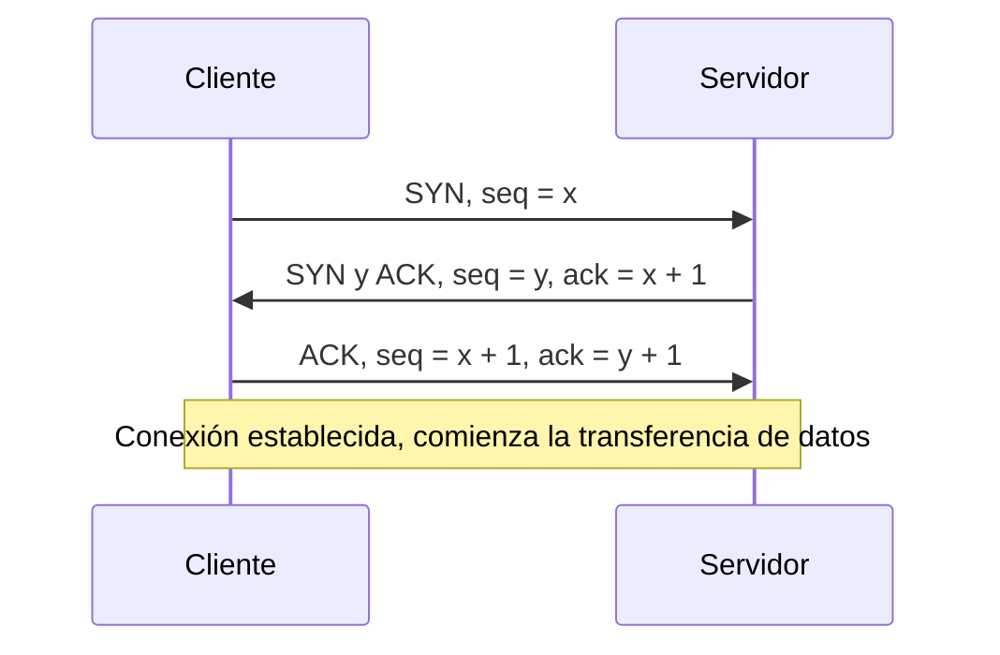
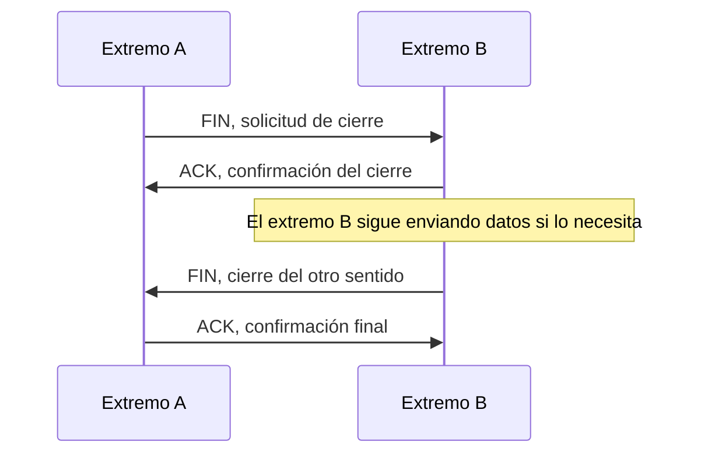

!!! warning

    El contenido de esta página no ha sido revisado ni corregido, por lo que puede
    estar incompleto, contener errores o presentar información desactualizada. Además,
    es posible que esté desordenado, carezca de una estructura clara o incluya notas
    copiadas directamente.

Este capítulo resume los fundamentos de redes que intervienen al servir un modelo o
desplegar infraestructura en la nube: el modelo de capas, el direccionamiento IPv4 con
subredes y CIDR, los puertos, la diferencia entre TCP y UDP, DNS y las herramientas para
diagnosticar problemas de conectividad.

## Introducción

**TCP/IP** es el conjunto de protocolos que sostiene la comunicación en Internet. Los
equipos finales, denominados _hosts_, ejecutan las aplicaciones y los _routers_ de los
nodos intermedios reenvían los paquetes entre redes. Un servicio de inferencia o un
clúster de entrenamiento dependen de estos mecanismos, por lo que conocerlos facilita
configurar redes en la nube, publicar puertos de un contenedor y localizar la causa de
un fallo de conexión.

## Modelo de capas

La comunicación en red se divide en capas. Cada una presta un servicio a la superior y
se comunica con su capa homóloga del otro extremo. El modelo OSI define siete niveles y
sirve como referencia, mientras que TCP/IP es el que se implementa en Internet y agrupa
las funciones en cuatro capas:

| Capa TCP/IP     | Niveles OSI | Función principal                                  | Protocolos           |
| --------------- | ----------- | -------------------------------------------------- | -------------------- |
| Aplicación      | 5, 6 y 7    | Ofrece servicios a las aplicaciones.               | HTTP, DNS, SSH, DHCP |
| Transporte      | 4           | Transfiere datos extremo a extremo entre procesos. | TCP, UDP             |
| Internet        | 3           | Encamina los datos entre redes mediante _routers_. | IP, ICMP             |
| Acceso a la red | 1 y 2       | Entrega las tramas dentro de la red local.         | Ethernet, Wi-Fi, ARP |

Los _routers_ solo trabajan hasta la capa de Internet, de modo que la fiabilidad se
decide en la capa de transporte, en los equipos finales.

### Encapsulamiento

Cada capa añade su información de control al inicio de los datos en forma de
**cabecera**, y la capa de enlace añade además una cola final. Este proceso, el
**encapsulamiento**, produce una estructura anidada que el receptor deshace en sentido
inverso. La unidad de datos se denomina segmento en TCP, datagrama en UDP e IP, y trama
en el enlace.

```plaintext linenums="1"
Datos de la aplicación (por ejemplo, una petición HTTP)
  -> segmento TCP:    [ cabecera TCP | datos ]
  -> datagrama IP:    [ cabecera IP | [ cabecera TCP | datos ] ]
  -> trama Ethernet:  [ cab. Ethernet | [ cab. IP | [ cab. TCP | datos ] ] | cola ]
```

## Tipos de direcciones

Una comunicación necesita identificar la interfaz de red de destino y el proceso que
recibe los datos. Para ello se emplean tres tipos de direcciones:

- **Física**: La dirección MAC, de 6 bytes (por ejemplo `06:01:02:01:2C:4B`), identifica
  una tarjeta de red y solo es válida dentro de la red local.
- **Lógica**: La dirección IP identifica una interfaz en una red de alcance global y
  puede cambiar al conectar el equipo a otra red.
- **De puerto**: Un número de 16 bits identifica el proceso dentro de un equipo.

## Direcciones IPv4

Una dirección **IPv4** tiene 32 bits y se escribe como cuatro números decimales
separados por puntos, por ejemplo `192.168.1.130`. Una parte identifica la red y otra el
equipo dentro de ella. La **máscara de red** marca esa división con unos contiguos para
la red y ceros para el equipo. Un AND bit a bit entre dirección y máscara produce la
dirección de red.

Como la máscara es siempre una secuencia continua de unos seguida de ceros, basta
indicar cuántos bits forman la red. La notación **CIDR** (_Classless Inter-Domain
Routing_) escribe esa longitud tras una barra: `192.168.1.0/24` equivale a la dirección
`192.168.1.0` con máscara `255.255.255.0`. Una red con prefijo de longitud $p$ contiene
$2^{32 - p}$ direcciones. Dos de ellas no se asignan a equipos: la dirección de red, que
identifica la subred, y la de _broadcast_, que alcanza a todos sus equipos:

| Prefijo | Máscara         | Direcciones totales | Equipos utilizables |
| ------- | --------------- | ------------------- | ------------------- |
| `/8`    | 255.0.0.0       | 16.777.216          | 16.777.214          |
| `/16`   | 255.255.0.0     | 65.536              | 65.534              |
| `/24`   | 255.255.255.0   | 256                 | 254                 |
| `/26`   | 255.255.255.192 | 64                  | 62                  |
| `/30`   | 255.255.255.252 | 4                   | 2                   |

Dividir una red en subredes consiste en tomar bits del campo del equipo y asignarlos a
la red. La red `192.168.1.0/24` se divide así en cuatro subredes `/26` de 62 equipos:
`192.168.1.0/26`, `192.168.1.64/26`, `192.168.1.128/26` y `192.168.1.192/26`. La
[VPC de AWS](../02_cloud/section_2_aws.md) y sus subredes emplean esta misma notación.

???+ example "Cálculo de la subred de 192.168.1.130/26"

    Dado el equipo `192.168.1.130/26`, se obtienen la red a la que pertenece, su
    _broadcast_ y el rango de equipos utilizables.

    - **Máscara**: El prefijo `/26` equivale a 26 bits a uno, es decir,
      `255.255.255.192`.
    - **Dirección de red**: El último octeto, `130`, es `10000010` en binario. Al
      aplicar la máscara `11000000` mediante AND resulta `10000000`, que equivale a 128.
      La red es `192.168.1.128`.
    - **_Broadcast_**: Se ponen a uno los seis bits del equipo. El octeto `10111111` es
      191 y la dirección es `192.168.1.191`.
    - **Equipos utilizables**: Van de `192.168.1.129` a `192.168.1.190`, es decir, 62
      direcciones.

### Direcciones privadas y especiales

Algunos rangos se reservan para redes privadas, uno por cada clase histórica de
direcciones (A, B y C) anterior a CIDR, y los _routers_ de Internet descartan los
paquetes que los usan:

| Clase | Rango privado                 | Notación CIDR    |
| ----- | ----------------------------- | ---------------- |
| A     | 10.0.0.0 a 10.255.255.255     | `10.0.0.0/8`     |
| B     | 172.16.0.0 a 172.31.255.255   | `172.16.0.0/12`  |
| C     | 192.168.0.0 a 192.168.255.255 | `192.168.0.0/16` |

Para que un equipo con dirección privada acceda a Internet, el _router_ de salida
sustituye la dirección de origen por una pública mediante **NAT** (_Network Address
Translation_) y conserva la correspondencia para devolver las respuestas. Entre las
direcciones reservadas destacan `127.0.0.0/8`, el _loopback_ que apunta al propio equipo
(`127.0.0.1`), y `0.0.0.0`, que indica el propio equipo sin dirección asignada y, en un
servicio que escucha, todas sus interfaces. Con la forma `0.0.0.0/0` designa la ruta por
defecto de las tablas de encaminamiento.

El número de direcciones IPv4 resulta insuficiente para el crecimiento de Internet. Las
soluciones combinan CIDR, las direcciones privadas con NAT y un protocolo nuevo, IPv6,
con direcciones de 128 bits, cuyo estudio queda fuera de este capítulo.

## IP, enrutamiento, ARP e ICMP

El **Protocolo de Internet**, IP, ofrece un servicio **sin conexión** y **no fiable**:
cada datagrama se encamina de forma independiente y no hay garantía de entrega ni de
orden. La fiabilidad se traslada así a la capa de transporte.

Cada equipo decide por qué interfaz envía un datagrama consultando su **tabla de
encaminamiento**. Si el destino está en una red directamente conectada, lo entrega en la
red local. En caso contrario lo dirige a la **puerta de enlace** (_gateway_), el
_router_ que reenvía el tráfico hacia el resto de redes, a la que apunta la ruta por
defecto.

**ARP** (_Address Resolution Protocol_) obtiene la dirección MAC de una dirección IP de
la misma red local. El emisor lanza una petición en _broadcast_. Solo responde el equipo
que posee esa IP y la correspondencia se guarda en la **tabla ARP**. Para un destino
remoto, el emisor resuelve únicamente la MAC de la puerta de enlace.

**ICMP** (_Internet Control Message Protocol_) transporta mensajes de control y de error
entre equipos y _routers_. El comando `ping` envía mensajes de eco y mide el tiempo de
ida y vuelta de las respuestas. El comando `traceroute` envía datagramas con un tiempo
de vida (_TTL_) creciente: cada _router_ resta una unidad y, cuando llega a cero,
descarta el datagrama y responde con un mensaje de tiempo excedido, lo que revela los
saltos de la ruta.

```bash linenums="1"
ping -c 4 192.168.48.1
```

La opción `-c` limita el número de peticiones. La salida muestra el tiempo de cada
mensaje y un resumen con las pérdidas:

```plaintext title="Expected output"
PING 192.168.48.1 (192.168.48.1) 56(84) bytes of data.
64 bytes from 192.168.48.1: icmp_seq=1 ttl=128 time=0.649 ms
64 bytes from 192.168.48.1: icmp_seq=2 ttl=128 time=0.601 ms
64 bytes from 192.168.48.1: icmp_seq=3 ttl=128 time=0.420 ms
64 bytes from 192.168.48.1: icmp_seq=4 ttl=128 time=0.506 ms

--- 192.168.48.1 ping statistics ---
4 packets transmitted, 4 received, 0% packet loss, time 3117ms
rtt min/avg/max/mdev = 0.420/0.544/0.649/0.088 ms
```

## Capa de transporte

La capa de transporte ofrece comunicación **extremo a extremo** entre procesos.

### Puertos

El número de **puerto** tiene 16 bits, con valores entre 0 y 65535. La dirección IP
identifica un equipo y el puerto distingue los procesos dentro de él, por lo que solo
necesita ser único en cada equipo y para cada protocolo de transporte. Un servidor
escucha en un puerto conocido y cada cliente recibe un puerto efímero por conexión. Los
rangos habituales son:

| Rango         | Denominación        | Uso                                                      |
| ------------- | ------------------- | -------------------------------------------------------- |
| 0 a 1023      | Puertos conocidos   | Servicios estándar, como SSH (22), DNS (53) o HTTP (80). |
| 1024 a 49151  | Puertos registrados | Aplicaciones concretas que se registran ante la IANA.    |
| 49152 a 65535 | Puertos dinámicos   | Puertos efímeros que el sistema asigna a los clientes.   |

En Linux, los puertos efímeros salen por defecto del rango 32768 a 60999. Dos procesos
no pueden escuchar en el mismo puerto y protocolo de un equipo. La interfaz con la que
una aplicación abre estas conexiones se describe en el capítulo de
[_sockets_ en C](../../03_programming/05_c_systems/section_7_sockets.md).

### UDP

**UDP** (_User Datagram Protocol_) envía datagramas sin conexión y con una cabecera de 8
bytes. Reduce la sobrecarga cuando la fiabilidad no es lo más importante, como en DNS,
en la transmisión multimedia o en la telefonía sobre IP, donde un paquete perdido apenas
afecta y un retraso por retransmisión resulta más perjudicial.

### TCP

**TCP** (_Transmission Control Protocol_) proporciona una comunicación fiable, orientada
a conexión y _full-duplex_, con datos en ambos sentidos a la vez. Trata la información
como un **flujo de bytes** y numera cada byte para confirmar su llegada. La confirmación
es **acumulativa**: al confirmar un número, el receptor reconoce todos los bytes
anteriores. Antes de transferir datos, ambos extremos establecen la conexión con el
_three-way handshake_, un intercambio de tres segmentos con los indicadores SYN
(sincronizar) y ACK (confirmar), y acuerdan sus números de secuencia iniciales:



El cierre es **bidireccional** y cada sentido se cierra por separado. Un extremo que
termina de enviar transmite un segmento con el indicador FIN, que el otro confirma con
ACK. Cuando el otro extremo también termina, envía su propio FIN, que el primero
confirma. En total se intercambian cuatro segmentos:



El **control de flujo** evita que un emisor rápido sature a un receptor lento: el
receptor anuncia en cada segmento el espacio libre de su _buffer_, la ventana de
recepción, y el emisor no mantiene sin confirmar más bytes que los que caben en ella. El
**control de congestión** evita que el emisor sature la red. TCP aumenta el ritmo de
envío de forma gradual mientras la red responde bien y lo reduce de forma drástica al
detectar pérdidas, como describe la RFC 5681. Cada retransmisión añade latencia, que
repercute en el tiempo de respuesta de un servicio.

### Comparativa entre UDP y TCP

La elección entre ambos protocolos depende de si la aplicación necesita fiabilidad o
prefiere minimizar la latencia y la sobrecarga:

| Característica        | UDP                                      | TCP                                                     |
| --------------------- | ---------------------------------------- | ------------------------------------------------------- |
| Conexión              | No orientado a conexión.                 | Orientado a conexión punto a punto.                     |
| Fiabilidad            | Envío sin garantías ni orden.            | Confirmaciones, retransmisiones y números de secuencia. |
| Modo de datos         | Datagramas independientes.               | Flujo de bytes, con _buffers_ de envío y recepción.     |
| Control de flujo      | No.                                      | Sí, mediante la ventana de recepción.                   |
| Control de congestión | No.                                      | Sí.                                                     |
| Ejemplos de uso       | DNS, VoIP, juegos en línea, _streaming_. | HTTP, SSH, transferencia de archivos.                   |

## DNS

El **Sistema de Nombres de Dominio**, DNS (_Domain Name System_), traduce nombres
legibles, como `ejemplo.com`, en direcciones IP. Las consultas usan habitualmente UDP en
el puerto 53 y recurren a TCP cuando la respuesta no cabe en un datagrama. El equipo
consulta primero el servidor configurado en `/etc/resolv.conf` y este reenvía la
consulta a otros servidores hasta llegar a los autoritativos de la zona. El comando
`getent hosts` resuelve un nombre con la misma configuración que usan las aplicaciones:

```bash linenums="1"
getent hosts example.com
```

```plaintext title="Expected output"
2606:4700:10::6814:179a example.com
2606:4700:10::ac42:93f3 example.com
```

La salida muestra direcciones IPv6 porque el nombre dispone de ellas. Con
`getent ahostsv4` se obtienen las IPv4.

## Herramientas de diagnóstico

Las herramientas de red de Linux permiten comprobar en la práctica los conceptos
anteriores. El paquete `net-tools` está obsoleto y su sustituto es `iproute2`:

| Comando                    | Función                                                                    | Ejemplo de uso             |
| -------------------------- | -------------------------------------------------------------------------- | -------------------------- |
| `ip route`                 | Muestra la tabla de encaminamiento del sistema.                            | `ip route`                 |
| `ip route get`             | Indica por qué interfaz y con qué dirección origen se enviaría un destino. | `ip route get 8.8.8.8`     |
| `ss -tulnp`                | Lista los puertos TCP y UDP en escucha junto con su proceso.               | `ss -tulnp`                |
| `ss -tn state established` | Lista las conexiones TCP establecidas.                                     | `ss -tn state established` |

`ip route get` indica el _router_ de salida, la interfaz y la dirección origen para un
destino remoto:

```bash linenums="1"
ip route get 8.8.8.8
```

```plaintext title="Expected output"
8.8.8.8 via 192.168.48.1 dev eth0 src 192.168.49.117 uid 1000
    cache
```

La trama Ethernet se dirige a la MAC del _router_ `192.168.48.1`, mientras que el
datagrama IP conserva como destino final `8.8.8.8`. Como la pasarela y la dirección
origen difieren en el tercer octeto, ambas solo pertenecen a la misma red con una
máscara más corta que `/24`, por ejemplo `/23`.

## Redes en el trabajo con modelos

Los conceptos anteriores reaparecen al servir un modelo en un contenedor y desplegarlo
en una VPC. Los capítulos de
[contenedores](../../06_operations/section_1_containers.md),
[orquestadores](../../06_operations/section_3_orchestrators.md) y
[AWS](../02_cloud/section_2_aws.md) detallan cada herramienta. La conexión con la teoría
es la siguiente:

- **Puertos y contenedores**: El mapeo de puertos asigna un puerto del _host_ a uno del
  contenedor, como en `docker run -d -p 8080:80 --name web debian:12`. Sin él, el
  servicio solo resulta accesible desde la red interna del contenedor. `EXPOSE`
  únicamente documenta el puerto. Las imágenes de ejemplo lanzan uvicorn con
  `--host 0.0.0.0`, de modo que el servidor escucha en todas las interfaces y no solo en
  el _loopback_.
- **Nombres y servicios**: En una red personalizada de Docker, los contenedores se
  localizan por su nombre. En Kubernetes, un servicio `ClusterIP` ofrece una IP virtual
  interna y `NodePort` abre un puerto del rango 30000 a 32767 en cada nodo.
- **Subredes y CIDR**: El bloque `ipam` de Docker Compose fija subredes como
  `172.16.232.0/24`, un rango privado de los vistos antes. En AWS, la VPC y sus subredes
  se definen con CIDR, y las subredes privadas, sin ruta al Internet Gateway, solo
  alcanzan el exterior mediante puertas de enlace NAT.
- **Puertos y seguridad**: Los grupos de seguridad de AWS filtran por puerto, por
  ejemplo con HTTP (80) y HTTPS (443) abiertos y SSH (22) restringido. Publicar un
  puerto de un contenedor no sustituye a la autenticación del servicio.
- **DNS y latencia**: Route 53 traduce los nombres y puede dirigir al usuario a la
  región con menor tiempo de respuesta, como describe el capítulo de
  [AWS](../02_cloud/section_2_aws.md).

## Cierre

Este capítulo ha recorrido lo necesario para razonar sobre la red de un servicio: las
capas, el direccionamiento con CIDR, los puertos, las diferencias entre TCP y UDP, DNS y
los comandos de diagnóstico. Para pasar de los protocolos a su uso desde un programa, el
capítulo de [_sockets_ en C](../../03_programming/05_c_systems/section_7_sockets.md)
muestra cómo una aplicación crea un extremo de comunicación y envía datos mediante TCP o
UDP.
