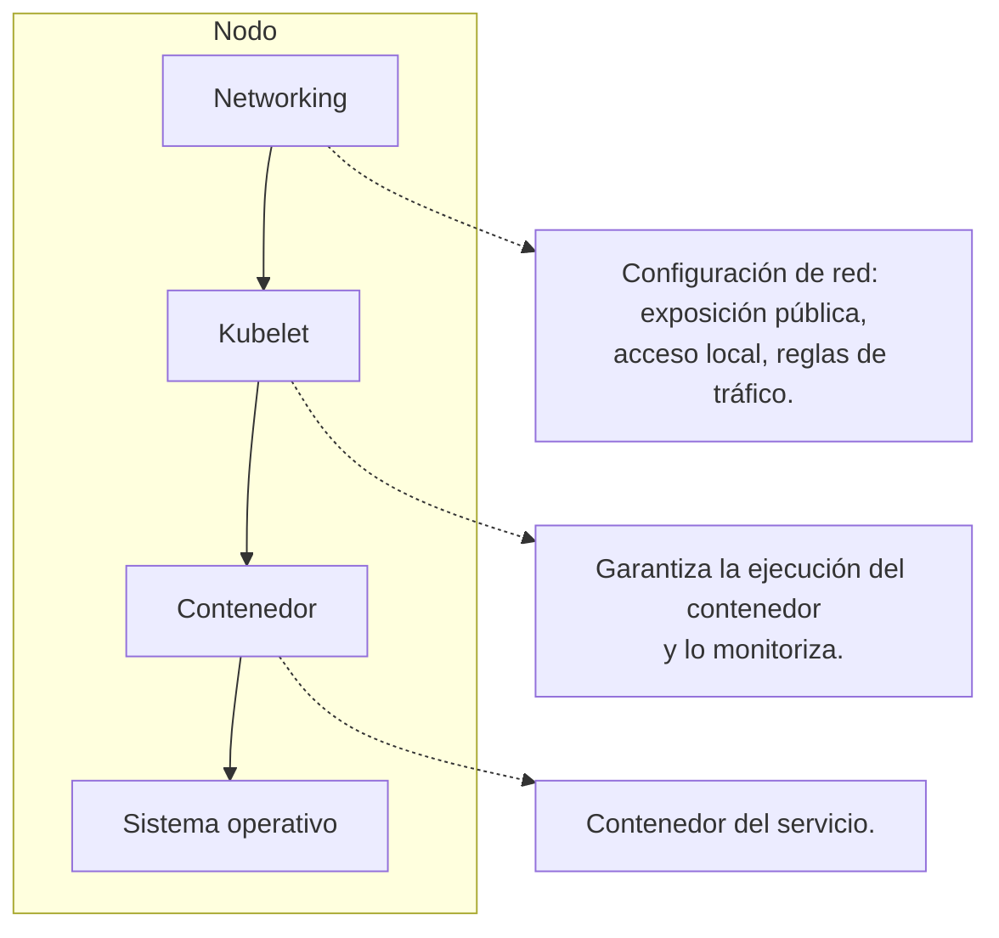

!!! warning

    El contenido de esta página no ha sido revisado ni corregido, por lo que puede
    estar incompleto, contener errores o presentar información desactualizada. Además,
    es posible que esté desordenado, carezca de una estructura clara o incluya notas
    copiadas directamente.

Este capítulo introduce Kubernetes como orquestador de contenedores, explicando sus
componentes, la gestión de pods, despliegues, servicios y patrones de resiliencia.

## Bibliografía

- Kubernetes. (s.f.). _Kubernetes Documentation_. <https://kubernetes.io/docs/>
- Minikube. (s.f.). _Minikube Documentation_. <https://minikube.sigs.k8s.io/docs/>

## Kubernetes

<figure markdown="span">
  
  <figcaption>Logo de Kubernetes</figcaption>
</figure>

La adopción de Kubernetes se motiva principalmente por la necesidad de administrar de
manera eficiente y escalable múltiples contenedores distribuidos en diversos servidores.
Kubernetes facilita la orquestación de estos contenedores a través de una
infraestructura declarativa, en la que los usuarios definen la configuración deseada en
un manifiesto (un archivo de configuración) que se procesa mediante la API de
Kubernetes. La plataforma asume la responsabilidad de distribuir la carga de trabajo
entre los nodos disponibles y de administrar los recursos requeridos por los
contenedores.

Kubernetes también posibilita la construcción de _pipelines_ ETL utilizando herramientas
como Spark o Airflow, y se emplea extensamente en el entrenamiento de modelos de
aprendizaje automático, como se evidencia en su uso con Kubeflow. Al gestionar la
infraestructura de cómputo, redes y almacenamiento, Kubernetes simplifica la
implementación y administración de aplicaciones en contenedores a gran escala.

### Componentes

**Kubectl** es una interfaz de línea de comandos que facilita la interacción con un
clúster de Kubernetes, permitiendo la gestión de objetos como _pods_, servicios y
despliegues.

Para la creación de un clúster de Kubernetes en un entorno local, se utiliza
**Minikube**. Esta herramienta permite la ejecución de Kubernetes de manera local para
fines de prueba o desarrollo, creando un clúster con uno o varios nodos virtualizados.
Por defecto, Minikube crea un clúster que contiene un nodo. Para inicializar el clúster
se utiliza el comando `minikube start`, y para verificar su estado, `minikube status`.
Internamente, Minikube levanta el clúster sobre Docker, de modo que el nodo es en
realidad un contenedor.

#### Plano de control

Los nodos de un clúster se dividen según su función. Los **nodos maestros** se destinan
a las tareas de gestión del propio clúster, mientras que los **nodos trabajadores**
(_workers_) ejecutan las cargas de trabajo de la aplicación. La configuración mínima
habitual comprende un nodo maestro y un nodo trabajador.

El **plano de control** (_control plane_) que reside en los nodos maestros se compone de
cuatro elementos esenciales:

- **etcd**: Base de datos clave-valor distribuida y de alta disponibilidad que almacena
  todo lo definido en Kubernetes, incluyendo la configuración y el estado del clúster.
- **Scheduler**: Proceso que asigna los _pods_ a los nodos, seleccionando los nodos
  óptimos y descartando aquellos que no satisfacen los requisitos del _pod_.
- **API Server**: Interfaz que permite gestionar, desarrollar y configurar el clúster, y
  punto de entrada de todas las operaciones.
- **Controller Manager**: Servicio que ejecuta los bucles de control principales,
  encargados de reconciliar el estado observado del clúster con el estado declarado.

Cada nodo trabajador ejecuta por su parte dos componentes. El **kubelet** se asegura de
que los contenedores asignados al nodo estén en ejecución y los monitoriza. El
**kube-proxy** gestiona las reglas de red del nodo para que el tráfico dirigido a los
servicios alcance los _pods_ correspondientes.



#### Modalidades de escalado y tipos de clúster

Un sistema admite dos formas de escalado. El **escalado vertical** aumenta la CPU, la
GPU o la memoria de un nodo concreto. El **escalado horizontal** incrementa el número de
nodos, que en conjunto conforman un clúster. Esta segunda modalidad resulta más
eficiente y es precisamente la que Kubernetes facilita. Para aprovecharla, el servicio
no debe guardar estado en la réplica: si cada instancia mantiene información que las
demás no conocen, las peticiones de un mismo usuario deben dirigirse siempre a la misma
réplica y el escalado deja de ser libre.

Los clústeres se clasifican además según quién gestiona la infraestructura. Los
clústeres **_on-premise_** son aquellos donde la propia organización monta y administra
la infraestructura a nivel local. Los clústeres **gestionados** los proporcionan los
proveedores de nube pública como AWS, Azure o GCP.

Dentro de la modalidad _on-premise_ existen varias topologías según el grado de
disponibilidad requerido:

- **_All in one_**: Todo se instala en un único nodo mediante Minikube, con propósito de
  aprendizaje o pruebas.
- **Un maestro y varios trabajadores**: Un nodo para el plano de control y uno o más
  nodos controlados por él.
- **Un maestro, un etcd y varios trabajadores**: Separa el almacén de estado del plano
  de control.
- **Varios maestros y varios trabajadores**: Topología de alta disponibilidad, donde la
  caída de un nodo maestro no detiene el clúster. Se recomiendan al menos tres nodos
  maestros, porque las decisiones de coordinación del plano de control se toman por
  mayoría y con dos nodos no es posible distinguir la caída de uno de ellos de una
  partición de la red.

### Nodos

Un nodo representa la unidad más pequeña dentro de un clúster de Kubernetes. Puede ser
una máquina física o una máquina virtual donde se ejecutan las aplicaciones. Kubernetes
abstrae el _hardware_ subyacente, permitiendo una gestión eficiente de los requisitos de
recursos. Si un nodo no puede proporcionar más recursos o falla, Kubernetes redistribuye
las cargas de trabajo a otros nodos disponibles. Existen diferentes tipos de nodos: los
nodos bajo demanda (_on-demand nodes_), que se crean cuando los recursos requeridos son
elevados (CPU, GPU, RAM), y los nodos al mejor precio (_spot nodes_), que son más
económicos pero pueden ser retirados en cualquier momento.

### _Pods_

Un _pod_ es la unidad mínima de ejecución en Kubernetes y puede contener uno o más
contenedores que comparten los mismos recursos y red local. Todos los contenedores
dentro del mismo _pod_ pueden comunicarse entre sí y comparten el mismo entorno de red.
Al escalar un _pod_, todos los contenedores dentro de él se escalan conjuntamente.

Un _pod_ es efímero por diseño: no se repara, sino que cuando falla se sustituye por
otro con identidad distinta, y su dirección IP no sobrevive al reemplazo. Por ello los
_pods_ no se declaran directamente en producción, sino a través de un objeto que
mantenga su número, como un _deployment_, y el acceso a ellos se realiza mediante un
servicio en lugar de por su dirección.

### Clúster

Un clúster es un conjunto de nodos, también conocidos como _workers_, que se ejecutan en
Kubernetes. La relación entre las aplicaciones que se ejecutan en cada nodo es
independiente. Por ejemplo, si se dispone de un servidor de Proxmox con dos máquinas
virtuales, VM1 y VM2, a pesar de que cuenten con diferentes _pods_, si todos están
gestionados por Kubernetes, ambos forman parte del mismo clúster.

### _StatefulSet_ y volúmenes

Dado que no se puede garantizar el lugar de ejecución de una aplicación, el uso del
disco local para almacenar datos resulta inviable, siendo útil únicamente para
almacenamiento temporal como caché. Kubernetes emplea volúmenes persistentes que, a
diferencia de otros recursos como la CPU, GPU y RAM gestionados por los clústeres, deben
adjuntarse al propio clúster desde unidades locales o en la nube. Estos volúmenes no se
asocian a un nodo en particular.

**_StatefulSet_** permite la creación de _pods_ con volúmenes persistentes, garantizando
la integridad de los datos incluso si el _pod_ se reinicia o se elimina. A continuación
se muestra un ejemplo:

???+ example "Manifiesto de un _StatefulSet_"

    ```yaml linenums="1"
    apiVersion: apps/v1
    kind: StatefulSet
    metadata:
      name: my-csi-app-set
    spec:
      selector:
        matchLabels:
          app: my-frontend
      serviceName: "my-frontend"
      replicas: 1
      template:
        metadata:
          labels:
            app: my-frontend
        spec:
          containers:
            - name: my-frontend
              image: busybox
              args:
                - sleep
                - infinity
              volumeMounts:
                - name: data
                  mountPath: "/data"
      volumeClaimTemplates:
        - metadata:
            name: csi-pvc
          spec:
            accessModes: ["ReadWriteOnce"]
            resources:
              requests:
                storage: 1Gi
    ```

Para verificar el estado de los volúmenes y los _StatefulSets_ se utilizan los comandos
`kubectl get pvc` (para consultar la asignación del volumen, capacidad y otros detalles)
y `kubectl get sts` (para consultar los _StatefulSets_).

### Manifiestos

Un manifiesto es un archivo en formato YAML o JSON que especifica cómo desplegar una
aplicación en un clúster de Kubernetes. Este archivo se conoce como un registro de
intención, donde se le indica a Kubernetes el estado deseado del clúster. El modelo es
declarativo: el operador no ordena acciones, y los controladores trabajan de forma
continua para reducir la diferencia entre el estado deseado y el observado. Por eso un
_pod_ eliminado a mano reaparece al momento, ya que el controlador responsable observa
que faltan réplicas respecto a las declaradas y crea las que faltan.

Un concepto importante asociado es el de _namespace_, que constituye la división lógica
del clúster de Kubernetes y permite separar la carga del clúster. Se pueden crear
políticas para separar tráfico entre _namespaces_, aunque por defecto los datos de un
_namespace_ son visibles desde otro. Para obtener los _namespaces_ del clúster se
utiliza `kubectl get ns`, para obtener los _pods_ de un _namespace_ específico se emplea
`kubectl -n nombre_namespace get pods -o wide` (la opción `-o wide` proporciona
información adicional como la IP del _pod_ y el nodo), y para eliminar un _pod_ se usa
`kubectl -n nombre_namespace delete pod nombre_pod`.

A continuación se muestra un ejemplo de manifiesto para crear un _pod_ simple:

???+ example "Manifiesto de un _pod_ simple"

    ```yaml linenums="1"
    apiVersion: v1
    kind: Pod
    metadata:
      name: nginx
    spec:
      containers:
        - name: nginx
          image: nginx:alpine
    ```

Para aplicar el manifiesto se ejecuta `kubectl apply -f nombre.yaml`, y para consultar
el estado del _pod_, `kubectl get pods`.

El siguiente ejemplo muestra un manifiesto más complejo que incluye variables de
entorno, solicitudes y límites de recursos, así como _readiness probe_ y _liveness
probe_:

???+ example "Manifiesto con variables de entorno, recursos y _probes_"

    ```yaml linenums="1"
    apiVersion: v1
    kind: Pod
    metadata:
      name: nginx
    spec:
      containers:
        - name: nginx
          image: nginx:alpine
          env:
            - name: MI_VARIABLE
              value: "valor_ejemplo"
            - name: MI_OTRA_VARIABLE
              value: "otro_valor"
            - name: DD_AGENT_HOST
              valueFrom:
                fieldRef:
                  fieldPath: status.hostIP
          resources:
            requests:
              memory: "64Mi"
              cpu: "200m"
            limits:
              memory: "128Mi"
              cpu: "500m"
          readinessProbe:
            httpGet:
              path: /
              port: 80
            initialDelaySeconds: 5
            periodSeconds: 10
          livenessProbe:
            tcpSocket:
              port: 80
            initialDelaySeconds: 15
            periodSeconds: 20
          ports:
            - containerPort: 80
    ```

En este manifiesto, la sección `resources.requests` define los recursos garantizados que
la instancia debe tener disponibles para poder realizar el despliegue, medidos en
_milicores_ para CPU (donde 1000 _milicores_ equivalen a 1 _core_). La sección
`resources.limits` establece el límite máximo de recursos que el _pod_ puede consumir.
Si se excede el límite de memoria, el _kernel_ de Linux finaliza el proceso y el _pod_
se reinicia, mientras que el exceso de CPU se limita sin terminar el proceso. Las sondas
se describen en el apartado siguiente.

### Sondas de vida, disponibilidad y arranque

Un proceso en ejecución no es necesariamente un proceso que funcione. El `kubelet`
distingue ambas situaciones mediante sondas que consulta de forma periódica, y de cuyo
resultado dependen decisiones distintas:

- **Sonda de vida** (`livenessProbe`): Determina si el contenedor sigue operativo. Su
  fallo reiterado provoca el reinicio del contenedor, lo que resuelve los bloqueos
  internos del proceso que no llegan a terminarlo.
- **Sonda de disponibilidad** (`readinessProbe`): Determina si el contenedor está en
  condiciones de atender tráfico. Su fallo retira la réplica del reparto de carga del
  servicio sin reiniciarla, lo que protege al usuario durante un arranque lento o una
  sobrecarga transitoria.
- **Sonda de arranque** (`startupProbe`): Determina si el proceso ha completado su
  inicialización. Mientras no tenga éxito, las otras dos quedan suspendidas, lo que
  evita que un arranque largo se interprete como un fallo y desencadene un ciclo de
  reinicios. Es especialmente útil en los servicios de inferencia que cargan un modelo
  de gran tamaño al iniciarse.

!!! warning "No usar la misma comprobación para las sondas de vida y de disponibilidad"

    Emplear la misma comprobación para ambas convierte una sobrecarga momentánea en un
    reinicio, y el reinicio agrava la sobrecarga sobre las réplicas restantes hasta
    propagar el fallo a todo el servicio.

### Despliegue y gestión de réplicas

Un despliegue (_deployment_) permite declarar el número de réplicas de _pods_ y asegurar
que el estado deseado se mantenga, monitorizándolos de forma continua:

???+ example "Manifiesto de un _deployment_"

    ```yaml linenums="1"
    apiVersion: apps/v1
    kind: Deployment
    metadata:
      name: nginx-deployment
    spec:
      replicas: 3
      selector:
        matchLabels:
          app: nginx
      template:
        metadata:
          labels:
            app: nginx
        spec:
          containers:
            - name: nginx
              image: nginx:alpine
              ports:
                - containerPort: 80
    ```

### Actualización progresiva y reversión

La sustitución de una versión por otra se realiza mediante una **actualización
progresiva** (_rolling update_), que es la estrategia por defecto de un _deployment_. El
controlador crea réplicas de la versión nueva y retira las de la anterior de forma
gradual, manteniendo en todo momento capacidad suficiente para atender el tráfico. Dos
parámetros gobiernan el proceso: `maxUnavailable`, que acota cuántas réplicas pueden
faltar respecto a las declaradas, y `maxSurge`, que acota cuántas pueden existir por
encima de ellas.

La _readiness probe_ es la pieza que hace segura la actualización. Sin ella, el
controlador considera disponible una réplica en cuanto su contenedor arranca y retira
las antiguas antes de que las nuevas atiendan tráfico, lo que interrumpe el servicio.
Con ella, una versión defectuosa nunca alcanza el estado de disponibilidad, la
actualización se detiene con las réplicas antiguas en servicio y la reversión restaura
la revisión anterior a partir del historial que el _deployment_ conserva.

```bash linenums="1"
kubectl apply -f deployment.yaml
kubectl rollout status deployment nginx-deployment
kubectl rollout undo deployment nginx-deployment
```

La primera orden declara la nueva versión, la segunda informa del avance de la
actualización y la tercera revierte el _deployment_ a su revisión anterior.

### Escalado horizontal automático

El **escalado horizontal automático** (`HorizontalPodAutoscaler`) ajusta el número de
réplicas de un _deployment_ en función de métricas observadas, habitualmente la
utilización de CPU o de memoria respecto a lo solicitado en `resources.requests`. El
controlador compara de forma periódica la métrica con el objetivo declarado y modifica
el número de réplicas dentro de los límites establecidos.

???+ example "Manifiesto de un `HorizontalPodAutoscaler`"

    ```yaml linenums="1"
    apiVersion: autoscaling/v2
    kind: HorizontalPodAutoscaler
    metadata:
      name: mi-servicio
    spec:
      scaleTargetRef:
        apiVersion: apps/v1
        kind: Deployment
        name: mi-servicio
      minReplicas: 2
      maxReplicas: 12
      metrics:
        - type: Resource
          resource:
            name: cpu
            target:
              type: Utilization
              averageUtilization: 70
    ```

    Con un objetivo del 70 % de utilización media y una solicitud de `100m` por réplica,
    un consumo agregado sostenido de 840 milicores conduce a 12 réplicas, ya que
    840 / (100 × 0,7) = 12, y uno de 140 milicores, al mínimo de 2. El valor de
    `minReplicas` no baja de 2 porque una réplica única deja el servicio sin
    disponibilidad durante cualquier reemplazo, y `maxReplicas` acota los recursos que el
    servicio puede reclamar al clúster.

Dos condiciones determinan su utilidad: que el _deployment_ declare
`resources.requests`, porque la utilización se calcula como fracción de lo solicitado, y
que el servicio tolere que sus réplicas aparezcan y desaparezcan. Además, el clúster
necesita un servidor de métricas desplegado que proporcione el consumo de los _pods_.

### _DaemonSet_

Un _DaemonSet_ es una forma de despliegue que garantiza que un _pod_ se ejecute en todos
los nodos del clúster, con exactamente un _pod_ por nodo. No se especifica el número de
réplicas, ya que depende del número de nodos. Se utiliza habitualmente para servicios de
monitoreo:

???+ example "Manifiesto de un _DaemonSet_"

    ```yaml linenums="1"
    apiVersion: apps/v1
    kind: DaemonSet
    metadata:
      name: nginx-daemonset
    spec:
      selector:
        matchLabels:
          app: nginx
      template:
        metadata:
          labels:
            app: nginx
        spec:
          containers:
            - name: nginx
              image: nginx:alpine
    ```

### Exponer aplicaciones

#### Tipos de servicios

Los servicios en Kubernetes permiten acceder a los _pods_ desde dentro y fuera del
clúster. Existen varios tipos de servicios según las necesidades de exposición.

**ClusterIP** proporciona una dirección IP virtual única a nivel de clúster, facilitando
la comunicación y el balanceo de carga entre _pods_ de forma interna.

**NodePort** crea un puerto en cada nodo que recibe el tráfico y lo redirige a los
_pods_ correspondientes, permitiendo que la aplicación sea accesible desde fuera del
clúster. Suele utilizar puertos dentro del rango 30000 a 32767:

???+ example "Servicio NodePort"

    ```yaml linenums="1"
    apiVersion: v1
    kind: Service
    metadata:
      name: mi-servicio
    spec:
      type: NodePort
      selector:
        app: mi-aplicacion
      ports:
        - port: 80
          targetPort: 9376
          nodePort: 30007
    ```

**LoadBalancer** está orientado a proveedores de la nube y crea un balanceador de carga
que proporciona una IP estable para el servidor, facilitando su acceso desde Internet:

???+ example "Servicio LoadBalancer"

    ```yaml linenums="1"
    apiVersion: v1
    kind: Service
    metadata:
      name: mi-servicio
    spec:
      type: LoadBalancer
      selector:
        app: mi-aplicacion
      ports:
        - port: 80
          targetPort: 80
    ```

**ExternalName** no enruta tráfico hacia _pods_, sino que redirige el nombre del
servicio a un nombre de dominio externo al clúster.

#### _Ingress_

_Ingress_ administra el acceso externo a los servicios del clúster, típicamente HTTP.
Proporciona balanceo de carga y terminación SSL, y permite el acceso al servicio
mediante _paths_. Suele requerirse un controlador Ingress-Nginx que se instala por
separado: el objeto por sí solo no encamina nada, y necesita un controlador que lo
interprete. Concentra en un único punto de entrada lo que de otro modo exigiría un
balanceador de carga por servicio.

???+ example "Manifiesto de un _Ingress_ con dos rutas"

    ```yaml linenums="1"
    apiVersion: networking.k8s.io/v1
    kind: Ingress
    metadata:
      name: mi-ingress
    spec:
      ingressClassName: nginx
      rules:
        - host: ejemplo.interno
          http:
            paths:
              - path: /
                pathType: Prefix
                backend:
                  service:
                    name: mi-servicio
                    port:
                      number: 80
              - path: /api
                pathType: Prefix
                backend:
                  service:
                    name: mi-api
                    port:
                      number: 8080
    ```

    El campo `ingressClassName` identifica al controlador que debe atender la regla, algo
    necesario cuando el clúster tiene más de uno desplegado. El campo `pathType` es
    obligatorio en la versión vigente de la API, `networking.k8s.io/v1`; las versiones
    preliminares `extensions/v1beta1` y `networking.k8s.io/v1beta1` están retiradas desde
    Kubernetes 1.22 y el servidor rechaza los manifiestos que las declaren.

!!! warning

    El tipo NodePort resulta adecuado para desarrollo y pruebas, pero no para
    producción. Expone un puerto en todos los nodos del clúster dentro de un rango
    elevado y no fija, lo que complica la gestión de nombres y certificados. En
    producción se recurre a LoadBalancer o, preferentemente, a un _Ingress_ que centralice
    el enrutamiento y la terminación TLS.

Cuando una petición llega a un servicio, este la redirige de forma aleatoria a uno de
los _pods_ gestionados por el _deployment_ asociado, lo que proporciona el balanceo de
carga entre réplicas sin configuración adicional.

Conviene tener presente que un _pod_ que se reescala o se elimina pierde toda la
información almacenada localmente. Para mantener la persistencia en un _deployment_, a
diferencia de lo que ocurre con un _StatefulSet_, es necesario crear un
`PersistentVolumeClaim` que solicite almacenamiento independiente del ciclo de vida del
_pod_.

#### Operaciones habituales con kubectl

Las órdenes de uso más frecuente permiten inspeccionar y manipular los recursos del
clúster. Al crear un _pod_ sin indicar el _namespace_, Kubernetes lo sitúa en el
_namespace_ `default`.

| Comando                                        | Función                                                |
| ---------------------------------------------- | ------------------------------------------------------ |
| `kubectl get pods`                             | Lista los _pods_ existentes.                           |
| `kubectl describe pod nombre_del_pod`          | Muestra información detallada de un _pod_.             |
| `kubectl get services`                         | Lista los servicios creados.                           |
| `kubectl describe service nombre_del_servicio` | Devuelve la IP, los puertos y el detalle del servicio. |
| `kubectl exec -it nombre_del_pod -- bash`      | Abre una sesión interactiva dentro del _pod_.          |
| `minikube service --url nombre_del_servicio`   | Obtiene la URL de acceso al servicio en Minikube.      |
| `minikube dashboard --url`                     | Devuelve la URL del panel de control de Kubernetes.    |

La exposición rápida de un _pod_ como servicio durante el desarrollo se realiza mapeando
el puerto del _host_ al puerto del contenedor:

```bash linenums="1"
kubectl expose pod nombre_del_pod --type=LoadBalancer --port=8080 --target-port=80
```

### _Networking_ y almacenamiento

Cada _pod_ en Kubernetes tiene su propia dirección IP, y para comunicar _pods_ en
diferentes nodos se utiliza el _Container Network Interface_ (CNI). Los complementos CNI
suelen implementar esa comunicación mediante una red superpuesta (_overlay_), que
encapsula el tráfico de los _pods_ en paquetes que viajan por la red física entre nodos.
En cuanto al almacenamiento, **etcd** es un almacén de datos clave-valor distribuido
utilizado para guardar datos de configuración, estado y metadatos del clúster.

### Patrones de resiliencia

Para reforzar la robustez de los sistemas distribuidos orquestados, se emplean patrones
de resiliencia ampliamente contrastados:

| Patrón              | Descripción                                                                                                                  |
| :------------------ | :--------------------------------------------------------------------------------------------------------------------------- |
| **Retry**           | Gestiona errores transitorios mediante reintentos controlados con incrementos progresivos en el tiempo de espera (_backoff_) |
| **Circuit Breaker** | Evita que un servicio continúe llamando a dependencias que están fallando, previniendo efectos en cascada                    |
| **Bulkhead**        | Aísla recursos para que los fallos de un componente no afecten a otros                                                       |
| **Monkey Testing**  | Introduce fallos deliberados en el sistema para evaluar su capacidad de recuperación ante situaciones imprevistas            |

## Tipos de orquestación

Las herramientas de orquestación se agrupan en cuatro categorías según el nivel de
abstracción sobre el que operan:

| Categoría                        | Descripción                                                                                                                                                                                                                                                                     | Ejemplos                                            |
| :------------------------------- | :------------------------------------------------------------------------------------------------------------------------------------------------------------------------------------------------------------------------------------------------------------------------------ | :-------------------------------------------------- |
| **Orquestación de servidores**   | Gestiona la ejecución de aplicaciones directamente sobre servidores físicos o virtuales. Se encarga de distribuir procesos, reiniciarlos ante fallos y balancear la carga entre múltiples máquinas. Es el enfoque más tradicional y ofrece control total sobre el hardware.     | Nomad, scripts personalizados                       |
| **Orquestación de VMs**          | Gestiona máquinas virtuales completas, cada una con su propio sistema operativo. Permite escalar creando o destruyendo VMs según la demanda. Ofrece aislamiento fuerte pero con mayor consumo de recursos y tiempos de arranque más lentos.                                     | Amazon EC2 Auto Scaling, Azure VM Scale Sets        |
| **Orquestación de contenedores** | Gestiona el ciclo de vida de contenedores: programación (_scheduling_), escalado automático, auto-recuperación ante fallos, descubrimiento de servicios y balanceo de carga. Es el estándar actual para arquitecturas de microservicios.                                        | Kubernetes, Amazon ECS, Docker Swarm, OpenShift     |
| **Orquestación _serverless_**    | Abstrae completamente la infraestructura subyacente. El desarrollador proporciona únicamente el código (funciones) y la plataforma se encarga de ejecutarlo, escalarlo y facturar solo por el tiempo de ejecución. No hay servidores que gestionar ni capacidad que planificar. | AWS Lambda, Google Cloud Functions, Azure Functions |

!!! note "Elección de la categoría adecuada"

    La elección depende de los requisitos del proyecto. Las soluciones _serverless_ minimizan
    la carga operativa pero limitan el control y pueden resultar costosas a gran escala. La
    orquestación de contenedores ofrece un equilibrio entre flexibilidad y automatización.
    Las VMs y servidores proporcionan máximo control a costa de mayor complejidad operativa.

La orquestación resuelve la ejecución y el escalado de los servicios que componen un
sistema. Cuando esos servicios contienen modelos de aprendizaje automático aparecen
requisitos propios, como el versionado de los conjuntos de datos y el registro de los
resultados de cada entrenamiento, que se abordan en el capítulo de
[seguimiento de experimentos](section_4_experiment_management.md).
