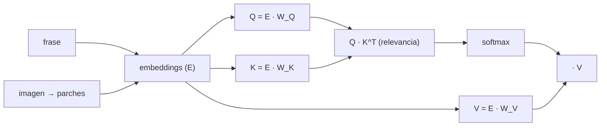

!!! warning

    El contenido de esta página no ha sido revisado ni corregido, por lo que puede
    estar incompleto, contener errores o presentar información desactualizada. Además,
    es posible que esté desordenado, carezca de una estructura clara o incluya notas
    copiadas directamente.

Muchos problemas en inteligencia artificial se caracterizan por involucrar datos
**secuenciales**, es decir, información organizada en un orden temporal o lógico.
Ejemplos destacados incluyen el reconocimiento de voz, la generación de música, el
análisis de sentimientos en texto, la interpretación de secuencias de ADN o la
traducción automática de idiomas. A diferencia de las imágenes, donde la información
espacial es clave, en las secuencias la dependencia entre elementos previos y
posteriores resulta esencial.

En el contexto de los modelos secuenciales, resulta importante definir el concepto de
**modelo causal**: una capa es causal si la salida correspondiente al $i$-ésimo elemento
de la secuencia depende únicamente de los elementos anteriores o del propio elemento.
Por ejemplo, una capa convolucional con _kernel_ de tamaño 1 es causal, ya que cada
elemento se procesa considerando solo a sí mismo. Sin embargo, una capa convolucional
con _kernel_ de tamaño 3 no es causal, ya que considera un elemento a la izquierda y
otro a la derecha. Cualquier convolución puede convertirse en su variante causal
mediante el enmascaramiento parcial de los pesos correspondientes a conexiones no
causales. Este es uno de los métodos utilizados en modelos como los _Transformers_ en la
parte del decodificador, que funciona como un modelo autoregresivo gracias al
enmascarado.

## Representación de secuencias

Antes de entrar en las arquitecturas conviene caracterizar los tipos de problema que
abordan. Según la relación entre el número de entradas y de salidas se distinguen tres
casos. Los problemas de múltiples entradas y una sola salida, como la clasificación de
sentimientos sobre un texto completo. Los de una entrada y múltiples salidas, como la
generación de texto a partir de un estímulo inicial. Y los de múltiples entradas y
múltiples salidas, como la traducción automática.

En el procesamiento del lenguaje natural, las palabras deben transformarse en
representaciones que puedan ser interpretadas por un modelo. Este procedimiento se
denomina **tokenización** y consiste en asignar a cada palabra un índice único dentro de
un diccionario y, posteriormente, transformarla en un vector que codifica su
información. El proceso contempla también el uso de **_tokens_ especiales**, como un
_token_ reservado para palabras desconocidas y un _token_ de fin de secuencia empleado
en tareas de generación de texto.

## Redes neuronales recurrentes

Las **redes neuronales recurrentes (_Recurrent Neural Networks_, RNN)** constituyen una
extensión de las redes tradicionales diseñada para procesar datos secuenciales. Su
principal característica es la capacidad de **recordar información previa**, ya que
reutilizan la salida de un paso anterior como parte de la entrada en el siguiente. Este
mecanismo permite que los parámetros se compartan a lo largo de la secuencia, reduciendo
el número de variables que deben aprenderse.

El esquema general de estos modelos produce en cada instante $t$ una salida $\hat{y}_t$
que depende tanto de la entrada actual como del estado acumulado:

$$
\hat{y}_t = f(\mathbf{x}_t, \mathbf{h}_{t-1})
$$

donde $\mathbf{h}_{t-1}$ representa la memoria del instante anterior. El estado de la
celda se actualiza mediante una función parametrizada por los pesos del modelo:

$$
\mathbf{h}_t = f_{\mathbf{W}}(\mathbf{x}_t, \mathbf{h}_{t-1})
$$

donde $f_{\mathbf{W}}$ es la función con pesos $\mathbf{W}$, $\mathbf{x}_t$ la entrada
en el instante actual y $\mathbf{h}_{t-1}$ el estado anterior. Este diseño responde a
cuatro requisitos que los datos secuenciales imponen: admitir secuencias de longitud
variable, capturar dependencias a largo plazo (_long-term dependencies_), preservar el
orden de los elementos y compartir parámetros a lo largo de la secuencia.

El entrenamiento aplica el algoritmo de **retropropagación** a través de cada celda,
recorriendo la secuencia desde el último instante $T_x$ hasta el inicial $T_0$. Este
desplegado temporal es precisamente el origen de las dificultades de optimización que se
describen a continuación.

No obstante, las RNN se enfrentan a problemas significativos de desvanecimiento y
explosión de gradientes. Para superar estas limitaciones, se desarrollaron variantes más
sofisticadas:

- **RNN bidireccionales:** Procesan la secuencia tanto hacia adelante como hacia atrás,
  integrando simultáneamente información del pasado y del futuro.
- **LSTM (_Long Short-Term Memory_):** Introducen celdas de memoria acompañadas de
  puertas de control que regulan qué información se conserva, cuál se descarta y cuál se
  utiliza en cada paso.
- **GRU (_Gated Recurrent Unit_):** Constituyen una variante simplificada de las LSTM,
  con una estructura más ligera y eficiente.

Una alternativa complementaria actúa sobre la inicialización de los pesos. Inicializar
la matriz de pesos recurrentes como la matriz identidad, en lugar de emplear los
esquemas habituales de Xavier o He, mitiga el desvanecimiento del gradiente al preservar
inicialmente la magnitud de la señal que atraviesa cada paso temporal.

## Modelos de lenguaje y predicción de secuencias

Los **modelos de lenguaje** son sistemas diseñados para asignar probabilidades a
secuencias de palabras, permitiendo predecir la siguiente palabra en un texto dado el
contexto previo. En el procesamiento del lenguaje natural, un concepto central es el de
los **_word embeddings_**, vectores densos que representan palabras en un espacio
continuo donde las relaciones semánticas se reflejan en la geometría.

El aprendizaje de _embeddings_ puede realizarse mediante diferentes técnicas.
**Word2Vec** entrena modelos para predecir palabras a partir de su contexto en ventanas
de texto, utilizando estrategias como _negative sampling_. **GloVe** combina información
de coocurrencia global con factorización de matrices, integrando información local y
estadística global del corpus. Estas representaciones pueden preentrenarse en grandes
corpus y transferirse a tareas específicas, aunque es importante señalar que los
_embeddings_ también reflejan **sesgos presentes en los datos de entrenamiento**, los
cuales pueden identificarse y mitigarse mediante técnicas de neutralización o ajuste
post-entrenamiento.

## Mecanismo de atención

El mecanismo de atención constituye un componente fundamental en las arquitecturas
modernas de procesamiento de secuencias. Se implementa a través de tres vectores:
**Query (Q)**, que representa lo que se está buscando; **Key (K)**, que codifica la
información disponible que puede ser relevante; y **Value (V)**, que contiene el
contenido asociado para construir la representación final. El funcionamiento consiste en
comparar la _Query_ con cada _Key_ para calcular pesos de relevancia relativa, que se
aplican a los _Values_ correspondientes para generar representaciones contextuales.

Una analogía útil para fijar la intuición es la de una búsqueda de vídeos. La _Query_
corresponde a los términos introducidos en el buscador, las _Keys_ a los títulos de los
vídeos disponibles, y los _Values_ al contenido que se extrae de aquel título que guarda
mayor relación con la búsqueda. El mecanismo selecciona, en definitiva, la información
asociada a las claves más afines a la consulta.

Las tres matrices se obtienen a partir de la misma representación de entrada. Tanto si
la entrada es una frase como si es una imagen dividida en parches, se parte de una
matriz de _embeddings_ con codificación posicional que se multiplica por tres capas
lineales con parámetros independientes, produciendo respectivamente $\mathbf{Q}$,
$\mathbf{K}$ y $\mathbf{V}$.



La operación completa se expresa de forma compacta como:

$$
\mathrm{Attention}(\mathbf{Q}, \mathbf{K}, \mathbf{V}) =
\mathrm{softmax}\left(\frac{\mathbf{Q}\mathbf{K}^T}{\sqrt{d_K}}\right)\mathbf{V}
$$

donde $d_K$ es la dimensión de los vectores clave. La división por $\sqrt{d_K}$ escala
los productos internos para evitar que, al crecer la dimensión, los valores alcancen
magnitudes que saturen la función _softmax_ y degraden el gradiente.

## _Transformers_

Los _Transformers_, introducidos en el artículo _Attention is All You Need_,
revolucionaron el procesamiento de secuencias al eliminar la necesidad de recurrir a
RNN, permitiendo un procesamiento paralelo de los datos. Desde una perspectiva
neurocientífica, los _Transformers_ presentan similitudes funcionales con las **máquinas
de Tolman-Eichenbaum (TEM)**, modelos computacionales del hipocampo que obtienen
información de diferentes entornos, realizan una autocorrelación para evaluar las
relaciones entre ellos (análoga al mecanismo de atención) y determinan la acción o
posición a tomar en función de dichas relaciones. La arquitectura se organiza en dos
componentes principales:

- **_Encoder_**: Procesa la secuencia de entrada y genera representaciones internas
  enriquecidas. Se encarga de transformar la entrada en una representación vectorial
  interna, aplicando mecanismos de _self-attention_ y _cross-attention_ para identificar
  las partes más relevantes.
- **_Decoder_**: Utiliza estas representaciones para generar la secuencia de salida de
  manera autoregresiva. Emplea la representación generada por el _encoder_, junto con
  información adicional, para generar nuevo contenido.

Cada bloque del _Transformer_ combina mecanismos de **autoatención (_self-attention_)**
y redes totalmente conectadas. Dado que los _Transformers_ no procesan los elementos de
manera secuencial, se incorporan **_positional encodings_** para preservar información
sobre el orden de los elementos. El **_multi-head attention_** constituye una extensión
clave que permite al modelo observar relaciones desde múltiples perspectivas
simultáneamente.

Existen múltiples variantes de la arquitectura _Transformer_:

- **BERT (_Bidirectional Encoder Representations from Transformers_)**: Utiliza
  únicamente el _encoder_. Su entrenamiento se basa en la enmascaración de palabras en
  un texto y la predicción de las mismas. Es especialmente eficaz en tareas de
  clasificación y análisis de sentimientos.
- **GPT (_Generative Pre-trained Transformer_)**: Utiliza solamente el _decoder_ y está
  orientado a la generación de texto. Se entrena proporcionando secuencias incompletas
  que el modelo debe completar. Es un **modelo autoregresivo**, donde la salida generada
  en el tiempo $t$ se utiliza como entrada en el tiempo $t+1$, lo que permite mantener
  coherencia en la generación.
- **_Autoencoders_ enmascarados**: Se aplican principalmente en modelos visuales.
  Dividen una imagen en múltiples parches, ocultan algunos de ellos, y el objetivo es
  reconstruir los parches faltantes, de manera análoga al entrenamiento de BERT pero
  aplicado al dominio visual.

Estas arquitecturas basadas en _Transformers_ han destacado especialmente en el ámbito
de la **inteligencia artificial generativa**, donde el modelo es capaz de generar nuevos
datos a partir de una distribución de probabilidades aprendida. Las alucinaciones que
pueden presentar estos modelos se deben a factores como la insuficiencia de datos, la
presencia de ruido o datos sucios, la falta de contexto o la ausencia de restricciones y
pautas adecuadas.

## Mixture of Experts

Los modelos de mayor tamaño resultan más eficientes respecto al número de muestras
necesarias para alcanzar un rendimiento dado, lo que ha motivado la búsqueda de formas
de escalar la capacidad sin incrementar proporcionalmente el coste de cómputo. La
**dispersión** (_sparsity_) constituye una nueva dimensión de escalado en este sentido:
los pesos aplicados dependen de la entrada, de modo que cada muestra recibe la misma
cantidad de cómputo pero atravesando pesos distintos según el caso.

La arquitectura **Mixture of Experts** (MoE) materializa esta idea mediante múltiples
**expertos**, cada uno implementado como una pequeña red, junto con una red adicional
denominada **_gating network_** que determina a qué experto dirigir cada entrada. Esta
red de encaminamiento produce una distribución de probabilidad mediante _softmax_ sobre
el conjunto de expertos, lo que permite seleccionar uno o varios de ellos
simultáneamente.

La implementación de un experto individual no difiere de una red densa convencional, con
una capa oculta y una activación no lineal:

```python linenums="1"
import torch
import torch.nn as nn


class Expert(nn.Module):
    """Experto individual de una arquitectura Mixture of Experts.

    Args:
        input_dim: Dimensión del vector de entrada.
        hidden_dim: Número de unidades de la capa oculta.
        output_dim: Dimensión del vector de salida.
    """

    def __init__(self, input_dim: int, hidden_dim: int, output_dim: int) -> None:
        super().__init__()
        self.layer1 = nn.Linear(input_dim, hidden_dim)
        self.layer2 = nn.Linear(hidden_dim, output_dim)

    def forward(self, x: torch.Tensor) -> torch.Tensor:
        """Propaga la entrada a través del experto.

        Args:
            x: Tensor de entrada de forma (batch, input_dim).

        Returns:
            Distribución de probabilidad sobre las clases de salida.
        """
        x = torch.relu(self.layer1(x))
        return torch.softmax(self.layer2(x), dim=1)
```

La red de encaminamiento tiene como particularidad que su capa de salida produce tantos
valores como expertos existan, de forma que cada valor indica el peso asignado al
experto correspondiente:

```python linenums="1"
class Gating(nn.Module):
    """Red de encaminamiento que asigna pesos a cada experto.

    Args:
        input_dim: Dimensión del vector de entrada.
        num_experts: Número de expertos disponibles.
        dropout_rate: Probabilidad de desactivación de unidades.
    """

    def __init__(
        self, input_dim: int, num_experts: int, dropout_rate: float = 0.1
    ) -> None:
        super().__init__()
        self.layer1 = nn.Linear(input_dim, 128)
        self.dropout1 = nn.Dropout(dropout_rate)
        self.layer2 = nn.Linear(128, 256)
        self.leaky_relu1 = nn.LeakyReLU()
        self.dropout2 = nn.Dropout(dropout_rate)
        self.layer3 = nn.Linear(256, 128)
        self.leaky_relu2 = nn.LeakyReLU()
        self.dropout3 = nn.Dropout(dropout_rate)
        # La salida tiene tantas unidades como expertos
        self.layer4 = nn.Linear(128, num_experts)

    def forward(self, x: torch.Tensor) -> torch.Tensor:
        """Calcula la distribución de pesos sobre los expertos.

        Args:
            x: Tensor de entrada de forma (batch, input_dim).

        Returns:
            Pesos normalizados de forma (batch, num_experts).
        """
        x = torch.relu(self.layer1(x))
        x = self.dropout1(x)
        x = self.leaky_relu1(self.layer2(x))
        x = self.dropout2(x)
        x = self.leaky_relu2(self.layer3(x))
        x = self.dropout3(x)
        return torch.softmax(self.layer4(x), dim=1)
```

El módulo final combina ambos componentes. Calcula los pesos mediante la red de
encaminamiento, evalúa todos los expertos y agrega sus salidas ponderadas:

```python linenums="1"
class MoE(nn.Module):
    """Combina un conjunto de expertos mediante una red de encaminamiento.

    Args:
        trained_experts: Lista de expertos previamente entrenados.
    """

    def __init__(self, trained_experts: list[nn.Module]) -> None:
        super().__init__()
        self.experts = nn.ModuleList(trained_experts)
        num_experts = len(trained_experts)
        # Se asume que todos los expertos comparten la dimensión de entrada
        input_dim = trained_experts[0].layer1.in_features
        self.gating = Gating(input_dim, num_experts)

    def forward(self, x: torch.Tensor) -> torch.Tensor:
        """Agrega las salidas de los expertos ponderadas por la red de encaminamiento.

        Args:
            x: Tensor de entrada de forma (batch, input_dim).

        Returns:
            Salida combinada de todos los expertos.
        """
        weights = self.gating(x)
        outputs = torch.stack([expert(x) for expert in self.experts], dim=2)
        # Se ajusta la forma de los pesos para que coincida con las salidas
        weights = weights.unsqueeze(1).expand_as(outputs)
        return torch.sum(outputs * weights, dim=2)
```

### Switch Transformer

El **Switch Transformer** aplica esta arquitectura al _Transformer_ sustituyendo la red
_feed-forward_ de cada bloque por una capa Mixture of Experts. Su comportamiento
presenta varias características de interés práctico.

En cuanto a precisión numérica, admite trabajar con precisión reducida respecto a
float32 pero no resulta estable con float16. Es además más propenso al sobreajuste, lo
que se compensa incrementando la tasa de _dropout_. A cambio, ofrece un mapeo eficiente
al _hardware_ y aprovecha tanto el paralelismo de datos como el paralelismo entre
expertos. Incrementar el número de expertos aumenta el número de parámetros del modelo
sin aumentar el número de operaciones en coma flotante por muestra, que es precisamente
la propiedad que justifica el enfoque. Los resultados superan a la red _feed-forward_
del modelo base incluso con solo dos expertos.

Dos mecanismos resuelven las dificultades que plantea el encaminamiento dinámico. El
primero es el **equilibrado de carga entre expertos** (_load balance across experts_),
que busca distribuir de forma homogénea la misma cantidad de _tokens_ a cada experto y
evitar así que unos pocos concentren el trabajo. El segundo responde a un problema de
implementación: el grafo de cómputo se compila de forma estática mientras que la
arquitectura es dinámica, puesto que el destino de cada _token_ se decide en tiempo de
ejecución. Compiladores como XLA exigen una forma fija para todos los tensores, de modo
que se introduce un hiperparámetro denominado **_capacity factor_** que fija la
capacidad máxima de cada experto. Cuando un experto alcanza su capacidad, los _tokens_
sobrantes se descartan.
