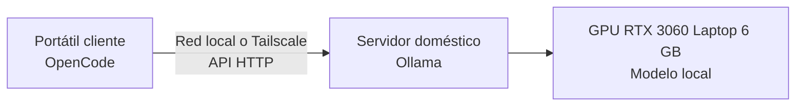

!!! warning

    El contenido de esta página no ha sido revisado ni corregido, por lo que puede
    estar incompleto, contener errores o presentar información desactualizada. Además,
    es posible que esté desordenado, carezca de una estructura clara o incluya notas
    copiadas directamente.

Este capítulo describe cómo montar un entorno de desarrollo asistido por un modelo de
lenguaje que se ejecuta en un servidor propio. Se emplea Ollama como servidor de
inferencia, OpenCode como cliente de terminal y Tailscale para el acceso remoto. Además
del procedimiento paso a paso, recoge los problemas reales que surgieron durante un
montaje sobre una GPU con 6 GB de memoria de vídeo y la forma de resolverlos.

## Bibliografía

- Ollama. (s.f.). _Ollama_. <https://ollama.com>
- SST. (s.f.). _OpenCode_. GitHub. <https://github.com/sst/opencode>
- Tailscale. (s.f.). _Tailscale_. <https://tailscale.com>

## Introducción

Ejecutar un modelo de lenguaje de gran tamaño (_LLM_) en un equipo propio permite usar
un asistente de programación en terminal, similar a Claude Code, sin enviar el código a
servicios externos y sin pagar por cada _token_ generado. A cambio, el tamaño del modelo
queda limitado por el _hardware_ disponible.

La solución se articula en torno a tres herramientas. **Ollama** es un servidor de
inferencia que descarga y ejecuta modelos y los expone mediante una API HTTP, por
defecto en el puerto `11434`. **OpenCode** es un agente de programación para terminal
que actúa exclusivamente como cliente, de modo que no ejecuta ningún modelo y delega la
generación en el servidor. **Tailscale** es una red privada virtual que conecta equipos
de forma segura sin abrir puertos al exterior.

| Componente        | Elección                       | Función                                  |
| ----------------- | ------------------------------ | ---------------------------------------- |
| Servidor          | Ollama                         | Ejecuta el modelo y expone la API.       |
| Cliente           | OpenCode                       | Interfaz de terminal para el desarrollo. |
| Acceso remoto     | Tailscale                      | Conecta cliente y servidor desde fuera.  |
| Sistema operativo | Ubuntu Server 24.04 o Debian   | Aloja el servidor de inferencia.         |
| Modelo            | Qwen2.5-Coder 7B cuantizado Q4 | Genera y revisa código.                  |

La **cuantización** reduce la precisión numérica de los pesos del modelo, en este caso a
4 bits, para disminuir la memoria necesaria a costa de una pérdida moderada de calidad.
Gracias a ella, un modelo de 7000 millones de parámetros cabe en una GPU de 6 GB.

El flujo de trabajo resultante se representa en el siguiente diagrama. El portátil
ejecuta OpenCode, envía las peticiones por la red local o por Tailscale y recibe las
respuestas generadas por el modelo que reside en el servidor.



## Capacidad del hardware

El factor limitante de una GPU con 6 GB de VRAM es la memoria de vídeo, ya que el modelo
debe caber en ella para ejecutarse a una velocidad útil. Cuando lo excede, parte de las
capas pasan a la memoria RAM del sistema y el rendimiento cae de forma notable.

Con esta configuración, los modelos de 7B parámetros cuantizados funcionan bien en
programación ligera o media, autocompletado, agentes de terminal, refactorizaciones
pequeñas y sistemas RAG sencillos. Los modelos de 14B y los contextos muy largos ofrecen
un funcionamiento irregular, al igual que los agentes complejos con varias herramientas.
Quedan fuera de alcance los modelos de 32B, el razonamiento de gran escala y la
ejecución simultánea de varios agentes.

## Preparación del servidor

Lo recomendable es Ubuntu Server 24.04 con los _drivers_ de NVIDIA instalados y CUDA
operativo, tal como se describe en el capítulo de
[fundamentos de CUDA](../../03_programming/03_cuda/section_1_fundamentals.md). El
montaje real de esta configuración se realizó sobre Debian, y los pasos son idénticos en
ambas distribuciones. La siguiente orden comprueba que el sistema detecta la GPU y debe
mostrar la RTX 3060:

```bash linenums="1"
nvidia-smi
```

## Instalación de Ollama

La instalación en el servidor se realiza con el script oficial, y la segunda orden
verifica que el binario está disponible:

```bash linenums="1"
curl -fsSL https://ollama.com/install.sh | sh
ollama --version
```

Ollama debe ejecutarse como un servicio de `systemd` para arrancar con el sistema y
mantenerse activo en segundo plano. En el montaje real el servicio no existía tras la
instalación, por lo que fue necesario crear manualmente el archivo
`/etc/systemd/system/ollama.service`. El manejo de servicios con `systemctl` se describe
en el capítulo de
[fundamentos de Linux](../../01_operative_systems/01_linux/section_1_fundamentals.md).

### Acceso desde la red

Por defecto, Ollama escucha únicamente en `127.0.0.1:11434`, por lo que el portátil no
puede alcanzarlo. Para cambiarlo se crea una configuración adicional del servicio con
`sudo systemctl edit ollama` y se añaden las siguientes variables de entorno:

```ini linenums="1"
[Service]
Environment="OLLAMA_HOST=0.0.0.0:11434"
Environment="OLLAMA_KEEP_ALIVE=24h"
```

La primera variable hace que Ollama acepte conexiones desde cualquier interfaz de red.
La segunda mantiene el modelo cargado en memoria durante 24 horas, lo que evita
descargarlo entre peticiones y acelera las respuestas. Tras guardar los cambios, se
recarga la configuración, se reinicia el servicio y se comprueba que el puerto está
abierto:

```bash linenums="1"
sudo systemctl daemon-reload
sudo systemctl restart ollama
ss -tulnp | grep 11434
```

La salida debe incluir una línea con la dirección `0.0.0.0:11434` o `*:11434`.

!!! danger "Servicio sin autenticación"

    Ollama no incorpora mecanismos de autenticación robustos por defecto. Al escuchar
    en todas las interfaces, cualquier equipo con acceso a la red puede usar la API.
    El puerto `11434` nunca debe exponerse directamente a internet. Para el acceso
    desde fuera de la red local se recomienda Tailscale, una VPN o un _reverse proxy_
    con autenticación.

## Selección del modelo

El modelo recomendado para 6 GB de VRAM es `qwen2.5-coder:7b`, que ofrece el mejor
equilibrio entre calidad y consumo y resulta adecuado para Python, JavaScript y
TypeScript, Bash, depuración y flujos de trabajo en terminal. La descarga se realiza con
`ollama pull`, mientras que `ollama run` abre además una sesión interactiva para
probarlo:

```bash linenums="1"
ollama pull qwen2.5-coder:7b
ollama run qwen2.5-coder:7b
```

Existen dos alternativas según la prioridad. La variante `qwen2.5-coder:3b` es más
rápida y ligera. En el extremo opuesto, `deepseek-coder-v2:16b` es más capaz, pero su
tamaño obliga a ejecutarla parcialmente en RAM, con la consiguiente lentitud. En la
instalación real se descargó inicialmente `gemma4:e4b`, que resultó demasiado pesado
para esta GPU, por lo que conviene evitar tanto los modelos de 14B o más como los
modelos grandes de la familia Gemma.

## Verificación desde el cliente

Antes de configurar OpenCode, se comprueba desde el portátil que la API es accesible
consultando la lista de modelos instalados en el servidor:

```bash linenums="1"
curl http://ip_del_servidor:11434/api/tags
```

La respuesta debe ser un JSON con los modelos disponibles. Si el resultado es
`{"models":[]}`, la red funciona correctamente, pero el servicio consultado no tiene
ningún modelo descargado.

## Instalación y configuración de OpenCode

OpenCode requiere Node.js en el portátil y se instala como paquete global de npm:

```bash linenums="1"
npm install -g opencode-ai
```

La conexión con el servidor remoto se define en el archivo
`~/.config/opencode/config.json`, que indica la dirección de Ollama y el modelo a usar.
El valor `ip_del_servidor` debe sustituirse por la dirección real del servidor.

```json linenums="1"
{
    "provider": {
        "ollama": {
            "baseUrl": "http://ip_del_servidor:11434"
        }
    },
    "model": "qwen2.5-coder:7b"
}
```

!!! note

    El formato del archivo de configuración de OpenCode puede variar entre versiones,
    por lo que conviene contrastarlo con la documentación oficial de la herramienta.

Una vez configurado, basta con ejecutar OpenCode en el directorio de cualquier proyecto:

```bash linenums="1"
opencode
```

A partir de ese momento, OpenCode se ejecuta en el portátil, el modelo lo hace en el
servidor y los _tokens_ se transmiten por la red local. La API también puede consultarse
directamente, sin pasar por OpenCode:

```bash linenums="1"
curl http://ip_del_servidor:11434/api/generate -d '{"model": "qwen2.5-coder:7b", "prompt": "Escribe una función en Python que invierta una cadena.", "stream": false}'
```

## Rendimiento esperado

Con la RTX 3060 Laptop de 6 GB y el modelo Qwen2.5-Coder 7B cuantizado a Q4, los valores
orientativos son los siguientes y resultan perfectamente utilizables:

| Métrica            | Valor         |
| ------------------ | ------------- |
| Tokens por segundo | 15 a 30       |
| Latencia           | Buena.        |
| RAM del sistema    | 8 a 12 GB     |
| VRAM               | Cerca de 5 GB |

## Acceso desde fuera de casa

Para trabajar fuera de la red local se instala Tailscale tanto en el servidor como en el
portátil. Ambos equipos pasan a formar parte de una misma red privada y el cliente puede
alcanzar el servidor desde cualquier ubicación mediante la dirección que Tailscale
asigna al servidor, que pertenece al rango `100.x.x.x`:

```text
http://ip_de_tailscale:11434
```

En la configuración de OpenCode basta con sustituir la dirección local por esta. De este
modo no es necesario abrir ningún puerto del router, lo que resuelve el riesgo descrito
anteriormente.

## Problemas habituales

Durante el montaje real aparecieron cinco problemas, resumidos en la siguiente tabla.
Todos tienen en común un fallo de integración entre Ollama y `systemd`, o entre el
servidor y el cliente, y no un fallo del modelo.

| Síntoma                            | Causa                                                      | Solución                                                           |
| ---------------------------------- | ---------------------------------------------------------- | ------------------------------------------------------------------ |
| El servicio no existe.             | Ollama estaba instalado, pero no registrado en `systemd`.  | Crear manualmente `/etc/systemd/system/ollama.service`.            |
| El servicio no arranca.            | La ruta del binario en el archivo del servicio es errónea. | Localizar la ruta real con `which ollama` y corregir `ExecStart`.  |
| Reinicios y estados anómalos.      | Ollama se ejecutaba a mano y a la vez como servicio.       | Ejecutar `pkill ollama` y después `sudo systemctl restart ollama`. |
| El portátil no puede conectar.     | Ollama escuchaba solo en `127.0.0.1:11434`.                | Definir `OLLAMA_HOST=0.0.0.0:11434` en el servicio.                |
| El cliente recibe `{"models":[]}`. | El servicio no tenía ningún modelo descargado o visible.   | Descargar el modelo con `ollama pull` en el servicio correcto.     |

De este episodio se extraen varias lecciones. `systemd` necesita la ruta exacta del
binario, Ollama escucha por defecto solo en `localhost`, la ejecución simultánea de un
proceso manual y del servicio genera conflictos, y OpenCode es únicamente un cliente. El
rendimiento depende por completo del modelo elegido.

## Operación diaria

Con el servicio configurado, el uso cotidiano es sencillo. Al encender el servidor,
`systemd` arranca Ollama automáticamente y la API queda disponible en el puerto `11434`.
El estado del servicio se consulta con `systemctl status ollama`, que debe indicar
`active (running)`. Desde el portátil, OpenCode envía las peticiones al servidor, la GPU
las procesa y la respuesta aparece en el terminal.

En el montaje real, el servidor con Debian y la RTX 3060 de 6 GB y el portátil cliente
con Fedora quedaron plenamente operativos, con acceso remoto y API funcionando. El único
ajuste pendiente era optimizar el modelo para programación, para lo cual se recomienda
Qwen2.5-Coder 7B.

## Mejoras futuras

Cuando se requiera más potencia, las mejoras de _hardware_ con mayor efecto son las
siguientes:

| Mejora             | Efecto                              |
| ------------------ | ----------------------------------- |
| 12 GB de VRAM      | Permite ejecutar modelos de 14B.    |
| 24 GB de VRAM      | Permite modelos de 32B cuantizados. |
| vLLM               | Aumenta el _throughput_.            |
| SSD NVMe rápido    | Acelera la carga de los modelos.    |
| 32 GB o más de RAM | Mejora el _offloading_ a memoria.   |

En el plano del _software_, quedan abiertas líneas como acelerar el _streaming_ en
OpenCode, reconectar automáticamente si el servidor cae, alternar de forma automática
entre modelos de 3B y de 7B, o habilitar un modo de agente que edite código de forma
autónoma, al estilo de Claude Code.
