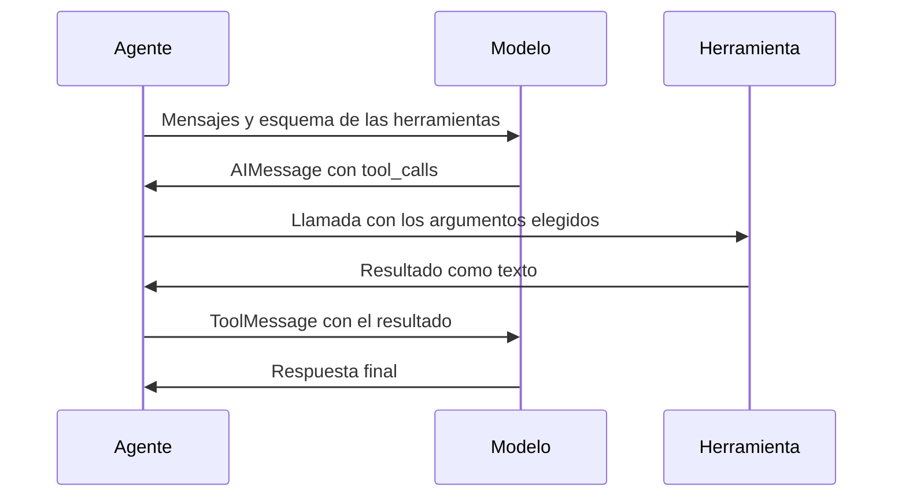

!!! warning

    El contenido de esta página no ha sido revisado ni corregido, por lo que puede
    estar incompleto, contener errores o presentar información desactualizada. Además,
    es posible que esté desordenado, carezca de una estructura clara o incluya notas
    copiadas directamente.

Este capítulo presenta **LangChain**, una biblioteca de Python para construir
aplicaciones y agentes sobre modelos de lenguaje. Parte de la invocación directa de un
modelo, continúa con las herramientas y el bucle del agente, y recorre la memoria de
conversación, el estado personalizado, el contexto de ejecución, la salida estructurada,
el contenido multimodal y la composición de varios agentes. Presupone los conceptos del
capítulo de [fundamentos](section_1_fundamentals.md), en particular la ventana de
contexto y los parámetros de generación, y el concepto de agente del capítulo de
[agentes](../03_deep_learning/section_10_agents.md). Los ejemplos se probaron con
`langchain==1.4.9`.

## Bibliografía

- LangChain. (s.f.). _LangChain documentation_. <https://docs.langchain.com/>

## Introducción

LangChain es **agnóstico al modelo**: ofrece una interfaz común para modelos de
proveedores distintos, de modo que cambiar de uno a otro apenas modifica el código de la
aplicación. Sobre esa interfaz añade las piezas habituales de un agente, que son las
herramientas, la memoria, la salida estructurada y el _middleware_. Los agentes se
ejecutan sobre **LangGraph**, el motor de grafos de estado de la misma familia, que
aporta la persistencia, las interrupciones y el _streaming_ que se utilizan en este
capítulo. Para el seguimiento de las ejecuciones, **LangSmith** es el servicio de
observabilidad de LangChain.

Las dependencias de los ejemplos se instalan con uv, descrito en el capítulo de
[entornos de Python](../../03_programming/01_python/section_1_environments.md):

```bash linenums="1"
uv add "langchain==1.4.9" "langchain-openai==1.3.4" "langgraph==1.2.20" python-dotenv pillow
```

## Inicialización del modelo

LangChain elige el modelo con la función `init_chat_model`, que recibe el nombre del
modelo, el proveedor y los parámetros de generación. Cualquier argumento adicional se
reenvía a la clase del proveedor, lo que permite apuntar a un servidor propio con API
compatible con OpenAI mediante `base_url`. La función siguiente centraliza la
configuración a partir de variables de entorno, de forma que el resto de los ejemplos de
este y de los siguientes capítulos la reutilizan sin cambios.

```python linenums="1" title="modelos.py"
import os
from typing import Any

from dotenv import load_dotenv
from langchain.chat_models import init_chat_model
from langchain_core.language_models import BaseChatModel

load_dotenv()


def crear_modelo(nombre: str | None = None, **parametros: Any) -> BaseChatModel:
    """Crea un modelo de chat a partir de las variables de entorno.

    Las variables esperadas son `LLM_MODEL`, `LLM_API_KEY` y, de forma
    opcional, `LLM_BASE_URL` para servidores con API compatible con OpenAI.

    Args:
        nombre: Nombre del modelo. Si se omite, se lee de `LLM_MODEL`.
        **parametros: Parámetros de generación, como `temperature`,
            `max_tokens`, `timeout` o `max_retries`.

    Returns:
        Modelo de chat de LangChain.
    """
    return init_chat_model(
        nombre or os.environ["LLM_MODEL"],
        model_provider="openai",
        base_url=os.environ.get("LLM_BASE_URL"),
        api_key=os.environ["LLM_API_KEY"],
        **parametros,
    )
```

```plaintext title="Contenido del archivo .env (excluido del control de versiones)"
LLM_MODEL=nombre_del_modelo
LLM_BASE_URL=http://servidor_del_modelo:8000/v1
LLM_API_KEY=clave_de_la_api
```

!!! note

    Algunos servidores compatibles con OpenAI no implementan todos los parámetros de la
    API, como la elección forzada de herramienta (`tool_choice`) o el formato de
    respuesta nativo. Cuando una llamada falla por ese motivo, la clase `ChatOpenAI`
    permite desactivar el parámetro conflictivo con `disabled_params`, por ejemplo
    `disabled_params={"tool_choice": None}`, o recurrir a una estrategia de salida
    estructurada basada en herramientas, descrita más adelante.

## Invocación del modelo

Con el modelo creado, `invoke` envía una pregunta y devuelve un mensaje de tipo
`AIMessage`. El texto está en `content`, y los metadatos de la respuesta, como el
proveedor, el modelo utilizado y el consumo de _tokens_, en `response_metadata` y
`usage_metadata`.

```python linenums="1"
from modelos import crear_modelo

modelo = crear_modelo(temperature=0.2, max_tokens=512, timeout=60, max_retries=3)

respuesta = modelo.invoke("¿Cuál es la capital de España?")
print(respuesta.content)

# Tokens de entrada, de salida y totales de la llamada
print(respuesta.usage_metadata)
```

Los cuatro parámetros fijados al crear el modelo son la temperatura, el máximo de
_tokens_ de la respuesta, el _timeout_ y el número de reintentos, tal como se describen
en el capítulo de fundamentos. Para reducir la latencia percibida, `stream` entrega la
respuesta por fragmentos conforme el modelo los genera, en lugar de esperar a que
termine:

```python linenums="1"
for fragmento in modelo.stream("Explica el interés compuesto en dos frases."):
    print(fragmento.content, end="", flush=True)
```

En un agente, `agente.stream(..., stream_mode="messages")` entrega los fragmentos de
todos los pasos. Como los fragmentos que construyen una llamada a una herramienta
incluyen `tool_call_chunks`, para mostrar solo el texto de la respuesta se descartan los
que lo contienen.

## Mensajes

El historial de una conversación es una lista de mensajes de cuatro tipos. Un
`SystemMessage` transporta las instrucciones, un `HumanMessage` la entrada del usuario,
un `AIMessage` la respuesta del modelo y un `ToolMessage` el resultado de una
herramienta. Los agentes construyen y actualizan este histórico en cada interacción, y
los modelos reciben el historial completo en cada llamada, puesto que no conservan
memoria propia.

## Herramientas y agentes

Un **agente** es un bucle en el que el modelo decide, en cada paso, si responde o si
invoca una herramienta, y recibe el resultado antes de continuar. Las acciones que puede
emprender dependen únicamente de las **herramientas** que se le proporcionen. Una
herramienta es una función de Python decorada con `@tool`. El modelo no ve el código,
sino el nombre, la descripción y los argumentos, y los infiere de la firma y del
_docstring_. Por eso las herramientas deben estar bien documentadas, ya que de esa
descripción depende que el modelo sepa cuándo y para qué usarlas. Con
`parse_docstring=True`, la sección `Args` del _docstring_ se convierte en la descripción
de cada argumento.

```python linenums="1"
import math

from langchain.agents import create_agent
from langchain.messages import HumanMessage
from langchain.tools import tool

from modelos import crear_modelo


@tool(parse_docstring=True)
def raiz_cuadrada(valor: float) -> float:
    """Calcula la raíz cuadrada de un número.

    Args:
        valor: Número no negativo del que se calcula la raíz.

    Returns:
        La raíz cuadrada del valor.
    """
    return math.sqrt(valor)


agente = create_agent(
    model=crear_modelo(),
    tools=[raiz_cuadrada],
    system_prompt="Eres un asistente especializado en matemáticas.",
)

respuesta = agente.invoke(
    {"messages": [HumanMessage("Dime la raíz cuadrada de 36.")]}
)
print(respuesta["messages"][-1].content)
```

El resultado de `invoke` es un diccionario cuya clave `messages` contiene todo el
recorrido de la ejecución. Para la pregunta anterior la secuencia es un `HumanMessage`,
un `AIMessage` cuyo atributo `tool_calls` solicita la herramienta con sus argumentos, un
`ToolMessage` con el resultado y un `AIMessage` final con la respuesta. Cada
`ToolMessage` incluye el `tool_call_id` de la petición a la que responde, que es lo que
permite al modelo asociar resultados con peticiones.

```python linenums="1"
# Herramienta solicitada y datos de entrada que el modelo ha elegido
print(respuesta["messages"][1].tool_calls)
```

```plaintext title="Forma de la salida"
[{'name': 'raiz_cuadrada', 'args': {'valor': 36.0}, 'id': '...', 'type': 'tool_call'}]
```

El intercambio completo entre el agente, el modelo y la herramienta sigue siempre la
misma secuencia. El agente envía al modelo el nombre, la descripción y los argumentos de
cada herramienta junto con los mensajes. El modelo responde con un `AIMessage` que
indica qué herramientas usar, cómo usarlas y con qué datos. El agente ejecuta la
herramienta con esos argumentos, obtiene su resultado como cadena de texto y lo
empaqueta en un `ToolMessage` que devuelve al modelo como retroalimentación para que
decida el siguiente paso.



El atributo `tool_calls` es una lista porque el modelo puede solicitar varias
herramientas en una misma respuesta. Si no existen dependencias entre ellas, se ejecutan
en paralelo. Conviene extremar la precaución con las herramientas que actúan sobre el
exterior, como enviar un correo o borrar un registro, porque modifican un estado ajeno
al agente y una llamada equivocada no se puede deshacer. El capítulo de
[_middleware_](section_4_middleware.md) describe cómo exigir una aprobación humana
previa.

## Salida estructurada

Para obtener datos en lugar de texto, `create_agent` acepta el parámetro
`response_format` con el esquema esperado. El esquema puede ser un modelo de Pydantic,
una _dataclass_, un `TypedDict` o un esquema JSON, y el resultado queda en la clave
`structured_response` del diccionario devuelto. Los tres primeros devuelven el objeto
con el tipo declarado, lo que evita analizar texto a mano.

```python linenums="1"
from langchain.agents import create_agent
from langchain.messages import HumanMessage
from pydantic import BaseModel, Field

from modelos import crear_modelo


class InfoCapital(BaseModel):
    """Datos de la capital de un país."""

    nombre: str = Field(description="Nombre de la capital")
    pais: str = Field(description="País al que pertenece")


agente = create_agent(model=crear_modelo(), response_format=InfoCapital)

respuesta = agente.invoke(
    {"messages": [HumanMessage("¿Cuál es la capital de Francia?")]}
)
info: InfoCapital = respuesta["structured_response"]
print(info.nombre, info.pais)
```

Cuando el modelo soporta salida estructurada de forma nativa, LangChain la utiliza. En
caso contrario recurre a una herramienta cuyo argumento es el esquema, una estrategia
que funciona con cualquier modelo capaz de llamar a herramientas. Ambas se pueden forzar
envolviendo el esquema en `ProviderStrategy` o en `ToolStrategy`, ambas importables
desde `langchain.agents.structured_output`. En todos los casos, tal como se explicó en
el capítulo de fundamentos, la respuesta debe tratarse como un contrato que se valida
antes de usarla.

## Memoria de corto plazo

Un agente, por sí solo, carece de memoria entre invocaciones. Para conservar el
historial se le asocia un **_checkpointer_**, un componente que guarda un _checkpoint_
del estado tras cada paso. Cada conversación se identifica con un `thread_id` que se
pasa en la configuración: mientras el identificador se repita, el agente continúa la
misma conversación, y con un identificador distinto comienza una limpia.

```python linenums="1"
from langchain.agents import create_agent
from langchain.messages import HumanMessage
from langgraph.checkpoint.memory import InMemorySaver

from modelos import crear_modelo

agente = create_agent(
    model=crear_modelo(),
    system_prompt="Sé claro, corto y conciso en tus respuestas.",
    checkpointer=InMemorySaver(),
)

conversacion = {"configurable": {"thread_id": "1"}}

for pregunta in ["Me llamo Daniel.", "¿Cómo me llamo?"]:
    respuesta = agente.invoke(
        {"messages": [HumanMessage(pregunta)]}, config=conversacion
    )
    print(respuesta["messages"][-1].content)
```

`InMemorySaver` (también accesible como `MemorySaver`) guarda los _checkpoints_ en la
memoria RAM del proceso de Python que ejecuta la aplicación. Por ese motivo sirve para
desarrollo y pruebas, pero no es apropiado para producción, porque el historial se
pierde al reiniciar el proceso. Esta memoria es de **corto plazo**, ya que cubre un
único _thread_ y no se comparte entre ellos. Para persistirla existen _checkpointers_
respaldados por bases de datos, y para compartir información entre conversaciones se
emplean los almacenes de memoria de largo plazo que describe el capítulo de
[DeepAgents](section_6_deepagents.md).

Cada paso del agente deja un _checkpoint_ que puede inspeccionarse. El método
`get_state_history` recorre los estados de un _thread_, del más reciente al más antiguo,
y cada instantánea expone los valores del estado (`values`), los metadatos (`metadata`),
la configuración (`config`), la fecha de creación (`created_at`) y los nodos pendientes
de ejecutar (`next`). Esa historia permite comprobar que dos conversaciones con
identificadores distintos no comparten nada.

```python linenums="1"
for instantanea in agente.get_state_history(conversacion):
    print(instantanea.created_at, instantanea.next, len(instantanea.values["messages"]))
```

## Estado personalizado

El **estado** del agente es el conjunto de datos que el grafo mantiene y que el
_checkpointer_ guarda. Por defecto contiene solo los mensajes, pero puede ampliarse con
campos propios si se define una subclase de `AgentState` y se pasa como `state_schema`.
Las herramientas acceden a él mediante el parámetro especial `runtime` de tipo
`ToolRuntime`, que no ve el modelo. Para modificarlo, la herramienta devuelve un objeto
`Command` con las actualizaciones, que debe incluir un `ToolMessage` asociado a la
llamada para que el historial siga siendo coherente.

```python linenums="1"
from langchain.agents import AgentState, create_agent
from langchain.messages import HumanMessage, ToolMessage
from langchain.tools import ToolRuntime, tool
from langgraph.checkpoint.memory import InMemorySaver
from langgraph.types import Command

from modelos import crear_modelo


class EstadoColor(AgentState):
    """Estado del agente ampliado con el color favorito."""

    color_favorito: str


@tool
def guardar_color(color: str, runtime: ToolRuntime) -> Command:
    """Guarda el color favorito del usuario en el estado."""
    return Command(
        update={
            "color_favorito": color,
            "messages": [
                ToolMessage("Color guardado", tool_call_id=runtime.tool_call_id)
            ],
        }
    )


@tool
def leer_color(runtime: ToolRuntime) -> str:
    """Lee el color favorito guardado en el estado."""
    return runtime.state.get("color_favorito", "No hay color guardado")


agente = create_agent(
    model=crear_modelo(),
    tools=[guardar_color, leer_color],
    state_schema=EstadoColor,
    checkpointer=InMemorySaver(),
)

conversacion = {"configurable": {"thread_id": "1"}}

agente.invoke(
    {"messages": [HumanMessage("Mi color favorito es el azul.")]},
    config=conversacion,
)
respuesta = agente.invoke(
    {"messages": [HumanMessage("¿Cuál es mi color favorito?")]},
    config=conversacion,
)

# Valor que la herramienta dejó en el estado, accesible al terminar la ejecución
print(respuesta.get("color_favorito"))
```

El estado también puede inicializarse o sobrescribirse desde fuera, añadiendo el campo a
la entrada de `invoke`, por ejemplo `{"messages": [...], "color_favorito": "amarillo"}`.
Delegar el acceso en herramientas, en lugar de volcar el contenido del estado en el
_prompt_, evita sobrecargar la ventana de contexto del modelo.

## Contexto de ejecución

El **contexto** es información de solo lectura que la aplicación inyecta en cada
ejecución, como el idioma del usuario, su identificador o las credenciales que una
herramienta necesita. Se declara con un `context_schema`, normalmente una _dataclass_, y
se lee desde las herramientas con `runtime.context`.

```python linenums="1"
from dataclasses import dataclass

from langchain.agents import create_agent
from langchain.messages import HumanMessage
from langchain.tools import ToolRuntime, tool
from langgraph.checkpoint.memory import InMemorySaver

from modelos import crear_modelo


@dataclass
class ContextoColor:
    """Contexto con el color favorito que se inyecta en las herramientas."""

    color_favorito: str = "azul"


@tool
def obtener_color_favorito(runtime: ToolRuntime[ContextoColor]) -> str:
    """Obtiene el color favorito del contexto."""
    return runtime.context.color_favorito


agente = create_agent(
    model=crear_modelo(),
    tools=[obtener_color_favorito],
    context_schema=ContextoColor,
    checkpointer=InMemorySaver(),
)

conversacion = {"configurable": {"thread_id": "1"}}

for contexto in [ContextoColor(), ContextoColor(color_favorito="negro")]:
    respuesta = agente.invoke(
        {"messages": [HumanMessage("¿Cuál es mi color favorito?")]},
        config=conversacion,
        context=contexto,
    )
    print(respuesta["messages"][-1].content)
```

La diferencia con el estado es de propiedad. El contexto **se debe pasar en cada
invocación** porque no lo guarda el _checkpointer_, a diferencia de los mensajes, y es
**inmutable**, de modo que el agente no puede modificarlo. Si el agente es quien genera,
corrige o valida un dato, este pertenece al estado mutable del flujo de trabajo y no al
contexto de ejecución.

## Contenido multimodal

Un mensaje puede transportar, además de texto, imágenes o audio si el modelo es
multimodal. El contenido se expresa como una lista de bloques, y un mismo bloque admite
varias formas de aportar el archivo. La más común en una API compatible con OpenAI es la
codificación en **Base64**, que representa los bytes del archivo como texto. También se
puede indicar una URL pública, referenciar un archivo subido previamente mediante su
identificador o transmitirlo como binario en _streaming_. Cada forma requiere adaptar el
código de la aplicación y depende de lo que acepte el proveedor.

```python linenums="1"
import base64
from io import BytesIO
from pathlib import Path

from langchain.agents import create_agent
from langchain.messages import HumanMessage
from PIL import Image

from modelos import crear_modelo


def imagen_a_base64(imagen: Image.Image) -> str:
    """Codifica una imagen como JPEG en Base64.

    Args:
        imagen: Imagen a codificar.

    Returns:
        Imagen codificada como cadena de texto.
    """
    buffer = BytesIO()
    imagen.convert("RGB").save(buffer, format="JPEG")
    return base64.b64encode(buffer.getvalue()).decode("utf-8")


pregunta = HumanMessage(
    content=[
        {"type": "text", "text": "Describe la imagen siguiente."},
        {
            "type": "image",
            "base64": imagen_a_base64(Image.open(Path("imagen.jpg"))),
            "mime_type": "image/jpeg",
        },
    ]
)

agente = create_agent(model=crear_modelo())
respuesta = agente.invoke({"messages": [pregunta]})
print(respuesta["messages"][-1].content)
```

## Varios agentes

Para dividir un problema entre especialistas, LangChain no necesita una abstracción
nueva: un agente se añade como herramienta de otro. Cada **subagente** se crea por
separado con sus propias herramientas e instrucciones, y un **agente orquestador**
recibe una herramienta por cada subagente cuya descripción indica cuándo delegar en él.
La función siguiente envuelve un subagente en una herramienta y devuelve solo el texto
final, que es lo que el orquestador necesita.

```python linenums="1"
import math

from langchain.agents import create_agent
from langchain.messages import HumanMessage
from langchain.tools import tool
from langchain_core.tools import BaseTool

from modelos import crear_modelo


@tool
def raiz_cuadrada(valor: float) -> float:
    """Calcula la raíz cuadrada de un número."""
    return math.sqrt(valor)


@tool
def cuadrado(valor: float) -> float:
    """Calcula el cuadrado de un número."""
    return valor**2


def crear_tool_subagente(nombre: str, descripcion: str, subagente) -> BaseTool:
    """Envuelve un subagente en una herramienta que el orquestador puede llamar.

    Args:
        nombre: Nombre de la herramienta que verá el orquestador.
        descripcion: Cuándo debe el orquestador delegar en este subagente.
        subagente: Agente al que se envía la petición.

    Returns:
        Herramienta que reenvía la petición y devuelve la respuesta final.
    """

    @tool(nombre, description=descripcion)
    def llamar_subagente(peticion: str) -> str:
        respuesta = subagente.invoke({"messages": [HumanMessage(peticion)]})
        return respuesta["messages"][-1].content

    return llamar_subagente


modelo = crear_modelo()

orquestador = create_agent(
    model=modelo,
    tools=[
        crear_tool_subagente(
            "subagente_raiz",
            "Delega el cálculo de raíces cuadradas. Entrada: la petición.",
            create_agent(model=modelo, tools=[raiz_cuadrada]),
        ),
        crear_tool_subagente(
            "subagente_cuadrado",
            "Delega el cálculo de cuadrados. Entrada: la petición.",
            create_agent(model=modelo, tools=[cuadrado]),
        ),
    ],
    system_prompt="Delega cada cálculo en el subagente adecuado.",
)

respuesta = orquestador.invoke({"messages": [HumanMessage("Cuadrado de 6.")]})
print(respuesta["messages"][-1].content)
```

Cada subagente se ejecuta con su propio historial y devuelve únicamente su resultado, de
modo que el contexto del orquestador no crece con los pasos intermedios. El coste es que
cada delegación añade una llamada completa a un modelo.

## Observabilidad con LangSmith

**LangSmith** registra la traza de cada ejecución: los agentes y subagentes invocados,
las herramientas llamadas con sus argumentos, el consumo de _tokens_ y la latencia de
cada paso. Se activa con variables de entorno, sin modificar el código:

```bash linenums="1"
export LANGSMITH_TRACING=true
export LANGSMITH_API_KEY=clave_de_langsmith
```

!!! warning

    La traza contiene los _prompts_ y las respuestas completos. Con LangSmith en su
    versión alojada, esa información sale de la infraestructura propia, por lo que en
    entornos con datos sensibles o restricciones de confidencialidad hay que valorar
    una instalación autoalojada o desactivar el seguimiento.

El siguiente capítulo describe el [_middleware_](section_4_middleware.md), el mecanismo
con el que se intercepta y modifica el comportamiento del agente en cada paso.
