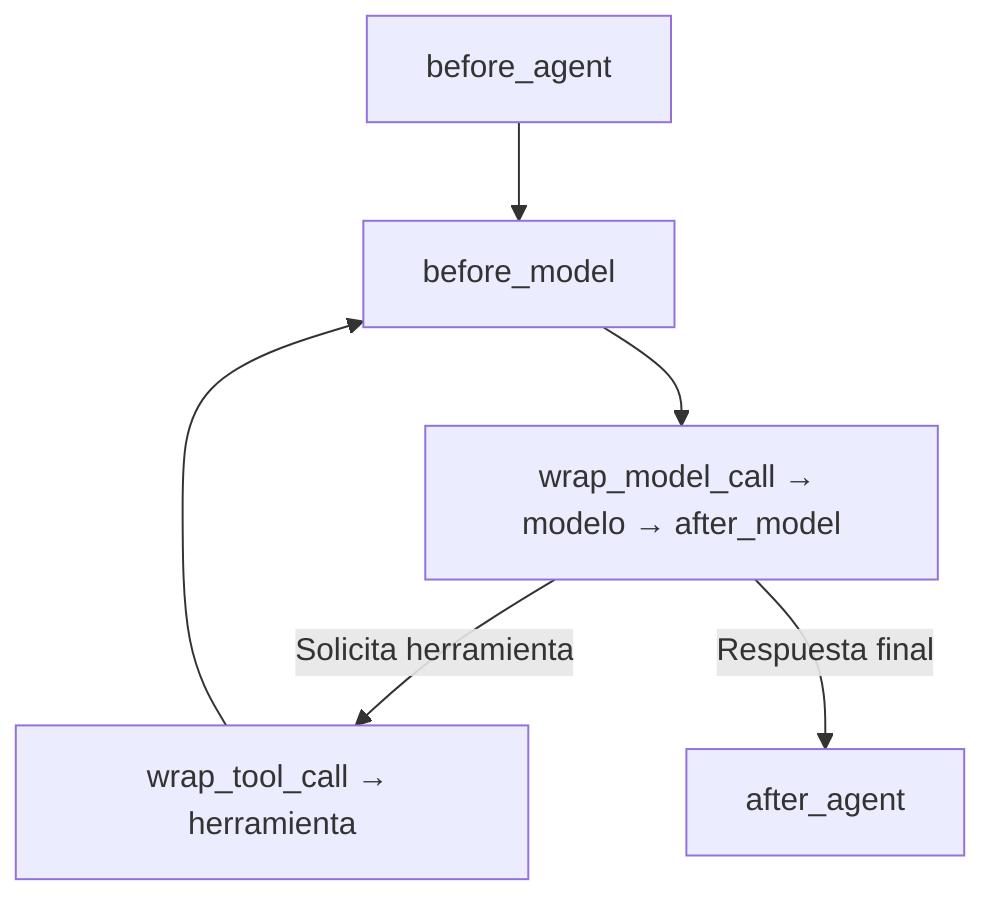

!!! warning

    El contenido de esta página no ha sido revisado ni corregido, por lo que puede
    estar incompleto, contener errores o presentar información desactualizada. Además,
    es posible que esté desordenado, carezca de una estructura clara o incluya notas
    copiadas directamente.

Este capítulo describe el **_middleware_** de LangChain, el mecanismo que permite
interceptar y modificar el comportamiento de un agente en cada paso de su ejecución. Se
presentan los ganchos disponibles, los dos estilos con que se escriben y varios usos
habituales: cambiar el modelo o el _prompt_ durante la conversación, controlar el tamaño
del historial mediante recortes y resúmenes, y pedir aprobación humana antes de ejecutar
una herramienta. Presupone el capítulo de [LangChain](section_3_langchain.md), en
particular la función `crear_modelo`, el estado y el contexto de ejecución.

## Bibliografía

- LangChain. (s.f.). _LangChain documentation_. <https://docs.langchain.com/>

## Concepto y ganchos

Un _middleware_ es una función, o un conjunto de ellas, que se sitúa entre las entidades
que intervienen en el bucle de un agente: entre la petición y el modelo, entre el modelo
y las herramientas, y entre el modelo y el resultado final. Como son funciones
intermedias, no alteran la lógica del agente sino lo que entra y sale en cada punto. Una
aplicación típica es resumir la conversación cuando crece, pero también sirven para
registrar, limitar o validar llamadas.

Los ganchos se declaran con decoradores y se pasan al agente en el parámetro
`middleware` de `create_agent`. Se dividen en dos estilos según cómo participan.

| Decorador          | Estilo                | Cuándo se ejecuta                                                |
| :----------------- | :-------------------- | :--------------------------------------------------------------- |
| `@before_agent`    | _Node-style_          | Una vez, al comenzar cada ejecución.                             |
| `@after_agent`     | _Node-style_          | Una vez, al terminar cada ejecución.                             |
| `@before_model`    | _Node-style_          | Antes de cada llamada al modelo, que puede ocurrir varias veces. |
| `@after_model`     | _Node-style_          | Después de cada llamada al modelo.                               |
| `@wrap_model_call` | _Wrap-style_          | Envuelve cada llamada al modelo.                                 |
| `@wrap_tool_call`  | _Wrap-style_          | Envuelve cada llamada a una herramienta.                         |
| `@dynamic_prompt`  | Atajo de _wrap-style_ | Calcula el _system prompt_ antes de cada llamada al modelo.      |

Los ganchos de estilo **_node_** reciben el estado y el entorno de ejecución (`Runtime`)
y devuelven, si procede, una actualización del estado. Los de estilo **_wrap_** reciben
la petición (`ModelRequest` o `ToolCallRequest`) y un `handler` que ejecuta el paso
real, de modo que pueden modificar la petición antes de delegarla, transformar la
respuesta o incluso evitar la llamada. En un agente con una sola herramienta, el orden
de ejecución de los ganchos es el siguiente:



## Modelo y _prompt_ dinámicos

Con `wrap_model_call` es posible cambiar de modelo en mitad de una conversación, por
ejemplo para usar uno más barato en los primeros turnos y uno más potente cuando el
historial se alarga. La petición es inmutable, por lo que se genera una copia modificada
con `request.override(...)`. Los modelos se instancian una sola vez, fuera del gancho.

```python linenums="1"
from collections.abc import Callable

from langchain.agents import create_agent
from langchain.agents.middleware import ModelRequest, ModelResponse, wrap_model_call
from langgraph.checkpoint.memory import InMemorySaver

from modelos import crear_modelo

modelo_avanzado = crear_modelo("nombre_del_modelo_avanzado")


@wrap_model_call
def elegir_modelo(
    peticion: ModelRequest,
    handler: Callable[[ModelRequest], ModelResponse],
) -> ModelResponse:
    """Usa el modelo avanzado cuando la conversación supera seis mensajes."""
    if len(peticion.messages) > 6:
        peticion = peticion.override(model=modelo_avanzado)

    return handler(peticion)


agente = create_agent(
    model=crear_modelo(),
    middleware=[elegir_modelo],
    checkpointer=InMemorySaver(),
)
```

Los metadatos de la respuesta (`response_metadata["model_name"]`) indican qué modelo
contestó realmente, y conviene consultarlos para comprobar que el cambio se produce. El
_system prompt_ admite el mismo tratamiento mediante `@dynamic_prompt`, que devuelve el
texto a partir de la petición y del contexto de ejecución definido con `context_schema`.

```python linenums="1"
from dataclasses import dataclass

from langchain.agents import create_agent
from langchain.agents.middleware import ModelRequest, dynamic_prompt
from langchain.messages import HumanMessage

from modelos import crear_modelo


@dataclass
class ContextoLenguaje:
    """Contexto con el idioma en que debe responder el agente."""

    lenguaje: str = "Español"


@dynamic_prompt
def prompt_segun_idioma(peticion: ModelRequest) -> str:
    """Genera el system prompt según el idioma indicado en el contexto."""
    base = "Eres un asistente resolutivo"
    lenguaje = peticion.runtime.context.lenguaje

    if lenguaje == "Español":
        return base

    return f"{base}. Responde en {lenguaje}."


agente = create_agent(
    model=crear_modelo(),
    context_schema=ContextoLenguaje,
    middleware=[prompt_segun_idioma],
)

respuesta = agente.invoke(
    {"messages": [HumanMessage("Hello, how is it going?")]},
    context=ContextoLenguaje(lenguaje="Inglés"),
)
print(respuesta["messages"][-1].content)
```

## Conversaciones largas

En un cliente _stateless_, el historial crece con cada turno y tarde o temprano supera
la ventana de contexto o encarece cada llamada. El _middleware_ ofrece dos estrategias
para contenerlo, el recorte y el resumen. Ambas gestionan el historial para **reducir el
contexto**, pero no son un mecanismo de ofuscación de la información.

!!! warning

    Eliminar del historial los mensajes de herramientas o de llamadas no es una medida
    de seguridad. Los datos sensibles deben mantenerse en el _backend_ y no exponerse al
    usuario, porque el recorte solo decide qué ve el modelo en la siguiente llamada.
    Además, un `ToolMessage` debe eliminarse siempre junto con el `AIMessage` cuya
    solicitud responde, ya que la mayoría de los proveedores rechazan historiales con
    resultados huérfanos.

### Recorte del historial

El recorte conserva el primer mensaje, que suele fijar la tarea, y los últimos, que
contienen el contexto inmediato. El gancho `before_model` sustituye el historial
devolviendo un `RemoveMessage` con el identificador especial `REMOVE_ALL_MESSAGES`,
seguido de los mensajes que se mantienen.

```python linenums="1"
from typing import Any

from langchain.agents import AgentState
from langchain.agents.middleware import before_model
from langchain.messages import RemoveMessage
from langgraph.graph.message import REMOVE_ALL_MESSAGES
from langgraph.runtime import Runtime


@before_model
def recortar_historial(
    estado: AgentState, runtime: Runtime
) -> dict[str, Any] | None:
    """Conserva el primer mensaje y los tres últimos del historial."""
    mensajes = estado["messages"]

    if len(mensajes) <= 3:
        return None

    primero = mensajes[0]
    # Con un número par de mensajes el último es del asistente
    recientes = mensajes[-3:] if len(mensajes) % 2 == 0 else mensajes[-4:]

    return {"messages": [RemoveMessage(id=REMOVE_ALL_MESSAGES), primero, *recientes]}
```

### Resumen automático

El recorte descarta información. El **resumen** la comprime: `SummarizationMiddleware`
sustituye los mensajes antiguos por un resumen cuando se supera un umbral. Se configura
con el modelo que genera el resumen, que puede ser uno más barato que el del agente, el
umbral que lo dispara (`trigger`), la cantidad de mensajes recientes que se conservan
intactos (`keep`) y la plantilla del _prompt_ de resumen, que debe incluir el marcador
`{messages}`.

```python linenums="1"
from langchain.agents import create_agent
from langchain.agents.middleware import SummarizationMiddleware
from langchain.messages import HumanMessage
from langgraph.checkpoint.memory import InMemorySaver

from modelos import crear_modelo

modelo = crear_modelo()

agente = create_agent(
    model=modelo,
    checkpointer=InMemorySaver(),
    system_prompt="Responde de forma clara y concisa, en texto plano.",
    middleware=[
        SummarizationMiddleware(
            model=modelo,
            trigger=("tokens", 3000),
            keep=("messages", 4),
            summary_prompt=(
                "Resume la conversación conservando solo lo esencial.\n\n{messages}"
            ),
        )
    ],
)

conversacion = {"configurable": {"thread_id": "1"}}

for fragmento, metadatos in agente.stream(
    {"messages": [HumanMessage("Cuéntame qué es el interés compuesto.")]},
    config=conversacion,
    stream_mode="messages",
):
    # Se omite el texto del resumen, que el middleware genera con su propio modelo
    if fragmento.content and metadatos["langgraph_node"] == "model":
        print(fragmento.content, end="", flush=True)
```

El filtro por `langgraph_node` es necesario al hacer _streaming_, porque el modelo de
resumen también emite fragmentos y, sin él, el usuario vería el resumen mezclado con la
respuesta. En DeepAgents este mecanismo viene activado por defecto con un umbral
relativo a la ventana del modelo, como se describe en el capítulo de
[DeepAgents](section_6_deepagents.md).

## Aprobación humana

Algunas herramientas no deben ejecutarse sin que una persona las revise, como enviar un
correo o modificar datos. `HumanInTheLoopMiddleware` recibe un diccionario
`interrupt_on` que indica qué herramientas requieren permiso. Cuando el agente solicita
una de ellas, el grafo se detiene con una **interrupción** y guarda en el _checkpointer_
la ejecución pendiente, de modo que es imprescindible haber configurado uno y reutilizar
después el mismo `thread_id`. La ejecución se reanuda con un objeto `Command` que
transporta la decisión humana.

| Decisión  | Efecto                                                          |
| :-------- | :-------------------------------------------------------------- |
| `approve` | La herramienta se ejecuta con los argumentos propuestos.        |
| `edit`    | Se ejecuta con los argumentos corregidos por la persona.        |
| `reject`  | No se ejecuta y el modelo recibe el motivo del rechazo.         |
| `respond` | No se ejecuta y la persona aporta el resultado que habría dado. |

```python linenums="1"
from langchain.agents import create_agent
from langchain.agents.middleware import HumanInTheLoopMiddleware
from langchain.messages import HumanMessage
from langchain.tools import tool
from langgraph.checkpoint.memory import InMemorySaver
from langgraph.types import Command

from modelos import crear_modelo


@tool
def enviar_email(destinatario: str, asunto: str, cuerpo: str) -> str:
    """Envía un correo electrónico con el asunto y el cuerpo indicados."""
    return f"Correo '{asunto}' enviado a {destinatario}."


agente = create_agent(
    model=crear_modelo(),
    tools=[enviar_email],
    checkpointer=InMemorySaver(),
    middleware=[
        HumanInTheLoopMiddleware(
            interrupt_on={"enviar_email": True},
            description_prefix="La ejecución de la herramienta requiere aprobación.",
        )
    ],
)

conversacion = {"configurable": {"thread_id": "1"}}

# El agente se detiene antes de enviar el correo y espera una decisión
resultado = agente.invoke(
    {"messages": [HumanMessage("Avisa a ana@ejemplo.com de que llegaré tarde.")]},
    config=conversacion,
    version="v2",
)

for interrupcion in resultado.interrupts:
    print(interrupcion.value["action_requests"])

# Se reanuda la misma conversación con la decisión de la persona
resultado = agente.invoke(
    Command(resume={"decisions": [{"type": "approve"}]}),
    config=conversacion,
    version="v2",
)
print(resultado.value["messages"][-1].content)
```

Con `version="v2"`, `invoke` devuelve un objeto con dos atributos, `value`, que contiene
el estado final del grafo, e `interrupts`, que lista las pausas pendientes y está vacía
si no hubo ninguna. Sin esa opción se devuelve un diccionario plano en el que las pausas
aparecen bajo la clave `__interrupt__`. Para rechazar o editar basta con sustituir la
decisión, por ejemplo `{"type": "reject", "message": "Falta el asunto"}` o
`{"type": "edit", "edited_action": {"name": "enviar_email", "args": {...}}}`. La
decisión `respond` está pensada para herramientas del tipo «preguntar al usuario», cuya
implementación real es la respuesta de la persona.

## Otros _middleware_ incluidos

LangChain incorpora varios _middleware_ listos para usar, que cubren necesidades
frecuentes sin escribir ganchos propios.

| _Middleware_               | Función                                                             |
| :------------------------- | :------------------------------------------------------------------ |
| `ModelFallbackMiddleware`  | Cambia automáticamente a modelos alternativos cuando uno falla.     |
| `ModelRetryMiddleware`     | Reintenta las llamadas fallidas al modelo con espera configurable.  |
| `ToolRetryMiddleware`      | Reintenta las llamadas fallidas a herramientas.                     |
| `ModelCallLimitMiddleware` | Limita el número de llamadas al modelo por ejecución.               |
| `ToolCallLimitMiddleware`  | Limita el número de llamadas a herramientas.                        |
| `PIIMiddleware`            | Detecta y trata datos personales en la conversación.                |
| `ContextEditingMiddleware` | Poda los resultados de herramientas antiguos para ahorrar contexto. |
| `TodoListMiddleware`       | Da al agente una lista de tareas con la que planificar el trabajo.  |

El siguiente capítulo presenta el [_Model Context Protocol_](section_5_mcp.md), que
estandariza cómo se ofrecen herramientas a un agente desde servidores externos.
