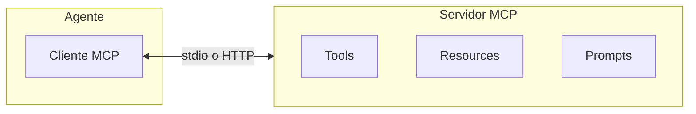

!!! warning

    El contenido de esta página no ha sido revisado ni corregido, por lo que puede
    estar incompleto, contener errores o presentar información desactualizada. Además,
    es posible que esté desordenado, carezca de una estructura clara o incluya notas
    copiadas directamente.

Este capítulo presenta el **_Model Context Protocol_** (MCP), un protocolo abierto que
estandariza cómo un agente accede a herramientas y a datos externos. Se describe su
arquitectura, se construye un servidor con FastMCP, se prueba sin procesos ni red y se
integra en un agente de LangChain. Cierra con las consecuencias que tiene sobre la
ventana de contexto y sobre la seguridad. Presupone el capítulo de
[LangChain](section_3_langchain.md), en particular las herramientas.

## Bibliografía

- Model Context Protocol. (s.f.). _Model Context Protocol_.
  <https://modelcontextprotocol.io/>
- LangChain. (s.f.). _LangChain documentation_. <https://docs.langchain.com/>

## Arquitectura

Sin un estándar, cada herramienta se programa dentro de la aplicación que la usa y no se
puede reutilizar en otra. MCP separa ambos lados mediante una arquitectura cliente
servidor. El **cliente MCP** vive dentro del agente y se conecta a uno o varios
**servidores MCP**, que publican tres tipos de elementos.

| Elemento    | Qué ofrece                                                                   | Quién lo decide |
| :---------- | :--------------------------------------------------------------------------- | :-------------- |
| _Tools_     | Funciones que el modelo puede invocar, con nombre, descripción y argumentos. | El modelo       |
| _Resources_ | Datos que el cliente puede leer, identificados por una URI.                  | La aplicación   |
| _Prompts_   | Plantillas de instrucciones reutilizables.                                   | El usuario      |



La comunicación puede realizarse por la entrada y salida estándar (_stdio_), cuando el
servidor es un proceso local que lanza el propio cliente, o por HTTP, cuando el servidor
es un servicio remoto. La especificación de los transportes se mantiene en la
documentación oficial del protocolo. Un servidor MCP resulta especialmente útil cuando
los datos cambian con frecuencia, porque el agente consulta en cada momento la fuente
real mediante la API en lugar de trabajar con copias que envejecen.

## Servidor con FastMCP

**FastMCP** es una biblioteca de Python que convierte funciones en elementos de un
servidor MCP mediante decoradores. El nombre, la descripción y los argumentos de cada
herramienta se infieren de la firma y del _docstring_, por lo que valen las mismas
recomendaciones de documentación que para una herramienta de LangChain.

```bash linenums="1"
uv add fastmcp
```

```python linenums="1" title="servidor_mcp.py"
from pathlib import Path

from fastmcp import FastMCP

RUTA_README = Path(__file__).parent / "README.md"

mcp = FastMCP("servidor_de_ejemplo")


@mcp.tool()
def suma(valor_1: int, valor_2: int) -> int:
    """Suma dos números enteros.

    Args:
        valor_1: Primer sumando.
        valor_2: Segundo sumando.

    Returns:
        La suma de ambos valores.
    """
    return valor_1 + valor_2


@mcp.resource("resource://readme", mime_type="text/markdown")
def informacion() -> str:
    """Devuelve el contenido del README del proyecto."""
    return RUTA_README.read_text(encoding="utf-8")


@mcp.prompt()
def experto_en_sumas() -> str:
    """Prompt de sistema para un experto en sumas."""
    return "Eres un experto en matemáticas especializado en sumar dos valores."


def main() -> None:
    """Arranca el servidor MCP por la entrada y salida estándar."""
    mcp.run(transport="stdio")


if __name__ == "__main__":
    main()
```

El decorador `@mcp.tool()` registra una herramienta, `@mcp.resource()` un recurso con su
URI y su tipo de contenido, y `@mcp.prompt()` una plantilla. Para exponer el servidor
por HTTP basta con cambiar el transporte en `mcp.run`.

## Cliente y pruebas

FastMCP incluye un cliente que, si recibe el objeto del servidor en lugar de una
dirección, lo ejecuta **en memoria** y evita lanzar procesos o abrir puertos. Es la
forma más cómoda de probar un servidor antes de conectarlo a un agente.

```python linenums="1" title="cliente_mcp.py"
import asyncio

from fastmcp import Client

from servidor_mcp import mcp


async def main() -> None:
    """Prueba el servidor en memoria, sin procesos ni red."""
    async with Client(mcp) as cliente:
        herramientas = await cliente.list_tools()
        print("Herramientas:", [h.name for h in herramientas])

        resultado = await cliente.call_tool("suma", {"valor_1": 2, "valor_2": 3})
        print("suma(2, 3) =", resultado.data)

        recursos = await cliente.list_resources()
        print("Recursos:", [str(r.uri) for r in recursos])

        prompts = await cliente.list_prompts()
        print("Prompts:", [p.name for p in prompts])


if __name__ == "__main__":
    asyncio.run(main())
```

```plaintext title="Expected output"
Herramientas: ['suma']
suma(2, 3) = 5
Recursos: ['resource://readme']
Prompts: ['experto_en_sumas']
```

## Integración en un agente

Las herramientas de un servidor MCP no son directamente herramientas de LangChain, por
lo que se envuelven en una `StructuredTool` que reutiliza el nombre, la descripción y el
esquema de argumentos publicados por el servidor y delega la ejecución en el cliente. Al
ser la llamada asíncrona, el agente se invoca con `ainvoke`.

```python linenums="1" title="agente_mcp.py"
import asyncio

from fastmcp import Client
from langchain.agents import create_agent
from langchain.messages import HumanMessage
from langchain_core.tools import BaseTool, StructuredTool

from modelos import crear_modelo
from servidor_mcp import mcp


def convertir_herramienta(cliente: Client, herramienta_mcp) -> BaseTool:
    """Envuelve una herramienta MCP en una herramienta de LangChain.

    Args:
        cliente: Cliente MCP ya conectado.
        herramienta_mcp: Definición devuelta por `cliente.list_tools()`.

    Returns:
        Herramienta de LangChain que llama a la herramienta MCP.
    """

    async def llamar(**argumentos) -> str:
        resultado = await cliente.call_tool(herramienta_mcp.name, argumentos)
        # Algunos servidores de modelos exigen que el contenido sea un `str`
        return "".join(b.text for b in resultado.content if hasattr(b, "text"))

    return StructuredTool.from_function(
        coroutine=llamar,
        name=herramienta_mcp.name,
        description=herramienta_mcp.description or herramienta_mcp.name,
        args_schema=herramienta_mcp.input_schema,
    )


async def main() -> None:
    """Usa las herramientas de un servidor MCP desde un agente."""
    async with Client(mcp) as cliente:
        herramientas = [
            convertir_herramienta(cliente, herramienta)
            for herramienta in await cliente.list_tools()
        ]

        agente = create_agent(model=crear_modelo(), tools=herramientas)

        respuesta = await agente.ainvoke(
            {"messages": [HumanMessage("¿Cuánto es 2 + 3? Usa las herramientas.")]}
        )
        print(respuesta["messages"][-1].content)


if __name__ == "__main__":
    asyncio.run(main())
```

## Servidores remotos y filtrado

Cuando el servidor es un servicio remoto, el cliente recibe su dirección HTTP en lugar
del objeto del servidor, y el resto del código no cambia. Un servidor de terceros puede
publicar herramientas que no interesa que el modelo utilice, y la forma de impedirlo es
filtrar la lista antes de entregarla al agente: el modelo no puede usar lo que ignora
que existe. Además, el envoltorio debe convertir los errores de la herramienta en texto,
para que el modelo los lea y pueda reaccionar en lugar de abortar la ejecución.

```python linenums="1"
from fastmcp import Client
from fastmcp.exceptions import ToolError
from langchain_core.tools import BaseTool, StructuredTool

HERRAMIENTAS_PERMITIDAS: set[str] = {"obtener_cotizacion", "buscar_valor"}


def convertir_herramienta(cliente: Client, herramienta_mcp) -> BaseTool:
    """Envuelve una herramienta MCP y devuelve sus errores como texto.

    Args:
        cliente: Cliente MCP ya conectado.
        herramienta_mcp: Definición devuelta por `cliente.list_tools()`.

    Returns:
        Herramienta de LangChain que llama a la herramienta MCP.
    """

    async def llamar(**argumentos) -> str:
        try:
            resultado = await cliente.call_tool(herramienta_mcp.name, argumentos)
        except ToolError as error:
            return f"Error en la herramienta {herramienta_mcp.name}: {error}."

        return "".join(b.text for b in resultado.content if hasattr(b, "text"))

    return StructuredTool.from_function(
        coroutine=llamar,
        name=herramienta_mcp.name,
        description=herramienta_mcp.description or herramienta_mcp.name,
        args_schema=herramienta_mcp.input_schema,
    )


async def listar_herramientas_permitidas(cliente: Client) -> list[BaseTool]:
    """Devuelve solo las herramientas del servidor cuyo nombre está permitido.

    Args:
        cliente: Cliente MCP ya conectado a un servidor remoto.

    Returns:
        Herramientas de LangChain filtradas por nombre.
    """
    return [
        convertir_herramienta(cliente, herramienta)
        for herramienta in await cliente.list_tools()
        if herramienta.name in HERRAMIENTAS_PERMITIDAS
    ]
```

El cliente se crea con la URL del servidor, `async with Client("https://servidor/mcp")`,
y el agente debe ejecutarse dentro de ese bloque, igual que en el ejemplo anterior,
porque las herramientas llaman a un cliente que se cierra al salir de él.

## Contexto y seguridad

Un servidor MCP no ocupa por sí mismo la ventana de contexto. Lo que consume contexto
son las **definiciones de sus herramientas**, que se envían al modelo en cada llamada
junto con los mensajes. Conectar muchos servidores con decenas de herramientas encarece
cada petición y puede confundir al modelo, por lo que conviene exponer solo las
necesarias o filtrarlas con `LLMToolSelectorMiddleware`, que utiliza un modelo para
seleccionar las relevantes antes de la llamada principal.

!!! warning

    Los resultados de un servidor MCP son datos de terceros que el modelo lee como si
    fueran texto de la conversación. Un resultado malicioso puede contener instrucciones
    dirigidas al modelo, un ataque conocido como _prompt injection_. Los servidores solo
    deben instalarse desde fuentes de confianza, con los permisos mínimos, y las
    acciones con efectos externos deben pasar por una aprobación humana como la descrita
    en el capítulo de [_middleware_](section_4_middleware.md).

???+ example "Arquitectura de un asistente de documentación"

    Un servidor MCP del repositorio de código extrae la documentación y la configuración
    de una aplicación. Un paso de filtrado conserva solo lo que describe su
    funcionamiento y su configuración, y lo almacena como una base de conocimiento en
    archivos Markdown que se actualiza con cada _release_. El agente consulta esa base
    para responder al usuario, y un _guardrail_ valida la respuesta antes de entregarla.

    ```mermaid
    flowchart LR
        G["Servidor MCP del repositorio"] --> D["Documentación y configuración"]
        D --> F["Filtrado: funcionamiento y configuración"]
        F --> K["Base de conocimiento en Markdown"]
        K --> A["Agente"]
        U["Usuario"] --> A
        A --> V["Guardrail"]
        V --> U
    ```

El siguiente capítulo presenta [DeepAgents](section_6_deepagents.md), un _framework_ que
equipa a un agente con sistema de archivos, subagentes, memoria y gestión del contexto.
