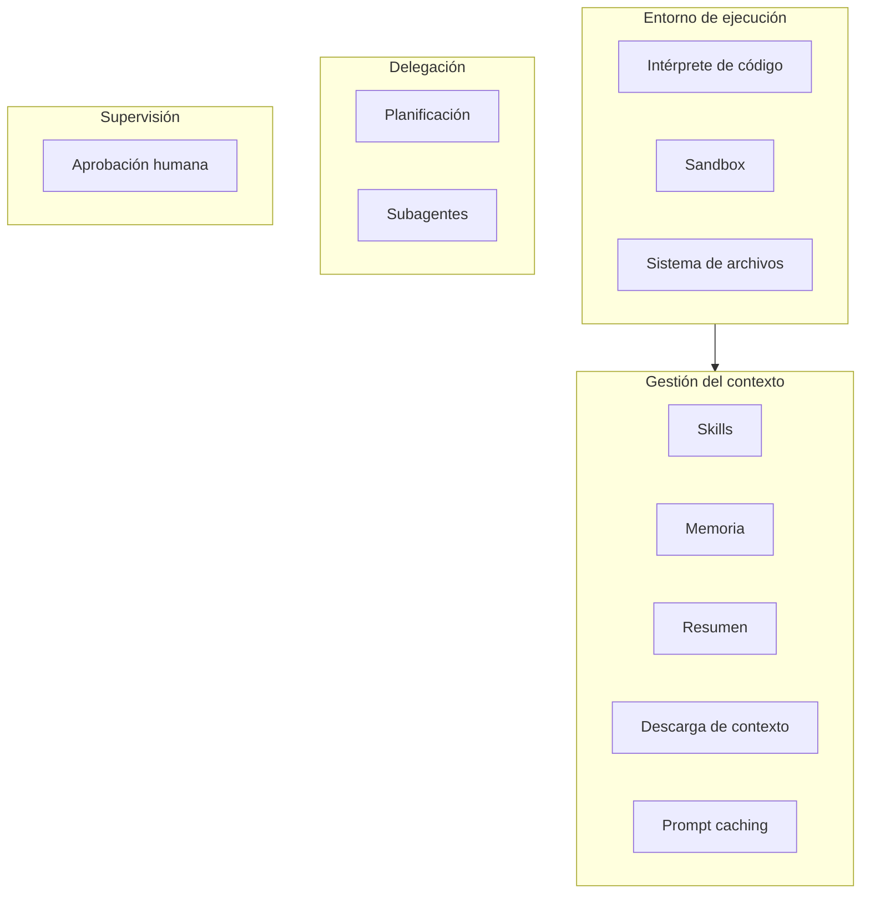
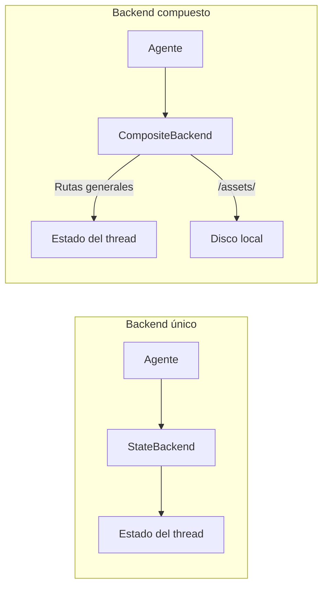
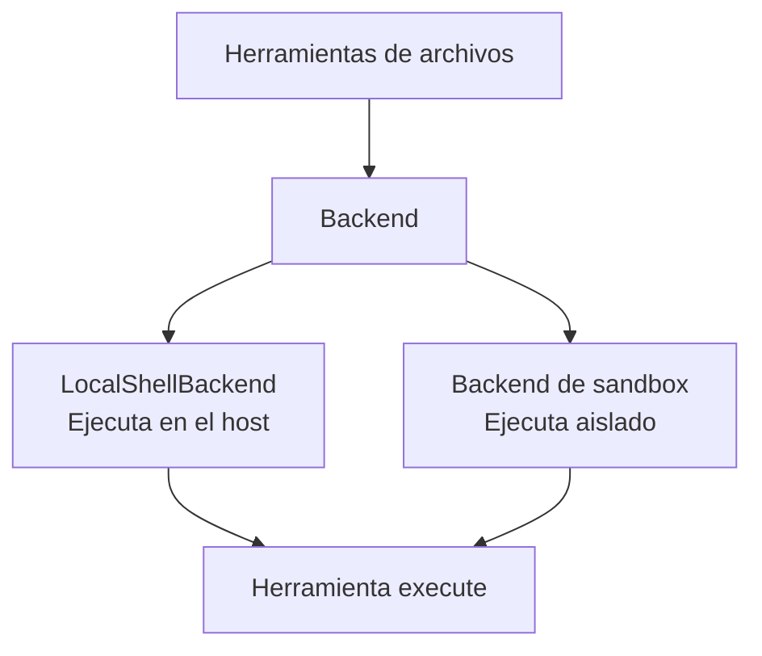
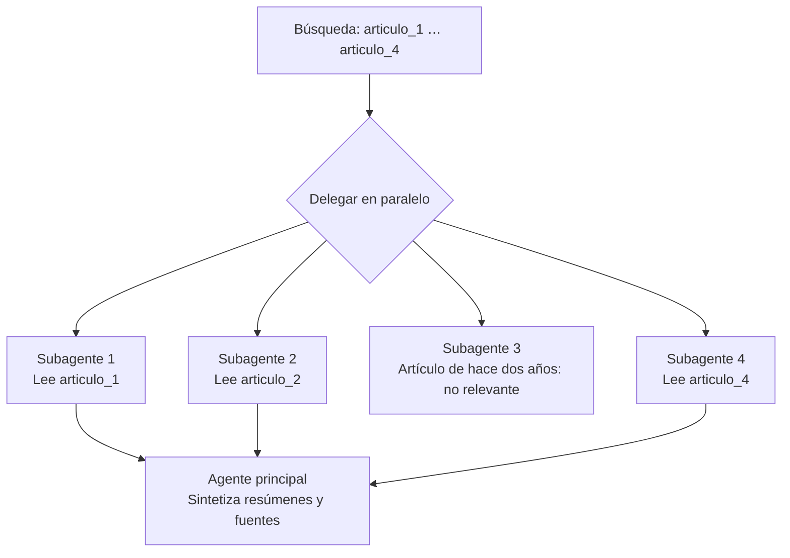
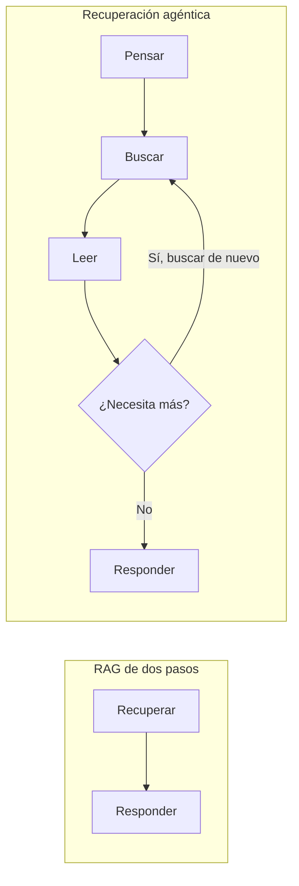

!!! warning

    El contenido de esta página no ha sido revisado ni corregido, por lo que puede
    estar incompleto, contener errores o presentar información desactualizada. Además,
    es posible que esté desordenado, carezca de una estructura clara o incluya notas
    copiadas directamente.

Este capítulo presenta **DeepAgents**, un _framework_ construido sobre LangChain y
LangGraph que proporciona a un agente todo lo que necesita para abordar tareas largas y
abiertas. Recorre el concepto de arnés, las herramientas integradas, el entorno de
ejecución y sus _backends_, los permisos sobre el sistema de archivos, la ejecución de
comandos con aislamiento, la memoria, las _skills_, las técnicas para gestionar el
contexto y las de recuperación de información. La coordinación de varios agentes y el
intérprete de código se tratan en el capítulo siguiente. Presupone los capítulos de
[LangChain](section_3_langchain.md) y de [_middleware_](section_4_middleware.md). Los
ejemplos se probaron con `deepagents==0.7.34`.

## Bibliografía

- LangChain. (s.f.). _Deep Agents documentation_. <https://docs.langchain.com/>
- Agents.md. (s.f.). _AGENTS.md_. <https://agents.md/>

## Arnés de agentes

Un **arnés** (_harness_) es el conjunto de conexiones que un modelo necesita para
trabajar como agente. Igual que un arnés de seguridad ofrece los puntos de enganche,
este aporta al modelo las _skills_, la memoria, el _system prompt_, los subagentes, el
contexto y las herramientas. Un agente útil necesita tomar acciones, conectarse a datos,
manejar contextos grandes, paralelizar tareas, aceptar la supervisión de una persona y
mejorar con el tiempo, y DeepAgents cubre cada una de esas necesidades con un mecanismo
concreto.

| Necesidad del agente      | Mecanismo en DeepAgents                                   |
| :------------------------ | :-------------------------------------------------------- |
| Tomar acciones            | Herramientas integradas y propias, y entorno de ejecución |
| Conectarse a datos        | Sistema de archivos con _backends_ intercambiables y MCP  |
| Manejar contextos grandes | Resumen, descarga de resultados al disco y _skills_       |
| Paralelizar tareas        | Subagentes y programación desde un intérprete             |
| Supervisión humana        | `interrupt_on` y permisos de tipo `interrupt`             |
| Mejorar con el tiempo     | Memoria de largo plazo en archivos                        |

La anatomía completa del arnés se agrupa en cuatro bloques. El **entorno de ejecución**
reúne el intérprete de código, el _sandbox_ y el sistema de archivos. La **gestión del
contexto** se apoya sobre ese entorno con las _skills_, la memoria, el resumen, la
descarga de contexto y el _prompt caching_. La **delegación** aporta la planificación y
los subagentes. La **supervisión** (_steering_) corresponde a la aprobación humana.



`create_deep_agent` devuelve el mismo tipo de objeto que `create_agent`, de modo que
conserva `invoke`, `stream`, el _checkpointer_ y los _threads_ de conversación. El
ejemplo mínimo solo necesita un modelo.

```python linenums="1"
from deepagents import create_deep_agent
from langchain.messages import HumanMessage

from modelos import crear_modelo

agente = create_deep_agent(model=crear_modelo())

respuesta = agente.invoke({"messages": [HumanMessage("¿Cuál es la capital de España?")]})
print(respuesta["messages"][-1].content)
```

Conviene indicar siempre el modelo de forma explícita, ya que depender del modelo por
defecto está desaconsejado. El _system prompt_ se pasa en `system_prompt` y funciona
como en LangChain. Sin él, el modelo se comporta según su configuración por defecto, de
forma genérica, sin una persona definida ni un alcance y unas limitaciones concretos.

## Herramientas integradas

Sin configuración adicional, un agente de DeepAgents dispone de herramientas para el
sistema de archivos y para delegar tareas. El parámetro `tools` es **aditivo**: las
herramientas propias se suman a las integradas y no las sustituyen.

| Herramienta                            | Función                                                                   |
| :------------------------------------- | :------------------------------------------------------------------------ |
| `ls`, `glob`, `grep`                   | Listan archivos, los buscan por patrón y buscan texto en ellos.           |
| `read_file`, `write_file`, `edit_file` | Leen, crean y modifican archivos.                                         |
| `delete`                               | Elimina archivos.                                                         |
| `task`                                 | Delega un trabajo en un subagente.                                        |
| `execute`                              | Ejecuta comandos de _shell_. Solo existe con un _backend_ que lo soporte. |
| `write_todos`                          | Mantiene una lista de tareas. Solo existe con `TodoListMiddleware`.       |

## Entorno de ejecución y _backends_

Un agente trabaja dentro de un **entorno**. El sistema de archivos está siempre presente
y sirve para leer y escribir. Una _shell_ para ejecutar comandos y un intérprete para
ejecutar código dentro del bucle del agente son opcionales. Lo que hace configurable ese
entorno es el **_backend_**, la capa a la que las herramientas de archivos delegan cada
operación.

| _Backend_           | Dónde se guardan los archivos                                           |
| :------------------ | :---------------------------------------------------------------------- |
| `StateBackend`      | En el estado del _thread_ actual, por defecto y no persistente.         |
| `FilesystemBackend` | En un directorio del disco local.                                       |
| `StoreBackend`      | En un almacén de LangGraph, persistente y compartido entre _threads_.   |
| `CompositeBackend`  | En varios _backends_, según el prefijo de la ruta.                      |
| `ContextHubBackend` | En un repositorio de agente de LangSmith Hub, persistente y compartido. |
| _Backend_ propio    | En un servicio como S3 o GitHub, implementando el protocolo.            |

Con un único _backend_, todas las rutas van al mismo destino. Con un `CompositeBackend`,
un _backend_ por defecto atiende las rutas generales y cada prefijo registrado se
redirige a otro.



La diferencia es práctica. Con el _backend_ por defecto, si un agente escribe un
documento en el _thread_ A y después se abre el _thread_ B para leerlo, el archivo no se
encuentra, porque vive en el estado del _thread_ A y ese estado no es persistente. Para
conservar archivos entre conversaciones se enruta una ruta concreta hacia un _backend_
persistente. El parámetro `virtual_mode=True` de `FilesystemBackend` expone el
directorio indicado como la raíz `/` del agente e impide salir de él.

### Permisos

Las reglas `FilesystemPermission` restringen qué operaciones puede hacer el agente sobre
qué rutas. Cada regla indica las operaciones, los patrones de ruta y un modo que puede
ser `allow` (por defecto), `deny` o `interrupt`, que pausa la llamada hasta que una
persona la apruebe. Las reglas se evalúan **en orden y la primera coincidencia gana**,
de modo que las reglas más específicas deben preceder a las más generales. En el
ejemplo, el agente puede escribir en `/assets/` y en ninguna otra ruta, y lo hace con la
ayuda de un _backend_ compuesto que guarda esa carpeta en el disco.

```python linenums="1"
from pathlib import Path

from deepagents import FilesystemPermission, create_deep_agent
from deepagents.backends import CompositeBackend, FilesystemBackend, StateBackend
from langchain.messages import HumanMessage
from langgraph.checkpoint.memory import InMemorySaver

from modelos import crear_modelo

DIRECTORIO_ASSETS = Path("assets")
DIRECTORIO_ASSETS.mkdir(exist_ok=True)

agente = create_deep_agent(
    model=crear_modelo(),
    checkpointer=InMemorySaver(),
    backend=CompositeBackend(
        default=StateBackend(),
        routes={
            "/assets/": FilesystemBackend(
                root_dir=str(DIRECTORIO_ASSETS), virtual_mode=True
            )
        },
    ),
    permissions=[
        FilesystemPermission(operations=["write"], paths=["/assets/**"], mode="allow"),
        FilesystemPermission(operations=["write"], paths=["/**"], mode="deny"),
    ],
)

peticion = (
    "Escribe un archivo en Markdown que describa el interés compuesto en la carpeta "
    "de assets, con el nombre 'interes_compuesto.md'."
)
respuesta = agente.invoke(
    {"messages": [HumanMessage(peticion)]},
    config={"configurable": {"thread_id": "1"}},
)
print(respuesta["messages"][-1].content)
```

Si se invirtiera el orden de las dos reglas, la denegación general se evaluaría primero
y ninguna escritura sería posible, tal como se comprobó al ejecutar ambas variantes. Los
permisos se aplican a las herramientas de archivos integradas, no a lo que un comando de
_shell_ pueda hacer sobre el disco, de modo que no sustituyen al aislamiento descrito en
la sección siguiente. Los subagentes heredan las reglas del agente principal salvo que
definan las suyas.

## Comandos de _shell_ y aislamiento

Para que un agente compile o ejecute programas necesita la herramienta `execute`, que
aparece cuando el _backend_ implementa la capacidad de ejecutar comandos. El
`LocalShellBackend` es el más sencillo, ya que ejecuta los comandos directamente en la
máquina que corre el agente.

```python linenums="1"
from pathlib import Path

from deepagents import create_deep_agent
from deepagents.backends.local_shell import LocalShellBackend
from langchain.messages import HumanMessage

from modelos import crear_modelo

DIRECTORIO_TRABAJO = Path("assets")
DIRECTORIO_TRABAJO.mkdir(exist_ok=True)

agente = create_deep_agent(
    model=crear_modelo(),
    backend=LocalShellBackend(root_dir=DIRECTORIO_TRABAJO, virtual_mode=True),
    system_prompt="Eres un programador de C. El compilador gcc está instalado.",
)

peticion = "Crea un programa 'Hola mundo' en C, compílalo y ejecútalo."
respuesta = agente.invoke({"messages": [HumanMessage(peticion)]})
print(respuesta["messages"][-1].content)
```

!!! danger

    Con `LocalShellBackend` los comandos se ejecutan con los permisos del _host_ y
    pueden acceder a cualquier ruta, aunque las herramientas de archivos estén
    confinadas por `virtual_mode`. Un modelo equivocado o manipulado podría borrar datos
    o filtrar secretos, por lo que este _backend_ no es viable en producción.

La alternativa es un **_sandbox_**, un entorno aislado que puede ser un contenedor, una
máquina virtual o un servicio remoto. Existen dos disposiciones. En la primera, el
propio agente se ejecuta dentro del _sandbox_, y por tanto la llamada a la API del
modelo sale desde allí. En la segunda, el agente permanece fuera y el _sandbox_ se usa
como una herramienta, de modo que solo el comando se ejecuta aislado.



Cuando el agente trabaja dentro de un _sandbox_, este no debe llamar directamente a las
API con las credenciales. Un **_proxy_ de autenticación** en el _host_ recibe la
petición, inyecta los secretos y la reenvía, con lo que las claves nunca residen dentro
del entorno aislado. Además, los recursos del _sandbox_ deben liberarse siempre al
terminar de usarlo, porque un contenedor olvidado sigue consumiendo cómputo.

## Memoria

DeepAgents distingue dos tipos de memoria. La de **corto plazo** es el histórico de
mensajes de un único _thread_, que gestiona automáticamente el _checkpointer_, no
persiste por sí misma y no se comparte entre _threads_, tal como se describió en el
capítulo de LangChain. La de **largo plazo** es lo que el agente aprende y debe llevar
de una conversación a otra, como las preferencias del usuario o las convenciones del
proyecto. Es persistente y se guarda en el sistema de archivos.

En DeepAgents la memoria de largo plazo es **texto plano en el sistema de archivos del
agente**, escrito normalmente en Markdown en un archivo `AGENTS.md`, siguiendo la
convención del mismo nombre. El parámetro `memory` recibe las rutas de esos archivos y
activa un _middleware_ que los carga siempre en el _prompt_. Las rutas son relativas a
las del _backend_, de modo que se combina con un `CompositeBackend` en el que las rutas
normales van al _backend_ por defecto y una ruta concreta, como `/memory/`, se almacena
de forma persistente.

```python linenums="1"
from pathlib import Path

from deepagents import create_deep_agent
from deepagents.backends import CompositeBackend, FilesystemBackend, StateBackend
from langchain.messages import HumanMessage

from modelos import crear_modelo

DIRECTORIO_MEMORIA = Path("memory")
DIRECTORIO_MEMORIA.mkdir(exist_ok=True)

archivo_memoria = DIRECTORIO_MEMORIA / "AGENTS.md"
if not archivo_memoria.exists():
    archivo_memoria.write_text(
        "# Guía del proyecto\n\n"
        "- Todas las funciones llevan anotaciones de tipo.\n"
        "- Se usa `pathlib.Path` para las rutas, no `os.path`.\n",
        encoding="utf-8",
    )

agente = create_deep_agent(
    model=crear_modelo(),
    system_prompt="Eres un asistente de código especializado en Python.",
    backend=CompositeBackend(
        default=StateBackend(),
        routes={
            "/memory/": FilesystemBackend(
                root_dir=DIRECTORIO_MEMORIA, virtual_mode=True
            )
        },
    ),
    memory=["/memory/AGENTS.md"],
)

peticion = "El equipo ha cambiado a ruff para el linting. Actualiza la memoria."
agente.invoke({"messages": [HumanMessage(peticion)]})
print(archivo_memoria.read_text(encoding="utf-8"))
```

El agente actualiza la memoria editando el archivo con sus herramientas, y como este
vive en el disco el cambio persiste entre ejecuciones. Para aislar la memoria por
usuario se usa un `StoreBackend` respaldado por un almacén de LangGraph, cuyo espacio de
nombres (_namespace_) se calcula a partir del contexto de la ejecución. El agente solo
ve los archivos del usuario que figura en el contexto, que se pasa en cada `invoke`.

```python linenums="1"
from dataclasses import dataclass

from deepagents import create_deep_agent
from deepagents.backends import CompositeBackend, StateBackend, StoreBackend
from langgraph.checkpoint.memory import InMemorySaver
from langgraph.store.memory import InMemoryStore

from modelos import crear_modelo


@dataclass
class Contexto:
    """Contexto de ejecución con el identificador del usuario."""

    user_id: str


agente = create_deep_agent(
    model=crear_modelo(),
    checkpointer=InMemorySaver(),
    store=InMemoryStore(),
    context_schema=Contexto,
    backend=CompositeBackend(
        default=StateBackend(),
        routes={
            "/memories/": StoreBackend(
                namespace=lambda runtime: ("memory", runtime.context.user_id)
            )
        },
    ),
    memory=["/memories/AGENTS.md"],
)

# Cada invocación aporta el usuario cuyo espacio de memoria se lee y se escribe
# agente.invoke({...}, config={...}, context=Contexto(user_id="ana"))
```

!!! warning

    Ni `InMemorySaver` ni `InMemoryStore` son persistentes, porque guardan los datos en
    estructuras de Python dentro de la memoria RAM del proceso. Sirven para desarrollo
    local y pruebas, pero en producción deben sustituirse por implementaciones
    respaldadas por una base de datos.

## _Skills_

Una **_skill_** es una carpeta con un archivo `SKILL.md` y, de forma opcional, material
de referencia, que enseña al agente a realizar una tarea concreta. La carga es
**progresiva** (_progressive disclosure_): al iniciar, el agente solo recibe el nombre y
la descripción de cada _skill_, lo justo para saber que existe y cuándo usarla, y lee el
contenido completo únicamente cuando la tarea lo requiere. De este modo se pueden tener
muchas _skills_ sin saturar el contexto.

```plaintext linenums="1"
skills/
└── estandares-python/
    ├── SKILL.md
    └── references/
        └── estandares-completos.md
```

```plaintext linenums="1" title="skills/estandares-python/SKILL.md"
---
name: estandares-python
description:
    Estándares de código Python del proyecto. Úsala al escribir o revisar código.
---

# Estándares de Python

- Anotaciones de tipo obligatorias en todas las firmas.
- Docstrings con el formato de Google.

El detalle completo está en `references/estandares-completos.md`.
```

Las _skills_ se registran con el parámetro `skills`, que recibe la ruta de la carpeta
dentro del _backend_.

```python linenums="1"
from pathlib import Path

from deepagents import create_deep_agent
from deepagents.backends import FilesystemBackend

from modelos import crear_modelo

agente = create_deep_agent(
    model=crear_modelo(),
    backend=FilesystemBackend(root_dir=Path("."), virtual_mode=True),
    skills=["/skills"],
)
```

## Gestión del contexto

Cada agente tiene una ventana de contexto limitada, y las tareas largas la desbordan si
no se evita que entre información innecesaria. **Ingeniería de contexto** (_context
engineering_) es el conjunto de técnicas para mejorar el contexto del modelo una vez que
este ha adquirido el conocimiento, mientras que la **recuperación** (_retrieval_) se
ocupa de traer la información adecuada. DeepAgents aplica varias estrategias a la vez.

1. **Resumen**: Los mensajes antiguos se sustituyen por un resumen. El umbral por
   defecto se sitúa en torno al 85 % de la ventana del modelo, y cuando se supera se
   resumen los mensajes anteriores a los más recientes antes de la siguiente petición,
   que queda encolada mientras tanto. El historial original se guarda en
   `/conversation_history/`.
2. **Descarga de contexto**: Los resultados grandes de las herramientas se escriben en
   el sistema de archivos, en `/large_tool_results/id_de_la_llamada`, y el contexto
   recibe solo un puntero compacto. Lo mismo ocurre con un mensaje del usuario muy
   extenso, como un documento pegado, que se guarda en `/conversation_history/`. Un
   _middleware_ intercepta la entrada antes de que llegue al contexto cuando su
   contenido es muy grande.
3. **_Skills_**: Cargan la información solo cuando hace falta, según se vio en la
   sección anterior.
4. **Memoria**: Mantiene lo que debe persistir entre conversaciones, sin repetirlo en el
   historial.
5. **_Prompt caching_**: Reduce el coste de repetir el prefijo del _prompt_, aunque
   depende del modelo utilizado.

Qué parte de esa información entra en el contexto, y cómo se encuentra, es el problema
de la recuperación, que se trata en la sección siguiente.

## Recuperación de información

La **recuperación** (_retrieval_) consiste en traer al contexto la información adecuada
y solo esa. Un agente que trabaja sobre muchos archivos o sobre resultados voluminosos
se enfrenta a tres problemas distintos, y cada uno tiene su propia solución.

| Problema                        | Síntoma                                       | Solución                                                       |
| :------------------------------ | :-------------------------------------------- | :------------------------------------------------------------- |
| Búsqueda ineficiente            | Se leen archivos enteros que no hacían falta. | Explorar primero con `glob` y `grep`, y leer solo lo que casa. |
| Demasiado contexto de una vez   | Un único resultado llena la ventana.          | Leer por rangos y descargar los resultados grandes al disco.   |
| Contexto irrelevante u obsoleto | Se mezclan fuentes que no vienen al caso.     | Delegar la lectura en subagentes y sintetizar sus resúmenes.   |

### Búsqueda ineficiente

La estrategia más costosa consiste en listar el directorio y leer todos los archivos
antes de responder. La alternativa es **explorar primero**: `glob` localiza archivos por
nombre, `grep` busca texto dentro de ellos y `read_file` lee únicamente lo que ha
coincidido. Dos agentes sobre la misma carpeta de notas ilustran la diferencia. El
primero abre todo porque el _prompt_ le prohíbe buscar, y el segundo usa las
herramientas por defecto. La métrica relevante es el **contexto máximo**, el mayor
número de _tokens_ de entrada que se envía al modelo en una sola llamada.

```python linenums="1"
from langchain.messages import AIMessage


def contexto_maximo(resultado: dict) -> int:
    """Devuelve el mayor número de tokens de entrada enviado al modelo.

    Args:
        resultado: Diccionario devuelto por `invoke`, con la clave `messages`.

    Returns:
        Tokens de entrada de la llamada con más contexto, o 0 si no hay metadatos.
    """
    return max(
        (
            mensaje.usage_metadata["input_tokens"]
            for mensaje in resultado["messages"]
            if isinstance(mensaje, AIMessage) and mensaje.usage_metadata
        ),
        default=0,
    )
```

```python linenums="1"
from pathlib import Path

from deepagents import create_deep_agent
from deepagents.backends import FilesystemBackend

from modelos import crear_modelo

PREGUNTA = "¿Qué se decidió sobre el presupuesto en las notas de /notes/?"

backend = FilesystemBackend(root_dir=Path("datos"), virtual_mode=True)

agente_abre_todo = create_deep_agent(
    model=crear_modelo(),
    backend=backend,
    system_prompt=(
        "No uses glob ni grep. Lista /notes/ con ls y lee cada archivo con "
        "read_file antes de responder."
    ),
)
agente_explora = create_deep_agent(model=crear_modelo(), backend=backend)

for agente in (agente_abre_todo, agente_explora):
    resultado = agente.invoke({"messages": [{"role": "user", "content": PREGUNTA}]})
    print(f"Contexto máximo: {contexto_maximo(resultado):,} tokens")
```

El contexto máximo del primer agente crece con el número de notas, mientras que el del
segundo apenas varía porque solo lee los archivos que contienen la palabra buscada.

### Demasiado contexto de una vez

Aunque la búsqueda sea eficiente, un único archivo o resultado puede ser enorme, como
una exportación de 40 000 filas. `read_file` admite un **desplazamiento** (_offset_) y
un **límite** (_limit_), de modo que el agente lee la región que le interesa,
normalmente la que señala un `grep`, en lugar del archivo completo. Cuando una
herramienta devuelve muchos resultados, existen dos patrones. La herramienta puede
guardar cada resultado como un archivo, por ejemplo en `/retrieved/`, y devolver solo
las rutas, que el agente lee después a demanda. Si no lo hace, el arnés descarga el
resultado grande a `/large_tool_results/id_de_la_llamada` y deja en el contexto la ruta
y una vista previa, que se amplía con lecturas por `offset` y `limit`, como se describió
al tratar la descarga de contexto.

### Contexto irrelevante u obsoleto

El tercer problema no es de tamaño sino de calidad. Entre los resultados de una búsqueda
puede haber un artículo de hace dos años, ya superado, que contamine la respuesta si se
lee en el contexto principal. La solución es delegar: el agente principal lanza **en
paralelo** un subagente por archivo, cada uno lee el suyo, descarta lo que no es
relevante o está obsoleto y devuelve un resumen con su fuente. El principal solo
sintetiza esos resúmenes, con lo que su ventana contiene lo mínimo y trazable.



### Búsqueda exacta y búsqueda semántica

`grep` encuentra coincidencias **exactas** de palabras clave. Si la consulta es
«financiación de la empresa A», casa con una nota que contiene esas palabras y no con
otra que diga «la empresa A cierra una serie B de 50 millones», aunque trate del mismo
hecho. Funciona muy bien con términos concretos, pero obliga a probar sinónimos cuando
no se conoce la redacción exacta.

La **búsqueda semántica** compara por significado. Un modelo de _embeddings_ convierte
la consulta y cada fragmento en vectores, y los fragmentos se ordenan por su **similitud
del coseno** con la consulta, siendo $\mathbf{a}$ el vector de la consulta y
$\mathbf{b}$ el de un fragmento:

$$
\cos(\theta) = \frac{\mathbf{a} \cdot \mathbf{b}}{\Vert \mathbf{a} \Vert \, \Vert \mathbf{b} \Vert}
$$

El ejemplo siguiente usa `fastembed`, una biblioteca de _embeddings_ que ejecuta un
modelo pequeño en local, sobre cinco anuncios de alquiler. Se busca «pet-friendly 1BR»
con las dos técnicas.

```bash linenums="1"
uv add fastembed numpy
```

```python linenums="1"
import numpy as np
from fastembed import TextEmbedding

PARRAFOS: dict[str, str] = {
    "alder-avenue.md": "This 1BR is pet-friendly, with a small yard out back.",
    "birch-lane.md": "Small dogs and cats are welcome in this 1BR loft, and there's a dog run.",
    "cedar-court.md": "Bring your furry friend: this 1BR building has a grooming station.",
    "dover-street.md": "No animals allowed in this quiet 1BR near the university.",
    "elm-street.md": "Sunny kitchen with new appliances and a view of the park.",
}
CONSULTA: str = "pet-friendly 1BR"


def similitud_coseno(consulta: np.ndarray, matriz: np.ndarray) -> np.ndarray:
    """Calcula la similitud del coseno entre un vector y cada fila de una matriz.

    Args:
        consulta: Vector de la consulta, de forma `(d,)`.
        matriz: Vectores de los fragmentos, de forma `(n, d)`.

    Returns:
        Similitudes de cada fragmento con la consulta, de forma `(n,)`.
    """
    normas = np.linalg.norm(matriz, axis=1) * np.linalg.norm(consulta)
    return matriz @ consulta / normas


# Búsqueda exacta: solo coincide el texto que contiene la palabra clave
coinciden = [archivo for archivo, texto in PARRAFOS.items() if "pet-friendly" in texto]
print("grep:", coinciden)

# Búsqueda semántica con un modelo de embeddings pequeño que se ejecuta en local
modelo = TextEmbedding("BAAI/bge-small-en-v1.5")
vectores = np.array(list(modelo.embed(list(PARRAFOS.values()))))
vector_consulta = np.array(list(modelo.embed([CONSULTA])))[0]

similitudes = similitud_coseno(vector_consulta, vectores)
for indice in np.argsort(similitudes)[::-1]:
    print(f"{similitudes[indice]:.3f} {list(PARRAFOS)[indice]}")
```

```plaintext title="Expected output"
grep: ['alder-avenue.md']
0.884 alder-avenue.md
0.754 cedar-court.md
0.748 birch-lane.md
0.646 dover-street.md
0.604 elm-street.md
```

`grep` solo encuentra un anuncio, mientras que la búsqueda semántica sitúa en cabeza los
tres que hablan de mascotas con palabras distintas, como «perros y gatos» o «amigo
peludo». El resultado también enseña dos límites. La similitud mide cercanía temática y
no verdad lógica, de modo que el anuncio que prohíbe los animales queda en cuarto lugar
con una puntuación alta, y solo el texto completo permite descartarlo. Además, como en
la mayoría de los almacenes vectoriales, cada fragmento conserva únicamente el texto del
párrafo, y el título y la fecha viajan como metadatos que el modelo nunca ve. Si la
fecha importa para descartar anuncios obsoletos, hay que incluirla en el texto que se
devuelve al agente.

### Recuperación en dos pasos y recuperación agéntica

El esquema clásico de **RAG** (_Retrieval-Augmented Generation_) de dos pasos recupera
los fragmentos más similares a la pregunta y se los entrega al modelo para que responda.
La **recuperación agéntica** convierte la búsqueda en un bucle que el propio agente
controla. Piensa qué necesita, busca, lee y decide si le falta información, en cuyo caso
vuelve a buscar con lo aprendido, por ejemplo al encontrar un producto nuevo de una
empresa y buscar después su precio.



### Técnicas disponibles

La recuperación no es una técnica única sino un conjunto que se combina con la
ingeniería de contexto. Por un lado están las formas de **traer** información: RAG con
búsqueda vectorial, búsqueda en el sistema de archivos con `ls`, `glob`, `grep` y
`read_file`, _skills_ que se cargan bajo demanda y subagentes que actúan como
recuperadores. Por otro lado están las formas de **dar forma** al contexto una vez
traído: descarga al disco, resumen, subagentes que aíslan el trabajo y memoria de largo
plazo. Un buen diseño elige de cada grupo lo que su problema necesita. Cuando los datos
cambian con frecuencia, la fuente debe ser una API o un servidor MCP en tiempo real,
como el descrito en el [capítulo de MCP](section_5_mcp.md), porque de lo contrario el
agente trabajaría con copias antiguas.

## Aprobación humana

DeepAgents reutiliza el `HumanInTheLoopMiddleware` del capítulo anterior mediante el
parámetro `interrupt_on`, y admite los mismos tipos de decisión, `approve`, `edit`,
`reject` y `respond`. Los permisos de archivos con modo `interrupt` instalan además ese
_middleware_ de forma automática.

```python linenums="1"
from deepagents import create_deep_agent
from langgraph.checkpoint.memory import InMemorySaver

from modelos import crear_modelo

agente = create_deep_agent(
    model=crear_modelo(),
    checkpointer=InMemorySaver(),
    # Pausa antes de cada edición para que una persona la revise
    interrupt_on={"edit_file": True},
)
```

El siguiente capítulo describe cómo [coordinar varios agentes](section_7_subagents.md) y
cómo programar flujos de trabajo desde un intérprete de código.
