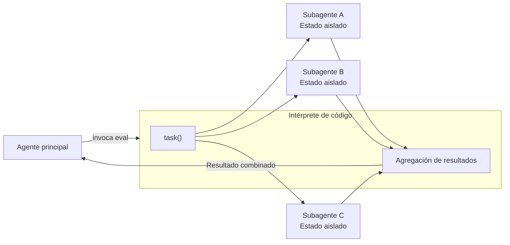

!!! warning

    El contenido de esta página no ha sido revisado ni corregido, por lo que puede
    estar incompleto, contener errores o presentar información desactualizada. Además,
    es posible que esté desordenado, carezca de una estructura clara o incluya notas
    copiadas directamente.

Este capítulo describe las dos herramientas de coordinación que ofrece DeepAgents para
trabajar con varios agentes, la planificación y los subagentes, y el intérprete de
código que permite programar esa coordinación. Se explica la diferencia entre subagentes
síncronos y asíncronos, la anatomía de un subagente, la llamada programática a
herramientas y los subagentes dinámicos orquestados con código. Presupone el capítulo de
[DeepAgents](section_6_deepagents.md). Los ejemplos se probaron con `deepagents==0.7.34`
y `langchain-quickjs==0.3.12`.

## Bibliografía

- LangChain. (s.f.). _Deep Agents documentation_. <https://docs.langchain.com/>

## Planificación

La **planificación** es opcional y funciona como una lista de tareas (_to-do list_) que
el agente construye y actualiza mientras trabaja, lo que le ayuda a no perder el hilo en
trabajos largos. Se activa con el _middleware_ `TodoListMiddleware`, que añade la
herramienta `write_todos`.

```python linenums="1"
from deepagents import create_deep_agent
from langchain.agents.middleware import TodoListMiddleware

from modelos import crear_modelo

agente = create_deep_agent(model=crear_modelo(), middleware=[TodoListMiddleware()])
```

## Subagentes

Un **subagente** es un agente al que el principal delega una tarea. Desde el punto de
vista del agente principal, cada subagente se ejecuta como una herramienta, la llamada
`task`, y el principal agrupa el trabajo de todos ellos. Los subagentes reciben una
tarea específica y no el contexto completo del principal, de modo que trabajan con un
contexto limpio, y devuelven un único mensaje con el resultado. Cada subagente tiene
además sus propias herramientas. Este aislamiento es la principal ventaja de la
delegación, porque los pasos intermedios del subagente no inflan el contexto del
principal.

La definición de un subagente, su **anatomía**, consta de los campos siguientes.

| Campo           | Función                                                                     |
| :-------------- | :-------------------------------------------------------------------------- |
| `name`          | Nombre del subagente, con el que el principal lo invoca mediante `task`.    |
| `description`   | Texto que el principal lee para decidir cuándo delegar en él.               |
| `system_prompt` | Instrucciones del subagente.                                                |
| `tools`         | Herramientas de las que dispone.                                            |
| `model`         | Modelo que utiliza, que puede diferir del principal.                        |
| `permissions`   | Reglas de acceso al sistema de archivos que sustituyen a las del principal. |

```python linenums="1"
from deepagents import create_deep_agent
from langchain.messages import HumanMessage
from langchain.tools import tool

from modelos import crear_modelo

modelo = crear_modelo()


@tool
def raiz_cuadrada(valor: float) -> float:
    """Calcula la raíz cuadrada de un número."""
    return valor**0.5


@tool
def cuadrado(valor: float) -> float:
    """Calcula el cuadrado de un número."""
    return valor**2


agente_raiz = {
    "name": "experto-raiz-cuadrada",
    "description": "Calcula raíces cuadradas con sus herramientas.",
    "system_prompt": "Eres un experto en calcular raíces cuadradas.",
    "tools": [raiz_cuadrada],
    "model": modelo,
}

agente_cuadrado = {
    "name": "experto-cuadrado",
    "description": "Calcula cuadrados con sus herramientas.",
    "system_prompt": "Eres un experto en calcular cuadrados.",
    "tools": [cuadrado],
    "model": modelo,
}

orquestador = create_deep_agent(
    model=modelo,
    subagents=[agente_raiz, agente_cuadrado],
    system_prompt=(
        "Delegas los cálculos en el subagente adecuado e indicas en la respuesta "
        "cuál se ha utilizado."
    ),
)

respuesta = orquestador.invoke({"messages": [HumanMessage("Dime el cuadrado de 6.")]})

# La llamada a `task` indica qué subagente se eligió y con qué descripción
print(respuesta["messages"][1].tool_calls)
print(respuesta["messages"][-1].content)
```

Los subagentes pueden ser **síncronos** o **asíncronos**. Un subagente síncrono es
bloqueante: el principal espera a que termine antes de continuar, y si varios se lanzan
a la vez, la espera la marca el más lento. Uno asíncrono se ejecuta en segundo plano, de
modo que el principal sigue trabajando y recoge el resultado cuando el subagente
termina. Los asíncronos se ejecutan en un servidor aparte, por lo que requieren la
infraestructura de despliegue que se describe en el
[último capítulo](section_8_agent_deployment.md).

## Intérprete de código

Hasta ahora cada paso del agente es una llamada al modelo. Un **intérprete de código**
cambia el planteamiento: el modelo escribe un programa, el intérprete lo ejecuta, evalúa
el resultado y lo devuelve al modelo como una cadena, que da la respuesta final al
usuario. El intérprete no forma parte del _backend_, sino que es una herramienta más,
llamada `eval`. DeepAgents lo incorpora con `CodeInterpreterMiddleware`, del paquete
`langchain-quickjs`, que ejecuta JavaScript sobre el motor QuickJS, hoy en versión beta.
Su entorno es un _sandbox_ ligero, sin sistema de archivos, red ni reloj reales, con un
límite de 5 segundos por llamada y 64 MB de memoria por defecto, y mantiene las
variables entre llamadas de una misma conversación.

Los intérpretes son útiles para dos cosas. La primera son las **transformaciones de
datos**: cuando hay que filtrar, agrupar o recorrer muchos elementos, es mejor que el
modelo lo exprese como código a que lo haga él mismo _token_ a _token_. La segunda es la
**llamada programática a herramientas** (_Programmatic Tool Calling_, PTC), que permite
que el código ejecutado en el intérprete llame directamente a las herramientas del
agente sin que cada resultado intermedio pase por el contexto del modelo. Las
herramientas se exponen con el parámetro `ptc` y se invocan desde JavaScript con el
espacio de nombres `tools`, con el nombre convertido a _camelCase_.

El ejemplo siguiente responde a una pregunta con tres consultas encadenadas, en la que
cada una depende del resultado de la anterior. Sin intérprete, el agente necesita una
llamada al modelo por consulta. Con PTC, puede escribir las consultas en un único bloque
de código y los valores intermedios permanecen en variables.

```python linenums="1"
import sqlite3
from typing import Any

from deepagents import create_deep_agent
from langchain.messages import HumanMessage
from langchain.tools import tool
from langchain_quickjs import CodeInterpreterMiddleware

from modelos import crear_modelo

conexion = sqlite3.connect("ventas.db", check_same_thread=False)


@tool
def consultar_sql(consulta: str) -> list[dict[str, Any]]:
    """Ejecuta una consulta SELECT de solo lectura y devuelve hasta 100 filas.

    Args:
        consulta: Consulta SQL que empieza por SELECT o WITH.
    """
    if not consulta.strip().lower().startswith(("select", "with")):
        raise ValueError("Solo se permiten consultas SELECT o WITH")

    cursor = conexion.execute(consulta)
    columnas = [columna[0] for columna in cursor.description]
    return [dict(zip(columnas, fila)) for fila in cursor.fetchmany(100)]


agente = create_deep_agent(
    model=crear_modelo(),
    tools=[consultar_sql],
    middleware=[CodeInterpreterMiddleware(ptc=["consultar_sql"])],
    system_prompt=(
        "Eres analista de ventas. La tabla ventas tiene las columnas artista, "
        "album, pista, cliente e importe. Para consultas que dependen unas de otras, "
        "encadénalas en una sola llamada a eval con tools.consultarSql."
    ),
)

pregunta = (
    "¿Quién es el artista que más vende, cuál es su álbum más vendido y cuántos "
    "clientes distintos lo han comprado?"
)
respuesta = agente.invoke({"messages": [HumanMessage(pregunta)]})
print(respuesta["messages"][-1].content)
```

El código que el modelo escribe en `eval` tendría una forma como la siguiente, en la que
el artista y el álbum de las dos primeras consultas se reutilizan en las siguientes sin
volver al modelo:

```javascript linenums="1"
const [top] = await tools.consultarSql({
    consulta:
        "SELECT artista, SUM(importe) AS total FROM ventas GROUP BY artista ORDER BY total DESC LIMIT 1",
});
const [album] = await tools.consultarSql({
    consulta: `SELECT album FROM ventas WHERE artista = '${top.artista}' GROUP BY album ORDER BY SUM(importe) DESC LIMIT 1`,
});
const [n] = await tools.consultarSql({
    consulta: `SELECT COUNT(DISTINCT cliente) AS clientes FROM ventas WHERE album = '${album.album}'`,
});
({ artista: top.artista, album: album.album, clientes: n.clientes });
```

!!! warning

    El código interpola valores devueltos por consultas anteriores dentro del texto SQL.
    Aquí los valores proceden de la propia base de datos, pero si pudieran contener
    datos de un usuario, la construcción de consultas por concatenación abriría la
    puerta a una inyección de SQL. La herramienta debe limitarse a lectura, como hace
    `consultar_sql`, y conviene aceptar parámetros en lugar de texto libre cuando sea
    posible.

## Subagentes dinámicos

Con subagentes convencionales, es el modelo quien decide cuándo delegar y cuántas veces.
Con **subagentes dinámicos**, la delegación se programa en el intérprete. Cuando el
`CodeInterpreterMiddleware` conoce los subagentes configurados, expone dentro del
intérprete una función global `task` que recibe la descripción de la tarea y el tipo de
subagente, y por tanto el código puede lanzar agentes dentro de un bucle, de un
condicional o de una ronda de ejecuciones en paralelo. Cada llamada es una ejecución
nueva y aislada, y el subagente no conserva memoria de las llamadas anteriores. `task()`
es, en esencia, la llamada programática a herramientas aplicada a los subagentes.



Esta orquestación es más **determinista** que la dirigida por el modelo, porque los
patrones, como bucles, condicionales o rondas en lote, están escritos en código. Es
especialmente adecuada para dividir un trabajo en lotes, y reduce un riesgo propio de
los modelos, que a veces afirman haber terminado una tarea que en realidad no han
completado. Para activarla, basta con mencionar el término «_workflow_» en la petición,
ya que las instrucciones que el _middleware_ añade al _prompt_ indican al modelo que, en
ese caso, debe repartir el trabajo entre subagentes desde el código. El modelo puede
entonces elegir el patrón según la naturaleza de los datos, por ejemplo una búsqueda
mediante un bucle o un procesado en paralelo de archivos del mismo tipo.

La función `task` admite además un campo `responseSchema` con un esquema JSON, que
conviene indicar siempre que el resultado alimente código posterior, para que la salida
sea validable.

???+ example "Búsqueda de frases corruptas en un manuscrito de 60 libros"

    Un corpus de texto de gran tamaño se divide en libros. El agente principal programa
    un flujo de trabajo que lee el archivo dentro del intérprete, lo trocea por libros y
    lanza un subagente revisor por libro, en dos rondas de 30 con `Promise.all`. Nunca
    lee el texto completo en su contexto: el intérprete conserva el archivo y cada
    subagente solo recibe el libro que le corresponde.

    ```python linenums="1"
    from pathlib import Path

    from deepagents import FilesystemPermission, create_deep_agent
    from deepagents.backends import FilesystemBackend
    from langchain_quickjs import CodeInterpreterMiddleware
    from langgraph.checkpoint.memory import InMemorySaver

    from modelos import crear_modelo

    PROMPT_REVISOR = (
        "Revisas un libro de una epopeya clásica en busca de frases anacrónicas, que "
        "mencionan algo que no podía existir en la Antigüedad, como un teléfono. "
        "Recibes la etiqueta del libro y su texto. Devuelve solo un array JSON con las "
        "frases exactas encontradas, o [] si no hay ninguna."
    )

    PROMPT_PRINCIPAL = (
        "Tienes un manuscrito en /corpus.txt dividido en 60 libros, cada uno con una "
        "línea de la forma '=== LIBRO 9 ==='. Ejecuta un workflow que lea el archivo, "
        "lo divida en libros y lance una llamada al subagente revisor por libro, en "
        "dos rondas de 30 con Promise.all. No leas nunca el texto de un libro en tu "
        "propio contexto. Reúne los hallazgos en un informe agrupado por libro."
    )

    modelo = crear_modelo()

    agente = create_deep_agent(
        model=modelo,
        subagents=[
            {
                "name": "revisor",
                "description": "Revisa un libro y devuelve sus frases anacrónicas.",
                "system_prompt": PROMPT_REVISOR,
                "model": modelo,
            }
        ],
        system_prompt=PROMPT_PRINCIPAL,
        middleware=[CodeInterpreterMiddleware(ptc=["read_file", "grep"])],
        backend=FilesystemBackend(root_dir=Path("assets"), virtual_mode=True),
        permissions=[
            FilesystemPermission(operations=["read"], paths=["/corpus.txt"], mode="allow"),
            FilesystemPermission(operations=["read", "write"], paths=["/**"], mode="deny"),
        ],
        checkpointer=InMemorySaver(),
    )
    ```

    Los permisos dejan acceso de solo lectura al único archivo necesario y deniegan el
    resto, y las reglas se evalúan en orden, por lo que la regla de lectura específica
    va antes de la denegación general.

### Seguimiento de la ejecución

Un flujo con docenas de subagentes tarda en completarse, y conviene seguir su avance.
Con `stream_mode="updates"` y `subgraphs=True`, el agente emite cada actualización de
estado de él mismo y de sus subagentes, identificada por una ruta. La función siguiente
imprime las herramientas llamadas y sus resultados con el tiempo transcurrido, y se
aplica al agente del ejemplo anterior.

```python linenums="1"
import time
from typing import Any

from langchain.messages import HumanMessage

MAX_CARACTERES = 200


def recortar(texto: Any) -> str:
    """Compacta un texto en una línea y lo limita a `MAX_CARACTERES`.

    Args:
        texto: Valor a mostrar.

    Returns:
        Texto en una sola línea, truncado si es necesario.
    """
    plano = " ".join(str(texto).split())
    return plano if len(plano) <= MAX_CARACTERES else f"{plano[:MAX_CARACTERES]}..."


def mostrar_traza(ruta: tuple, actualizacion: dict, inicio: float) -> None:
    """Imprime las llamadas a herramientas y los resultados de cada nodo.

    Args:
        ruta: Identifica el agente: vacía para el principal o con los subagentes.
        actualizacion: Cambios de estado que emite cada nodo.
        inicio: Instante de comienzo, para mostrar el tiempo transcurrido.
    """
    origen = "/".join(str(parte).split(":")[0] for parte in ruta) or "principal"
    segundos = time.monotonic() - inicio

    for nodo, valor in actualizacion.items():
        mensajes = valor.get("messages", []) if isinstance(valor, dict) else []
        if not isinstance(mensajes, list):
            mensajes = [mensajes]

        for mensaje in mensajes:
            prefijo = f"[+{segundos:5.1f}s] [{origen}] {nodo}"
            if mensaje.type == "ai":
                for llamada in mensaje.tool_calls:
                    argumentos = recortar(llamada["args"])
                    print(f"{prefijo} LLAMADA {llamada['name']}({argumentos})")
            elif mensaje.type == "tool":
                print(f"{prefijo} RESULTADO {mensaje.name}: {recortar(mensaje.content)}")


inicio = time.monotonic()
for ruta, actualizacion in agente.stream(
    {"messages": [HumanMessage("Ejecuta un workflow que busque frases corruptas.")]},
    config={"configurable": {"thread_id": "1"}, "recursion_limit": 200},
    stream_mode="updates",
    subgraphs=True,
):
    mostrar_traza(ruta, actualizacion, inicio)
```

El límite de recursión se eleva porque un flujo largo encadena muchos pasos del grafo.

## Modelos de lenguaje recursivos

Los **modelos de lenguaje recursivos** (_Recursive Language Models_, RLM) son el patrón
que generaliza lo anterior. En lugar de procesar toda la entrada en un único contexto,
se divide en varios _prompts_ o contextos, cada parte se ejecuta por separado y los
resultados se combinan después. Esas divisiones pueden volver a dividirse tantas veces
como haga falta, de modo que cada llamada al modelo trabaja con un contexto pequeño
aunque el problema global sea enorme. Los subagentes dinámicos con `task()` son la
herramienta con la que se programa este reparto.

El siguiente capítulo trata [el despliegue de agentes](section_8_agent_deployment.md) en
un servidor, los subagentes asíncronos y los aspectos de seguridad de una aplicación
real.
