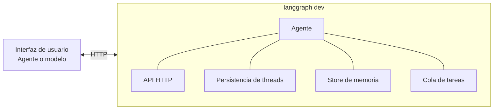

!!! warning

    El contenido de esta página no ha sido revisado ni corregido, por lo que puede
    estar incompleto, contener errores o presentar información desactualizada. Además,
    es posible que esté desordenado, carezca de una estructura clara o incluya notas
    copiadas directamente.

Este capítulo describe cómo llevar un agente fuera del _script_ en el que se desarrolla
y convertirlo en un servicio al que se conecta una interfaz de usuario por HTTP. Se
presentan dos vías, un servidor propio con FastAPI y el servidor de LangGraph, se
introducen los subagentes asíncronos y los agentes gestionados, y se recogen las medidas
de seguridad que exige una aplicación real. Presupone los capítulos de
[LangChain](section_3_langchain.md), de [DeepAgents](section_6_deepagents.md) y de
[subagentes](section_7_subagents.md). Los ejemplos de FastAPI se probaron con
`fastapi==0.165.0`. El servidor de LangGraph y los agentes gestionados se describen a
partir de su documentación y no se ejecutaron.

## Bibliografía

- LangChain. (s.f.). _LangGraph and LangSmith documentation_.
  <https://docs.langchain.com/>
- Ramírez, S. (s.f.). _FastAPI_. <https://fastapi.tiangolo.com/>

## Del _script_ al servicio

Un agente que se ejecuta en un _script_ vive y muere con el proceso. Para ofrecerlo a
varios usuarios hay que alojarlo detrás de una API, que recibe los mensajes, los pasa al
agente, mantiene cada conversación separada de las demás y devuelve la respuesta, mejor
si es en _streaming_ para reducir la latencia percibida. Dos requisitos condicionan el
diseño. El primero es la persistencia, porque el _checkpointer_ en memoria del que se
habló en capítulos anteriores se pierde al reiniciar el proceso y no se comparte entre
varios procesos. El segundo es la identidad, ya que el `thread_id` de cada conversación
debe pertenecer a un único usuario.

## Servidor propio con FastAPI

La primera vía es escribir el servicio con **FastAPI**, el _framework_ web de Python
presentado en el capítulo de
[desarrollo web](../../03_programming/04_web/section_1_fundamentals.md). El diseño es el
de un servidor con dos rutas. Una abre una conversación y devuelve su identificador, que
hace de `thread_id`. La otra recibe un mensaje y devuelve la respuesta en _streaming_.
Ambas exigen una clave de API en la cabecera `X-API-Key`.

```bash linenums="1"
uv add "fastapi[standard]==0.165.0" httpx
```

El esquema del mensaje se declara con Pydantic, que FastAPI utiliza para validar la
entrada, y el agente se crea una sola vez, al importar el módulo.

```python linenums="1" title="formatos.py"
from pydantic import BaseModel, Field


class Mensaje(BaseModel):
    """Mensaje que el cliente envía a una conversación."""

    conversacion: str = Field(description="Identificador devuelto por /conversaciones")
    texto: str = Field(min_length=1, max_length=4000)
```

```python linenums="1" title="agente.py"
from deepagents import create_deep_agent
from langgraph.checkpoint.memory import InMemorySaver

from modelos import crear_modelo

agente = create_deep_agent(
    model=crear_modelo(),
    system_prompt="Responde de forma clara, corta y concisa.",
    checkpointer=InMemorySaver(),
)
```

Las rutas verifican la clave con `secrets.compare_digest`, que compara en tiempo
constante para no filtrar información por la duración de la comparación. La respuesta se
construye con un generador asíncrono que emite los fragmentos del modelo conforme
llegan, filtrados por nodo para no incluir pasos internos.

```python linenums="1" title="rutas.py"
import os
import secrets
import uuid
from collections.abc import AsyncIterator

from fastapi import APIRouter, Depends, Header, HTTPException
from fastapi.responses import StreamingResponse
from langchain.messages import HumanMessage

from agente import agente
from formatos import Mensaje

router = APIRouter()

# Conversaciones abiertas. En producción viven en una base de datos.
CONVERSACIONES: set[str] = set()


def verificar_clave(x_api_key: str = Header()) -> None:
    """Rechaza las peticiones que no traen la clave de API del servicio.

    Args:
        x_api_key: Valor de la cabecera `X-API-Key`.

    Raises:
        HTTPException: Con código 401 si la clave no coincide.
    """
    esperada = os.environ["CLAVE_API_SERVICIO"]
    if not secrets.compare_digest(x_api_key, esperada):
        raise HTTPException(status_code=401, detail="Clave de API incorrecta")


@router.post("/conversaciones", dependencies=[Depends(verificar_clave)])
async def nueva_conversacion() -> str:
    """Abre una conversación nueva y devuelve su identificador."""
    identificador = str(uuid.uuid4())
    CONVERSACIONES.add(identificador)
    return identificador


async def tokens(mensaje: Mensaje) -> AsyncIterator[str]:
    """Emite los tokens del modelo según los va generando."""
    async for fragmento, metadatos in agente.astream(
        {"messages": [HumanMessage(mensaje.texto)]},
        config={"configurable": {"thread_id": mensaje.conversacion}},
        stream_mode="messages",
    ):
        if fragmento.content and metadatos["langgraph_node"] == "model":
            yield fragmento.content


@router.post("/chat", dependencies=[Depends(verificar_clave)])
async def chat(mensaje: Mensaje) -> StreamingResponse:
    """Envía el mensaje al agente y devuelve la respuesta en streaming."""
    if mensaje.conversacion not in CONVERSACIONES:
        raise HTTPException(status_code=404, detail="Conversación desconocida")

    return StreamingResponse(tokens(mensaje), media_type="text/plain")
```

```python linenums="1" title="servidor.py"
from fastapi import FastAPI

from rutas import router

app = FastAPI(title="Agente con DeepAgents")
app.include_router(router)
```

El servidor se arranca con `uvicorn servidor:app --port 8000`, tras exportar la variable
`CLAVE_API_SERVICIO`. El cliente de consola abre una conversación y la utiliza para
chatear, imprimiendo cada trozo de la respuesta según llega gracias al _streaming_ de
`httpx`.

```python linenums="1" title="cliente.py"
import asyncio
import os

import httpx

URL = "http://localhost:8000"
CABECERAS = {"X-API-Key": os.environ["CLAVE_API_SERVICIO"]}


async def main() -> None:
    """Abre una conversación y mantiene un chat por consola."""
    async with httpx.AsyncClient(base_url=URL, headers=CABECERAS, timeout=120) as http:
        respuesta = await http.post("/conversaciones")
        respuesta.raise_for_status()
        conversacion: str = respuesta.json()

        while True:
            texto = input("[USUARIO] - ")
            print("[MODELO] - ", end="", flush=True)

            async with http.stream(
                "POST", "/chat", json={"conversacion": conversacion, "texto": texto}
            ) as flujo:
                flujo.raise_for_status()
                async for trozo in flujo.aiter_text():
                    print(trozo, end="", flush=True)
            print("\n")


if __name__ == "__main__":
    asyncio.run(main())
```

!!! warning

    Un servicio que expone un agente sin autenticación permite a cualquiera consumir el
    presupuesto del modelo y ejecutar sus herramientas. La clave compartida del ejemplo
    es el mínimo imprescindible y no sustituye a un sistema de identidad real. Una
    versión de producción necesita HTTPS, usuarios autenticados, una conversación ligada
    a un único usuario, límite de peticiones, por ejemplo con `slowapi`, y un
    _checkpointer_ y un registro de conversaciones respaldados por una base de datos,
    porque con varios procesos la memoria de cada uno es distinta.

## Servidor de LangGraph

La segunda vía es dejar que el servidor de LangGraph aporte la infraestructura. El
comando `langgraph dev` arranca en local un servidor que expone el agente mediante una
API HTTP y ya incluye la persistencia de los _threads_, el almacén de memoria y una cola
de tareas, lo que evita implementar todo eso a mano. Una interfaz gráfica, LangGraph
Studio, permite conversar con el agente y depurar su ejecución.



Como el servidor gestiona la persistencia, el grafo se exporta **sin** `checkpointer`.
El archivo `langgraph.json` indica dónde están las dependencias y qué variable contiene
cada grafo.

```python linenums="1" title="grafo.py"
from deepagents import create_deep_agent

from modelos import crear_modelo

agente = create_deep_agent(
    model=crear_modelo(),
    system_prompt="Responde de forma clara, corta y concisa.",
)
```

```json linenums="1" title="langgraph.json"
{
    "dependencies": ["."],
    "graphs": { "agente": "./grafo.py:agente" },
    "env": ".env"
}
```

```bash linenums="1"
uv add "langgraph-cli[inmem]"
uv run langgraph dev
```

## Subagentes asíncronos

Los subagentes asíncronos del capítulo anterior se ejecutan en un servidor, no dentro
del proceso del agente principal. Se declaran con un diccionario que, en lugar de un
modelo y herramientas, indica el grafo remoto, y utilizan el SDK de LangGraph para
comunicarse con él.

```python linenums="1"
from deepagents import create_deep_agent

from modelos import crear_modelo

agente = create_deep_agent(
    model=crear_modelo(),
    subagents=[
        {
            "name": "investigador",
            "description": "Investiga un tema en segundo plano y devuelve un informe.",
            "graph_id": "investigador",
            "url": "http://localhost:2024",
        }
    ],
)
```

El agente principal recibe entonces cinco herramientas de gestión: `start_async_task`
lanza una tarea y devuelve su identificador, `check_async_task` consulta su estado y su
resultado, `update_async_task` le envía instrucciones nuevas, `cancel_async_task` la
cancela y `list_async_tasks` las enumera. Como cada tarea tiene un identificador, el
principal puede revisarla en cualquier momento mientras sigue trabajando y gestionar
varias tareas a la vez. Un `AsyncSubAgent` requiere una infraestructura de despliegue de
LangGraph o LangSmith, ya que el grafo remoto debe estar en un servidor accesible.

## Agentes gestionados

**Managed Deep Agents** es la oferta de LangChain para desplegar agentes en producción
sin operar la infraestructura. Se utiliza mediante el paquete `managed-deepagents`, que
incluye la función `define_deep_agent` para definir el agente en código y la herramienta
de línea de comandos `mda`, que crea la estructura de carpetas donde viven el agente,
sus instrucciones y su configuración, y lo compila y despliega en LangSmith.

!!! warning

    Managed Deep Agents se encuentra en beta pública, por lo que su API y su entorno de
    ejecución pueden cambiar. Además, el agente se aloja en LangSmith, un servicio
    externo, de modo que no encaja cuando los datos o los modelos deben permanecer
    dentro de la infraestructura propia. En ese caso, las alternativas son el servidor
    propio de FastAPI o el servidor de LangGraph autoalojado.

## Seguridad en producción

Las consideraciones de los capítulos anteriores se resumen aquí como lista de
comprobación para pasar de un prototipo a un servicio.

| Riesgo                          | Medida                                                                    |
| :------------------------------ | :------------------------------------------------------------------------ |
| Acceso no autorizado            | Autenticación de usuarios, HTTPS y límite de peticiones.                  |
| Ejecución de comandos           | _Sandbox_ aislado en lugar de `LocalShellBackend`.                        |
| Fuga de credenciales            | Secretos fuera del código, _proxy_ de autenticación y gestor de secretos. |
| Acciones con efectos externos   | Aprobación humana con `interrupt_on` y permisos de archivos mínimos.      |
| Pérdida de conversaciones       | _Checkpointer_ y almacén respaldados por una base de datos.               |
| Datos sensibles en las trazas   | Seguimiento autoalojado o desactivado, y filtrado de datos personales.    |
| Contenido malicioso en entradas | Tratar las salidas de herramientas y de MCP como datos no confiables.     |
| Consumo descontrolado           | Límites de llamadas al modelo y a herramientas, y estimación de coste.    |

La infraestructura sobre la que se aloja el servicio, ya sean contenedores,
orquestadores o una nube, se aborda en los capítulos de
[contenedores](../../06_operations/section_1_containers.md) y de
[despliegue](../../06_operations/section_5_deployment.md).
